# 0장. LLM이 만들어지기까지

> **한 줄 요약** — LLM은 **토크나이저 + 트랜스포머(언어 모델)** 로 이루어지고, **사전 학습 → 사후 학습(SFT → 강화 학습)** 을 거쳐 "텍스트 이어 쓰기 기계"에서 "AI 비서"로 자란다.

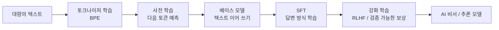

---

## 1. 구성 요소

### 1.1 언어 모델 = "다음 단어 예측기"

- **언어 모델**: 문자열이 얼마나 자연스러운지를 **확률**로 나타내는 모델
  - `A cat sat on the mat` ↑ 확률 높음 / `Mat the on sat cat a` ↓ 확률 낮음
- 확률을 구하는 대표적인 방법이 **다음 단어 예측**이다.

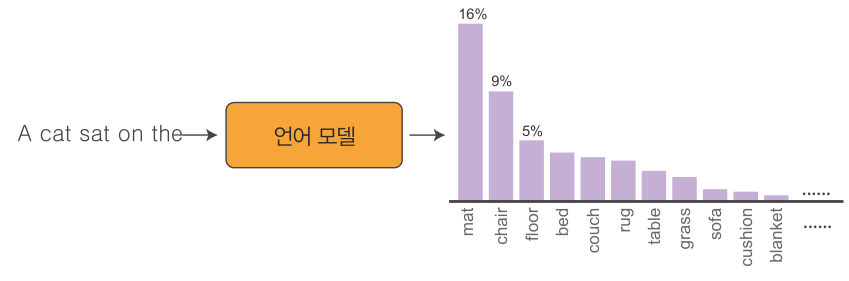
*그림 0-1 — "A cat sat on the" 다음에 올 단어의 확률 분포. 고양이가 앉을 만한 장소(mat, chair, floor)일수록 확률이 높다.*

**문장 확률 = 조건부 확률의 곱 (연쇄 법칙)**

$$
P(x_1, x_2, \dots, x_n) = P(x_1)\,P(x_2 \mid x_1)\,P(x_3 \mid x_1, x_2) \cdots P(x_n \mid x_1, \dots, x_{n-1})
$$

언어 모델이 하는 "다음 단어 예측"은 바로 각 항 $P(x_i \mid x_1, \dots, x_{i-1})$ 을 계산하는 일이다.

**자기 지도 학습(Self-Supervised Learning)** — 텍스트만 있으면 입력과 정답 쌍을 자동으로 만들 수 있다.

| 입력 | 정답 레이블 |
|---|---|
| A | cat |
| A cat | sat |
| A cat sat | on |
| A cat sat on | the |
| A cat sat on the | mat |

→ 사람이 레이블을 달 필요가 없으므로 인터넷 규모의 텍스트를 그대로 학습에 쓸 수 있다. 이것이 LLM이 커질 수 있었던 핵심 이유다.

### 1.2 토큰화

- LLM은 텍스트를 **토큰** 단위로 처리하고, 각 토큰은 고유한 **ID(정수)** 로 바뀐다.
- 단어 단위: `"A cat sat on the mat" → ["A", "cat", "sat", "on", "the", "mat"]` (직관적이지만 현대 LLM에서는 잘 쓰지 않음)
- 현대 LLM은 대부분 **BPE(Byte Pair Encoding)** 를 쓴다. 단위는 **서브워드**(단어보다 작으면서 의미가 있는 조각)이다.

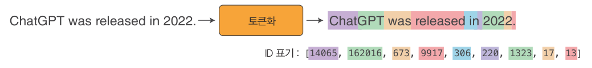
*그림 0-2 — 자주 나오는 문자열(`Chat`, `GPT`, `was`)은 토큰 하나가 되고, 드문 문자열은 여러 개로 쪼개진다.*

> 💡 **공백도 정보다** — BPE에서는 `" was"`, `" in"`처럼 앞의 공백까지 토큰에 포함된다. (→ [1장](../ch01/README.md)의 사전 토큰화)

### 1.3 트랜스포머

- 2017년 「Attention is All You Need」에서 제안된 구조. GPT, Llama 등 대부분의 LLM이 이 구조를 쓴다.
- 원래는 **기계 번역**용으로 만든 **인코더–디코더** 구조였다.

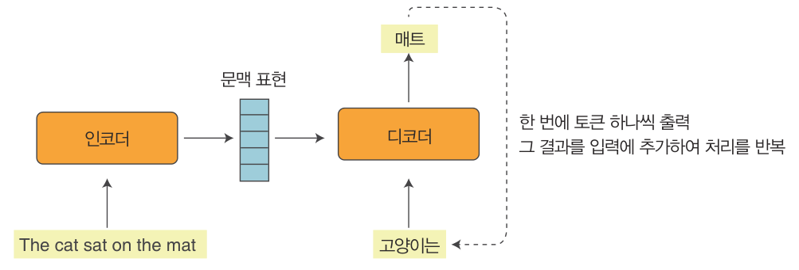
*그림 0-3 — 인코더가 원문을 이해해 문맥 표현을 만들고, 디코더가 번역문을 한 토큰씩 생성한다.*

- 최근에는 **디코더 전용(decoder-only)** 모델이 주류다. 토큰 ID열을 받아 **다음 토큰의 확률 분포**를 출력한다.
- 이 책에서 "트랜스포머"라고 하면 **디코더 전용 모델**을 뜻한다.

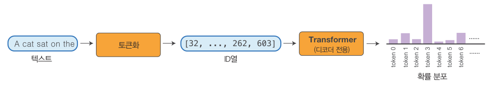
*그림 0-4 — 텍스트 → 토큰화 → ID열 → Transformer → 다음 토큰의 확률 분포*

> 💡 **어텐션** — 트랜스포머의 핵심 기술. "어떤 토큰에 주목할지"를 동적으로 계산해 토큰 사이의 관계를 파악한다. (→ 2장)

### 1.4 GPT 시리즈

GPT = **G**enerative **P**re-trained **T**ransformer (생성적 · 사전 학습된 · 트랜스포머)

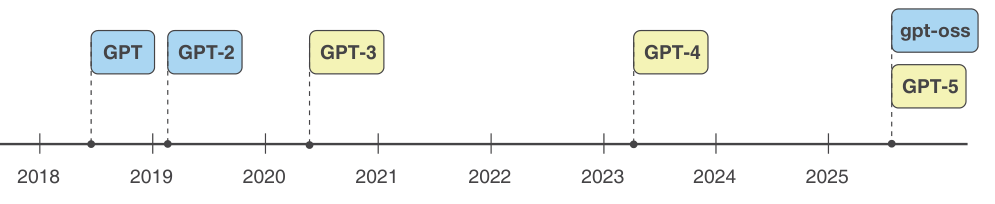
*그림 0-5 — GPT 시리즈의 발전 (파란색: 오픈소스, 노란색: 비공개)*

| 장 | 구현 대상 |
|---|---|
| 2장 모델(기본편) | **GPT-2** — 현대 LLM의 기반이 되었고 오픈소스라 교재로 알맞다 |
| 5장 모델(응용편) | gpt-oss, nanochat, Stanford CS336 등을 참고한 **최신 개선 기술** |

---

## 2. 사전 학습 (Pre-training)

> 비유: 책을 많이 읽으며 **언어 능력과 기초 지식**을 쌓는 단계

### 2.1 데이터 수집과 전처리

- 출처: 뉴스, 전자책, 논문, 위키백과, 코드 저장소 등. 2024년쯤부터는 **LLM이 만든 합성 데이터**도 늘고 있다.
- 수집 방법: ① 직접 크롤링 ② Common Crawl 같은 공개 데이터셋 이용
- 품질을 높이고 위험을 줄이기 위해 **여러 단계의 정제**를 거친다.

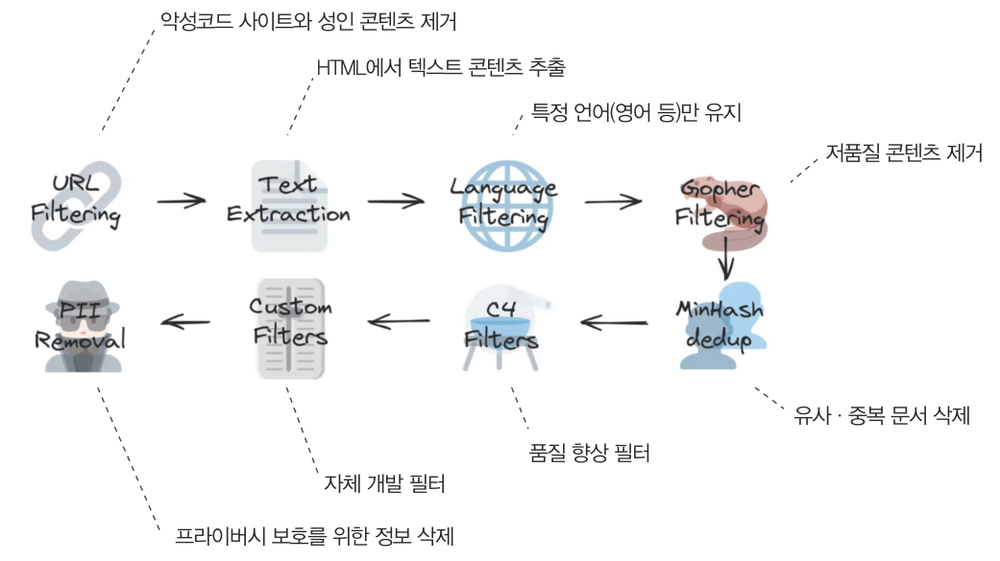
*그림 0-6 — FineWeb 전처리 파이프라인: URL 필터링 → 텍스트 추출 → 언어 필터 → 품질 필터 → 중복 제거(MinHash) → C4/자체 필터 → 개인정보(PII) 제거. 결과물은 40TB가 넘는다.*

### 2.2 토크나이저 학습

- LLM = **토크나이저**(텍스트 ↔ 토큰 ID) + **모델**(토큰 ID열 → 다음 토큰 예측). 둘은 **따로 설계하고 따로 학습**한다.

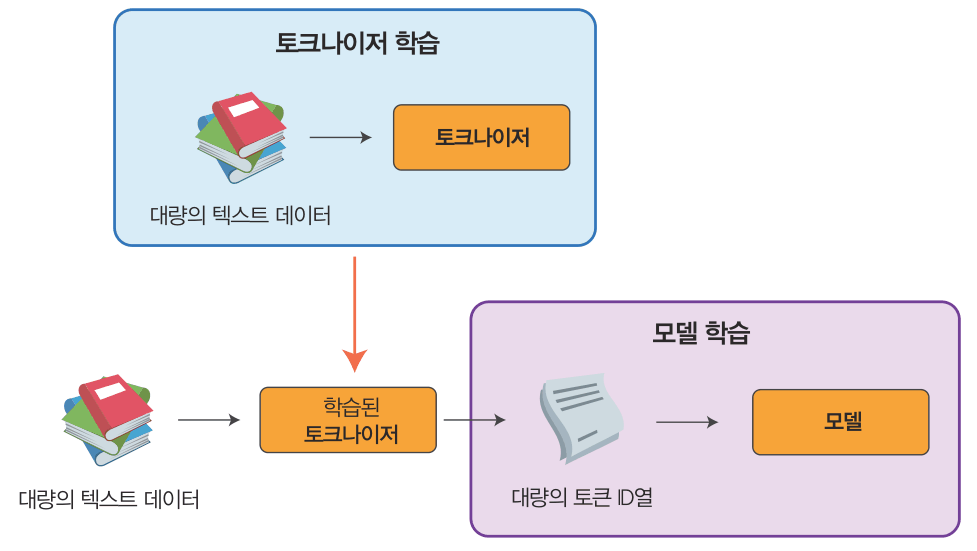
*그림 0-7 — ① 텍스트로 토크나이저를 학습하고 → ② 학습된 토크나이저로 텍스트를 토큰 ID열로 바꾼 뒤 → ③ 모델을 학습한다.*

| | 토크나이저 학습 | 모델 학습 |
|---|---|---|
| 방법 | **통계적 기법**(신경망 X) — 자주 나오는 문자열 패턴을 토큰으로 등록 | 신경망으로 다음 토큰 예측 |
| 결과 | 어휘: 보통 수만~수십만 개 토큰 | 베이스 모델 |

- 토큰은 LLM이 의미를 인식하는 **최소 단위**이므로, 토크나이저 품질이 모델 성능에 큰 영향을 준다.
- 실제로는 토크나이저와 모델을 **서로 다른 데이터셋**으로 학습하는 경우가 많다(계산 효율과 자원 제약 때문).

### 2.3 모델 학습과 스케일링 법칙

- 인터넷 규모 데이터로 다음 토큰을 예측하도록 학습한다 → **사전 학습**
- 수천 개 이상의 GPU로 수개월씩 학습한다.

| 모델 | 파라미터 수 |
|---|---|
| GPT-2 | 약 15억 |
| GPT-3 | 1,750억 |
| GPT-4 | 비공개 (1.8조라는 추측이 있음, 학습 비용 1억 달러 이상) |

**스케일링 법칙(Scaling law)** — 계산량 · 데이터 크기 · 파라미터 수가 늘어날수록 테스트 손실이 **거듭제곱 법칙(power law)** 에 따라 줄어든다. 그래서 성능 향상을 **미리 예측**할 수 있다. (→ 8장)

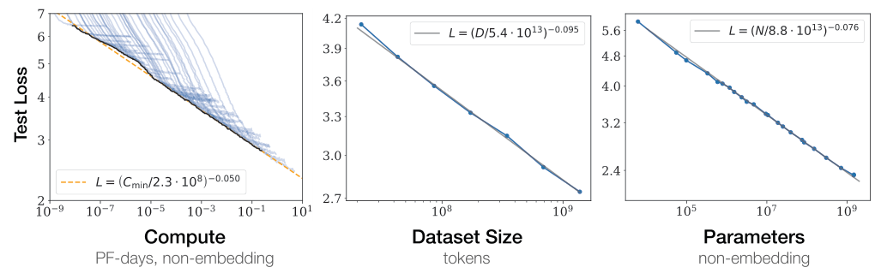
*그림 0-8 — 로그-로그 그래프에서 직선 = 거듭제곱 관계 (출처: Kaplan et al., 2020)*

### 2.4 베이스 모델의 특성

**베이스 모델** = 사전 학습만 마친 모델 = **"텍스트 이어 쓰기 시스템"**

```text
프롬프트:   Hello!
베이스 모델: I'm new to this forum, and I have a question about ...
```

→ 인사에 대답하지 않고 **포럼 글의 첫머리를 이어 쓴다**. 학습 데이터에 "Hello!"로 시작하는 게시글이 많았기 때문이다. 대화하거나 지시를 따르는 능력은 아직 없다.

그래도 놀라운 능력이 하나 생긴다. 바로 **컨텍스트 내 학습(In-Context Learning)**: 파라미터를 바꾸지 않고 프롬프트에 든 예만 보고 새 과제를 푼다.

```text
도쿄→일본
파리→프랑스
로마→        ⟹  이탈리아 (이어서 런던→영국, 뉴욕→미국 ...)
```

| 퓨샷 프롬프팅 분류 | 예의 개수 |
|---|---|
| 제로샷 | 0 |
| 원샷 | 1 |
| 퓨샷 | 여러 개 |

---

## 3. 사후 학습 (Post-training)

**정렬(alignment)**: LLM의 출력을 사람의 가치관과 선호에 맞추는 일. 사후 학습은 정렬을 위한 핵심 과정이다.

### 3.1 SFT (Supervised Fine-Tuning, 지도 파인튜닝)

- 사람이 작성한(또는 LLM이 초안을 쓰고 사람이 다듬은) **대화 데이터**로 "비서처럼 답하는 법"을 가르친다.
- 언어 모델은 **1차원 토큰열**만 처리하므로 대화 구조를 **특수 토큰**으로 표시한다. (예: **ChatML**)

```text
<|im_start|>user<|im_sep|>
안녕하세요
<|im_end|>
<|im_start|>assistant<|im_sep|>
안녕하세요! 무엇을 도와드릴까요?
<|im_end|>
```

| 특수 토큰 | 역할 |
|---|---|
| `<\|im_start\|>` | 발언 시작 + 역할(user / assistant) |
| `<\|im_sep\|>` | 역할과 내용 구분 |
| `<\|im_end\|>` | 발언 끝 |

- 학습 방식은 사전 학습과 **똑같이 "다음 토큰 예측"** 이다. 바뀌는 것은 **데이터**(잡다한 웹 텍스트 → 고품질 대화)뿐이다.
- ⭐ **SFT는 지식이 아니라 "응답 방식"을 배운다.** 지식은 사전 학습에서 이미 얻었다. 그래서 적은 데이터로도 효과가 있다.

### 3.2 강화 학습 (Reinforcement Learning)

SFT의 한계: 대화 예시 수가 적고, "좋은 답 / 나쁜 답"의 기준은 너무 복잡해서 지도 학습만으로는 담기 어렵다.

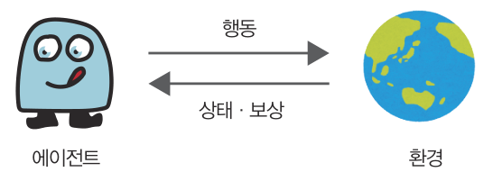
*그림 0-9 — 에이전트가 행동하고, 환경이 새 상태와 보상을 돌려준다. 시행착오를 반복하며 보상이 큰 행동을 배운다.*

**LLM과의 대응**: "다음 토큰을 무엇으로 고를까?" = "이 상태에서 어떤 행동을 할까?"

| 강화 학습 | LLM |
|---|---|
| 에이전트 | LLM |
| 상태 | 지금까지의 토큰열 |
| 행동 | 다음 토큰 선택 |
| 보상 | 답변의 품질 점수 |

LLM용 강화 학습은 **보상을 어떻게 설계하느냐**에 따라 두 가지로 나뉜다.

#### ① 사람의 피드백을 활용한 강화 학습 — RLHF

1. 같은 질문에 대한 답변 여러 개를 사람이 비교해 **선호 데이터**(A > B)를 만든다.
2. 선호 데이터로 **보상 모델**(답변 → 점수)을 학습한다.

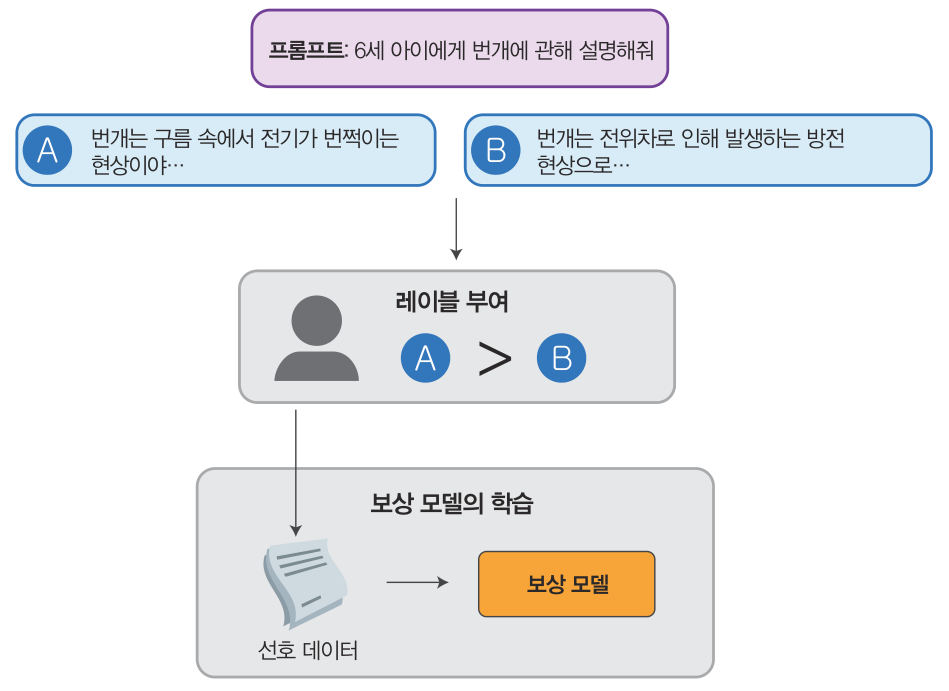
*그림 0-10 — "6세 아이에게 번개를 설명해줘"에 대한 두 답변 중 사람이 A를 고른다 → 보상 모델 학습*

3. LLM이 답변을 생성하면 보상 모델이 점수를 매기고, **점수가 높은 답변을 더 자주 생성**하도록 LLM을 갱신한다.

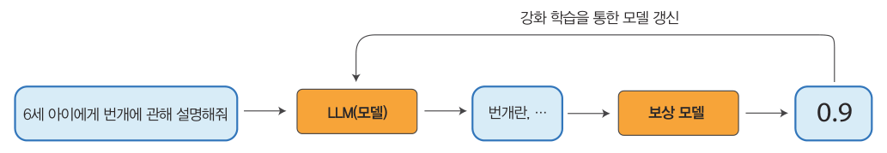
*그림 0-11 — LLM 답변 → 보상 모델 점수(0.9) → 강화 학습으로 모델 갱신*

> 💡 **DPO(Direct Preference Optimization)** — 보상 모델 없이 **선호 데이터로 모델을 바로 최적화**한다. 더 효율적이고 안정적이다. (→ 6장)

#### ② 검증 가능한 보상을 활용한 강화 학습

- 수학 정답, 코드 테스트 결과처럼 **자동으로 정답을 판정**할 수 있는 과제에 쓴다. 사람이 필요 없다.
- 업계에서는 흔히 **RLVR**(Reinforcement Learning with Verifiable Rewards)이라 부른다. (책에 나오는 용어는 아님)

> 💡 **누가 "자동 판정"하나?** (책 밖 보충)
> 모델이 자기 답을 채점하는 게 아니다. **모델 바깥의 채점 프로그램(검증기, verifier)** 이 미리 정해 둔 규칙대로 기계적으로 판정한다. 그림 0-12라면 문제와 함께 저장해 둔 정답 15와 모델 답을 비교해 1/0을 매긴다.
>
> | 과제 | 판정 방법 |
> |---|---|
> | 수학 | 최종 답을 추출해 정답과 비교 |
> | 코딩 | 생성한 코드를 실행해 테스트 케이스 통과 여부 확인 |
> | 형식 (R1-Zero) | `<think>`, `<answer>` 태그를 올바르게 썼는지 문자열 규칙으로 검사 |
>
> - **왜 모델(신경망)에게 채점을 맡기지 않나?** 학습 중인 LLM이 채점 모델의 허점을 파고들어 점수만 올리는 **보상 해킹(reward hacking)** 이 생길 수 있다. 규칙 채점은 "실제로 맞히는 것" 외에 점수를 올릴 길이 없다. DeepSeek-R1도 이 이유로 규칙 기반 보상을 썼다.
> - **한계**: 정답을 기계적으로 확인할 수 있는 과제에만 쓸 수 있다. "번개를 6세 아이에게 설명해줘" 같은 질문은 규칙으로 채점할 수 없어 RLHF(사람 선호·보상 모델)가 필요하다.
> - LLM이 자기 답을 직접 평가하는 연구(LLM-as-a-judge, self-rewarding)도 있지만 이 방식과는 별개다.

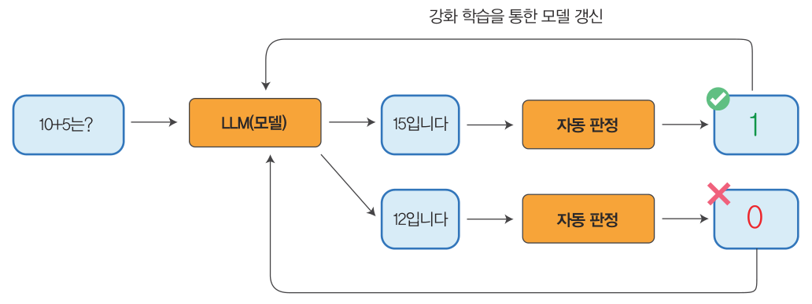
*그림 0-12 — "10+5는?" → "15입니다" → 자동 판정 1 / "12입니다" → 자동 판정 0*

**사례: DeepSeek-R1-Zero** — 베이스 모델에 **강화 학습만** 적용해 기존 기법보다 훨씬 좋은 성능을 냈다.

```text
... 비서는 먼저 마음속으로 사고 과정을 거친 후, 사용자에게 답을 제시합니다.
사고 과정과 답은 각각 <think> </think>와 <answer> </answer> 태그로 감쌉니다.
사용자: {prompt}
비서:
```

보상 기준
1. `<answer>` 안의 답이 맞는가?
2. `<think>`, `<answer>` 태그를 올바르게 썼는가?

→ 학습이 진행되면서 모델이 스스로 생각을 고치고, 멈춰서 다시 검토하고, 추론을 길게 펼치게 된다 ⇒ **추론 모델(reasoning model)**.
알파고 제로처럼 "푸는 법" 대신 **"맞았는지"만 알려줘도** 고도의 사고 과정을 스스로 익힌다.

---

## 4. 이 책의 1부 로드맵: CodeBot 만들기

CodeBot = 파이썬 코드를 쓰고, 대화하고, 간단한 계산도 하는 작은 언어 모델

| 장 | 주제 | 내용 |
|---|---|---|
| 1장 | 토크나이저(기본편) | BPE 구현, 텍스트 → 토큰 ID열 |
| 2장 | 모델(기본편) | 트랜스포머 원리, 소형 GPT-2 구현 |
| 3장 | 학습(기본편) | 사전 학습 → SFT → 강화 학습 |

| 단계 | 데이터 | 얻는 능력 |
|---|---|---|
| 사전 학습 | `codebot/tiny_codes.txt` (약 6MB, 코드가 `<\|endoftext\|>`로 구분됨) | 기본적인 파이썬 코드 작성 |
| SFT | `codebot/tiny_codes_sft.json` (약 100KB, `instruction`/`response` 쌍) | 지시 따르기, 대화 |
| 강화 학습 | 덧셈 문제 + 정답 여부 보상 | 계산 능력 (`7+8=` → `15`) |

---

## 5. 핵심 정리

- **언어 모델** = 다음 토큰의 조건부 확률 $P(x_i \mid x_{<i})$ 계산기. 텍스트만으로 **자기 지도 학습**이 된다.
- **LLM = 토크나이저(BPE, 통계 기반) + 디코더 전용 트랜스포머(신경망)**. 둘은 따로 학습한다.
- **사전 학습** → 지식 + 컨텍스트 내 학습 능력이 생기지만, 결과는 "텍스트 이어 쓰기" 베이스 모델이다.
- **SFT** → 지식이 아니라 **답변 방식**을 배운다(특수 토큰으로 대화 구조화).
- **강화 학습** → RLHF(보상 모델) / DPO(보상 모델 없음) / 검증 가능한 보상(자동 판정 → 추론 모델).

## 6. 복습 질문

1. 언어 모델이 사람이 단 레이블 없이도 학습할 수 있는 이유는?
2. 베이스 모델에 "Hello!"를 입력하면 왜 인사로 대답하지 않을까?
3. SFT와 사전 학습은 학습 방식이 같은데, 무엇이 다른가?
4. RLHF와 DPO의 차이는? 검증 가능한 보상은 어떤 과제에 적합한가?
5. 스케일링 법칙이 "예측 가능"하다는 것은 무슨 뜻인가?
