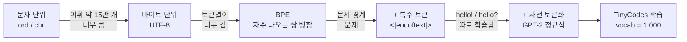
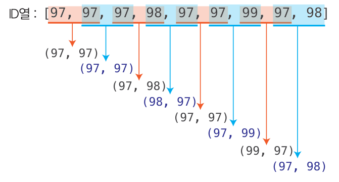
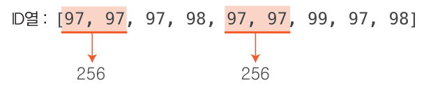

# 1장. 토크나이저 (기본편)

> **한 줄 요약** — 문자 단위 → 바이트 단위 → **BPE** 순서로 토크나이저를 발전시키고, **특수 토큰**과 **사전 토큰화**를 더해 GPT-2와 같은 방식의 토크나이저를 완성한다. 마지막으로 TinyCodes 데이터셋으로 학습해 어휘 1,000개짜리 CodeBot 토크나이저를 만든다.



**토크나이저의 두 기능**
- **인코딩(encode)**: 텍스트 → ID(정수)열
- **디코딩(decode)**: ID열 → 텍스트

| 방식 | 어휘 크기 | 토큰열 길이 | 문제점 |
|---|---|---|---|
| 문자 단위 | 약 15만 (유니코드에 배정된 문자 수) | 짧음 | 어휘가 너무 크고, 거의 안 쓰는 문자까지 포함 |
| 바이트 단위 | **256 고정** | 김 (한글 1자 = 3토큰) | 계산 효율·학습 효율 저하 |
| BPE | 원하는 만큼 (256 + 병합 횟수) | 적당함 | 균형점 ✅ |

---

## 1.1 문자 단위 토큰화 — `ch01/01_char_tokenizer.py`

- 유니코드의 **코드 포인트**를 그대로 ID로 쓴다.
  - `ord('h')` → `104`, `ord('😁')` → `128513`
  - `chr(104)` → `'h'`

```python
class CharTokenizer:
    def encode(self, text):
        return [ord(char) for char in text]

    def decode(self, ids):
        return ''.join([chr(i) for i in ids])

CharTokenizer().encode("hello월드😁")
# [104, 101, 108, 108, 111, 50900, 46300, 128513]
```

**문제점**: 어휘 크기 = 유니코드 문자 수(약 15만 개). 어휘가 커지면 모델의 파라미터 수와 계산량도 커진다. 고대 문자나 특수 기호처럼 거의 안 쓰는 문자까지 어휘에 들어간다.

---

## 1.2 바이트 단위 토큰화 — `ch01/02_byte_tokenizer.py`

- **UTF-8**: 유니코드 문자를 **1~4바이트**의 가변 길이 바이트열로 바꾼다. 1바이트 = 0~255.
  - `'A'.encode("utf-8")` → `b'A'` → `[65]` (1바이트)
  - `'가'.encode("utf-8")` → `b'\xea\xb0\x80'` → `[234, 176, 128]` (3바이트)
- 어떤 문자든 0~255 정수열로 바뀌므로 **어휘가 256개로 고정**된다.

```python
class ByteTokenizer:
    def encode(self, text):
        return list(text.encode("utf-8"))

    def decode(self, ids):
        return bytes(ids).decode("utf-8")

ByteTokenizer().encode("hello월드😁")
# [104, 101, 108, 108, 111, 236, 155, 148, 235, 147, 156, 240, 159, 152, 129]
#  h    e    l    l    o   |---- 월 ----| |---- 드 ----| |------ 😁 ------|
```

> ⚠️ `bytes(65)`는 길이가 65인 0바이트열을 만든다. 정수 하나라도 `bytes([65])`처럼 **리스트로** 넘겨야 한다.

**문제점**: 토큰열이 길어진다(문자 8개 → 토큰 15개).
- **계산 효율 저하**: 계산량과 메모리 사용량 증가
- **학습 효율 저하**: 의미 덩어리가 여러 토큰으로 쪼개져 패턴을 배우기 어렵다

> 💡 **유니코드 vs UTF-8** (책 밖 보충)
> **유니코드 = 문자 → 번호**, **UTF-8 = 번호 → 바이트(1~4개)**
> - 유니코드는 문자마다 번호(코드 포인트)를 붙인 표일 뿐, 그 자체에는 바이트 수가 없다. `ord()`가 주는 값이 이 번호다. 배정된 문자는 약 15만 개, 번호 공간은 0~1,114,111(약 111만 개)이다.
> - 바이트 수는 번호를 UTF-8로 인코딩할 때 번호 크기에 따라 정해진다: 0~127은 1바이트, ~2,047은 2바이트, ~65,535는 3바이트(한글 음절 U+AC00~U+D7A3), 그 이상은 4바이트.
>
> | 문자 | `ord()` (코드 포인트) | 16진수 | UTF-8 바이트 | 바이트 수 |
> |---|---|---|---|---|
> | `h` | 104 | U+0068 | `68` | 1 |
> | `월` | 50900 | U+C6D4 | `EC 9B 94` | **3** |
> | `드` | 46300 | U+B4DC | `EB 93 9C` | **3** |
> | `😁` | 128513 | U+1F601 | `F0 9F 98 81` | **4** |
>
> 같은 번호라도 인코딩 방식이 다르면 바이트 수가 달라진다.
>
> | 인코딩 | `'월'` 바이트 | 바이트 수 | `'😁'` 바이트 수 |
> |---|---|---|---|
> | UTF-8 | `EC 9B 94` | **3** | 4 |
> | UTF-16 | `C6 D4` | **2** | 4 |
> | UTF-32 | `00 00 C6 D4` | **4** | 4 |
>
> 번호 0xC6D4는 2바이트에 들어가지만, UTF-8은 바이트마다 표시 비트를 붙이므로 3바이트가 된다.
>
> ```text
> 3바이트 틀:  1110xxxx 10xxxxxx 10xxxxxx   → 실제 데이터 칸은 16비트
> 0xC6D4    =      1100   011011   010100
> UTF-8     =  11101100 10011011 10010100  = EC 9B 94
> ```
>
> - `1110`은 "3바이트짜리 문자의 시작", `10`은 "이어지는 바이트"라는 표시다. 덕분에 바이트열 중간부터 읽어도 문자 경계를 찾을 수 있고, 0~127은 1바이트 그대로라 ASCII와 호환된다.

---

## 1.3 BPE 학습 알고리즘 — `ch01/03_bpe_train.py`

**BPE(Byte Pair Encoding)의 핵심**: 가장 자주 함께 나오는 **토큰 쌍을 새 토큰 하나로 병합**하는 일을 반복한다.

1. **초기화** — 텍스트를 바이트열(0~255)로 변환
2. **쌍의 카운트** — 인접한 토큰 쌍의 출현 횟수를 센다
3. **병합** — 가장 많이 나온 쌍을 새 ID로 치환 (이 대응 관계 = **병합 규칙**)
4. **반복** — 목표 어휘 크기에 도달할 때까지 2~3단계 반복

### 손으로 따라가기: `"aaabaacab"`

```text
ID열:  [97, 97, 97, 98, 97, 97, 99, 97, 98]      (a=97, b=98, c=99)
```

**① 쌍의 카운트**


*그림 1-1 — 인접한 두 토큰씩 짝을 지으면 쌍이 len(ids) − 1개 나온다.*

| 쌍 | 횟수 |
|---|---|
| **(97, 97)** | **3** |
| (97, 98) | 2 |
| (98, 97) | 1 |
| (97, 99) | 1 |
| (99, 97) | 1 |

**② 병합** — 가장 많이 나온 `(97, 97)` → `256`


*그림 1-2 — 왼쪽부터 훑으면서 겹치지 않게 치환한다. `97 97 97`의 앞 두 개만 병합되는 점에 주의.*

| 반복 | ID열 | 어휘 크기 | 병합 규칙 |
|---|---|---|---|
| 0 | `[97, 97, 97, 98, 97, 97, 99, 97, 98]` | 256 | `{}` |
| 1 | `[256, 97, 98, 256, 99, 97, 98]` | 257 | `{(97,97): 256}` |
| 2 | `[256, 257, 256, 99, 257]` | 258 | `+ {(97,98): 257}` |

→ 9개 토큰이 5개로 줄었다. 병합할수록 **같은 텍스트를 더 적은 토큰으로** 표현한다.

### 구현

```python
from collections import defaultdict

def count_pairs(ids):
    counts = defaultdict(int)          # 없는 키는 자동으로 0부터 시작
    for pair in zip(ids, ids[1:]):     # 한 칸 밀린 리스트와 짝 → 인접 쌍
        counts[pair] += 1
    return counts

def merge(ids, pair, new_id):
    merged_ids = []
    i = 0
    while i < len(ids):
        if i < len(ids) - 1 and (ids[i], ids[i+1]) == pair:
            merged_ids.append(new_id)
            i += 2                     # 쌍을 소비했으니 두 칸 이동
        else:
            merged_ids.append(ids[i])
            i += 1
    return merged_ids

def train_bpe(text, vocab_size):
    ids = list(text.encode("utf-8"))
    num_merges = vocab_size - 256      # 병합 1번 = 어휘 +1
    merge_rules = {}
    for step in range(num_merges):
        counts = count_pairs(ids)
        if not counts:                 # 더 이상 병합할 쌍이 없음
            break
        best_pair = max(counts, key=counts.get)
        new_id = 256 + step
        merge_rules[best_pair] = new_id
        ids = merge(ids, best_pair, new_id)
    return merge_rules
```

```python
train_bpe("Hello world! This is BPE training.", vocab_size=260)
# {(105, 115): 256, (256, 32): 257, (105, 110): 258, (72, 101): 259}
```

| 토큰 쌍 | 새 ID | 의미 |
|---|---|---|
| (105, 115) | 256 | `"is"` |
| (256, 32) | 257 | `"is "` ← **병합된 토큰이 다시 병합됨** |
| (105, 110) | 258 | `"in"` |
| (72, 101) | 259 | `"He"` |

> 💡 **동점 처리** — 횟수가 같은 쌍이 여럿이면 `max()`의 결과가 고정되지 않을 수 있다. 재현성을 원하면 기준을 추가한다.
> ```python
> best_pair = max(counts, key=lambda p: (counts[p], p[0], p[1]))
> ```
> (횟수 → 첫 번째 ID → 두 번째 ID 순으로 큰 쪽)

---

## 1.4 BPE 인코딩·디코딩 — `ch01/04_bpe_tokenizer.py`

```python
class BPETokenizer:
    def __init__(self, merge_rules):
        self.merge_rules = merge_rules
        # 0~255는 바이트 그대로
        self.id_to_bytes = {i: bytes([i]) for i in range(256)}
        # 병합 토큰 = 두 토큰의 바이트열을 이어 붙인 것
        for (id1, id2), new_id in merge_rules.items():
            self.id_to_bytes[new_id] = self.id_to_bytes[id1] + self.id_to_bytes[id2]
        self.vocab_size = len(self.id_to_bytes)

    def encode(self, text):
        ids = list(text.encode("utf-8"))
        for merge_pair, new_id in self.merge_rules.items():   # ⭐ 학습 순서대로
            ids = merge(ids, merge_pair, new_id)
        return ids

    def decode(self, ids):
        text_bytes = b"".join(self.id_to_bytes[i] for i in ids)
        return text_bytes.decode("utf-8", errors="replace")    # 깨진 바이트는 '�'
```

**포인트**
- `id_to_bytes[259] = b'H' + b'e' = b'He'`처럼 **어휘표는 병합 규칙만 있으면 다시 만들 수 있다**. 따라서 저장할 것은 `merge_rules` 하나뿐이다.
- 인코딩할 때는 **학습할 때와 같은 순서로** 규칙을 적용해야 한다(나중 규칙이 앞 규칙의 결과를 재료로 쓰기 때문). 파이썬 3.7+의 dict는 삽입 순서를 유지하므로 순회만 하면 된다.
- `errors="replace"` — 임의의 ID열은 올바른 UTF-8이 아닐 수 있다(예: 한글 3바이트 중 일부만 생성된 경우).
- ⚠️ 이 `encode()`는 규칙이 10,000개면 짧은 텍스트에도 10,000번 `merge()`를 돈다 → 4.6절에서 개선한다.

```python
tokenizer = BPETokenizer(merge_rules)
tokenizer.encode("Hello월드😁")
# [259, 108, 108, 111, 236, 155, 148, 235, 147, 156, 240, 159, 152, 129]
#  "He"  l    l    o   ... (학습 데이터에 없던 한글·이모지는 바이트 그대로)
```

---

## 1.5 특수 토큰 — `ch01/05_special_token.py`

GPT-2 수준의 토크나이저를 만들려면 **① 특수 토큰**과 **② 사전 토큰화** 두 가지가 더 필요하다.

### `<|endoftext|>`의 두 가지 역할

1. **생성 종료 신호** — 모델이 이 토큰을 출력하면 생성을 멈춘다.
2. **문서 구분자** — `doc1<|endoftext|>doc2<|endoftext|>doc3`처럼 여러 문서를 하나의 긴 텍스트로 이어 붙여 관리할 수 있다 → 배치를 만들기 편하다.

### 학습에서 해결할 문제

- 그냥 학습하면 `<|endoftext|>` 자체가 `<`, `|`, `end` ... 로 쪼개져 병합 대상이 된다.
- 서로 관련 없는 **문서 경계를 넘는 쌍**(예: 앞 문서의 `.`와 다음 문서의 `I`)이 집계된다.

→ **특수 토큰으로 텍스트를 먼저 나누고, 조각별로 쌍을 세서 합산**한다.

```python
def count_pairs(ids, counts=None):          # counts를 받아 누적할 수 있게 확장
    if counts is None:
        counts = defaultdict(int)
    for pair in zip(ids, ids[1:]):
        counts[pair] += 1
    return counts

def train_bpe(input_text, vocab_size, end_token="<|endoftext|>"):
    texts = input_text.split(end_token)                      # ❶ 문서 단위로 분할
    ids_list = [list(t.encode("utf-8")) for t in texts]
    num_merges = vocab_size - 256 - 1                        # 특수 토큰 1개 자리 확보
    merge_rules = {}
    for step in range(num_merges):
        counts = defaultdict(int)
        for ids in ids_list:                                 # ❷ 조각별로 세서 누적
            counts = count_pairs(ids, counts)
        if not counts:
            break
        best_pair = max(counts, key=counts.get)
        new_id = 256 + step
        merge_rules[best_pair] = new_id
        for i in range(len(ids_list)):                       # ❸ 모든 조각에 병합 적용
            ids_list[i] = merge(ids_list[i], best_pair, new_id)
    return merge_rules
```

### 토크나이저 쪽

- 특수 토큰 ID = `256 + len(merge_rules)` → **어휘의 마지막 번호**
- 인코딩: `re.split`의 패턴을 **괄호로 감싸면** 구분자도 결과에 남는다. `|`는 정규식 메타 문자이므로 `re.escape()`가 필요하다.

```python
re.split("(" + re.escape("<|endoftext|>") + ")", "abc<|endoftext|>def")
# ['abc', '<|endoftext|>', 'def']
#   ↓            ↓           ↓
# [97,98,99]   [259]     [100,101,102]   → 이어 붙이면 완성
```

```python
def encode(self, input_text):
    pattern = '(' + re.escape(self.end_token) + ')'
    all_ids = []
    for text in re.split(pattern, input_text):
        if text == self.end_token:
            all_ids.append(self.end_token_id)        # 특수 토큰은 ID를 바로 넣음
        else:
            all_ids.extend(self._encode_text(text))  # 일반 텍스트는 BPE
    return all_ids
```

```python
tokenizer.encode("Hello world!<|endoftext|>")
# [72, 101, 108, 108, 111, 32, 119, 111, 114, 108, 100, 33, 259]   ← 259 = <|endoftext|>
```

---

## 1.6 사전 토큰화 — `ch01/06_pretokenize.py`

### 왜 필요한가?

`"Say hello! Why hello? Just hello."`로 그냥 학습하면 `"hello!"`, `"hello?"`, `"hello."`가 **서로 다른 토큰**이 될 수 있다 → 어휘 낭비.

**사전 토큰화(pre-tokenization)**: BPE 전에 단어·구두점·숫자·공백을 먼저 나눠 두고, **조각 내부에서만** 병합하게 한다.

```text
["Say", " hello", "!", " Why", " hello", "?", " Just", " hello", "."]
         ^^^^^^ 앞 공백을 포함한 " hello"가 공통 단위가 됨
```

### GPT-2의 정규식 패턴 (`pip install regex` 필요 — 표준 `re`는 `\p{L}`을 지원하지 않음)

```python
import regex as re

def pretokenize(text):
    pattern = r"""'(?:[sdmt]|ll|ve|re)| ?\p{L}+| ?\p{N}+| ?[^\s\p{L}\p{N}]+|\s+(?!\S)|\s+"""
    return re.findall(pattern, text)

pretokenize("Hello! I'm fine.")
# ['Hello', '!', ' I', "'m", ' fine', '.']
```

| 패턴 | 매칭 대상 |
|---|---|
| `'(?:[sdmt]\|ll\|ve\|re)` | 영어 축약형 `'s 'd 'm 't 'll 've 're` |
| ` ?\p{L}+` | 단어 (앞 공백 1개 포함 가능) |
| ` ?\p{N}+` | 연속된 숫자 |
| ` ?[^\s\p{L}\p{N}]+` | 구두점·기호 |
| `\s+(?!\S)\|\s+` | 공백 문자 |

> 💡 **`" hello"`와 `"hello"`는 다른 토큰인가?** (책 밖 보충)
> 그렇다. ` ?\p{L}+`가 단어 앞 공백 1개를 단어에 붙여 자르므로, 둘은 처음부터 **다른 바이트열**이 된다.
>
> ```python
> pretokenize("hello hello world")  # ['hello', ' hello', ' world']
> list(" hello".encode())  # [32, 104, 101, 108, 108, 111]   ← 32 = 공백
> list("hello".encode())   # [104, 101, 108, 108, 111]
> ```
>
> - BPE 병합은 이 바이트열 위에서 일어나므로 둘은 서로 다른 ID를 받는다. (위 예에서 `' hello'`는 260번 토큰 하나)
> - 문장 속 단어는 대부분 앞에 공백이 있어 `" hello"`가 훨씬 흔하다. 공백 없는 `"hello"`는 문장·줄 맨 앞, 따옴표 뒤 등에서 나온다. 빈도가 낮은 쪽은 `'hel' + 'lo'`처럼 여러 토큰으로 쪼개질 수 있다.
> - 대소문자도 마찬가지다. `"Hello"`, `" Hello"`, `"hello"`, `" hello"`는 모두 다른 토큰이고, 이들이 비슷하다는 것은 모델이 임베딩 학습으로 알아낸다.
> - 공백을 단어에 붙이는 이유: 토큰 수가 줄고, 디코딩 때 토큰을 그냥 이어 붙이기만 해도 원래 띄어쓰기가 정확히 복원된다.

### 학습·인코딩 흐름 변화

```text
입력 텍스트
  └─ ① <|endoftext|>로 분할 (문서 단위)
       └─ ② pretokenize()로 분할 (단어·구두점 단위)
            └─ ③ 각 조각마다 바이트열로 바꿔 BPE 학습/인코딩
```

- `train_bpe()`: `ids_list`에 **사전 토큰마다 ID열 하나씩** 넣는다(나머지 로직은 같음, `tqdm`으로 진행률 표시).
- `encode()`: 일반 텍스트를 `pretokenize()`로 나눈 뒤 조각별로 `_encode_text()`를 적용한다. `show_progress=True`면 진행률 표시.

```python
sample_text = "Say hello! Why hello? Just hello.<|endoftext|>Good morning!"
tokenizer = BPETokenizer(train_bpe(sample_text, vocab_size=270))
tokenizer.encode("Say hello!")   # [262, 260, 33]
# 262 -> 'Say'   260 -> ' hello'   33 -> '!'
```

> 💡 같은 사전 토큰(예: `" hello"`)이 10번 나오면 지금은 10번 따로 처리한다. "한 번 처리하고 ×10"으로 빠르게 만들 수 있다 → 4.1절(중복 제거).

---

## 1.7 TinyCodes로 학습 — `ch01/07_tiny_codes.py`

### 저장과 불러오기 (pickle)

```python
# 저장
with open("codebot/merge_rules.pkl", "wb") as f:
    pickle.dump(merge_rules, f)

# 불러오기 — @staticmethod라 인스턴스 없이 클래스에서 바로 호출
tokenizer = BPETokenizer.load_from("codebot/merge_rules.pkl")
```

### 코드 구성

- 지금까지 만든 `merge()`, `count_pairs()`, `pretokenize()`, `train_bpe()`, `BPETokenizer`는 **`codebot/tokenizer.py`** 에 모여 있다.
- 각 장의 스크립트는 맨 앞에서 작업 디렉터리를 저장소 루트로 옮겨 `codebot` 패키지를 임포트한다 → `ch01/`에서 실행하든 루트에서 실행하든 똑같이 동작한다.

```python
import os, sys
os.chdir(os.path.join(os.path.dirname(os.path.abspath(__file__)), '..'))
sys.path.append('.')
from codebot.tokenizer import train_bpe
```

### 학습 실행

```python
vocab_size = 1000
text = open("codebot/tiny_codes.txt").read()     # 파이썬 코드 약 2만 개, <|endoftext|>로 구분
merge_rules = train_bpe(text, vocab_size)        # M2 맥북에어 기준 약 15분
```

> 학습된 `codebot/merge_rules.pkl`이 저장소에 이미 있으므로 건너뛰어도 된다.

**어휘 크기 선택 (하이퍼파라미터)**
- ↑ 크게 하면: 토큰열이 짧아지지만 **임베딩 계층이 커지고** 필요한 데이터도 늘어난다.
- CodeBot = **1,000** (작은 데이터·작은 모델) / GPT-2 ≈ 5만 / 최신 LLM은 10만 이상

---

## 1.8 토크나이저 평가 — `ch01/08_eval.py`

### 학습된 토큰 살펴보기

| 처음 학습된 토큰 (256~265) | 마지막 토큰 (990~999) |
|---|---|
| 들여쓰기 공백, 줄바꿈, `in`, `re`, `or`, ` =`, `st`, `te` | `'''`, `Error`, `atter`, `St`, `thod`, `cle`, ` on`, ` R`, `ery`, `<\|endoftext\|>` |
| → 코드의 **기본 요소**(들여쓰기, 키워드) | → 더 **구체적인 문자열** (`thod` = me**thod**의 일부) |

### 압축률 = 바이트 수 / 토큰 수 (토큰 하나가 평균 몇 바이트를 나타내는가)

```text
바이트 수: 10,000   토큰 수: 4,709   → 압축률 2.12배
```

| 토크나이저 | 어휘 크기 | 압축률 |
|---|---|---|
| **CodeBot (직접 구현)** | 1,000 | 2.12배 |
| GPT-2 | 50,257 | 3.09배 |
| cl100k_base (GPT-4) | 100,277 | 3.97배 |

→ 어휘가 클수록 압축률이 높지만 임베딩 계층도 커진다. 작은 모델에는 1,000이면 적당하다.
(비교 코드는 `08_eval.py`에 주석으로 들어 있다 — `pip install tiktoken` 후 실행)

> 💡 **왜 처음 10,000자만 재나?** (책 밖 보충)
> - **속도**: 1장의 `encode()`는 사전 토큰마다 병합 규칙 약 740개를 전부 순회하므로, 전체 약 650만 자를 인코딩하면 몇 분 이상 걸린다(→ 4.6절에서 개선). 압축률은 평균값이라 표본으로도 감은 잡힌다.
> - **공정한 비교**: tiktoken 비교도 같은 10,000자를 쓰므로 세 토크나이저의 **상대 비교**는 의미가 있다.
> - **한계**: 무작위 표본이 아니라 파일 앞부분이고, 학습에 쓴 데이터 그 자체다. 1.9절의 `tiny_codes.bin`으로 전체를 재면 값이 다르다.
>
> | 측정 대상 | 압축률 |
> |---|---|
> | 처음 10,000자 (책) | 2.12배 |
> | 전체 6,487,033바이트 / 2,677,398토큰 | **2.42배** |
> | 전체, `<\|endoftext\|>` 21,835개 제외 | 2.34배 |
>
> `<|endoftext|>`는 13바이트가 토큰 1개가 되어 압축률을 부풀리므로 뺀 값도 함께 봤다. 처음 보는 코드라면 압축률은 이보다 낮을 가능성이 크다. 2.12배는 "대략 2배 남짓" 정도의 감으로 보면 된다.

---

## 1.9 TinyCodes 인코딩 — `ch01/09_bpe_encode.py`

```python
tokenizer = BPETokenizer.load_from("codebot/merge_rules.pkl")
ids = tokenizer.encode(open("codebot/tiny_codes.txt").read(), show_progress=True)

ids_array = np.array(ids, dtype=np.uint16)   # 어휘 1,000 < 65,535 → 2바이트면 충분
ids_array.tofile("codebot/tiny_codes.bin")   # 바이너리로 저장: 파싱이 필요 없어 빠름
# 토큰 ID 수: 2,677,398
```

→ 이 `tiny_codes.bin`이 2장 이후 **모델 학습의 입력 데이터**가 된다.

---

## 핵심 정리

- **문자 단위**는 어휘가 너무 크고, **바이트 단위**는 토큰열이 너무 길다 → **BPE**가 그 중간에서 균형을 잡는다.
- **BPE 학습** = "가장 자주 나오는 인접 쌍을 새 ID로 병합"을 `vocab_size − 256(−1)`번 반복한다. 결과물은 **순서가 있는** `merge_rules` 딕셔너리다.
- **인코딩**은 병합 규칙을 **학습 순서 그대로** 적용하고, **디코딩**은 `id_to_bytes`로 바이트를 이어 붙인 뒤 UTF-8로 복원한다.
- **특수 토큰** `<|endoftext|>`: 문서 경계 + 생성 종료. 학습할 때는 경계를 넘는 쌍을 막고, 인코딩할 때는 ID를 직접 넣는다(어휘의 마지막 번호).
- **사전 토큰화**(GPT-2 정규식): 단어·구두점·숫자를 먼저 나눠 `"hello!"`/`"hello?"` 같은 어휘 낭비를 막는다.
- CodeBot 토크나이저: 어휘 1,000, 압축률 2.12배 → `tiny_codes.bin`(uint16)으로 저장해 다음 장에서 쓴다.

## 이후 장과의 연결

| 이번 장의 한계 | 개선되는 곳 |
|---|---|
| `encode()`가 모든 병합 규칙을 매번 순회 | 4.6 BPE 인코딩 개선 (고속 병합) |
| 같은 사전 토큰을 중복 처리 | 4.1 BPE 학습 개선 (중복 제거) |
| 학습 시 매번 전체 쌍을 다시 셈 | 4.2 BPE 학습 개선 (부분 갱신) |
| UTF-8 가변 길이의 원리 | 부록 A |

## 복습 질문

1. 바이트 단위 토크나이저는 어휘가 256개로 고정되는데도 BPE가 필요한 이유는?
2. `"aaabaacab"`에서 첫 병합 후 `[256, 97, 98, 256, ...]`이 되는 이유는? (`97 97 97`이 왜 `256 256`이 아닐까?)
3. 인코딩할 때 병합 규칙의 **적용 순서**가 중요한 이유는?
4. `<|endoftext|>`로 텍스트를 나누지 않고 학습하면 어떤 문제가 생기는가?
5. 학습 데이터에 없던 한글 `"월드"`를 인코딩하면 어떤 토큰이 나오는가? 디코딩은 제대로 될까?
6. 어휘 크기를 키우면 얻는 것과 잃는 것은?
