# 2장. 모델 (기본편)

> **한 줄 요약** — 어텐션을 **"소프트 딕셔너리"** 로 이해하는 데서 출발해 행렬 수식, 스케일링, 위치 임베딩, **인과 마스크**, 밸류/출력 행렬 분리, **멀티헤드**를 차례로 더하고, LayerNorm·GELU·FFN·잔차 연결로 **트랜스포머 블록**을 만든다. 블록을 쌓아 **GPT-2**(CodeBot용, 약 11M 파라미터)를 완성한다.


**이번 장의 기호 (코드 기준)**

| 기호 | 의미 | 코드 변수 | CodeBot 값 |
|---|---|---|---|
| B | 배치 크기 | `batch_size` | — |
| C | 컨텍스트 길이(토큰 수) | `context_len` | 최대 256 |
| E | 임베딩 벡터 차원 수 | `embed_dim` | 384 |
| H | 헤드 수 | `n_head` | 6 |
| D | 쿼리·키(헤드) 차원 수 | `key_dim` / `head_dim` | 384 // 6 = 64 |
| V | 어휘 크기 | `vocab_size` | 1,000 |

> 💡 책의 2.2~2.4절은 소문자 $d, n, c, e, v$로 설명하고, 2.6절 구현부터 대문자 B, C, E, D(, H)를 쓴다. 의미는 같다($c \leftrightarrow C$, $e \leftrightarrow E$, $d \leftrightarrow D$).

---

## 2.1 어텐션 기본 원리 — `ch02/01_soft_dict.py`

### 하드 딕셔너리 vs 소프트 딕셔너리

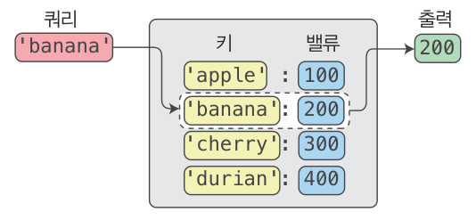

*그림 2-1 — 파이썬 딕셔너리는 쿼리와 **정확히 일치하는** 키 하나의 밸류만 꺼낸다. 없는 키를 넣으면 오류가 난다.*

| | 하드 딕셔너리 (파이썬 `dict`) | 소프트 딕셔너리 (= 어텐션) |
|---|---|---|
| 키 비교 | 같다 / 다르다 (양자택일) | **얼마나 비슷한가** (유사도) |
| 키·쿼리 표현 | 문자열 등 | **벡터** (내적을 계산하려고) |
| 출력 | 키 1개의 밸류 | **모든 밸류의 가중합** |
| 없는 키 | `KeyError` | 항상 답이 나옴 |

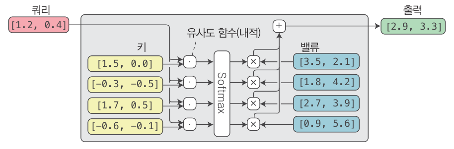

*그림 2-2 — 쿼리 `[1.2, 0.4]`를 네 개의 키와 비교하고, 그 결과로 밸류를 섞어 `[2.9, 3.3]`을 출력한다.*

### 3단계 계산

1. **유사도** — 쿼리와 각 키의 내적
2. **가중치** — 유사도에 softmax를 적용해 합이 1이 되게 정규화 (= **어텐션 가중치**)
3. **가중합** — 가중치를 곱한 밸류를 모두 더한다

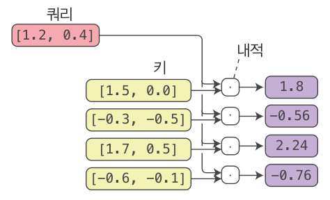

*그림 2-3 — 예: $1.2 \times 1.5 + 0.4 \times 0.0 = 1.8$. 방향이 비슷하고 길이가 클수록 내적이 커진다.*

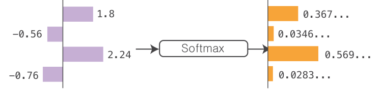

*그림 2-4 — `[1.8, -0.56, 2.24, -0.76]` → `[0.367, 0.035, 0.570, 0.028]`. 모두 0~1이고 합은 1이다.*

$$
\mathrm{softmax}(x)_i = \frac{e^{x_i}}{\sum_{k=1}^{n} e^{x_k}}
$$

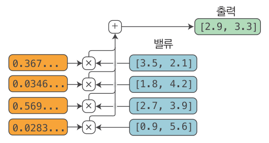

*그림 2-5 — 가중치가 가장 큰 세 번째 키(0.57)의 밸류 `[2.7, 3.9]`가 출력에 가장 많이 반영된다.*

| 키 | 내적 | 가중치 | 밸류 |
|---|---|---|---|
| [1.5, 0.0] | 1.80 | 0.367 | [3.5, 2.1] |
| [-0.3, -0.5] | -0.56 | 0.035 | [1.8, 4.2] |
| [1.7, 0.5] | 2.24 | **0.570** | [2.7, 3.9] |
| [-0.6, -0.1] | -0.76 | 0.028 | [0.9, 5.6] |
| | | **출력** | **[2.91, 3.30]** |

### 영화 평점 예측 예제

키 = 영화 특징 `(액션, 드라마, 코미디)`, 밸류 = 사용자 평점. 처음 보는 영화 `(6, 4, 5)`의 평점을 추정한다.

```python
movie_preferences = {
    (8, 2, 3): 85,   # 액션 중심
    (3, 9, 1): 70,   # 드라마 중심
    (1, 2, 9): 60,   # 코미디 중심
    (5, 5, 5): 75,   # 균형
    (7, 6, 2): 80,   # 액션 드라마
    (2, 7, 6): 65,   # 코미디 드라마
    (9, 1, 1): 90,   # 순수 액션
}
new_movie = (6, 4, 5)

def soft_dictionary(query, dictionary):
    similarity = [np.dot(query, key) for key in dictionary]        # ❶ 유사도
    exp_similarity = np.exp(similarity)                            # ❷ softmax
    weights = exp_similarity / np.sum(exp_similarity)
    result = 0                                                     # ❸ 가중합
    for weight, value in zip(weights, dictionary.values()):
        result += weight * value
    return result, weights
```

```text
새로운 영화 (6, 4, 5)의 예측 평점: 78.66점
영화 (5, 5, 5): 26.71%
영화 (7, 6, 2): 72.62%      ← 내적 76으로 가장 비슷
영화 (8, 2, 3):  0.49%      나머지는 거의 0%
```

> 💡 이 예제의 내적은 59~76 정도로 크다. 그래서 내적이 76인 키와 75인 키 두 개가 가중치를 거의 다 가져간다. 값이 커서 softmax가 한쪽으로 쏠리는 현상이 바로 2.3절에서 다루는 **포화**다.

---

## 2.2 어텐션의 수식과 구현 — `ch02/02_attn_math.py`

### 쿼리 1개

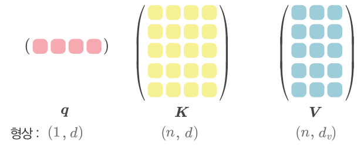

*그림 2-6 — 쿼리 $q$: $(1, d)$, 키 $K$: $(n, d)$, 밸류 $V$: $(n, d_v)$. 내적을 하려면 쿼리와 키의 차원 $d$가 같아야 하고, 밸류는 내적에 쓰이지 않으므로 $d_v \ne d$여도 된다.*

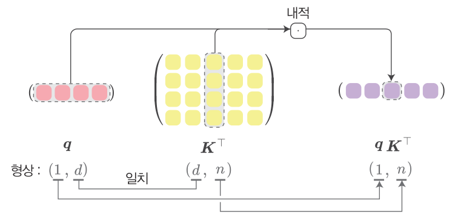

*그림 2-7 — $qK^\top$: $(1, d) @ (d, n) \to (1, n)$. 행렬곱 한 번으로 모든 키와의 내적을 구한다.*

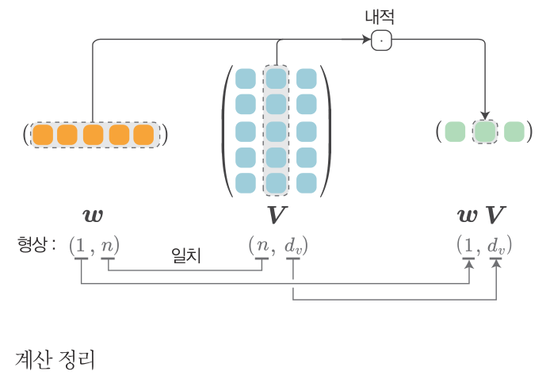

*그림 2-8 — $wV$: $(1, n) @ (n, d_v) \to (1, d_v)$. 가중합도 행렬곱 한 번으로 끝난다.*

| 단계 | 수식 | 형상 |
|---|---|---|
| 유사도 | $qK^\top$ | $(1,d) @ (d,n) \to (1,n)$ |
| 가중치 | $w = \mathrm{softmax}(qK^\top)$ | $(1,n)$ |
| 가중합 | $wV$ | $(1,n) @ (n,d_v) \to (1,d_v)$ |

$$
\mathrm{Attention}(q, K, V) = \mathrm{softmax}(qK^\top)\,V
$$

### 쿼리 여러 개

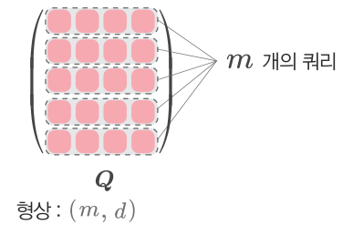

*그림 2-9 — 쿼리 $m$개를 쌓으면 $Q$: $(m, d)$.*

$$
\mathrm{Attention}(Q, K, V) = \mathrm{softmax}(QK^\top)\,V \qquad (m,d)\to(m,n)\to(m,d_v)
$$

$q$가 $Q$로 바뀌기만 했다. 식이 그대로인 이유는 **행렬곱과 (행 방향) softmax가 모두 행 단위로 독립적**이기 때문이다.

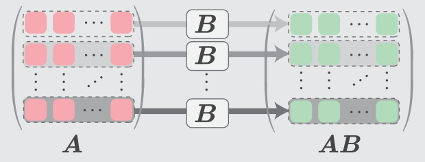

*그림 2-10 — $AB$의 $i$번째 행은 $A$의 $i$번째 행만으로 정해진다. $ABC$처럼 곱을 이어도 마찬가지다.*

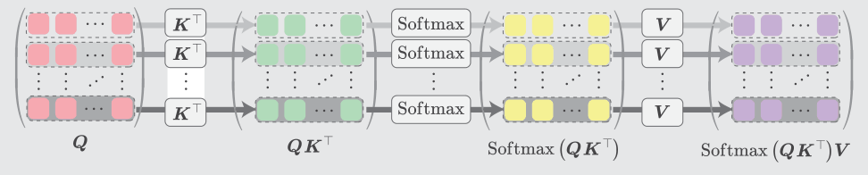

*그림 2-11 — 쿼리마다 $K^\top$ 곱 → softmax → $V$ 곱을 서로 독립적으로, 동시에 계산한다.*

```python
def attention(Q, K, V):
    similarity = torch.matmul(Q, K.t())     # (m, n)  QK^T
    weights = F.softmax(similarity, dim=1)  # 행(쿼리)마다 합이 1
    output = torch.matmul(weights, V)       # (m, d_v)
    return output, weights
```

```text
영화 [6. 4. 5.]의 예측 평점: 78.66
영화 [2. 8. 3.]의 예측 평점: 69.76
영화 [4. 3. 7.]의 예측 평점: 61.20
```

> ⚠️ `dim=1`(마지막 축)을 기준으로 softmax를 적용해야 **쿼리마다** 키 방향 가중치의 합이 1이 된다. `dim=0`을 쓰면 키마다 정규화되어 의미가 달라진다.

---

## 2.3 어텐션 스케일링 — `ch02/03_attn_scaling.py`

### softmax 포화

입력 중 하나가 다른 값보다 지나치게 크면 출력이 거의 one-hot이 되고, 입력을 조금 바꿔도 출력이 변하지 않는다. 이 상태를 **포화**라고 한다.

```python
F.softmax(torch.tensor([100.0, 200.0, 300.0]), dim=0)
# tensor([0.0000e+00, 3.7835e-44, 1.0000e+00])
```

→ 기울기가 거의 0이 되어 **파라미터가 갱신되지 않는다**(학습 방해).

### 해결: $\sqrt{d}$로 나누기

$$
\mathrm{Attention}(Q, K, V) = \mathrm{softmax}\!\left(\frac{QK^\top}{\sqrt{d}}\right) V
$$

- $d$ = 쿼리·키 벡터의 차원 수. $QK^\top$의 **모든 원소를** $\sqrt{d}$로 나눈다(요소별 계산).
- 각 원소가 평균 0, 분산 1인 $d$차원 벡터 두 개를 내적하면 분산은 $d$가 된다. $\sqrt{d}$로 나누면 분산이 다시 **1**이 된다.

```python
d, num_samples = 10, 10000
for _ in range(num_samples):
    q, k = np.random.randn(d), np.random.randn(d)   # 원소 ~ N(0, 1)
    dot_products.append(np.dot(q, k))
    scaled_dot_products.append(np.dot(q, k) / np.sqrt(d))
```

```text
분산(스케일링 없음): 9.985...   ≈ d = 10
분산(스케일링 적용): 0.998...   ≈ 1
```

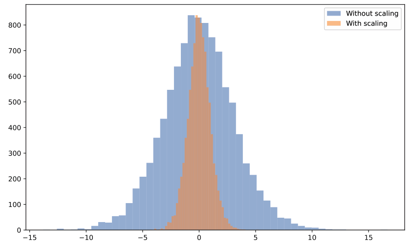

*그림 2-12 — 파란색(스케일링 없음)은 넓게 퍼지고, 주황색(스케일링 적용)은 좁게 모인다.*

> 💡 목적은 **차원 수 $d$가 커져도 내적의 분산을 1 근처로 유지**해 softmax 포화를 막는 것이다. 수학적 증명은 부록 B에 있다.

---

## 2.4 트랜스포머 기본 구조

### 3단계 처리 흐름

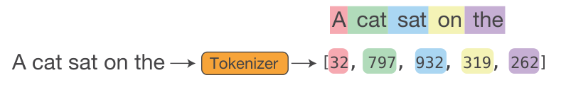

*그림 2-13 — `"A cat sat on the"` → `[32, 797, 932, 319, 262]` (1장의 토크나이저).*

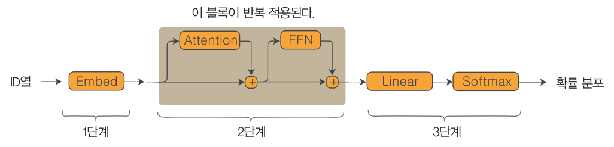

*그림 2-14 — ① Embed → ② (Attention + FFN) 블록을 반복 → ③ Linear + Softmax로 확률 분포를 만든다.*

| 단계 | 하는 일 | 형상 (토큰 $c$개) |
|---|---|---|
| ① 임베딩 | 토큰 ID → 임베딩 벡터 | $(1, c) \to (c, e)$ |
| ② 어텐션 + FFN (블록 × N) | 각 토큰 벡터를 갱신 | $(c, e) \to (c, e)$ **형상 유지** |
| ③ Linear + Softmax | 어휘 크기로 사영 → 확률 분포 | $(c, e) \to (c, v)$ |

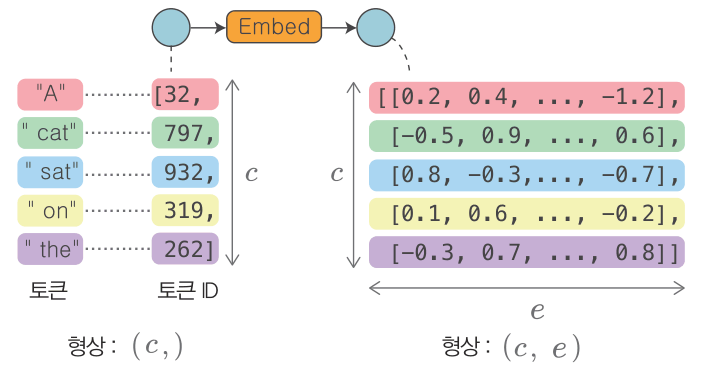

*그림 2-15 — 토큰 ID $c$개가 $e$차원 임베딩 벡터 $c$개, 즉 $(c, e)$ 텐서가 된다. 의미가 비슷한 토큰일수록 비슷한 벡터가 된다.*

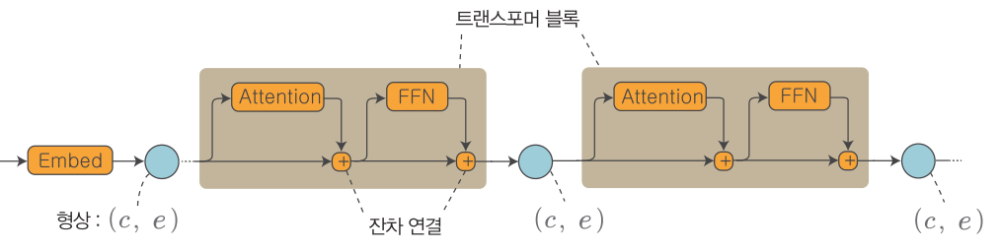

*그림 2-16 — 어텐션과 FFN의 출력을 각각 입력에 더한다(**잔차 연결**). 흐르는 텐서의 형상은 계속 $(c, e)$다.*

- **잔차 연결**: 역전파 때 기울기가 곧바로 흐르는 지름길이 생겨 기울기 소실이 줄고, 깊은 네트워크도 안정적으로 학습된다.
- 입출력 형상이 같기 때문에 블록을 **얼마든지 쌓을 수 있고**, 잔차 덧셈도 가능하다.

### 셀프 어텐션

블록 안의 어텐션은 입력이 $x$ 하나뿐이다. 그래서 $Q, K, V$를 모두 $x$에서 만든다(**셀프 어텐션**).

$$
Q = xW_q,\quad K = xW_k,\quad V = xW_v \qquad \text{[식 2.1]}
$$

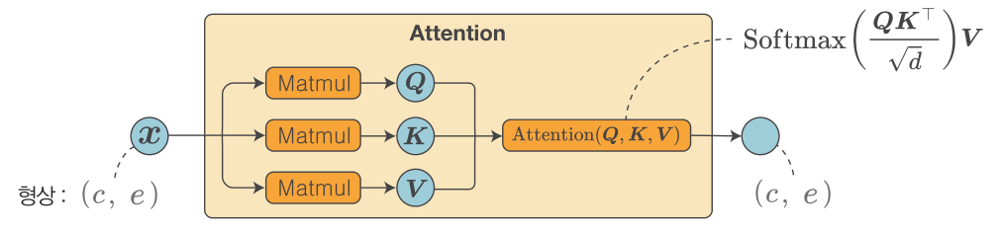

*그림 2-17 — 학습 가능한 가중치 행렬 $W_q, W_k, W_v$와의 행렬곱(Matmul)으로 $Q, K, V$를 만든 뒤 어텐션을 계산한다.*

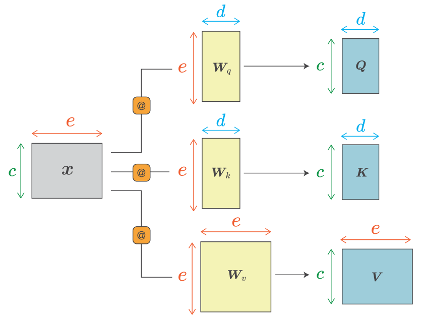

*그림 2-18 — $Q, K$: $(c, d)$ (내적을 위해 같아야 함), $V$: $(c, e)$ (잔차 덧셈을 위해 출력이 $e$차원이어야 함).*

| 행렬 | 형상 | 결과 |
|---|---|---|
| $W_q$, $W_k$ | $(e, d)$ | $Q, K$: $(c, d)$ |
| $W_v$ | $(e, e)$ | $V$: $(c, e)$ |
| $QK^\top$ | | $(c, c)$ — 토큰 × 토큰 |
| 출력 | | $(c, e)$ |

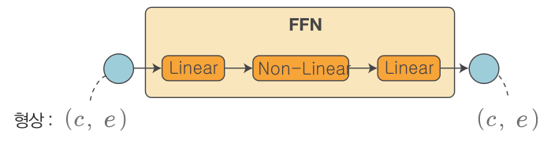

*그림 2-19 — FFN은 Linear → 비선형 → Linear 구조이며 $(c, e) \to (c, e)$다. 자세한 구조는 2.9절에서 다룬다.*

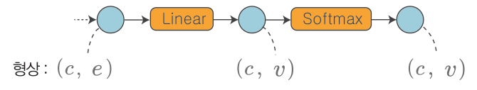

*그림 2-20 — Linear로 $(c, e) \to (c, v)$, softmax로 행마다 어휘 위의 확률 분포를 만든다.*

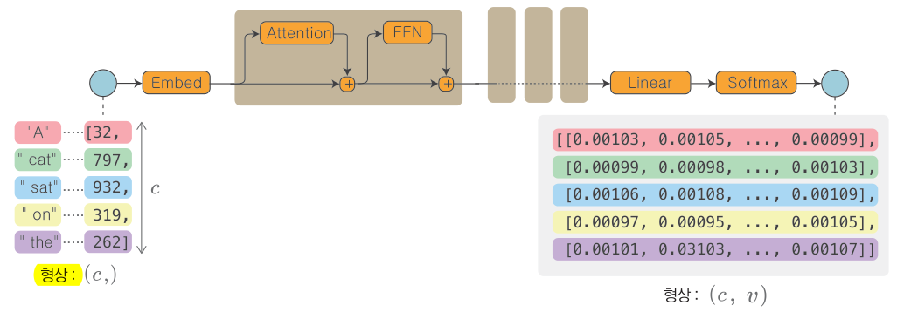

*그림 2-21 — 토큰 $c$개를 넣으면 확률 분포 $c$개가 나온다. $i$번째 분포는 "$i$번째까지 본 뒤 **다음 토큰**"을 예측한다.*

- 1번째 출력: `["A"]` 다음 → `" cat"` 예측
- 2번째 출력: `["A", " cat"]` 다음 → `" sat"` 예측
- `"A cat sat on the"` 다음 토큰을 알고 싶으면 **마지막 행**을 쓴다.
- 각 위치가 "자기까지만" 보게 하려면 **어텐션 마스크**가 필요하다(2.6절).

> 💡 **문장 확률** — 한 번의 순전파로 조건부 확률 $c$개를 동시에 얻는다.
> $$P(x_1,\dots,x_c) = P(x_1)\,P(x_2 \mid x_1)\,P(x_3 \mid x_1,x_2)\cdots P(x_c \mid x_1,\dots,x_{c-1})$$
> 단, $P(x_1)$은 따로 구해야 한다.

### 트랜스포머에서 어텐션의 역할

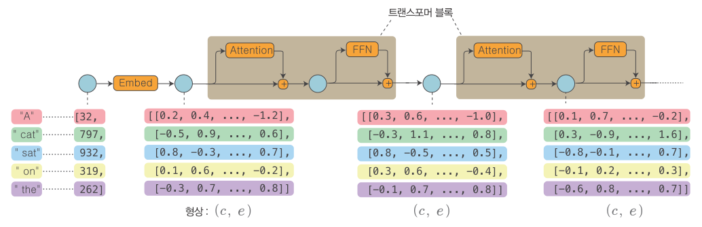

*그림 2-22 — 행과 토큰의 대응은 그대로다(2번째 행은 계속 `" cat"`). 블록을 지날 때마다 **벡터의 내용만** 바뀐다.*

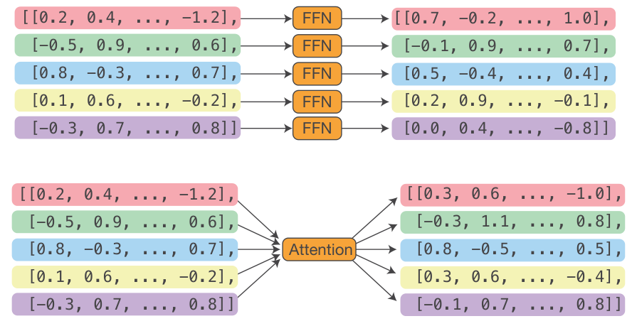

*그림 2-23 — FFN은 토큰마다 **독립적으로** 변환하고(Position-wise FFN), 어텐션은 **다른 토큰들의 정보를 섞어** 갱신한다.*

| | FFN | 어텐션 |
|---|---|---|
| 다른 토큰 참조 | ✕ (위치별 독립) | ○ (토큰 간 상호 참조) |
| 역할 | 토큰별 특징 변환 | 문맥 정보 반영 |

**예: 다의어 `" orange"`**

- `I ate a fresh orange` (과일) / `Her dress is bright orange` (색)

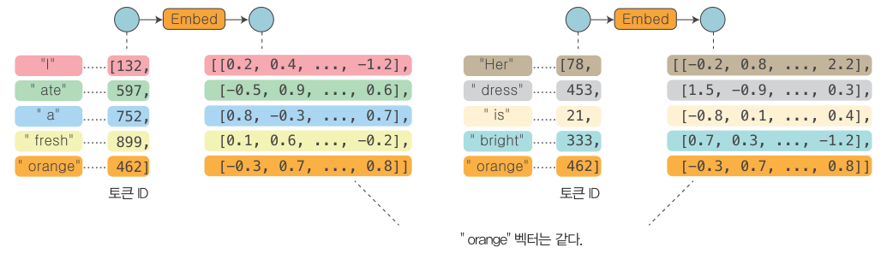

*그림 2-24 — 임베딩 직후에는 두 문장의 `" orange"`(ID 462) 벡터가 **똑같다**.*

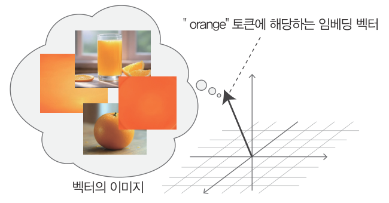

*그림 2-25 — 처음 벡터는 과일과 색의 의미가 섞인 "일반적인 오렌지"다.*

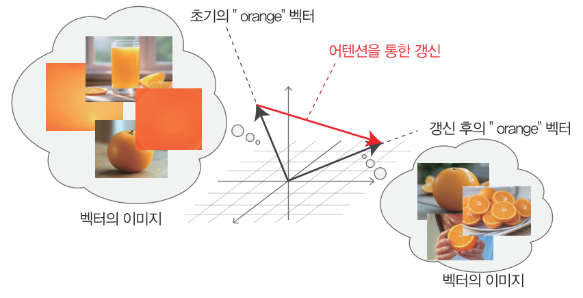

*그림 2-26 — `" ate"`, `" fresh"`의 정보가 잔차 연결로 더해지면서 "과일" 쪽 의미가 또렷해진다.*

→ 층을 거칠수록 같은 토큰이라도 **문맥에 맞는 표현**으로 바뀐다.

---

## 2.5 위치 인코딩

### 왜 필요한가?

어텐션은 **토큰의 순서를 모른다**. `Adam ate an apple`과 `apple ate an Adam`은 행 순서만 바뀔 뿐, 각 토큰이 받는 결과는 같다.

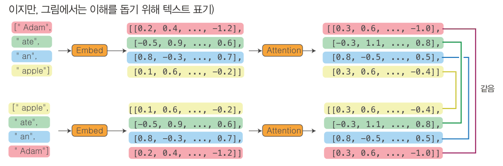

*그림 2-27 — 순서를 바꿔도 각 토큰의 출력 벡터는 같다. 행의 위치만 바뀐다.*

> 💡 인과 마스크(2.6절)를 쓰면 모델이 순서를 어느 정도 **암묵적으로** 배울 수 있다(Kazemnejad et al., 2023). 그래도 위치 정보를 명시적으로 주는 쪽이 성능이 훨씬 좋다.

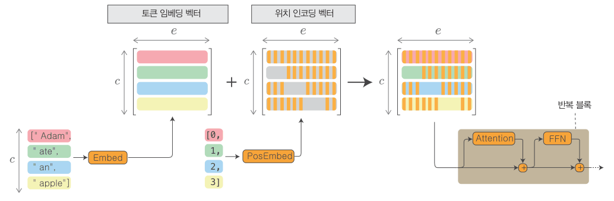

*그림 2-28 — 토큰 임베딩(Embed)에 위치 벡터(PosEmbed)를 **더한다**. 같은 토큰도 위치가 다르면 벡터가 달라진다.*

### 정현파 위치 인코딩 (Sinusoidal)

출발점은 **2진수**다. 자릿수마다 0/1이 반복되는 주기가 다르다.

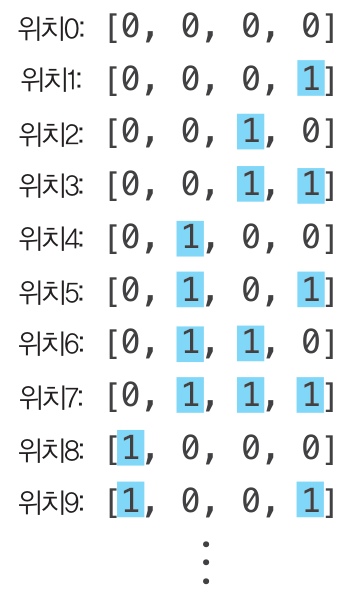

*그림 2-29 — 오른쪽 끝 자리의 주기는 2, 그 왼쪽부터 4, 8, 16. 낮은 자리일수록 빨리 바뀐다.*

뚝뚝 끊기는 0/1 대신 **부드러운 sin/cos**를 쓰고, 차원마다 주기를 다르게 둔다.

$$
PE_{(pos,\,2i)} = \sin\!\left(\frac{pos}{10000^{2i/d_{model}}}\right), \qquad
PE_{(pos,\,2i+1)} = \cos\!\left(\frac{pos}{10000^{2i/d_{model}}}\right)
$$

- $pos$: 토큰 위치, $d_{model}$: 임베딩 차원, $i = 0, 1, \dots, d_{model}/2 - 1$ (차원 쌍 인덱스)
- 짝수 차원은 sin, 홀수 차원은 cos

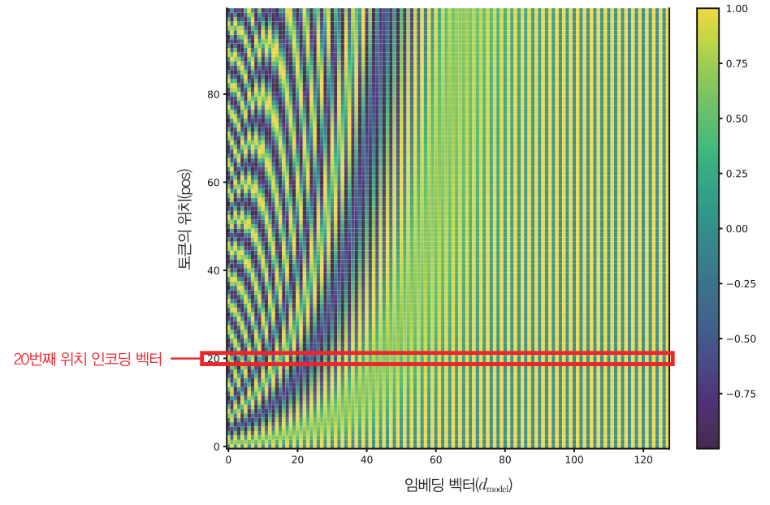

*그림 2-30 — $d_{model}=128$. 행마다 패턴이 고유하다. 왼쪽(낮은 차원)은 빠르게, 오른쪽(높은 차원)은 천천히 변한다. 2진수의 낮은 자리/높은 자리와 같은 구조다.*

### 학습 가능한 위치 임베딩 (Learnable) ← GPT-2·CodeBot이 쓰는 방식

위치 0 ~ `max_context_len - 1`마다 벡터를 하나씩 두고 **학습으로 최적화**한다. `nn.Embedding`은 "ID → 가중치 행렬의 해당 행"을 돌려주는 룩업 테이블이므로, 위치 인덱스를 ID로 넣으면 된다.

```python
self.token_embedding = nn.Embedding(vocab_size, embed_dim)
self.position_embedding = nn.Embedding(max_context_len, embed_dim)   # 위치마다 벡터 1개

def forward(self, x):                                   # x: (B, C) 토큰 ID
    token_emb = self.token_embedding(x)                 # (B, C, E)
    positions = torch.arange(0, x.size(1))              # [0, 1, ..., C-1]
    pos_emb = self.position_embedding(positions)        # (C, E)
    x = token_emb + pos_emb                             # 브로드캐스트 → (B, C, E)
```

| | 정현파 위치 인코딩 | 학습 가능한 위치 임베딩 |
|---|---|---|
| 파라미터 | 없음 | `max_context_len × E` |
| 계산·구현 | 저렴하고 간단 | 간단 |
| 최대 길이 | 이론상 제한 없음 | `max_context_len`을 넘을 수 없음 |
| 실제 한계 | 학습 때 못 본 길이에서 성능 저하 | 학습 때 못 본 길이로 일반화하기 어려움 |
| 사용 예 | 원조 트랜스포머 | **BERT, GPT-2** |

> 💡 더 발전한 방식인 **RoPE**는 5.1절에서 다룬다.

---

## 2.6 어텐션 마스크 — `ch02/06_attn_mask.py`

### 효율적인 학습 데이터 구성

`["A", " cat", " sat", " on", " the", " mat"]` 하나에서 예측 과제 5개를 만들 수 있다.

| 입력 | 정답 |
|---|---|
| `["A"]` | `" cat"` |
| `["A", " cat"]` | `" sat"` |
| … | … |
| `["A", " cat", " sat", " on", " the"]` | `" mat"` |

트랜스포머는 입력 토큰 수만큼 분포를 출력하므로, 5개를 **한 번에** 학습할 수 있다.

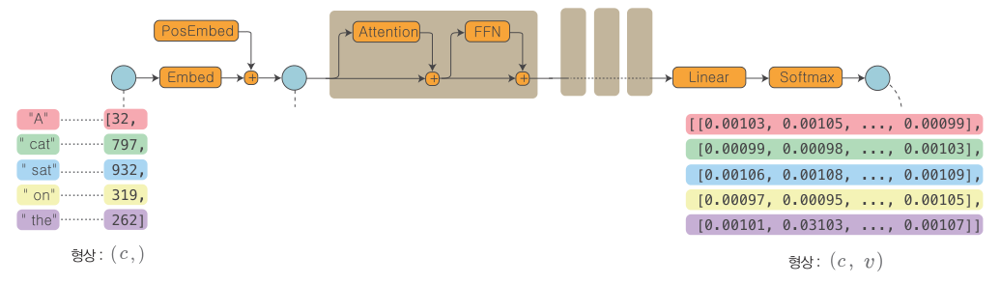

*그림 2-31 — 입력 5개 → 확률 분포 5개, 즉 $(5, v)$.*

| 입력 | 정답 레이블 (입력을 한 칸 왼쪽으로 민 것) |
|---|---|
| `["A", " cat", " sat", " on", " the"]` | `[" cat", " sat", " on", " the", " mat"]` |

### 문제: 미래 토큰을 보면 커닝이 된다

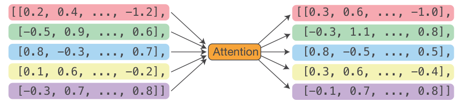

*그림 2-32 — 마스크가 없으면 각 위치가 뒤쪽 토큰(정답)까지 본다. 예측이 아니라 답을 베끼는 학습이 된다.*

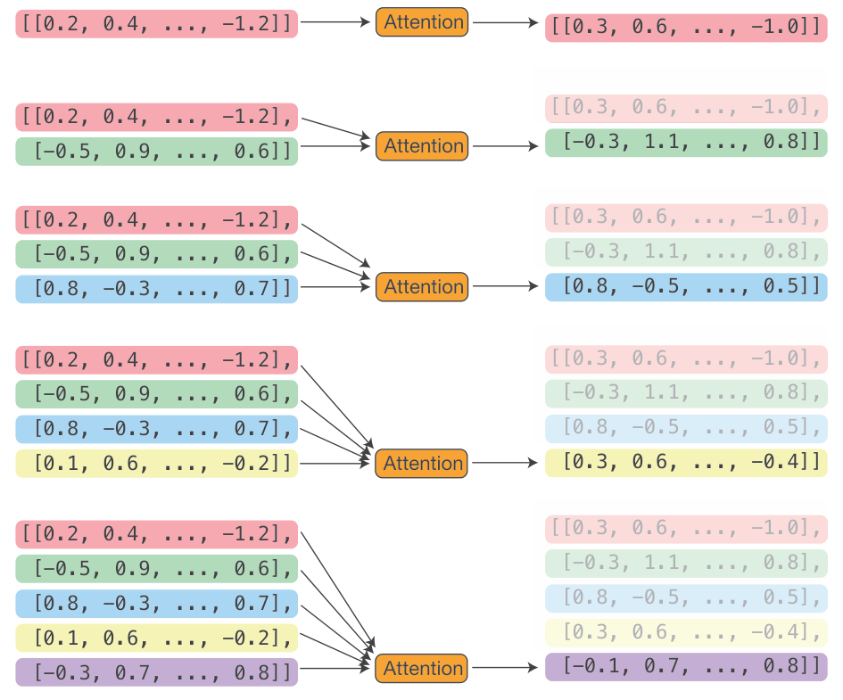

*그림 2-33 — 원하는 동작: $i$번째 위치는 1 ~ $i$번째 토큰만 참조한다.*

### 어텐션 맵과 마스크

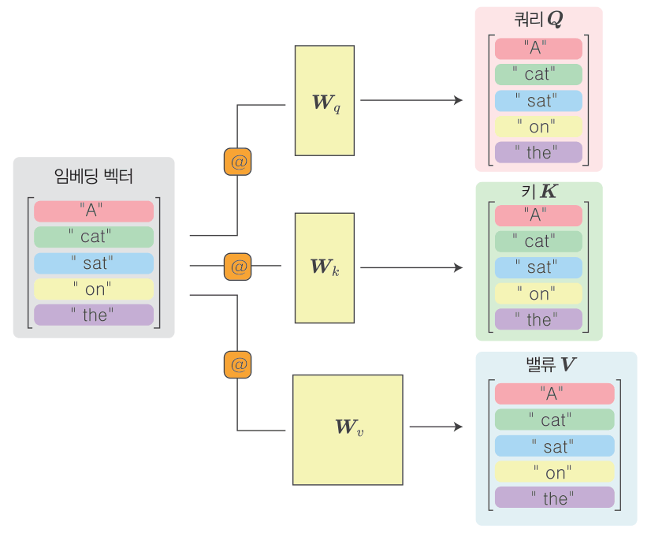

*그림 2-34 — 각 토큰의 임베딩 벡터에 $W_q, W_k, W_v$를 곱해 토큰마다 쿼리·키·밸류를 만든다.*

$\mathrm{softmax}(QK^\top/\sqrt{d})$의 결과인 $(C, C)$ 행렬을 **어텐션 가중치 행렬 = 어텐션 맵**이라고 한다. 행 = 쿼리(보는 쪽), 열 = 키(보이는 쪽)이고 각 행의 합은 1이다.

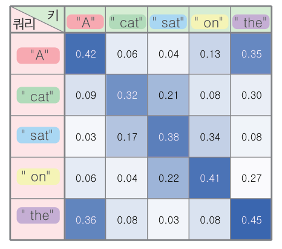

*그림 2-35 — 3번째 행(`" sat"`)은 자기 자신(0.38)과 **미래 토큰** `" on"`(0.34)에 크게 주목하고 있다.*

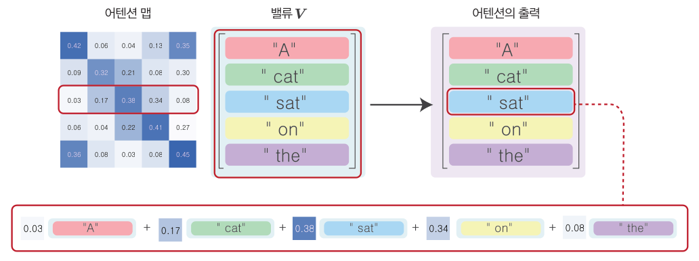

*그림 2-36 — `" sat"`의 출력 = 0.03·A + 0.17·cat + 0.38·sat + 0.34·on + 0.08·the. 미래인 on, the의 밸류가 섞여 들어간다.*

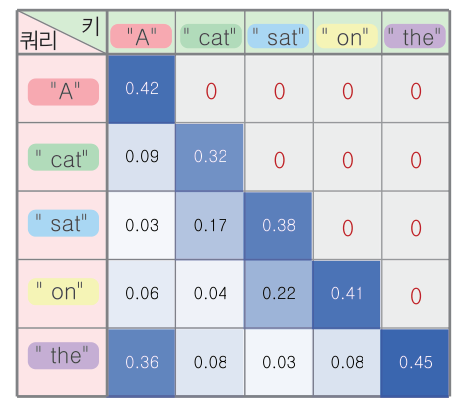

*그림 2-37 — 맵의 오른쪽 위 삼각형(미래)을 0으로 만들면 해당 밸류가 출력에 반영되지 않는다.*

⚠️ softmax **뒤에** 0으로 바꾸면 행의 합이 1이 아니게 된다. 그래서 softmax **앞에서** 점수를 $-\infty$로 바꾼다.

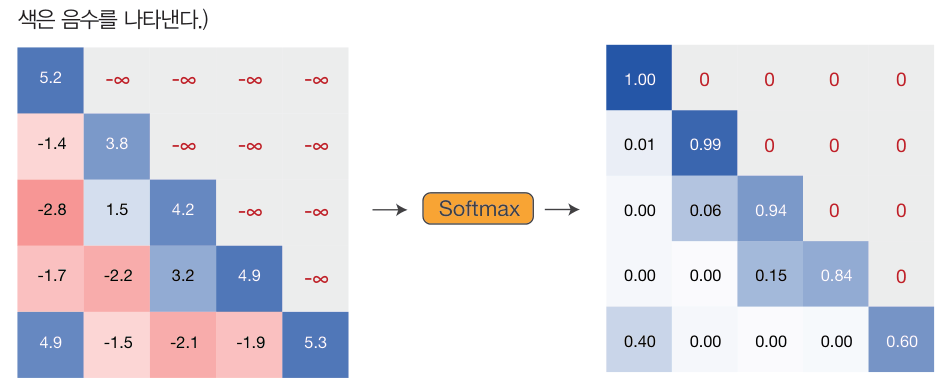

*그림 2-38 — 예: 2행 `[-1.4, 3.8, -∞, -∞, -∞]` → `[0.01, 0.99, 0, 0, 0]`. $e^{-\infty}=0$이고, 남은 값끼리 합이 1이 되도록 정규화된다.*

- 행마다 대각 성분(자기 자신)은 항상 유한하므로 분모는 양수이고, 출력은 $0/\text{양수} = 0$이 된다.
- 이 마스크를 **인과 마스크(causal mask)** 라고 한다. 현재 출력이 과거와 현재 입력에만 의존한다는 뜻이다.

### 배치 행렬곱 `torch.matmul`

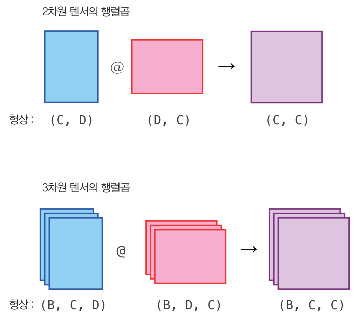

*그림 2-39 — 3차원 텐서는 첫 축을 **배치**로 보고, 배치마다 2차원 행렬곱을 독립적으로(병렬로) 수행한다.*

| 입력 형상 | 결과 | 배치 축 |
|---|---|---|
| $(C, D) @ (D, C)$ | $(C, C)$ | 없음 |
| $(B, C, D) @ (B, D, C)$ | $(B, C, C)$ | B |
| $(B, H, C, D) @ (B, H, D, C)$ | $(B, H, C, C)$ | B, H (2.8절에서 사용) |

### 구현

```python
class Attention(nn.Module):
    def __init__(self, embed_dim, key_dim):
        super().__init__()
        self.W_q = nn.Linear(embed_dim, key_dim, bias=False)    # E → D
        self.W_k = nn.Linear(embed_dim, key_dim, bias=False)    # E → D
        self.W_v = nn.Linear(embed_dim, embed_dim, bias=False)  # E → E
        self.key_dim = key_dim

    def forward(self, x):                  # x: (B, C, E)
        Q = self.W_q(x)                    # (B, C, D)
        K = self.W_k(x)                    # (B, C, D)
        V = self.W_v(x)                    # (B, C, E)

        scores = torch.matmul(Q, K.transpose(-2, -1))   # (B, C, D)@(B, D, C) → (B, C, C)
        scores = scores / (self.key_dim ** 0.5)         # 스케일링

        B, C, E = x.shape
        mask = torch.tril(torch.ones(C, C, device=scores.device))   # 하삼각 1
        scores = scores.masked_fill(mask == 0, float('-inf'))       # 미래 → -inf
        weights = F.softmax(scores, dim=-1)                         # (B, C, C)

        return torch.matmul(weights, V)    # (B, C, E)
```

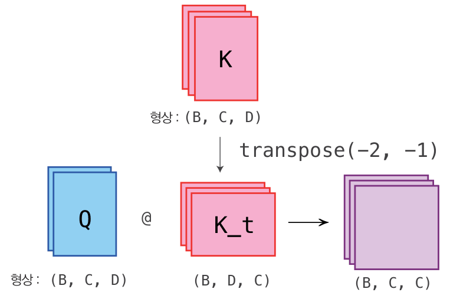

*그림 2-40 — `K.transpose(-2, -1)`은 마지막 두 축을 바꿔 $(B, C, D) \to (B, D, C)$로 만든다.*

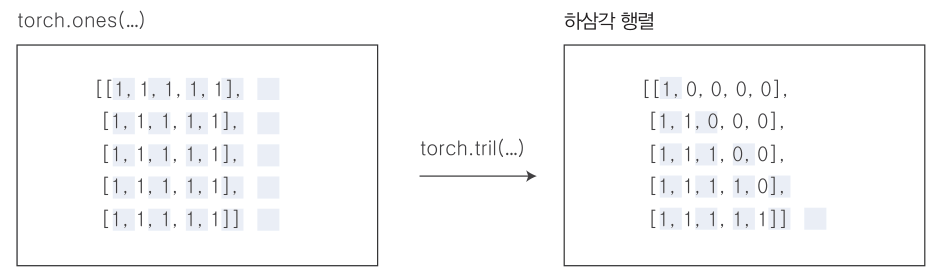

*그림 2-41 — `tril` = triangle lower. 대각선과 그 아래만 1로 남는다. `mask == 0`인 곳(미래)이 $-\infty$가 된다.*

- `masked_fill(cond, value)`: `cond`가 True인 위치를 `value`로 채운다.
- `mask`는 $(C, C)$, `scores`는 $(B, C, C)$ → **브로드캐스트**로 모든 배치에 같은 마스크가 적용된다.

```text
입력 형상: torch.Size([2, 5, 256])
출력 형상: torch.Size([2, 5, 256])      ← 입력과 같은 형상
```

---

## 2.7 밸류 변환 행렬 효율 개선 — `ch02/07_attn_value.py`

### 문제: $W_v$가 너무 크다

GPT-3는 $E = 12{,}288$, $D = 128$이다.

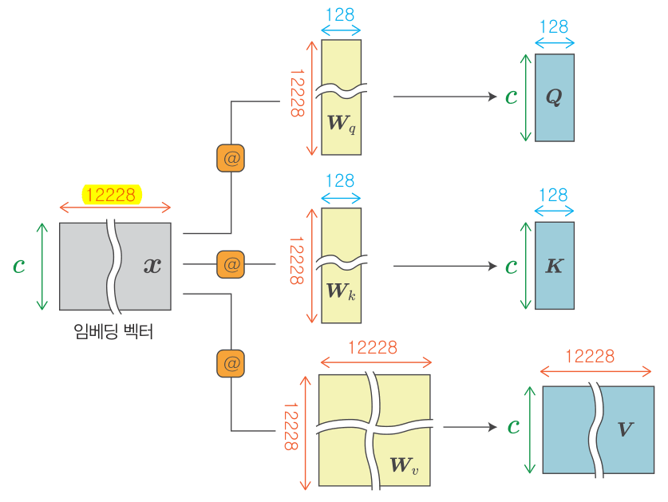

*그림 2-42 — $W_q, W_k$는 가늘고 긴 $(E, 128)$인데, $W_v$만 $(E, E)$ 정사각 행렬이다. (그림 속 숫자 "12228"은 12,288의 오기로 보인다.)*

| 행렬 | 형상 | 파라미터 수 |
|---|---|---|
| $W_q$ | 12,288 × 128 | 약 157만 |
| $W_k$ | 12,288 × 128 | 약 157만 |
| $W_v$ | 12,288 × 12,288 | **약 1.5억** |

### 해결: 저랭크 근사 (행렬 분해)

**랭크** = 행렬에 담긴, 서로 독립인 행(열)의 최대 개수 = 본질적인 정보의 차원 수. 큰 행렬을 작은 행렬 두 개의 곱으로 근사한다.

$$
W_v \approx W_{v1} W_{v2}, \qquad W_{v1}: (12288, k),\quad W_{v2}: (k, 12288)
$$

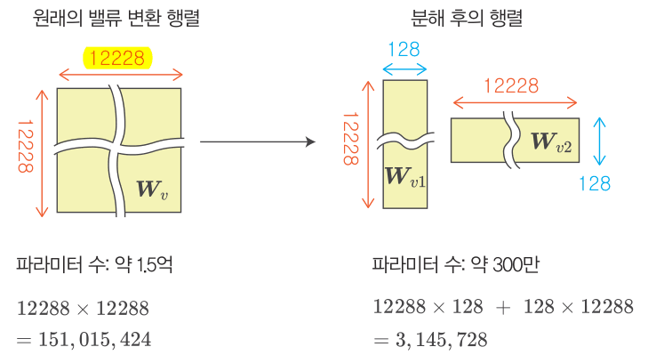

*그림 2-43 — $k = 128$이면 약 1.5억 → 약 300만($2 \times 12288 \times 128 \approx 315$만). 약 98%가 줄고, 입출력 차원은 그대로다.*

### 새로운 해석: 밸류 변환 + 출력 변환

$V = xW_{v1}W_{v2}$를 대입하고 행렬곱의 결합법칙으로 묶는다(마스크는 생략해도 결론이 같다).

$$
\mathrm{softmax}\!\left(\frac{QK^\top}{\sqrt{d}}\right) x W_{v1} W_{v2}
= \left[\mathrm{softmax}\!\left(\frac{QK^\top}{\sqrt{d}}\right) (x W_{v1})\right] W_{v2}
$$

$W_{v1} \to W_v$, $W_{v2} \to W_o$로 이름을 바꾸고 $V = xW_v$로 다시 정의하면 다음과 같다.

$$
Q = xW_q,\ K = xW_k,\ V = xW_v,\qquad
\mathrm{Attention} = \left[\mathrm{softmax}\!\left(\frac{QK^\top}{\sqrt{d}}\right) V\right] W_o
$$

| 행렬 | 형상 | 역할 |
|---|---|---|
| $W_v$ (밸류 변환) | $(E, D)$ | 입력 → **저차원** 밸류 |
| $W_o$ (출력 변환) | $(D, E)$ | 어텐션 결과 → **원래 차원** $E$로 복원 |

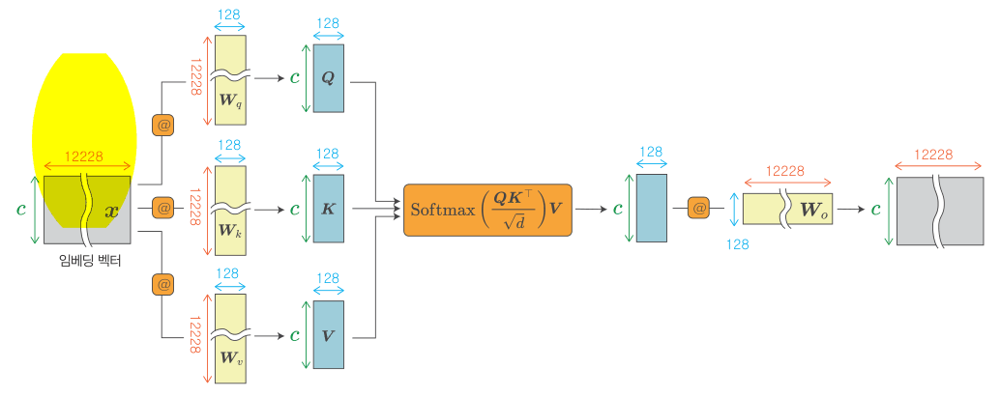

*그림 2-44 — $Q, K, V$가 모두 $(c, 128)$이고, 어텐션 결과 $(c, 128)$에 $W_o$를 곱해 $(c, 12288)$로 되돌린다.*

```python
self.W_v = nn.Linear(embed_dim, key_dim, bias=False)   # 밸류 변환: E → D
self.W_o = nn.Linear(key_dim, embed_dim, bias=False)   # 출력 변환: D → E

def forward(self, x):
    Q, K, V = self.W_q(x), self.W_k(x), self.W_v(x)    # 모두 (B, C, D)
    ...                                                # 스케일링 + 마스크 + softmax (2.6절과 같음)
    hidden = torch.matmul(weights, V)                  # (B, C, D)
    return self.W_o(hidden)                            # (B, C, E)
```

---

## 2.8 멀티헤드 어텐션 — `ch02/08_multi_head.py`

### 여러 관점에서 보기

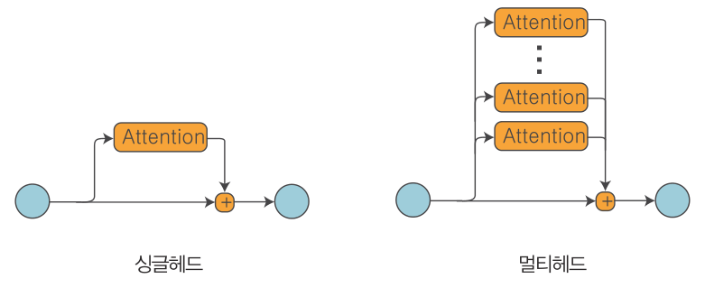

*그림 2-45 — 헤드(어텐션) 여러 개를 병렬로 돌리고 출력을 합친다.*

- 헤드마다 가중치가 따로 있고 초기값도 무작위로 다르다. 다른 헤드가 이미 잡은 특징을 또 배워 봐야 손실이 별로 줄지 않으므로, 헤드들은 **서로 다른 특징**(문법 관계, 의미 연관 등)을 나눠 맡는 쪽으로 수렴한다.

### 수식

$i$번째 헤드는 고유한 $W_q^i, W_k^i, W_v^i, W_o^i$를 가진다.

$$
\mathrm{head}_i = \underbrace{\mathrm{softmax}\!\left(\mathrm{mask}\!\left(\frac{Q^i (K^i)^\top}{\sqrt{d}}\right)\right) V^i}_{R^i}\, W_o^i
$$

$$
\mathrm{MultiHead}(x) = \sum_{i=1}^{h} \mathrm{head}_i = \sum_{i=1}^{h} R^i W_o^i \qquad \text{[식 2.2]}
$$

### 동등한 두 가지 계산법

$$
\sum_{i=1}^{h} R^i W_o^i =
\begin{bmatrix} R^1 & R^2 & \cdots & R^h \end{bmatrix}
\begin{bmatrix} W_o^1 \\ W_o^2 \\ \vdots \\ W_o^h \end{bmatrix} \qquad \text{[식 2.3]}
$$

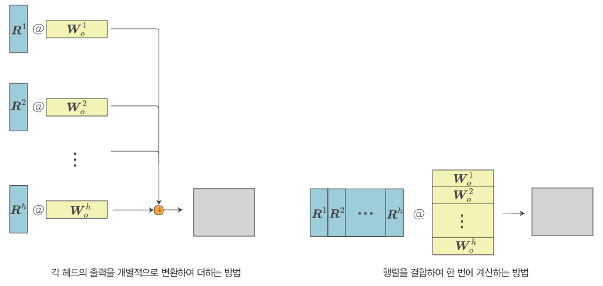

*그림 2-46 — 왼쪽: 헤드마다 따로 변환해서 더한다. 오른쪽: $R^i$를 가로로, $W_o^i$를 세로로 이어 붙여 **큰 행렬곱 한 번**으로 계산한다.*

→ 구현은 [식 2.3]을 쓴다. BLAS/cuBLAS 같은 라이브러리는 큰 행렬곱 하나를 훨씬 효율적으로 처리한다.

### 텐서 형상 흐름 (핵심)

| 단계 | 코드 | 형상 |
|---|---|---|
| 입력 | `x` | (B, C, E) |
| 모든 헤드의 Q/K/V를 한 번에 | `W_q(x)` (`nn.Linear(E, H*D)`) | (B, C, H·D) |
| 헤드 축 분리 | `.view(B, C, H, D)` | (B, C, H, D) |
| 헤드를 배치처럼 | `.transpose(1, 2)` | **(B, H, C, D)** |
| 점수 | `Q @ K.transpose(-2, -1)` | (B, H, C, C) |
| 가중합 | `weights @ V` | (B, H, C, D) |
| 축 되돌리기 | `.transpose(1, 2).contiguous()` | (B, C, H, D) |
| 헤드 이어 붙이기 ($[R^1 \cdots R^h]$) | `.view(B, C, H*D)` | (B, C, H·D) |
| 출력 변환 | `W_o` (`nn.Linear(H*D, E)`) | (B, C, E) |

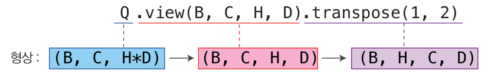

*그림 2-47 — `view`로 마지막 축을 (H, D)로 쪼개고, `transpose(1, 2)`로 H를 앞으로 보낸다. 4차원 matmul은 B와 H를 배치 축으로 다루므로 모든 헤드가 한 번에 계산된다.*

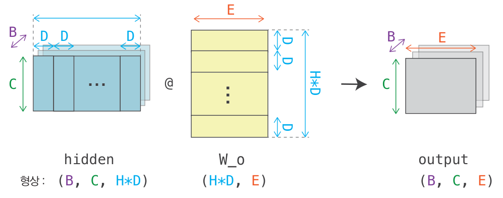

*그림 2-48 — 헤드 출력 D개 묶음 H개를 이어 붙인 (B, C, H·D)에 $(H·D, E)$ 크기의 W_o를 곱하면 (B, C, E)가 된다.*

> ⚠️ **`contiguous()`** — `transpose()`/`permute()` 뒤에는 메모리 배치가 연속이 아닐 수 있다. `view()`는 연속 메모리를 전제하므로 그대로 호출하면 오류가 난다. `contiguous()`로 다시 배치한 뒤 `view()`를 호출한다.

> 💡 **더 줄이기** — Q, K, V를 선형 변환 하나로 만들 수도 있다.
> ```python
> W = nn.Linear(E, 3*H*D, bias=False)
> Q, K, V = W(x).chunk(3, dim=2)    # 각각 (B, C, H*D)
> ```

> 💡 `head_dim`(D)은 싱글헤드의 `key_dim`에 해당한다. 예제(`E=16, H=3, D=8`)처럼 H·D가 E와 꼭 같을 필요는 없다. W_o가 H·D → E로 맞춰 준다.

### 최종 구현 (드롭아웃 포함, `codebot/model.py`에 저장됨)

```python
class MultiHeadAttention(nn.Module):
    def __init__(self, embed_dim, n_head, head_dim, dropout_rate=0.1):
        super().__init__()
        self.n_head, self.head_dim = n_head, head_dim
        E, H, D = embed_dim, n_head, head_dim
        self.W_q = nn.Linear(E, H*D, bias=False)
        self.W_k = nn.Linear(E, H*D, bias=False)
        self.W_v = nn.Linear(E, H*D, bias=False)
        self.W_o = nn.Linear(H*D, E, bias=False)
        self.attention_dropout = nn.Dropout(dropout_rate)
        self.output_dropout = nn.Dropout(dropout_rate)

    def forward(self, x):
        B, C, E = x.shape
        H, D = self.n_head, self.head_dim

        Q = self.W_q(x).view(B, C, H, D).transpose(1, 2)   # (B, H, C, D)
        K = self.W_k(x).view(B, C, H, D).transpose(1, 2)   # (B, H, C, D)
        V = self.W_v(x).view(B, C, H, D).transpose(1, 2)   # (B, H, C, D)

        scores = torch.matmul(Q, K.transpose(-2, -1)) / (D ** 0.5)  # (B, H, C, C)
        mask = torch.tril(torch.ones(C, C, device=scores.device))
        scores = scores.masked_fill(mask == 0, float('-inf'))

        weights = F.softmax(scores, dim=-1)        # (B, H, C, C)
        weights = self.attention_dropout(weights)  # ① 어텐션 가중치에 드롭아웃
        hidden = torch.matmul(weights, V)          # (B, H, C, D)

        hidden = hidden.transpose(1, 2).contiguous().view(B, C, H * D)  # 헤드 결합
        output = self.W_o(hidden)                  # (B, C, E)
        return self.output_dropout(output)         # ② 최종 출력에 드롭아웃
```

```text
입력 형상: torch.Size([2, 10, 512])     (embed_dim=512, n_head=8, head_dim=64)
출력 형상: torch.Size([2, 10, 512])
```

- **드롭아웃**: 학습할 때 출력 일부를 무작위로 0으로 만들어 과대적합을 줄인다. 어텐션 가중치와 최종 출력 두 곳에 적용한다.

---

## 2.9 트랜스포머 블록 — `ch02/09_norm_gelu.py`

GPT-2식 블록은 원조 트랜스포머와 두 가지가 다르다. 활성화 함수로 **GELU**를 쓰고, **LayerNorm 위치**가 다르다(pre-norm). 둘 다 학습 안정성과 성능을 높인다.

### LayerNorm과 pre-norm 구성

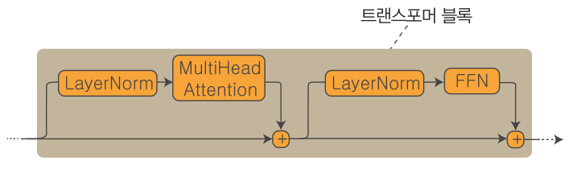

*그림 2-49 — 어텐션과 FFN **앞에** LayerNorm을 둔다(pre-norm).*

| 구성 | 위치 | 비고 |
|---|---|---|
| post-norm | 잔차 덧셈 **뒤** | 원조 트랜스포머 논문 |
| **pre-norm** | 어텐션/FFN **앞** | 학습이 더 안정적(Wang et al., 2019; Xiong et al., 2020), 현재 주류 |

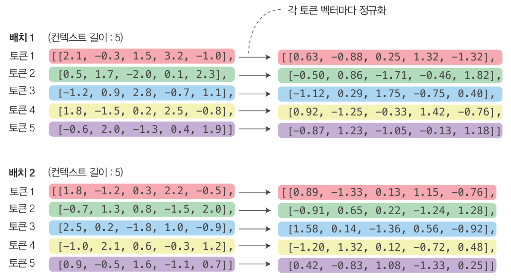

*그림 2-50 — (2, 5, 5) 텐서에서 **토큰 벡터 하나씩**(마지막 축 E 방향) 평균 0, 분산 1로 맞춘다.*

> 💡 **BatchNorm과의 차이** — BatchNorm은 배치에 있는 여러 샘플에 걸쳐 같은 특징의 통계를 낸다. 문장마다 길이가 달라 위치별 통계가 불안정하다. LayerNorm은 토큰마다 E 축으로만 계산하므로 **문장 길이와 무관**하다.

$$
\mathrm{LayerNorm}(x) = \gamma \odot \frac{x - \mu}{\sqrt{\sigma^2 + \epsilon}} + \beta
$$

- $\mu, \sigma^2$: 벡터 $x$의 원소 평균·분산, $\epsilon$: 0으로 나누는 것을 막는 작은 상수
- $\gamma$(스케일, 초기값 1), $\beta$(시프트, 초기값 0): 길이 E의 **학습 가능한** 벡터. 표준정규분포에만 묶이지 않고 층마다 알맞은 분포를 배우게 한다.

```python
class LayerNorm(nn.Module):
    def __init__(self, embed_dim):
        super().__init__()
        self.gamma = nn.Parameter(torch.ones(embed_dim))
        self.beta = nn.Parameter(torch.zeros(embed_dim))
        self.eps = 1e-5

    def forward(self, x):                                       # (B, C, E)
        mean = x.mean(dim=-1, keepdim=True)                     # (B, C, 1)
        var = x.var(dim=-1, keepdim=True, unbiased=False)       # 모분산(N으로 나눔)
        norm_x = (x - mean) / torch.sqrt(var + self.eps)
        return self.gamma * norm_x + self.beta
```

- `keepdim=True`: (2, 5, 512) → (2, 5, **1**). 축 개수가 유지되어 `x - mean`이 브로드캐스트된다(False면 (2, 5)).
- 파이토치 기본 `nn.LayerNorm`으로 바꿔 써도 된다(`codebot/model.py`는 `nn.LayerNorm` 사용).

### FFN과 GELU


*그림 2-51 — GPT-2의 FFN: Linear → GELU → Linear → Dropout.*


*그림 2-52 — GELU는 ReLU를 부드럽게 만든 곡선이다. 음수 입력에도 0이 아닌 작은 값을 내고, 기울기가 급격히 끊기지 않는다.*

$$
\mathrm{GELU}(x) = x\,\Phi(x) = \frac{x}{2}\left[1 + \mathrm{erf}\!\left(\frac{x}{\sqrt{2}}\right)\right],\qquad
\mathrm{erf}(x) = \frac{2}{\sqrt{\pi}}\int_0^x e^{-t^2}\,dt
$$

$\Phi$는 표준정규분포의 누적분포함수다. 실제 구현에서는 계산이 가벼운 **tanh 근사식**을 많이 쓴다.

$$
\mathrm{GELU}(x) \approx 0.5\,x\left(1 + \tanh\!\left[\sqrt{2/\pi}\,\left(x + 0.044715\,x^3\right)\right]\right)
$$

```python
class GELU(nn.Module):
    def forward(self, x):
        return 0.5 * x * (1 + torch.tanh(
            torch.sqrt(torch.tensor(2.0 / torch.pi)) * (x + 0.044715 * torch.pow(x, 3))
        ))

class FFN(nn.Module):
    def __init__(self, x_dim, hidden_dim=None, dropout_rate=0.1):
        super().__init__()
        if hidden_dim is None:
            hidden_dim = int(4 * x_dim)          # 은닉층 = 입력의 4배 (GPT-2 관례)
        self.layers = nn.Sequential(
            nn.Linear(x_dim, hidden_dim),        # (B, C, E)  → (B, C, 4E)
            GELU(),
            nn.Linear(hidden_dim, x_dim),        # (B, C, 4E) → (B, C, E)
            nn.Dropout(dropout_rate),
        )

    def forward(self, x):
        return self.layers(x)
```

### 블록 조립

```python
class Block(nn.Module):
    def __init__(self, embed_dim, n_head, ff_dim=None, dropout_rate=0.1):
        super().__init__()
        head_dim = embed_dim // n_head            # H가 바뀌어도 전체 파라미터 수 일정
        self.norm1 = LayerNorm(embed_dim)
        self.attn = MultiHeadAttention(embed_dim, n_head, head_dim, dropout_rate)
        self.norm2 = LayerNorm(embed_dim)
        self.ffn = FFN(embed_dim, ff_dim, dropout_rate)

    def forward(self, x):                          # (B, C, E) → (B, C, E)
        x = x + self.attn(self.norm1(x))           # pre-norm + 잔차 연결
        x = x + self.ffn(self.norm2(x))
        return x
```

> ⚠️ **`codebot/model.py`와의 차이** — 저장소의 `codebot/model.py`는 직접 만든 클래스 대신 `nn.LayerNorm`, `nn.GELU`를 쓴다. 그리고 `FFN(embed_dim, hidden_dim, dropout_rate)`의 `hidden_dim`에 기본값이 없어 반드시 넘겨야 한다(`Block`의 `ff_dim`도 마찬가지). 동작은 같다(`nn.GELU` 기본값은 tanh 근사가 아닌 erf 정확식이라는 사소한 차이만 있다).

---

## 2.10 GPT-2 — `ch02/10_gpt2.py`


*그림 2-53 — Embed + PosEmbed → Dropout → Transformer Block × N → LayerNorm → Linear → 로짓.*

| 단계 | 모듈 | 형상 |
|---|---|---|
| 입력 | 토큰 ID | (B, C) |
| 토큰 임베딩 | `nn.Embedding(V, E)` | (B, C, E) |
| 위치 임베딩 | `nn.Embedding(max_context_len, E)` on `arange(C)` | (C, E) → 브로드캐스트 |
| 합 + Dropout | | (B, C, E) |
| 블록 × `n_layer` | `nn.ModuleList([Block, ...])` | (B, C, E) |
| 최종 정규화 | `nn.LayerNorm(E)` | (B, C, E) |
| 출력 (unembed) | `nn.Linear(E, V)` | **(B, C, V)** 로짓 |

> 💡 **softmax는 모델에 넣지 않는다** — 출력은 **로짓**(softmax 전의 점수)이다. 학습할 때 쓰는 `CrossEntropyLoss`가 softmax와 손실 계산을 함께 처리하기 때문이다(3장).

```python
class GPT(nn.Module):
    def __init__(self, vocab_size, max_context_len, embed_dim, n_head, n_layer, ff_dim, dropout_rate):
        super().__init__()
        # (하이퍼파라미터를 self.*에 저장 — save()에서 사용)
        self.embed = nn.Embedding(vocab_size, embed_dim)
        self.pos_embed = nn.Embedding(max_context_len, embed_dim)
        self.dropout = nn.Dropout(dropout_rate)
        self.blocks = nn.ModuleList([
            Block(embed_dim, n_head, ff_dim, dropout_rate) for _ in range(n_layer)
        ])
        self.norm = nn.LayerNorm(embed_dim)
        self.unembed = nn.Linear(embed_dim, vocab_size)

        self.embed.weight = self.unembed.weight     # 가중치 공유
        self.apply(self._init_weights)              # 가중치 초기화

    def forward(self, ids):                         # (B, C)
        B, C = ids.shape
        pos = torch.arange(0, C, dtype=torch.long, device=ids.device)
        x = self.dropout(self.embed(ids) + self.pos_embed(pos))   # (B, C, E)
        for block in self.blocks:
            x = block(x)
        x = self.norm(x)
        return self.unembed(x)                      # (B, C, vocab_size)
```

- **`nn.ModuleList`**: 일반 리스트와 달리 안에 든 `Block`들을 하위 모듈로 **등록**한다. 그래야 `model.parameters()`, `model.to(device)`가 블록까지 처리한다.

### 개선 ① 가중치 공유 (weight tying)


*그림 2-54 — 맨 앞의 Embed(ID → 벡터)와 맨 뒤의 Linear(벡터 → 어휘 점수)는 서로 전치 관계다. 같은 가중치를 함께 쓴다.*

- `nn.Embedding(V, E).weight`와 `nn.Linear(E, V).weight`는 **둘 다 (V, E)** 형상이다(`nn.Linear`는 내부에서 전치해서 쓴다). 그래서 대입 한 줄로 공유할 수 있다.
- 효과: 임베딩 공간과 출력 어휘 공간이 일관되게 학습되고, 파라미터와 메모리가 줄어든다(CodeBot은 1,000 × 384 = 38.4만 개 절약).

### 개선 ② 가중치 초기화

```python
def _init_weights(self, module):
    if isinstance(module, nn.Linear):
        torch.nn.init.normal_(module.weight, mean=0.0, std=0.02)
        if module.bias is not None:
            torch.nn.init.zeros_(module.bias)
    elif isinstance(module, nn.Embedding):
        torch.nn.init.normal_(module.weight, mean=0.0, std=0.02)
```

- 모든 `Linear`/`Embedding`을 $\mathcal{N}(0, 0.02^2)$로 초기화한다(BERT·GPT 관례). 작은 표준편차로 깊은 네트워크에서 기울기가 폭주하는 것을 막는다.
- `module.apply(fn)`: 모든 하위 모듈에 `fn`을 **재귀적으로** 적용한다.

> ⚠️ 원래 GPT-2는 층이 깊어질수록 잔차 경로에 값이 쌓이는 것을 막으려고 잔차로 들어가는 출력층의 초기값을 따로 스케일링한다. 이 책은 간결함을 위해 그 보정을 생략했다.

### 저장과 불러오기

```python
def save(self, file_path):
    torch.save({'model_state_dict': self.state_dict(),
                'vocab_size': self.vocab_size, 'max_context_len': self.max_context_len,
                'embed_dim': self.embed_dim, 'n_head': self.n_head, 'n_layer': self.n_layer,
                'ff_dim': self.ff_dim, 'dropout_rate': self.dropout_rate}, file_path)

@classmethod
def load_from(cls, file_path, device='cpu'):
    ckpt = torch.load(file_path, map_location=device)    # 원하는 디바이스로 로드
    model = cls(**{k: ckpt[k] for k in ['vocab_size', 'max_context_len', 'embed_dim',
                                        'n_head', 'n_layer', 'ff_dim', 'dropout_rate']})
    model.load_state_dict(ckpt['model_state_dict'])
    return model.to(device)
```

(위 `load_from`은 원본의 키워드 인수 나열을 딕셔너리 컴프리헨션으로 줄여 쓴 것이다.) 하이퍼파라미터를 가중치와 **함께** 저장하므로 불러올 때 모델 구조를 다시 만들 수 있다.

### 동작 확인 (CodeBot 설정)

```python
vocab_size, max_context_len = 1000, 256
embed_dim, n_head, n_layer = 384, 6, 6
ff_dim, dropout_rate = 4 * embed_dim, 0.1

model = GPT(vocab_size, max_context_len, embed_dim, n_head, n_layer, ff_dim, dropout_rate)
logits = model(torch.randint(0, vocab_size, (1, max_context_len)))
# 출력 형상: torch.Size([1, 256, 1000])   ← (B, C, vocab_size)
```

**CodeBot 파라미터 수 (직접 계산, 가중치 공유 반영)**

| 부분 | 계산 | 개수 |
|---|---|---|
| 토큰 임베딩 (= unembed 가중치) | 1000 × 384 | 384,000 |
| 위치 임베딩 | 256 × 384 | 98,304 |
| 블록 1개: 어텐션 ($W_q,W_k,W_v,W_o$) | 4 × 384² | 589,824 |
| 블록 1개: FFN (편향 포함) | 384·1536 + 1536 + 1536·384 + 384 | 1,181,568 |
| 블록 1개: LayerNorm × 2 | 4 × 384 | 1,536 |
| 블록 × 6 | 6 × 1,772,928 | 10,637,568 |
| 최종 LayerNorm + unembed 편향 | 768 + 1000 | 1,768 |
| **합계** | | **약 11.1M** |

→ 책에 나온 "약 11M"과 맞는다. 파라미터의 대부분(약 96%)이 블록 안에 있고, 그중 2/3가 FFN이다.

**GPT-2 원본 크기 비교**

| 사이즈 | 파라미터 | 층 수 | 임베딩 차원 | 헤드 수 |
|---|---|---|---|---|
| Small | 124M | 12 | 768 | 12 |
| Medium | 350M | 24 | 1024 | 16 |
| Large | 774M | 36 | 1280 | 20 |
| XL | 1.5B | 48 | 1600 | 25 |
| **CodeBot (이 책)** | **약 11M** | **6** | **384** | **6** |

---

## 핵심 정리

- **어텐션 = 소프트 딕셔너리**: 유사도(내적) → softmax(가중치) → 밸류의 가중합. 행렬로 쓰면 $\mathrm{softmax}(QK^\top/\sqrt{d})V$이고, 쿼리(행)마다 독립적이라 한꺼번에 병렬로 계산된다.
- **스케일링 $\div\sqrt{d}$**: 차원이 커져도 내적의 분산을 1 근처로 유지해 softmax **포화**(기울기 ≈ 0)를 막는다.
- **트랜스포머** = 임베딩 → (어텐션 + FFN) 블록 × N → Linear. 블록 안에서는 형상 $(C, E)$가 유지되어 **잔차 연결**과 블록 쌓기가 가능하다. 어텐션은 토큰끼리 정보를 섞고, FFN은 토큰마다 따로 변환한다.
- **셀프 어텐션**: $Q, K, V$를 모두 같은 입력 $x$에서 만든다.
- **위치 임베딩**: 어텐션은 순서를 모르므로 위치 벡터를 더한다. GPT-2·CodeBot은 **학습 가능한 위치 임베딩**(`nn.Embedding(max_context_len, E)`)을 쓴다.
- **인과 마스크**: softmax 전에 미래 위치의 점수를 $-\infty$로 바꾼다(`tril` + `masked_fill`). 덕분에 입력을 한 칸 민 정답으로 **C개의 예측 과제를 한 번에** 학습한다.
- **$W_v$ / $W_o$ 분리**: 거대한 $W_v (E \times E)$를 저랭크로 분해하면 "저차원 밸류 변환 + 출력 변환"이 된다.
- **멀티헤드**: `view(B,C,H,D).transpose(1,2)`로 헤드를 배치 축처럼 다루고, 결합한 뒤 $W_o$ 한 번으로 [식 2.3]을 계산한다.
- **블록**: pre-norm(LayerNorm → 서브층 → 잔차), FFN은 E → 4E → E에 GELU를 쓴다.
- **GPT-2**: 로짓 $(B, C, V)$를 출력한다. 가중치 공유(Embed ↔ unembed)와 $\mathcal{N}(0, 0.02^2)$ 초기화를 쓴다. CodeBot은 6층·384차원·6헤드·약 11M 파라미터다.

## 이후 장과의 연결

| 이번 장의 내용 / 한계 | 이어지는 곳 |
|---|---|
| 모델만 만들고 학습은 아직 안 함 (로짓 → `CrossEntropyLoss`) | 3.1 사전 학습, 3.2 텍스트 생성 |
| 학습 가능한 위치 임베딩: `max_context_len`을 넘지 못함 | 5.1 RoPE, 8.6 컨텍스트 길이 확장 |
| FFN의 GELU | 5.2 SwiGLU |
| LayerNorm | 5.3 RMSNorm과 그 밖의 개선 |
| 생성할 때 매번 전체 시퀀스를 다시 계산 | 5.5 KV 캐시 |
| 어텐션의 $(C, C)$ 메모리 비용, 헤드마다 K/V를 따로 둠 | 8.2 FlashAttention, 8.3 GQA |
| 스케일링하면 분산이 1이 되는 이유 | 부록 B |
| GPT-2 원본의 잔차 스케일링 초기화 생략 | (이 책에서는 다루지 않음) |

## 복습 질문

1. 하드 딕셔너리와 소프트 딕셔너리의 차이는? 소프트 딕셔너리에서 키와 쿼리를 벡터로 표현해야 하는 이유는?
2. 쿼리가 1개일 때의 식 $\mathrm{softmax}(qK^\top)V$가 쿼리 $m$개에도 그대로 성립하는 이유는?
3. 원소가 $\mathcal{N}(0,1)$인 $d$차원 벡터 두 개의 내적의 분산은 얼마인가? $\sqrt{d}$로 나누면 어떻게 되며, 그렇게 하지 않으면 학습에서 어떤 문제가 생기는가?
4. 영화 예제에서 가중치가 `(7, 6, 2)`와 `(5, 5, 5)` 두 영화에 거의 몰린 이유를 포화와 연결해 설명해 보라.
5. 셀프 어텐션에서 $Q, K$의 마지막 차원은 같아야 하는데 $V$는 그렇지 않아도 되는 이유는? (2.4절 버전에서는 $V$가 왜 $E$차원이었나?)
6. 위치 정보가 없으면 `Adam ate an apple`과 `apple ate an Adam`을 구별하지 못하는 이유는?
7. 마스크를 softmax **뒤에** 0으로 적용하면 안 되는 이유와, $-\infty$를 쓰면 해결되는 이유는?
8. `scores`가 (B, H, C, C)이고 `mask`가 (C, C)일 때 `masked_fill`이 동작하는 원리는?
9. GPT-3 설정에서 $W_v$를 $W_v (E \times D)$와 $W_o (D \times E)$로 나누면 파라미터가 얼마나 줄어드는가?
10. [식 2.2]와 [식 2.3]이 같은 이유를 블록 행렬곱으로 설명해 보라. 코드에서 $[R^1 \cdots R^h]$에 해당하는 줄은?
11. `transpose(1, 2)` 다음에 바로 `view()`를 호출하면 어떤 문제가 생기는가?
12. pre-norm과 post-norm의 차이는? LayerNorm이 BatchNorm보다 언어 모델에 잘 맞는 이유는?
13. `head_dim = embed_dim // n_head`로 정하면 헤드 수를 바꿔도 어텐션 파라미터 수가 일정한 이유는?
14. 임베딩층과 출력층이 가중치를 공유할 수 있는 이유는(형상 관점)? 얻는 이득은?
15. `GPT.forward()`가 확률이 아니라 로짓을 돌려주는 이유는?
