# 3장. 학습 (기본편)

> **한 줄 요약** — **사전 학습**(다음 토큰 예측)으로 파이썬 패턴을 익히고, **SFT**(알파카 포맷 + 응답부만 손실)로 지시를 따르는 법을 배운 뒤, **강화 학습**(정책 경사법 → 베이스라인 → 오프-정책·클리핑 → **GRPO**)으로 한 자릿수 덧셈 정답률을 약 60%에서 80%대로 끌어올린다.

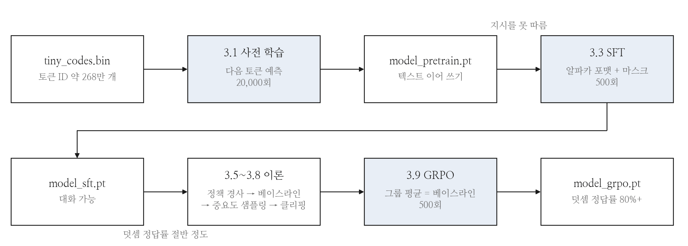

*3장의 흐름 — 학습 단계(색칠한 상자)마다 모델 파일이 하나씩 나오고, 각 모델의 한계(기울임 글씨)가 다음 단계를 부른다. (`ch03/diagrams.py`로 그린 그림)*

| 단계 | 시작 모델 | 데이터 | 손실/목적 함수 | 반복 | 얻는 능력 |
|---|---|---|---|---|---|
| 사전 학습 | 무작위 초기화 | TinyCodes 토큰열 | 교차 엔트로피 (모든 위치) | 20,000 | 파이썬 문법·패턴 |
| SFT | 사전 학습 모델 | 지시–응답 쌍 (JSON) | 교차 엔트로피 (**응답부만**) | 500 | 질문에 답하기 |
| GRPO | SFT 모델 | `1+1=` ~ `9+9=` 81문제 | 클리핑된 정책 경사 목적 함수 | 500 | 계산 정확도 |

---

## 3.1 사전 학습 — `ch03/01_pretrain.py`

**사전 학습** = 대량의 텍스트로 "다음 토큰 예측"을 반복해 언어 패턴을 익히는 과정이다.

### 데이터셋: 입력과 레이블은 한 칸 차이

1장에서 만든 `codebot/tiny_codes.bin`(토큰 ID 2,677,398개)을 그대로 쓴다.

```python
class TokenDataset(Dataset):
    def __init__(self, tokens, context_len):
        self.tokens = torch.tensor(tokens, dtype=torch.long)
        self.context_len = context_len

    def __len__(self):                      # 꺼낼 수 있는 샘플 수
        return len(self.tokens) - self.context_len

    def __getitem__(self, idx):
        x = self.tokens[idx : idx + self.context_len]          # 입력
        y = self.tokens[idx + 1 : idx + self.context_len + 1]  # 레이블 = 한 칸 뒤
        return x, y

ids = np.fromfile('codebot/tiny_codes.bin', dtype=np.uint16)
dataloader = DataLoader(TokenDataset(ids, 256), batch_size=32, shuffle=True)
# 입력 (32, 256), 레이블 (32, 256)
```

- `DataLoader`는 `__len__()`으로 크기를 파악하고 `__getitem__()`으로 샘플을 꺼내 배치로 묶는다.
- `shuffle=True` → 에포크마다 순서가 섞인다.

> 💡 **문서 경계는 신경 쓰지 않는다** — 샘플이 `<|endoftext|>`를 가로질러 잘려도 괜찮다. 모델이 학습 중에 "이 토큰 뒤에는 새 문서가 시작된다"는 사실을 스스로 배운다. 대부분의 LLM 사전 학습이 이렇게 한다.

### 디바이스 선택 — `codebot/utils.py`

```python
def get_device():
    if torch.cuda.is_available():            # 1순위: NVIDIA GPU
        return torch.device('cuda')
    elif torch.backends.mps.is_available():  # 2순위: 애플 실리콘 (MPS)
        return torch.device('mps')
    else:                                    # 3순위: CPU
        return torch.device('cpu')
```

### 하이퍼파라미터

| 항목 | 값 | 비고 |
|---|---|---|
| `context_len` | 256 | |
| `vocab_size` | 1000 | 1장 토크나이저 |
| `batch_size` | 32 | |
| `learning_rate` | 3e-4 | 옵티마이저는 **AdamW** (원리는 6.1절) |
| `max_iters` | 20,000 | |
| `embed_dim` / `n_head` / `n_layer` | 384 / 6 / 6 | |
| `ff_dim` | `4 * embed_dim` | 보통 임베딩 차원의 4배 |
| `dropout_rate` | 0.1 | |

→ 파라미터 약 **11M개**, 저장 파일 약 45MB.

### 학습 루프

```python
data_iter = cycle(dataloader)          # ❶ 데이터가 끝나면 처음부터 다시 → 무한 반복
for i in tqdm(range(max_iters)):
    batch_x, batch_y = next(data_iter)
    batch_x, batch_y = batch_x.to(device), batch_y.to(device)

    logits = model(batch_x)            # (B, C, V)
    loss = F.cross_entropy(            # ❷ (B*C, V) vs (B*C)로 펼쳐서 위치별 평가
        logits.view(-1, logits.size(-1)), batch_y.view(-1))

    optimizer.zero_grad()              # 이전 기울기 초기화
    loss.backward()                    # 기울기 계산
    optimizer.step()                   # 파라미터 갱신

model.save('codebot/model_pretrain.pt')
```

- ❶ `cycle()` 덕분에 에포크 단위가 아니라 **반복 횟수 단위**로 학습을 제어한다.
- ❷ `F.cross_entropy()`는 2차원 로짓과 1차원 레이블을 받으므로 `view()`로 형상을 바꾼다.

**교차 엔트로피 오차** — 정답 토큰 $y$에 모델이 준 확률을 $p_y$라 하면

$$
L = -\log p_y
$$

다음 토큰 예측은 "어휘 전체 중 하나를 고르는" 다중 클래스 분류이므로 이 손실을 쓴다. 손실을 줄이면 정답 토큰의 확률이 올라간다.

### 학습 결과

| 환경 | 소요 시간 (20,000회) |
|---|---|
| GPU (RTX 4090) | 약 10분 |
| 애플 실리콘 (M2 맥북에어) | 약 3시간 |
| CPU | 10시간 이상 |

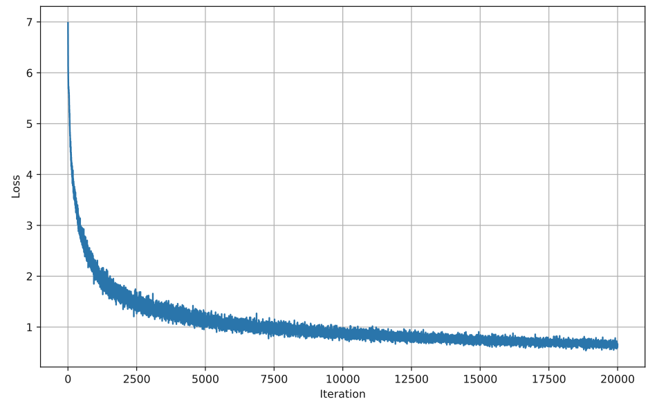

*그림 3-1 — 사전 학습의 손실 추이. 약 7에서 시작해 1 아래로 꾸준히 떨어진다.*

> 💡 초기 손실이 약 7인 것은 우연이 아니다. 어휘 1,000개에 균등한 확률을 주면 $-\log(1/1000) = \ln 1000 \approx 6.9$이다. 아무것도 모르는 상태에서 출발했다는 뜻이다.

> ⚠️ 이 장은 단순화를 위해 **훈련 데이터만** 쓴다. 검증 데이터로 과대적합을 감시하는 방법은 6장에서 다룬다.

> 💡 GPU가 없으면 `codebot/download.sh`로 사전 학습·SFT·GRPO 모델을 모두 내려받을 수 있다.

---

## 3.2 텍스트 생성 — `ch03/02_generate.py`

### 생성 과정

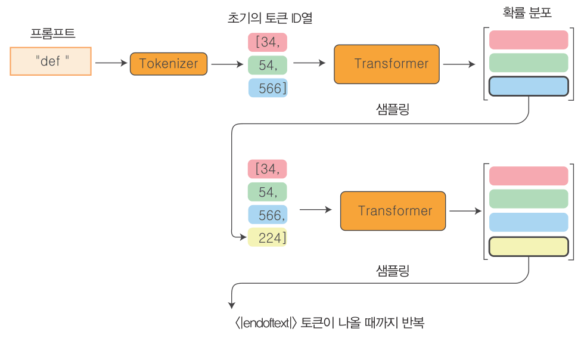

*그림 3-2 — 프롬프트를 토큰화해 트랜스포머에 넣고, 마지막 위치의 확률 분포에서 토큰을 하나 샘플링해 뒤에 붙인다. `<|endoftext|>`가 나올 때까지 반복한다.*

1. **토큰화** — 프롬프트 → 토큰 ID열
2. **예측** — 트랜스포머는 위치마다 분포를 내지만, 필요한 건 **마지막 위치**의 분포뿐이다
3. **샘플링** — 그 분포에서 토큰 하나 선택
4. **갱신** — 선택한 토큰을 ID열 끝에 추가
5. **반복** — `<|endoftext|>`가 나올 때까지 2~4단계

### 샘플링 전략

**온도(temperature)** — 로짓을 $T$로 나눈 뒤 소프트맥스를 적용한다.

$$
p_i = \frac{\exp(l_i / T)}{\sum_j \exp(l_j / T)}
$$

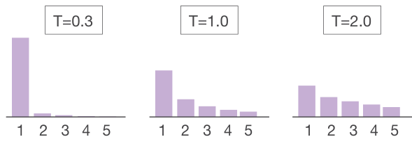

*그림 3-3 — 후보 5개의 분포. T=0.3이면 1번 토큰에 확률이 몰리고, T=2.0이면 고르게 퍼진다.*

| 온도 | 분포 | 출력 |
|---|---|---|
| $T \to 0$ | 최댓값에 집중 (argmax) | **결정적**, 무작위성 없음 |
| $T = 1$ | 모델 분포 그대로 | |
| $T > 1$ | 평평해짐 | 다양하지만 엉뚱한 토큰도 나옴 |

**후보 좁히기** — 확률이 너무 낮은 토큰이 뽑히는 일을 막는다.

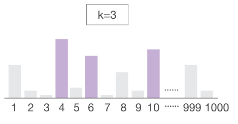

*그림 3-4 — Top-k (k=3): 확률 상위 3개 토큰만 후보로 남긴다.*

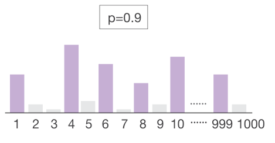

*그림 3-5 — Top-p (p=0.9): 확률이 높은 순으로 누적 확률이 0.9에 이를 때까지 후보에 넣는다.*

| 방법 | 후보 수 | 특징 |
|---|---|---|
| Top-k | 항상 k개 고정 | k↓ 안정, k↑ 다양 |
| Top-p (Nucleus) | **문맥에 따라 자동 조절** | 다음 토큰이 뻔하면 후보가 적고, 불확실하면 많다 |

### 구현 (온도만 지원)

```python
@torch.no_grad()                                 # 생성할 때는 기울기 불필요
def generate(model, tokenizer, prompt, max_new_tokens=1000, temperature=1.0):
    model.eval()                                 # 드롭아웃 끄기
    device = next(model.parameters()).device     # 모델이 올라간 디바이스
    ids = torch.tensor([tokenizer.encode(prompt)], dtype=torch.long, device=device)
    generated_ids = ids.clone()

    for _ in range(max_new_tokens):
        if ids.size(1) > model.max_context_len:          # 컨텍스트 초과 시 최근 것만
            ids = ids[:, -model.max_context_len:]
        logits = model(ids)[:, -1, :]                    # 마지막 위치의 로짓
        if temperature == 0:
            next_id = logits.argmax(dim=-1, keepdim=True)
        else:
            probs = F.softmax(logits / temperature, dim=-1)
            next_id = torch.multinomial(probs, num_samples=1)
        if next_id.item() == tokenizer.end_token_id:     # 종료 토큰이면 중단
            break
        ids = torch.cat((ids, next_id), dim=1)
        generated_ids = torch.cat((generated_ids, next_id), dim=1)

    return tokenizer.decode(generated_ids[0].tolist())
```

- `ids`는 모델 입력용(잘릴 수 있음), `generated_ids`는 전체 결과 보관용이다.
- 이 함수는 이후에도 쓰이므로 `codebot/utils.py`에 들어 있다.

### 실행 결과 (`prompt="def"`, `temperature=1.0`)

```text
--- 샘플 1 ---
def label_predict(X):
    X_test_pred = X.predict(X)
    return model_pred

--- 샘플 2 ---
def rmse_items_by_char(s):
    result = []
    for num in s:
        if num not in result:
            result.append(num)
    return result
```

→ `def` → 들여쓰기 → `return`으로 이어지는 함수 구조를 익혔다. `label_predict`, `rmse_items_by_char` 같은 이름은 **학습 데이터에 없던** 것이다. 외운 게 아니라 패턴을 응용했다는 뜻이다(변수명이 서로 안 맞는 등 의미까지 맞지는 않는다).

---

## 3.3 SFT (지도 파인튜닝) — `ch03/03_alpaca.py`, `ch03/03_sft.py`

사전 학습 모델은 `"Hello"`를 넣으면 `" World..."`처럼 **이어 쓸** 뿐 대답하지 않는다. SFT는 이미 가진 지식은 그대로 두고 **"질문을 받으면 답한다"는 사용법**만 가르치므로, 적은 데이터로도 효과가 크다.

### 데이터와 알파카 포맷

`codebot/tiny_codes_sft.json`:

```json
[
  {"instruction": "Hello", "response": "Hello. What can I help you with?"},
  {"instruction": "create a for loop from 1 to 5", "response": "for i in range(1, 6):\n    print(i)"},
  {"instruction": "3+5=", "response": "8"}
]
```

지시–응답 쌍을 **하나의 텍스트**로 만들어야 토큰화할 수 있다. 이 책은 **알파카 포맷**을 쓴다.

```text
### Instruction:
Hello

### Response:
Hello. What can I help you with?<|endoftext|>
```

- `### Instruction:` / `### Response:` 마커로 구역을 나눈다.
- 응답 끝의 `<|endoftext|>`로 "답은 여기서 끝"을 배운다.
- 이 장은 **1턴 대화**만 다룬다. (알파카의 `### Input:` 필드는 쓰지 않음)

```python
text = f"### Instruction:\n{item['instruction']}\n\n### Response:\n{item['response']}<|endoftext|>"
tokenizer.encode(text)   # [35, 35, 35, 962, ..., 932, 657, 63, 999]   ← 999 = <|endoftext|>
```

### 마스크 처리: 응답부만 손실 계산

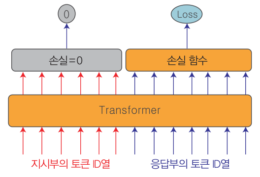

*그림 3-6 — 지시부의 손실은 0으로 두고, 응답부 토큰에 대해서만 손실을 계산한다.*

- 그대로 학습하면 지시문까지 예측 대상이 된다 → 배우고 싶은 건 "지시에 맞는 **응답** 생성"이다.
- `F.cross_entropy()`의 `ignore_index`(기본값 **-100**)를 이용해, 레이블이 -100인 위치를 손실에서 뺀다.

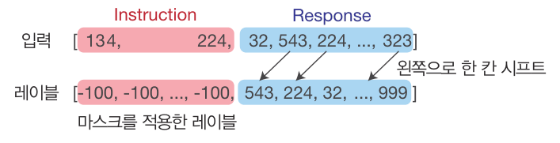

*그림 3-7 — 입력을 왼쪽으로 한 칸 시프트해 레이블을 만들고, 지시부 위치를 -100으로 채운다. 레이블 끝은 999(`<|endoftext|>`)다.*

> 💡 지시부도 손실에 넣는 편이 나을 때도 있다는 연구가 최근 나왔다 [Huerta-Enochian & Ko, 2024] [Shi et al., 2024]. 전통적으로는 마스킹을 많이 썼다.

### 패딩

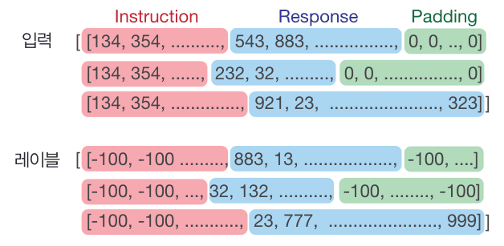

*그림 3-8 — 길이가 다른 샘플을 배치로 묶기 위해 패딩(0)을 붙이고, 패딩 위치의 레이블도 -100으로 둔다.*

- 그림처럼 **배치 안 최대 길이**에 맞추면 패딩이 가장 적지만 구현이 복잡하다.
- 이 책은 간단하게 **고정 길이 `context_len`(256)** 에 맞춘다.

### `SFTDataset`

```python
def _create_sample(self, instruction, response):
    prompt   = f"### Instruction:\n{instruction}\n\n### Response:\n"
    response = f"{response}<|endoftext|>"
    prompt_ids   = self.tokenizer.encode(prompt)
    response_ids = self.tokenizer.encode(response)

    ids    = prompt_ids + response_ids
    labels = [-100] * len(prompt_ids) + response_ids   # 지시부 마스킹

    ids, labels = ids[:-1], labels[1:]                 # 한 칸 시프트

    pad_len = self.context_len - len(ids)
    if pad_len > 0:                                    # 패딩
        ids    = ids + [0] * pad_len                   # 패딩 ID = 0
        labels = labels + [-100] * pad_len             # 패딩도 손실 제외
    elif pad_len < 0:                                  # 잘라내기
        ids, labels = ids[:self.context_len], labels[:self.context_len]
    return ids, labels
```

> ⚠️ 프롬프트와 응답을 **따로 인코딩해서 이어 붙인다**. 통째로 인코딩하면 경계에서 BPE 병합이 일어나 지시부/응답부 구분이 흐려질 수 있기 때문이다.

### 학습 루프 — 사전 학습과 달라진 4가지

```python
max_iters = 500                                              # ❶ 20,000 → 500
dataset = SFTDataset(data_path, tokenizer, context_len)      # ❷ SFT용 데이터셋
model = GPT.load_from('codebot/model_pretrain.pt', device=device)  # ❸ 사전 학습 모델에서 시작
...
loss = F.cross_entropy(
    logits.view(-1, logits.size(-1)), batch_y.view(-1),
    ignore_index=-100)                                       # ❹ 기본값이지만 의도를 명시
...
model.save('codebot/model_sft.pt')
```

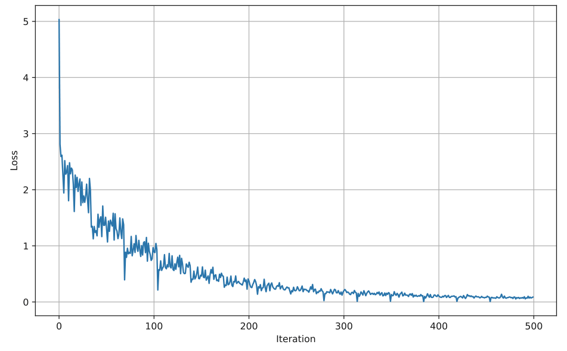

*그림 3-9 — SFT의 손실 추이. 사전 학습(약 7)보다 낮은 약 5에서 시작해 금방 0 근처로 내려간다.*

→ 사전 학습 모델이 이미 파이썬과 영어(주석)를 알고 있어서 시작점이 낮고, 빠르게 수렴한다.

---

## 3.4 SFT 모델과 나누는 대화 — `ch03/04_chat.py`

```python
def format_prompt(user_message):          # 학습 때와 같은 알파카 포맷
    return f"### Instruction:\n{user_message}\n\n### Response:\n"

while True:
    user_input = input("\nYou: ").strip()
    if not user_input:
        continue
    response = generate(model, tokenizer, format_prompt(user_input),
                        max_new_tokens, temperature)
    if "### Response:" in response:       # 응답 부분만 잘라냄
        response = response.split("### Response:")[-1].strip()
    print(f"Bot:\n{response}" if "\n" in response else f"Bot: {response}")
```

```text
You: Hello
Bot: Hello. What do you need?
You: Who are you?
Bot: I'm CodeBot. How can I assist you today?
You: write loop
Bot:
for i in range(10):
    if i == 5:
        break
```

→ 500회 학습만으로 대화형 어시스턴트의 기본기를 갖췄다. 다만 데이터가 작아서 학습 데이터와 비슷한 단순 지시에만 잘 반응한다.

### 계산 능력: 절반 정도만 맞힌다

```text
You: 1+3=   Bot: 4    ✅
You: 5+5=   Bot: 10   ✅
You: 1+8=   Bot: 10   ❌
You: 7+8=   Bot: 16   ❌
```

> 💡 **LLM은 계산하지 않는다** — `"1+3="`도 모델에게는 토큰의 나열일 뿐이다. 학습 데이터에서 본 패턴으로 "그럴듯한 다음 토큰"을 고를 뿐이라, 자주 본 패턴은 맞히고 드문 패턴은 틀린다. → 강화 학습으로 개선한다.

---

## 3.5 강화 학습과 언어 모델

> 💡 **읽는 방법** — 이론부터 차근차근 보려면 3.5절부터, 구현과 결과만 보려면 3.9절로 바로 가도 된다.

### 대응 관계

| 강화 학습 용어 | 언어 모델에서의 의미 |
|---|---|
| 에이전트 | 언어 모델 자체 |
| 상태 $s_t$ | 시점 $t$까지 생성된 텍스트 |
| 행동 $a_t$ | 시점 $t$에 생성할 토큰 |
| 정책 $\pi_\theta(a_t \mid s_t)$ | 다음 토큰의 확률 분포 (파라미터 $\theta$) |

### 궤적

다음 상태는 현재 상태에 새 토큰을 붙인 것이다($\oplus$ = 텍스트 연결).

$$
s_{t+1} = s_t \oplus a_t
$$

이를 반복해 얻은 상태·행동의 나열이 **궤적**(trajectory, = 롤아웃, 에피소드)이다.

$$
\tau = (s_0, a_0, s_1, a_1, \dots, s_T, a_T)
$$

$T$는 `<|endoftext|>`가 나오거나 최대 토큰 수에 도달한 마지막 단계다.

### 보상과 수익

- **보상** $r_t = r(s_t, a_t)$ — 각 단계 행동의 좋고 나쁨 (스칼라)
- **수익** $R(\tau)$ — 궤적 전체 보상의 합

$$
R(\tau) = \sum_{t=0}^{T} r_t
$$

**목표**: 수익의 기댓값을 최대화한다.

$$
J(\theta) = \mathbb{E}_{\tau \sim \pi_\theta}\left[ R(\tau) \right]
$$

> 💡 **할인율** — 끝없이 이어질 수 있는 문제에서는 $R(\tau) = \sum_{t=0}^{\infty} \gamma^t r_t \ (0 < \gamma < 1)$처럼 먼 미래 보상을 깎는다. 언어 생성은 반드시 끝나므로 이 책은 할인하지 않는다.

### 검증 가능한 과제의 보상

수학 문제처럼 정답을 확인할 수 있으면 **마지막 단계에서만** 보상을 준다.

$$
r_t = 0 \ (t < T), \qquad
r_T = \begin{cases} 1 & \text{정답} \\ 0 & \text{그 외} \end{cases}
\qquad\Rightarrow\qquad R(\tau) = r_T
$$

→ 이 경우 보상과 수익이 같아지므로 책에서도 두 용어를 엄밀히 구분하지 않는다.

---

## 3.6 정책 경사법

**정책 경사법**은 정책의 파라미터 $\theta$를 직접 최적화한다. 목적 함수를 **최대화**하므로 기울기를 더하는 **경사 상승법**을 쓴다.

$$
\theta_{k+1} = \theta_k + \alpha \nabla_\theta J(\theta_k)
$$

핵심은 $\nabla_\theta J(\theta)$를 어떻게 구하느냐다.

### 유도

$$
\begin{aligned}
\nabla_\theta J(\theta)
&= \nabla_\theta \sum_\tau P(\tau \mid \theta) R(\tau) && \text{(기댓값의 정의)} \\
&= \sum_\tau \nabla_\theta P(\tau \mid \theta) R(\tau) && \text{(}\nabla_\theta\text{를 합 안으로)} \\
&= \sum_\tau P(\tau \mid \theta) \nabla_\theta \log P(\tau \mid \theta) R(\tau) && \text{(로그 미분 트릭)} \\
&= \mathbb{E}_{\tau \sim \pi_\theta}\left[ \nabla_\theta \log P(\tau \mid \theta) R(\tau) \right] && \text{[식 3.1]}
\end{aligned}
$$

> 💡 **로그 미분 트릭** — $\nabla_\theta \log f(\theta) = \dfrac{\nabla_\theta f(\theta)}{f(\theta)}$의 양변에 $f(\theta)$를 곱하면 $\nabla_\theta f(\theta) = f(\theta) \nabla_\theta \log f(\theta)$. 이렇게 하면 다시 $P$에 대한 기댓값 꼴로 돌아올 수 있어 **샘플링으로 근사**할 수 있게 된다.

궤적의 확률을 풀어 쓰면

$$
P(\tau \mid \theta) = \rho_0(s_0) \prod_{t=0}^{T} P(s_{t+1} \mid s_t, a_t)\, \pi_\theta(a_t \mid s_t)
$$

- $\rho_0(s_0)$ — 초기 상태(프롬프트)의 분포
- $P(s_{t+1} \mid s_t, a_t)$ — 환경의 동역학 (언어 모델에서는 $s_{t+1} = s_t \oplus a_t$로 결정적)

로그를 취하면 곱이 합이 된다.

$$
\log P(\tau \mid \theta) = \log \rho_0(s_0) + \sum_{t=0}^{T} \left[ \log P(s_{t+1} \mid s_t, a_t) + \log \pi_\theta(a_t \mid s_t) \right]
$$

$\rho_0$와 $P(s_{t+1} \mid s_t, a_t)$는 $\theta$와 무관하므로 미분하면 사라지고 **정책 항만 남는다**.

$$
\nabla_\theta \log P(\tau \mid \theta) = \sum_{t=0}^{T} \nabla_\theta \log \pi_\theta(a_t \mid s_t)
$$

$$
\boxed{\nabla_\theta J(\theta) = \mathbb{E}_{\tau \sim \pi_\theta}\left[ \sum_{t=0}^{T} \nabla_\theta \log \pi_\theta(a_t \mid s_t)\, R(\tau) \right]} \qquad \text{[식 3.2] 정책 경사}
$$

> 💡 환경 모델을 몰라도 된다는 것이 핵심이다. 필요한 건 모델이 각 토큰에 준 로그 확률과 궤적의 수익뿐이다.

### 몬테카를로 근사 → REINFORCE

모든 궤적의 합은 계산할 수 없으므로 $N$개를 샘플링해 평균을 낸다.

$$
\hat{g} = \frac{1}{N} \sum_{i=1}^{N} \sum_{t=0}^{T} \nabla_\theta \log \pi_\theta\big(a_t^{(i)} \mid s_t^{(i)}\big)\, R\big(\tau^{(i)}\big) \qquad \text{[식 3.3]}
$$

$$
\theta_{k+1} = \theta_k + \alpha \hat{g}
$$

이것이 **REINFORCE** 알고리즘이다.

| 수익 $R(\tau)$ | 효과 |
|---|---|
| 양수 (좋은 궤적) | 그 궤적의 **모든 행동** 확률 ↑ |
| 음수 (나쁜 궤적) | 그 궤적의 모든 행동 확률 ↓ |
| 0 | 갱신에 영향 없음 |

**파이토치 구현용 손실** — 옵티마이저는 손실을 **최소화**하므로 마이너스를 붙인다.

$$
\text{loss} = -\frac{1}{N} \sum_{i=1}^{N} \sum_{t=0}^{T} \log \pi_\theta\big(a_t^{(i)} \mid s_t^{(i)}\big)\, R\big(\tau^{(i)}\big)
$$

---

## 3.7 베이스라인

[식 3.3]의 $`\hat{g}`$는 **불편 추정량**이다. 즉 $`\mathbb{E}_{\tau \sim \pi_\theta}[\hat{g}] = \nabla_\theta J(\theta)`$로, 평균적으로는 정확한 방향을 가리킨다. 문제는 **분산이 크다**는 점이다. 샘플마다 값이 크게 출렁여 학습이 불안정하고 느려진다.

### 직관: 절댓값이 아니라 상대적 우열로

| 상태 | 행동 | 보상 | 상태별 평균 | 보상 − 평균 |
|---|---|---|---|---|
| 상태 1 | A | 1000 | 999 | **+1** |
| 상태 1 | B | 999 | 999 | 0 |
| 상태 1 | C | 998 | 999 | **−1** |
| 상태 2 | X | 2 | 1 | **+1** |
| 상태 2 | Y | 1 | 1 | 0 |
| 상태 2 | Z | 0 | 1 | **−1** |

- 보상 그대로 쓰면: 상태 1에서는 A·B·C **모두** 강하게 강화되고(C는 피해야 하는데!), 상태 2에서는 같은 1점 차이인데도 갱신이 훨씬 약하다.
- 평균을 빼면: 어느 상태든 **+1, 0, −1**이라는 같은 척도로 비교된다.

이때 빼는 값이 **베이스라인**이다.

#### 확인: 평균 방향은 같고, 샘플 하나의 출렁임만 다르다

"C도 강화된다"는 말은 **샘플 하나**를 볼 때의 이야기다. 정책 경사는 한 번에 행동을 하나만 뽑아 그 행동의 $`\nabla_\theta \log \pi_\theta`$에 보상을 곱한다. 그래서 C가 뽑히면 C의 확률을 크게 올리는 기울기가 나온다. 하지만 기댓값(모든 행동을 확률대로 평균)으로는 베이스라인이 있든 없든 같은 방향이 된다. 상태 1에서 A, B, C를 1/3씩 고르는 정책(로짓 3개가 모두 0)으로 로짓에 대한 기울기를 직접 계산해 보면 다음과 같다.

| 뽑힌 행동 | 베이스라인 없음: 로짓 (A, B, C) 기울기 | 베이스라인 999: 로짓 (A, B, C) 기울기 |
|---|---|---|
| A (1000) | (+666.7, −333.3, −333.3) | (+0.7, −0.3, −0.3) |
| B (999) | (−333.0, +666.0, −333.0) | (0, 0, 0) |
| C (998) | (−332.7, −332.7, **+665.3**) | (+0.3, +0.3, **−0.7**) |
| 기댓값 | (+0.333, 0, −0.333) | (+0.333, 0, −0.333) |
| 분산 (세 성분 합) | 약 665,334 | 약 0.22 |

- 베이스라인이 없으면 C가 뽑힌 샘플은 C의 로짓을 +665 올린다. A와 B가 뽑힌 샘플이 반대로 밀어 주어야 평균이 (+0.333, 0, −0.333)으로 맞춰지므로, 올바른 방향을 얻으려면 샘플이 아주 많이 필요하다. 이것이 "분산이 크다"의 뜻이다.
- 베이스라인 999를 빼면 기댓값은 그대로이고, 샘플 하나만 봐도 C는 내리고 A는 올린다. 분산은 약 300만분의 1로 줄었다.

### 베이스라인을 적용한 정책 경사

$$
\nabla_\theta J(\theta) = \mathbb{E}_{\tau \sim \pi_\theta}\left[ \sum_{t=0}^{T} \nabla_\theta \log \pi_\theta(a_t \mid s_t)\, \big(R(\tau) - b(s_t)\big) \right]
$$

- 대표적인 베이스라인: **가치 함수** $`V^\pi(s) = \mathbb{E}_{\tau \sim \pi_\theta}\left[ R(\tau) \mid s_t = s \right]`$
- $R(\tau) - b(s_t)$ = **어드밴티지(advantage)** — 기대치보다 얼마나 좋았는가
- 베이스라인이 **행동에 의존하지 않는 한**, 넣어도 기댓값은 변하지 않는다(**불편성 유지**). 방향은 그대로 두고 출렁임만 줄인다. → 증명은 부록 C

> 💡 직관적으로는 $`\mathbb{E}_{a \sim \pi_\theta}\left[\nabla_\theta \log \pi_\theta(a \mid s)\right]`$ $`= \nabla_\theta \sum_a \pi_\theta(a \mid s)`$ $`= \nabla_\theta 1 = 0`$이기 때문이다. $`b(s)`$를 곱한 항은 기댓값이 0이 된다.

### GRPO: 그룹 평균을 베이스라인으로

가치 함수는 좋은 베이스라인이지만, 추정하려면 **별도의 신경망**을 학습해야 해서 LLM에서는 비용이 크다. **GRPO**(Group Relative Policy Optimization) [Shao et al., 2024]의 아이디어는 단순하다.

> **같은 질문 $q$로 답변을 $G$개 생성하고, 그 수익의 평균을 베이스라인으로 쓴다.**

답변 $\{o^{(1)}, \dots, o^{(G)}\}$의 수익을 $R^{(i)} = R(q, o^{(i)})$라 하면

$$
A^{(i)} = R^{(i)} - \operatorname{mean}\big(R^{(1)}, R^{(2)}, \dots, R^{(G)}\big) \qquad \text{[식 3.5]}
$$

- $A^{(i)} > 0$ → 그룹 평균보다 좋은 답 → 확률 ↑
- $A^{(i)} < 0$ → 평균보다 나쁜 답 → 확률 ↓

예: $G=8$개 중 정답 6개(보상 1)·오답 2개(보상 0)라면 평균 0.75 → 정답 $A = +0.25$, 오답 $A = -0.75$. **전부 맞거나 전부 틀리면 $A$가 모두 0**이 되어 학습 신호가 없다.

| | 원래 GRPO | **Dr. GRPO** (이 책) |
|---|---|---|
| 어드밴티지 | $\dfrac{R^{(i)} - \operatorname{mean}(R)}{\operatorname{std}(R)}$ (표준편차로 정규화) | $R^{(i)} - \operatorname{mean}(R)$ |
| 응답 길이 $\lvert o^{(i)} \rvert$로 정규화 | 함 | 안 함 |
| 특징 | | 두 정규화가 만드는 **편향 제거**, 구현이 쉽고 성능은 같거나 더 좋음 [Liu et al., 2025] |

---

## 3.8 오프-정책과 클리핑

GRPO를 실용적으로 만들려면 두 장치가 더 필요하다.

1. **오프-정책 학습** — 수집한 데이터를 재사용 (효율)
2. **클리핑** — 정책이 한 번에 크게 바뀌지 않게 (안정)

### 온-정책 vs 오프-정책

| | 온-정책 (REINFORCE) | 오프-정책 (PPO, GRPO) |
|---|---|---|
| 데이터 출처 | 지금 최적화 중인 $\pi_\theta$ | 고정해 둔 **옛 정책** $\pi_{\theta_\text{old}}$ |
| 한 번 샘플링으로 갱신 | 1회 | **여러 회** |
| 단점 | LLM은 생성 비용이 커서 비효율적 | $\pi_\theta$와 $\pi_{\theta_\text{old}}$가 벌어짐 → 보정 필요 |

오프-정책의 흐름:
1. 현재 정책을 $\pi_{\theta_\text{old}}$로 저장
2. $\pi_{\theta_\text{old}}$로 궤적 샘플링
3. 같은 궤적으로 $\pi_\theta$를 여러 번 갱신
4. 1로 돌아가기

### 중요도 샘플링

기댓값을 구하는 분포를 $\pi_\theta$에서 $\pi_{\theta_\text{old}}$로 바꾸고, 그 차이를 **가중치**로 보정한다.

$$
\begin{aligned}
\nabla_\theta J(\theta)
&= \sum_\tau P(\tau \mid \theta) \sum_{t=0}^{T} \nabla_\theta \log \pi_\theta(a_t \mid s_t) R(\tau) \\
&= \sum_\tau P(\tau \mid \theta_\text{old}) \frac{P(\tau \mid \theta)}{P(\tau \mid \theta_\text{old})} \sum_{t=0}^{T} \nabla_\theta \log \pi_\theta(a_t \mid s_t) R(\tau) \\
&= \mathbb{E}_{\tau \sim \pi_{\theta_\text{old}}}\left[ \frac{P(\tau \mid \theta)}{P(\tau \mid \theta_\text{old})} \sum_{t=0}^{T} \nabla_\theta \log \pi_\theta(a_t \mid s_t) R(\tau) \right]
\end{aligned}
$$

궤적 확률을 분해하면 $\rho_0$와 환경 동역학이 분자·분모에서 소거되어 **정책의 비만 남는다**.

$$
\frac{P(\tau \mid \theta)}{P(\tau \mid \theta_\text{old})} = \prod_{t=0}^{T} \frac{\pi_\theta(a_t \mid s_t)}{\pi_{\theta_\text{old}}(a_t \mid s_t)}
$$

### 중요도 가중치 근사

토큰이 많으면 확률비를 수백 번 곱하게 되어 값이 폭주하거나 0으로 사라진다(**분산 폭발**). 그래서 궤적 전체의 곱 대신 **각 단계의 확률비로 그 단계만** 보정한다.

$$
\nabla_\theta J(\theta)
= \mathbb{E}_{\tau \sim \pi_{\theta_\text{old}}}\left[ \prod_{t=0}^{T} \frac{\pi_\theta(a_t \mid s_t)}{\pi_{\theta_\text{old}}(a_t \mid s_t)} \sum_{t=0}^{T} \nabla_\theta \log \pi_\theta(a_t \mid s_t) R(\tau) \right]
\approx \mathbb{E}_{\tau \sim \pi_{\theta_\text{old}}}\left[ \sum_{t=0}^{T} \frac{\pi_\theta(a_t \mid s_t)}{\pi_{\theta_\text{old}}(a_t \mid s_t)} \nabla_\theta \log \pi_\theta(a_t \mid s_t) R(\tau) \right]
\quad \text{[식 3.6]}
$$

→ 엄밀하지는 않지만, 두 정책이 비슷하면 각 비율이 1에 가까워 괜찮다.

#### 확인: 근사는 확률비가 1 근처일 때만 맞는다

얼마나 비슷해야 하는지 작은 예로 확인했다. 토큰 4개를 차례로 고르고(단계마다 후보 2개, 단계마다 따로 둔 로짓), 4개 중 3개 이상이 정해진 토큰이면 보상 1을 준다. 궤적이 16개뿐이라 기댓값을 샘플링 없이 정확히 계산할 수 있다. $`\theta = \theta_\text{old} + \varepsilon d`$($`d`$는 무작위 방향)로 정책을 옮기면서 정확한 기울기와 [식 3.6]을 비교했다.

| $`\varepsilon`$ | 토큰별 확률비의 범위 | [식 3.6]의 상대 오차 |
|---|---|---|
| 0 | 1.00 ~ 1.00 | 0 |
| 0.05 | 0.93 ~ 1.03 | 1.9% |
| 0.2 | 0.73 ~ 1.11 | 6.9% |
| 0.5 | 0.43 ~ 1.23 | 13.9% |
| 1.0 | 0.16 ~ 1.44 | 20.9% |
| 2.0 | 0.02 ~ 1.87 | 32.7% |

- $`\theta = \theta_\text{old}`$에서는 오차가 0이다(아래 💡의 "REINFORCE와 같아진다").
- 확률비가 1에서 멀어질수록 오차가 커진다. 그래서 확률비를 1 근처에 붙잡아 두는 장치가 필요하고, 그것이 다음 절의 **클리핑**이다. 클리핑이 확률비를 직접 자르는 것은 아니다. 범위를 벗어난 토큰의 기울기를 0으로 만들어 그쪽으로 더 밀지 않게 한다. 3.9절의 작은 학습률(7e-6)과 생성당 2번뿐인 갱신도 정책이 멀리 가지 않게 하는 데 한몫한다.

**구현용 목적 함수** — 파이토치에서는 목적 함수를 정의하고 역전파한다. 아래 식을 미분하면 [식 3.6]이 나온다.

$$
J(\theta) = \mathbb{E}_{\tau \sim \pi_{\theta_\text{old}}}\left[ \sum_{t=0}^{T} \frac{\pi_\theta(a_t \mid s_t)}{\pi_{\theta_\text{old}}(a_t \mid s_t)} R(\tau) \right]
$$

> 💡 확인: $\nabla_\theta \dfrac{\pi_\theta}{\pi_{\theta_\text{old}}} = \dfrac{\pi_\theta}{\pi_{\theta_\text{old}}} \nabla_\theta \log \pi_\theta$ (로그 미분 트릭, $\pi_{\theta_\text{old}}$는 상수). 특히 $\theta = \theta_\text{old}$일 때 비율은 1이므로 기울기가 정확히 REINFORCE와 같아진다.

### 클리핑 (PPO)

두 정책이 너무 벌어지면 위 근사가 무너진다. 그래서 확률비 $r_t(\theta) = \dfrac{\pi_\theta(a_t \mid s_t)}{\pi_{\theta_\text{old}}(a_t \mid s_t)}$가 일정 범위를 넘으면 **목적 함수가 더 커지지 않게** 막는다.

| 경우 | 목적 함수를 키우려면 | 막는 방법 | 예 ($\epsilon = 0.2$) |
|---|---|---|---|
| $R(\tau) \ge 0$ | 비율 ↑ | $\min\big(r_t R,\ (1+\epsilon) R\big)$ — **상한** | 비율이 1.2를 넘어도 이득 없음 |
| $R(\tau) < 0$ | 비율 ↓ | $\min\big(r_t R,\ (1-\epsilon) R\big)$ — **하한** | 비율이 0.8 아래로 가도 이득 없음 |

합쳐 쓰면

$$
J^{\text{clip}}(\theta) = \mathbb{E}_{\tau \sim \pi_{\theta_\text{old}}}\left[ \sum_{t=0}^{T} \min\Big( r_t(\theta) R(\tau),\ g\big(\epsilon, R(\tau)\big) \Big) \right],
\qquad
g(\epsilon, R) = \begin{cases} (1+\epsilon) R & R \ge 0 \\ (1-\epsilon) R & R < 0 \end{cases}
$$

PPO 논문은 이와 동등하면서 구현하기 쉬운 형태를 쓴다(동등성 증명은 [Achiam, 2018]).

$$
J^{\text{clip}}(\theta) = \mathbb{E}_{\tau \sim \pi_{\theta_\text{old}}}\left[ \sum_{t=0}^{T} \min\Big( r_t(\theta) R(\tau),\ \operatorname{clip}\big(r_t(\theta), 1-\epsilon, 1+\epsilon\big) R(\tau) \Big) \right]
$$

- $\operatorname{clip}(x, a, b)$ = $x$를 $[a, b]$로 자른다.
- 실제로는 $R(\tau)$ 대신 $R(\tau) - b$(어드밴티지)를 쓴다. GRPO의 $b$는 그룹 평균이다.

> 💡 왜 `min`인가 — 비율이 "목적 함수를 **더 좋게** 만드는 쪽"으로 범위를 벗어나면 `clip` 항이 선택되어 기울기가 0이 된다. 반대로 "나빠지는 쪽"으로 벗어난 경우에는 `min`이 원래 항을 골라 그대로 벌을 준다. 즉 이득은 제한하고 손해는 제한하지 않는 **비관적 하한**이다.

#### GRPO에서는 $`A`$의 부호가 상한·하한을 고른다

위 표의 $`R(\tau)`$ 자리에 어드밴티지 $`A`$가 들어가므로, 표의 두 경우는 그대로 "$`A \ge 0`$이면 상한, $`A < 0`$이면 하한"이 된다. GRPO에서 $`A > 0`$은 그룹 평균보다 나은 응답(예: 정답), $`A < 0`$은 못한 응답(예: 오답)이다. 3.7절의 예($`A = +0.25`$, $`-0.75`$)로 토큰 하나의 목적 함수 $`\min(rA,\ \mathrm{clip}(r, 0.8, 1.2)A)`$와 $`r`$에 대한 기울기를 파이토치로 계산하면 다음과 같다.

| $`A`$ | 확률비 $`r`$ | $`rA`$ | $`\mathrm{clip}(r)A`$ | min | 기울기 | 뜻 |
|---|---|---|---|---|---|---|
| +0.25 | 1.3 | 0.325 | 0.3 | 0.3 | 0 | 정답 토큰을 이미 충분히 올림 → 멈춤 |
| +0.25 | 0.7 | 0.175 | 0.2 | 0.175 | 0.25 | 정답 토큰이 오히려 내려감 → 다시 올림 |
| −0.75 | 0.7 | −0.525 | −0.6 | −0.6 | 0 | 오답 토큰을 이미 충분히 내림 → 멈춤 |
| −0.75 | 1.3 | −0.975 | −0.9 | −0.975 | −0.75 | 오답 토큰이 오히려 올라감 → 다시 내림 |

3.9절 끝 "한눈에 보기"의 그림 (b) 아래쪽 그래프가 이 두 경우를 그린 것이다.

---

## 3.9 GRPO — `ch03/09_grpo.py`

목표: SFT 모델의 **한 자릿수 덧셈**(`1+1=` ~ `9+9=`) 능력 개선.

### 알고리즘 (Dr. GRPO)

```text
입력: 정책 모델 π_θ, 보상 함수 R, 데이터셋 D
for iter in range(max_iters):
    D에서 배치 D_b를 B개 샘플링                          ┐
    옛 정책 설정: π_θold ← π_θ                            │ 데이터 수집
    각 질문 q ∈ D_b에 대해 답변 G개 샘플링 ~ π_θold(·|q)   │ (2~6단계)
    보상 R^(1..G) 계산                                    │
    어드밴티지 A^(i) = R^(i) − mean(R^(1..G))             ┘
    for k in range(n_update_per_generation):            ┐ 정책 갱신
        J_GRPO(θ)를 경사 상승법으로 최대화                 ┘ (7~8단계)
출력: π_θ
```

**GRPO 목적 함수**

$$
J_{\text{GRPO}}(\theta) = \mathbb{E}_{\tau \sim \pi_{\theta_\text{old}}}\left[ \sum_{t=0}^{T} \min\left( \frac{\pi_\theta(o_t \mid q, o_{<t})}{\pi_{\theta_\text{old}}(o_t \mid q, o_{<t})} A^{(i)},\ \operatorname{clip}\left( \frac{\pi_\theta(o_t \mid q, o_{<t})}{\pi_{\theta_\text{old}}(o_t \mid q, o_{<t})}, 1-\epsilon, 1+\epsilon \right) A^{(i)} \right) \right]
$$

- $q$ = 질문(프롬프트), $o_t$ = 응답의 $t$번째 토큰, $o_{<t}$ = 그 앞까지 생성된 응답
- 어드밴티지 $A^{(i)}$는 답변 단위로 하나 → 그 답변의 **모든 토큰에 같은 값**이 곱해진다

**몬테카를로 근사** ($B$ = 배치 크기, $G$ = 그룹 크기)

$$
J_{\text{GRPO}}(\theta) \approx \frac{1}{B \cdot G} \sum_{b=1}^{B} \sum_{g=1}^{G} \sum_{t=0}^{T} \min(\cdots)
$$

### 하이퍼파라미터

| 항목 | 값 | 의미 |
|---|---|---|
| `learning_rate` | **7e-6** | SFT(3e-4)보다 훨씬 작게 — 조금씩만 고친다 |
| `max_iters` | 500 | |
| `n_update_per_generation` | 2 | 한 번 생성한 데이터로 갱신하는 횟수 (오프-정책) |
| `epsilon` | 0.2 | 클리핑 범위 |
| `group_size` | 8 | 질문당 답변 수 $G$ |
| `batch_size` | 32 | 질문 수 $B$ → 반복마다 32 × 8 = **256개** 답변 생성 |
| `eval_interval` | 10 | |

모델은 두 개다: 학습 대상 `model`(현재 정책)과 데이터를 생성하는 `old_model`(옛 정책, 주기적으로 가중치 복사). 둘 다 SFT 모델에서 시작한다.

### 데이터셋과 배치

```python
class GRPODataset(Dataset):
    def __init__(self, tokenizer):
        self.tokenizer = tokenizer
        self.data = []
        for i in range(1, 10):
            for j in range(1, 10):                 # 81문제, SFT와 같은 알파카 포맷
                prompt = f"### Instruction:\n{i}+{j}=\n\n### Response:\n"
                self.data.append((prompt, i + j))  # (프롬프트, 정답)
```

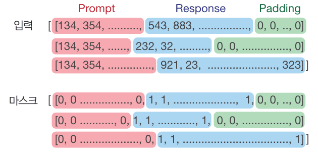

*그림 3-10 — 입력은 프롬프트 + 응답 + 패딩, 마스크는 응답 위치만 1이고 프롬프트와 패딩은 0이다.*

> ⚠️ 이 그림의 마스크는 **입력 토큰**에 맞춰 놓여 있지만, 손실에 쓰는 것은 한 칸 민 `mask[:, 1:]`이다(아래 `grpo_loss`). 위치 $`i`$의 출력은 토큰 $`i+1`$의 확률이기 때문이다(`compute_probs`의 `ids[:, 1:]`). 그래서 첫 응답 토큰의 확률은 **프롬프트의 마지막 토큰 위치**에서 나온다. `7+8=` → `15`(프롬프트 22토큰, 배치 최대 길이 28)로 확인하면, 확률 27개 중 마스크가 1인 것은 21번 위치(↵ → `1`)와 22번 위치(`1` → `5`) 두 개다. SFT에서 `labels[1:]`로 레이블을 한 칸 민 것과 같은 원리다.

```python
def get_batch(self, prompts, responses, device):
    all_ids, all_masks = [], []
    for prompt, response in zip(prompts, responses):
        prompt_ids   = self.tokenizer.encode(prompt)
        response_ids = self.tokenizer.encode(response)
        all_ids.append(prompt_ids + response_ids)
        all_masks.append([0] * len(prompt_ids) + [1] * len(response_ids))  # 응답만 1

    max_len = max(len(ids) for ids in all_ids)     # 배치 내 최대 길이에 맞춰 패딩
    padded_ids   = [ids  + [0] * (max_len - len(ids))  for ids  in all_ids]
    padded_masks = [mask + [0] * (max_len - len(mask)) for mask in all_masks]
    return (torch.tensor(padded_ids, dtype=torch.long, device=device),
            torch.tensor(padded_masks, dtype=torch.float, device=device))
```

| | SFT | GRPO |
|---|---|---|
| 제외 방법 | 레이블을 **-100**으로 (`ignore_index`) | **0/1 마스크**를 곱함 |
| 이유 | `cross_entropy` 사용 | `cross_entropy`를 쓰지 않음 |
| 패딩 길이 | 고정 `context_len` | 배치 내 최대 길이 |

### 보상 함수 — 정답이면 1, 아니면 0

```python
def calculate_reward(ground_truth, response):
    try:
        matches = re.findall(r'(-?\d+)', response)     # 부호 있는 정수 모두 추출
        if matches:
            predicted = int(matches[-1])               # 마지막 정수를 답으로 본다
            return 1.0 if predicted == ground_truth else 0.0
        return 0.0
    except:
        return 0.0
```

### 그룹 생성과 어드밴티지

```python
def generate_group(model, tokenizer, prompts, gts, group_size):
    all_prompts, all_responses, all_advantages = [], [], []
    for prompt, gt in zip(prompts, gts):
        responses = []
        for _ in range(group_size):                      # 같은 질문으로 G번 생성
            full_text = generate(model, tokenizer, prompt, temperature=1.0)  # 탐색
            responses.append(full_text[len(prompt):])    # 프롬프트 제거
        rewards = torch.tensor([calculate_reward(gt, r) for r in responses])
        advantages = rewards - rewards.mean()            # [식 3.5] 그룹 평균 = 베이스라인
        for response, advantage in zip(responses, advantages):
            all_prompts.append(prompt)
            all_responses.append(response)
            all_advantages.append(advantage)
    return all_prompts, all_responses, torch.stack(all_advantages)
```

> 💡 **응답에 `<|endoftext|>`가 없다** — `generate`(`codebot/utils.py`)는 종료 토큰이 뽑히면 `ids`에 붙이기 **전에** `break`한다. 그래서 `full_text[len(prompt):]`에는 종료 토큰이 없고, `get_batch`의 마스크에도 종료 위치가 생기지 않는다. 정답 응답 `15`라면 강화되는 토큰은 `1`, `5` 두 개뿐이다. SFT 레이블에는 `<|endoftext|>`가 들어 있어 "언제 끝낼지"도 배웠지만, GRPO에서는 종료 토큰의 확률이 보상으로 직접 올라가거나 내려가지 않는다.

### 토큰별 확률 — `torch.gather`

```python
def compute_probs(model, ids):
    logits = model(ids)                                   # (B, C, V)
    probs  = F.softmax(logits[:, :-1, :], dim=-1)         # (B, C-1, V)  마지막 위치는 예측할 다음 토큰이 없음
    labels = ids[:, 1:]                                   # (B, C-1)     실제로 나온 다음 토큰
    return torch.gather(probs, dim=-1,
                        index=labels.unsqueeze(-1)).squeeze(-1)  # (B, C-1)
```

| 변수 | 형상 |
|---|---|
| `probs` | (B, C−1, V) |
| `labels` | (B, C−1) |
| `labels.unsqueeze(-1)` | (B, C−1, 1) ← `index`는 `input`과 차원 수가 같아야 함 |
| `torch.gather(...)` | (B, C−1, 1) |
| `.squeeze(-1)` | (B, C−1) |

### GRPO 손실

```python
def grpo_loss(model, old_model, ids, mask, advantages, epsilon=0.2):
    probs = compute_probs(model, ids)                     # π_θ(o_t | q, o_<t)
    with torch.no_grad():
        old_probs = compute_probs(old_model, ids)         # π_θold — 상수 취급

    ratio = probs / (old_probs + 1e-8)                    # 확률비 (0 나눗셈 방지)
    advantages = advantages.unsqueeze(-1)                 # (N,) → (N, 1): 모든 토큰에 같은 A
    unclipped = ratio * advantages
    clipped   = torch.clamp(ratio, 1 - epsilon, 1 + epsilon) * advantages

    mask = mask[:, 1:]                                    # 확률과 맞춰 한 칸 시프트
    token_objective = torch.min(unclipped, clipped) * mask   # 응답 토큰만 남김

    n_samples = ids.size(0)                               # B × G
    return -token_objective.sum() / n_samples             # 최대화 → 마이너스 붙여 최소화
```

> 💡 **Dr. GRPO 정규화** — 응답 길이로 나누지 않고 **샘플 수(B×G)** 로만 나눈다. 수식의 $\frac{1}{B \cdot G}\sum_b \sum_g \sum_t$ 그대로다.

> 💡 확률비를 `probs / old_probs`로 직접 나눴다. 로그 확률 차이에 `exp`를 씌우는 방식도 흔한데, 수식상으로는 같다.

### 학습 루프

```python
for i in pbar:
    prompts, gts = next(data_iter)                            # ❶ 질문 32개
    old_model.load_state_dict(model.state_dict())             # ❷ 옛 정책 ← 현재 정책
    all_prompts, all_responses, all_advantages = generate_group(
        old_model, tokenizer, prompts, gts, group_size)       # ❸ 256개 생성 + 어드밴티지
    ids, mask = dataset.get_batch(all_prompts, all_responses, device)   # ❹ 텐서화
    all_advantages = all_advantages.to(device)

    for _ in range(n_update_per_generation):                  # ❺ 같은 데이터로 2번 갱신
        optimizer.zero_grad()
        loss = grpo_loss(model, old_model, ids, mask, all_advantages, epsilon)
        loss.backward()
        torch.nn.utils.clip_grad_norm_(model.parameters(), max_norm=1.0)  # 기울기 클리핑
        optimizer.step()

    if i % eval_interval == 0:                                # ❻ 81문제 전체로 정답률 측정
        model.eval()
        correct, total = 0, 0
        with torch.no_grad():
            for prompt, gt in dataset.data:
                response = generate(model, tokenizer, prompt, temperature=0)  # 활용
                correct += calculate_reward(gt, response) > 0
                total += 1
        model.train()
        accuracies.append(correct / total * 100)

model.save('codebot/model_grpo.pt')
```

- ❺ 첫 번째 갱신에서는 `model == old_model`이므로 비율이 1이고, 클리핑은 **두 번째 갱신부터** 실제로 작동할 수 있다.
- `clip_grad_norm_()`은 기울기 크기 자체를 자르는 것으로, 위의 **확률비 클리핑과는 다른 장치**다(6.5절에서 설명).

| | 온도 | 강화 학습 용어 | 목적 |
|---|---|---|---|
| 그룹 생성 (학습) | 1.0 | **탐색** (exploration) | 다양한 답을 시도해 좋은 답 발견 |
| 평가 | 0 | **활용** (exploitation) | 가장 확신하는 답으로 안정적으로 측정 |

### 실험 결과

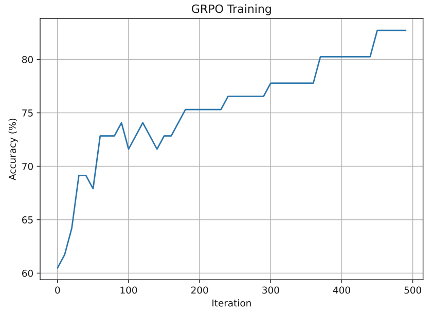

*그림 3-11 — GRPO 학습 중 81문제 정답률. 약 60%에서 출발해 출렁이며 오르다가 500회 무렵 80%를 넘는다.*

> ⚠️ 강화 학습에서는 **손실보다 보상(정답률) 추이**를 본다. 샘플링에 의존하므로 GRPO 손실은 단계마다 크게 출렁인다.

`ch03/04_chat.py`의 `model_path`를 `codebot/model_grpo.pt`로 바꿔 실행:

```text
$ python ch03/04_chat.py
You: 1+5=
Bot: 6
You: 8+3=
Bot: 11
You: 4+9=
Bot: 13
```

### 한눈에 보기: 세 단계가 손실을 만드는 방식

세 단계의 학습 코드를 나란히 놓으면 공통점이 보인다. 모두 모델이 "실제로 나온 다음 토큰"에 준 확률을 위치마다 구하고, 다른 것은 **어느 위치를 셀지와 무엇을 곱할지**뿐이다. (a)는 세 단계의 입력·정답·가중치를 실제 토큰으로 나란히 그린 것이고, (b)는 GRPO 반복 한 번에서 질문 하나를 펼친 것이다.

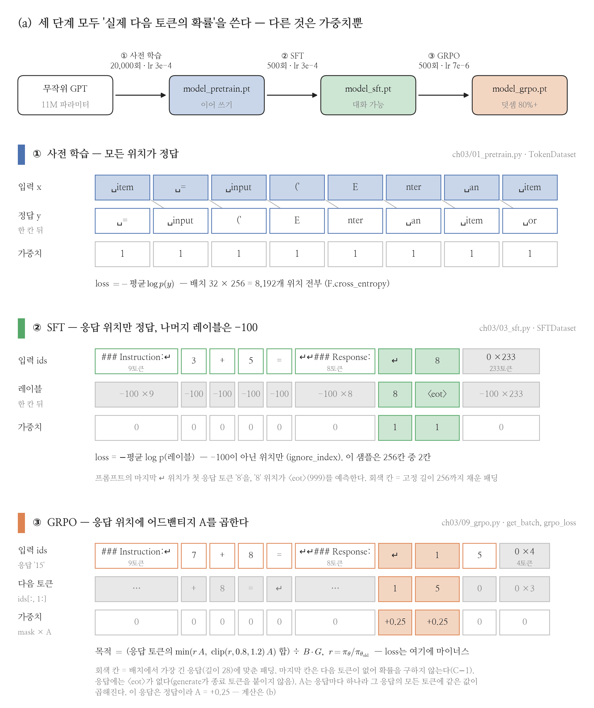

*그림 (a) — 사전 학습은 모든 위치에 가중치 1, SFT는 응답 위치에만 1(나머지 레이블은 -100), GRPO는 응답 위치에 어드밴티지 $`A`$를 곱한다. 사전 학습 토큰은 `tiny_codes.bin`, SFT 샘플은 `tiny_codes_sft.json`의 `3+5=`이고, ␣는 앞 공백, ↵는 줄바꿈이다. (`ch03/flow_graph.py`로 그린 그림)*

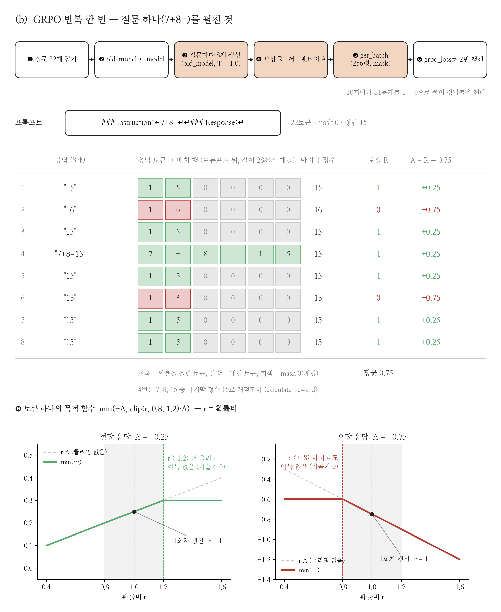

*그림 (b) — 질문 `7+8=`에 대한 그룹 8개. 응답 8개는 설명용 예시이고, 보상·어드밴티지·패딩은 `ch03/09_grpo.py`와 같은 방식으로 계산했다. 아래 그래프는 토큰 하나의 목적 함수 $`\min(rA,\ \mathrm{clip}(r, 0.8, 1.2)A)`$를 그대로 그린 것이다.*

- **세 단계 모두 같은 양을 쓴다.** 사전 학습과 SFT는 `F.cross_entropy`로 $`-\log p`$를, GRPO는 `compute_probs`로 $`p`$를 구하지만, 둘 다 "입력을 한 칸 민 토큰"의 확률이다. 그래서 SFT·GRPO 모두 입력과 레이블(마스크)을 한 칸씩 어긋나게 맞춘다.
- **프롬프트의 마지막 ↵ 위치가 첫 응답 토큰을 맡는다.** SFT의 `3+5=` 샘플은 256칸 중 2칸(↵→`8`, `8`→`<|endoftext|>`)만 손실에 들어가고, 나머지 254칸(지시부 21칸, 패딩 233칸)은 -100이다.
- **SFT는 끝내는 법도 배우지만 GRPO는 그렇지 않다.** SFT 레이블에는 `<|endoftext|>`가 있지만, GRPO 응답은 `generate`가 종료 토큰을 붙이지 않고 돌려준 텍스트라 `<|endoftext|>` 위치가 없다.
- **어드밴티지는 응답 하나에 값 하나다.** 정답 6개·오답 2개면 평균 0.75를 빼서 정답 응답의 모든 토큰에 +0.25, 오답 응답의 모든 토큰에 −0.75가 곱해진다. `"7+8=15"`처럼 식을 다시 쓴 응답도 마지막 정수가 15라 정답으로 채점되어, 그 6개 토큰이 모두 강화된다.
- **패딩 길이가 다르다.** SFT는 고정 길이 256까지, GRPO는 배치에서 가장 긴 행(여기서는 프롬프트 22 + `7+8=15`의 6 = 28)까지 채운다. 둘 다 패딩 위치는 손실에서 뺀다(-100 / mask 0).
- **클리핑은 두 번째 갱신부터 일한다.** 첫 갱신은 $`r = 1`$(검은 점)에서 시작해 클리핑이 없는 식과 기울기가 같다. 갱신 뒤 $`r`$이 정답 응답에서 1.2를 넘거나 오답 응답에서 0.8 아래로 가면 그래프가 평평해져 더는 그쪽으로 밀지 않는다.

---

## 핵심 정리

- **사전 학습**: 입력과 한 칸 밀린 레이블로 교차 엔트로피를 최소화한다. 11M 파라미터 GPT를 20,000회 학습하면 손실이 약 7(= ln 1000)에서 1 아래로 내려가고, 문법에 맞는 새 파이썬 함수를 생성한다.
- **텍스트 생성**: 마지막 위치의 분포에서 샘플링해 붙이기를 반복한다. 온도·Top-k·Top-p로 무작위성을 조절한다.
- **SFT**: 알파카 포맷으로 지시–응답을 한 텍스트로 만들고, 지시부·패딩의 레이블을 **-100**으로 두어 **응답부만** 학습한다. 500회면 대화가 된다.
- **정책 경사**: $\nabla_\theta J = \mathbb{E}\left[\sum_t \nabla_\theta \log \pi_\theta(a_t \mid s_t) R(\tau)\right]$. 로그 미분 트릭 덕분에 환경 모델 없이 샘플로 추정할 수 있다(REINFORCE).
- **베이스라인**: $R - b(s)$로 불편성은 유지하고 분산만 줄인다. **GRPO**는 가치 신경망 대신 **같은 질문에 대한 답변 그룹의 평균**을 베이스라인으로 쓴다(이 책은 표준편차·길이 정규화를 뺀 Dr. GRPO).
- **오프-정책 + 클리핑**: 옛 정책으로 생성한 데이터를 **토큰별 확률비**로 보정해 여러 번 재사용하고, 비율을 $[1-\epsilon, 1+\epsilon]$로 클리핑해 급격한 정책 변화를 막는다.
- **결과**: 정답이면 1, 아니면 0인 단순 보상만으로 덧셈 정답률이 약 60% → 80%+로 올랐다.

## 이후 장과의 연결

| 이번 장의 한계 | 개선되는 곳 |
|---|---|
| AdamW를 블랙박스로 사용 | 6.1 AdamW의 원리 |
| 검증 데이터 없이 훈련 데이터만으로 학습 | 6장 (검증 데이터로 평가) |
| `clip_grad_norm_()` 설명 생략 | 6.5 사전 학습 (개선판) |
| 베이스라인을 넣어도 불편성이 유지되는 이유 | 부록 C |
| 1턴 대화, 작은 데이터셋의 CodeBot | 4장부터 응용편 (StoryBot) |
| 가치 함수·어드밴티지 등 강화 학습 기초 | 『밑바닥부터 시작하는 딥러닝 4』 |

## 복습 질문

1. 사전 학습의 초기 손실이 약 7 근처인 이유는? (어휘 크기 1,000과 연결해 보자)

   <details><summary>정답 보기</summary>

   학습 전의 모델은 아무것도 모르므로 어휘 1,000개에 거의 균등한 확률을 준다. 그러면 정답 토큰의 확률도 $`p_y \approx 1/1000`$이고, 교차 엔트로피는 $`-\log(1/1000) = \ln 1000 \approx 6.91`$이다. 그림 3-1의 손실이 약 7에서 시작하는 것은 이 "무작위로 찍는 수준"에서 출발했다는 뜻이다. 손실이 1 아래로 내려갔다는 것은 정답 토큰의 확률이 기하평균으로 $`e^{-1} \approx 0.37`$ 이상이 되었다는 뜻이다.

   </details>

2. 온도 $T$를 0에 가깝게 할 때와 크게 할 때 분포는 각각 어떻게 변하는가? Top-p가 Top-k보다 유연한 이유는?

   <details><summary>정답 보기</summary>

   로짓을 $`T`$로 나누면 로짓 사이의 차이가 $`1/T`$배가 된다. $`T \to 0`$이면 차이가 한없이 커져 가장 큰 로짓의 토큰에 확률이 몰리고, 결국 argmax처럼 늘 같은 토큰을 고른다(결정적). $`T`$가 크면 차이가 줄어 분포가 평평해지고, 확률이 낮던 토큰도 자주 뽑힌다(그림 3-3).

   Top-k는 문맥과 상관없이 늘 k개를 후보로 남긴다. 다음 토큰이 뻔할 때도 엉뚱한 토큰이 k개 안에 들어오고, 후보가 많아야 할 때는 k개에서 잘린다. Top-p는 누적 확률이 p에 이를 때까지만 후보를 넣으므로, 분포가 한쪽에 몰려 있으면 후보가 한두 개로 줄고 퍼져 있으면 저절로 늘어난다.

   </details>

3. SFT에서 지시부 레이블을 -100으로 두는 이유는? 패딩 위치도 -100으로 두는 이유는?

   <details><summary>정답 보기</summary>

   SFT에서 배우려는 것은 "지시를 받으면 알맞게 답하는 것"이다. 지시문은 사용자가 주는 입력이라 모델이 예측할 필요가 없다. 레이블을 -100으로 두면 `F.cross_entropy()`가 `ignore_index`로 그 위치를 손실에서 빼므로, 기울기가 응답 토큰을 맞히는 데에만 쓰인다.

   패딩은 배치의 길이를 맞추려고 채운 가짜 토큰(ID 0)이다. 손실에 넣으면 모델이 "응답 뒤에는 ID 0이 이어진다"는 쓸모없는 것을 배운다. 게다가 이 장은 고정 길이 256에 맞추므로 패딩이 대부분이다. 예를 들어 `3+5=` → `8` 샘플은 시프트 후 입력이 23토큰이고 나머지 233칸이 패딩이다. 응답 위치는 2개(`8`, `<|endoftext|>`)뿐이라, 패딩을 빼지 않으면 손실이 패딩 예측에 거의 다 쓰인다.

   </details>

4. 정책 경사를 유도할 때 $\rho_0(s_0)$와 $P(s_{t+1} \mid s_t, a_t)$가 사라지는 이유는? 이것이 실용적으로 왜 중요한가?

   <details><summary>정답 보기</summary>

   $`\log P(\tau \mid \theta)`$를 풀면 $`\log \rho_0(s_0)`$, $`\log P(s_{t+1} \mid s_t, a_t)`$, $`\log \pi_\theta(a_t \mid s_t)`$의 합이 된다. 앞의 두 항은 프롬프트 분포와 환경의 규칙이라 $`\theta`$와 무관하다. 그래서 $`\theta`$로 미분하면 0이 되어 정책 항만 남는다.

   실용적으로는 **환경 모델을 몰라도 된다**는 점이 중요하다. 필요한 것은 모델이 생성한 각 토큰에 준 로그 확률(모델에서 바로 계산하고 자동 미분할 수 있다)과 궤적의 수익(보상 함수로 채점)뿐이다. 언어 모델에서는 상태 전이가 $`s_{t+1} = s_t \oplus a_t`$로 단순하지만, 일반적인 강화 학습에서도 환경의 확률을 모른 채 샘플만으로 기울기를 추정할 수 있다.

   </details>

5. 보상 1000/999/998인 상태에서 베이스라인 없이 학습하면 어떤 문제가 생기는가? 베이스라인을 빼도 기댓값이 변하지 않는 이유는?

   <details><summary>정답 보기</summary>

   보상이 모두 큰 양수이므로 A, B, C 세 행동의 확률을 **모두** 강하게 올리려 한다. 가장 나쁜 C도 998이라는 큰 값으로 강화된다. 정작 중요한 정보는 세 행동의 차이(±1)인데, 이 차이가 1000 근처의 큰 값에 묻힌다. 같은 차이가 있는 상태 2(2/1/0)보다 갱신도 훨씬 세서, 샘플이 어느 상태에서 나왔느냐에 따라 기울기가 크게 출렁인다(분산이 크다). 평균 999를 빼면 +1, 0, −1이 되어 좋은 행동만 올리고 나쁜 행동은 내린다.

   기댓값이 변하지 않는 이유는 베이스라인 항의 기댓값이 0이기 때문이다. $`b(s)`$는 행동과 무관하므로 합 밖으로 나오고, $`\mathbb{E}_{a \sim \pi_\theta}[\nabla_\theta \log \pi_\theta(a \mid s)]`$ $`= \sum_a \nabla_\theta \pi_\theta(a \mid s)`$ $`= \nabla_\theta \sum_a \pi_\theta(a \mid s)`$ $`= \nabla_\theta 1 = 0`$이다. 확률의 합은 언제나 1이라 기울기의 기댓값이 0이고, 여기에 상수 $`b(s)`$를 곱해도 0이다.

   </details>

6. GRPO에서 8개 답변이 모두 정답이거나 모두 오답이면 그 질문은 학습에 어떤 영향을 주는가?

   <details><summary>정답 보기</summary>

   영향이 없다. 보상이 모두 1이면 평균도 1, 모두 0이면 평균도 0이라 어드밴티지 $`A^{(i)} = R^{(i)} - \operatorname{mean}(R)`$가 8개 모두 0이다. `grpo_loss`에서 모든 토큰의 목적 함수에 0이 곱해지므로 기울기도 0이다. 이미 다 맞히는 쉬운 문제와 하나도 못 맞히는 어려운 문제에서는 배울 것이 없고, 정답과 오답이 섞인 문제에서만 "정답 쪽으로" 확률이 움직인다.

   그래도 생성 비용은 그대로 들고, 손실을 샘플 수 $`B \times G`$로 나누므로 이런 질문이 많을수록 나머지 질문의 갱신 폭도 그만큼 작아진다. 표준편차로 나누는 원래 GRPO라면 이 경우 표준편차가 0이 되므로, 분모에 작은 값을 더하는 처리가 필요하다. 이 책의 Dr. GRPO는 표준편차로 나누지 않아서 이 문제가 없다.

   </details>

7. 오프-정책 학습에서 궤적 전체의 확률비 곱 대신 토큰별 확률비를 쓰는 이유는?

   <details><summary>정답 보기</summary>

   궤적 전체의 확률비는 토큰마다의 비율을 모두 곱한 값이라, 토큰이 많으면 1에서 조금만 벗어나도 값이 폭주하거나 0으로 사라진다. 예를 들어 토큰 100개의 비율이 모두 1.05면 곱은 $`1.05^{100} \approx 131`$, 모두 0.95면 $`0.95^{100} \approx 0.006`$이다. 샘플마다 가중치가 이렇게 크게 달라지면 추정의 분산이 폭발해 학습이 불안정해진다.

   토큰별 확률비는 각 단계의 기울기를 그 단계의 비율 하나로만 보정한다([식 3.6]). 엄밀한 식은 아니지만, $`\pi_\theta`$와 $`\pi_{\theta_\text{old}}`$가 비슷하면 비율이 모두 1 근처라 근사가 잘 맞는다. 두 정책이 멀어지지 않게 막는 것이 클리핑의 역할이다.

   </details>

8. $A > 0$일 때와 $A < 0$일 때 클리핑은 각각 확률비를 어느 방향으로 제한하는가? `min`을 쓰는 이유는?

   <details><summary>정답 보기</summary>

   $`A > 0`$이면 목적 함수를 키우려고 확률비를 올리므로 **위쪽**을 제한한다. 비율이 $`1+\epsilon = 1.2`$를 넘으면 `clip` 항이 선택되어 기울기가 0이 된다. $`A < 0`$이면 확률비를 내리려 하므로 **아래쪽**을 제한한다. 비율이 $`1-\epsilon = 0.8`$ 아래로 내려가면 더 내려도 이득이 없다.

   `min`은 "목적 함수가 좋아지는 쪽"으로 벗어난 경우에만 클리핑이 걸리게 한다. 예를 들어 $`A > 0`$인데 비율이 0.7로 내려갔다면(좋은 답의 확률이 오히려 줄었다면) `min`은 원래 항 $`r_t A`$를 골라 기울기가 살아 있고, 확률을 다시 올리게 된다. 이득은 $`1 \pm \epsilon`$에서 잘라 정책이 한 번에 멀리 가지 못하게 하고, 손해는 그대로 반영해 바로잡게 하는 **비관적 하한**이다.

   </details>

9. `n_update_per_generation=1`이면 클리핑이 효과가 있을까?

   <details><summary>정답 보기</summary>

   효과가 없다. 반복마다 `old_model.load_state_dict(model.state_dict())`로 옛 정책을 현재 정책과 같게 맞춘 뒤 생성하므로, 첫 번째 갱신에서는 `probs`와 `old_probs`가 같아 확률비가 1이다. 1은 $`[0.8, 1.2]`$ 안이므로 `clip` 항과 원래 항이 같고, 기울기는 $`A \nabla_\theta \log \pi_\theta`$로 베이스라인이 있는 REINFORCE와 같아진다(3.8절의 확인 참고). 한 번 갱신하면 곧바로 새로 생성하므로 확률비가 1에서 벗어날 기회가 없다.

   토큰 확률 0.3, 0.6과 $`A = +0.25, -0.75`$로 `grpo_loss`와 같은 식을 미분해 보면, 기울기는 $`A / \pi_{\theta_\text{old}}`$ = (0.833, −1.25)로 클리핑이 없는 식과 정확히 같다. 클리핑은 같은 데이터로 두 번째 갱신을 할 때부터 실제로 작동한다.

   </details>

10. 그룹 생성에서는 `temperature=1.0`, 평가에서는 `temperature=0`을 쓰는 이유는?

    <details><summary>정답 보기</summary>

    그룹 생성은 **탐색**이다. 같은 질문에 서로 다른 답 8개가 나와야 정답과 오답이 섞이고, 그 차이에서 어드밴티지가 생긴다. `temperature=0`으로 생성하면 8개가 모두 같은 답이 되어 보상도 같고, 6번 질문처럼 어드밴티지가 모두 0이 되어 학습 신호가 사라진다.

    평가는 **활용**이다. 모델이 가장 확신하는 답(argmax)으로 81문제를 풀어야 정답률이 샘플링 운에 흔들리지 않고, 매번 같은 기준으로 비교할 수 있다. 실제로 사용할 때 내놓을 답의 품질을 재는 것이기도 하다.

    </details>
