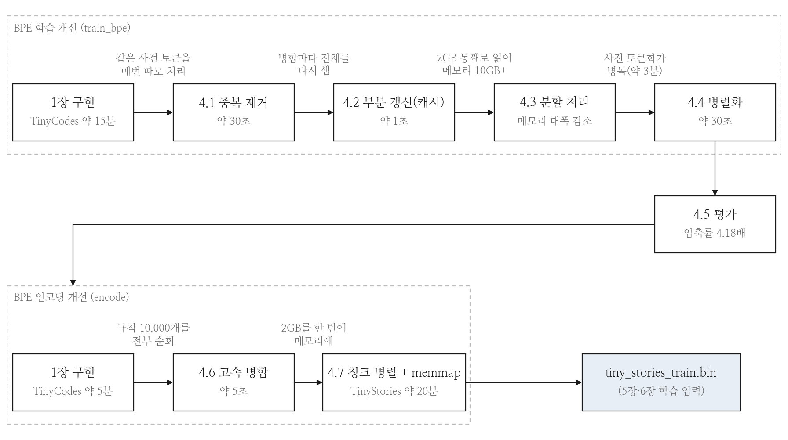
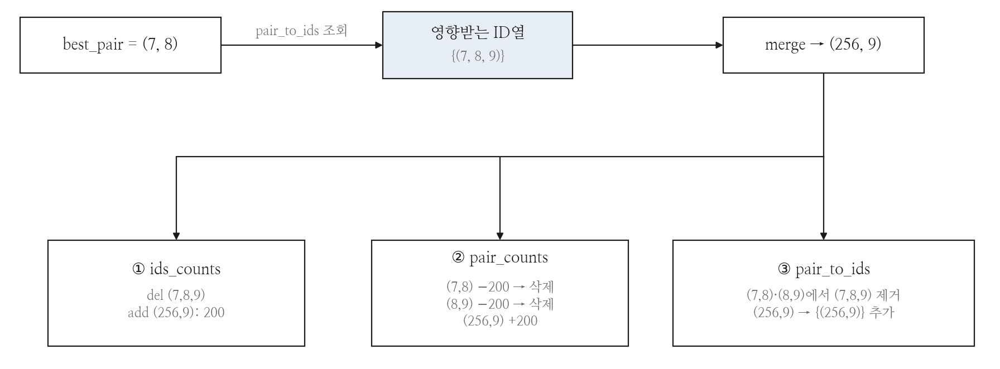
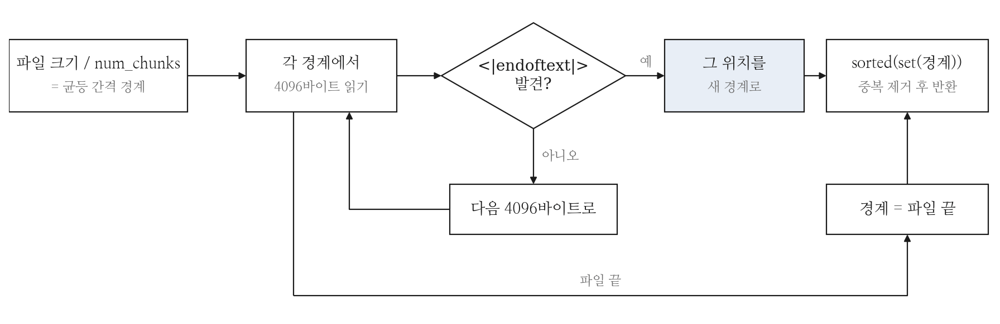
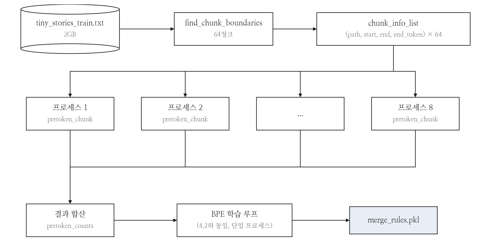
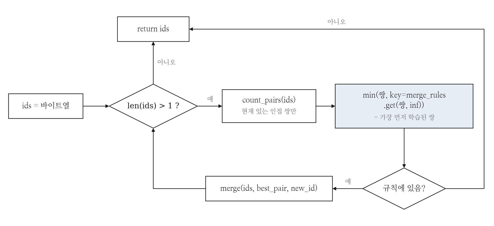
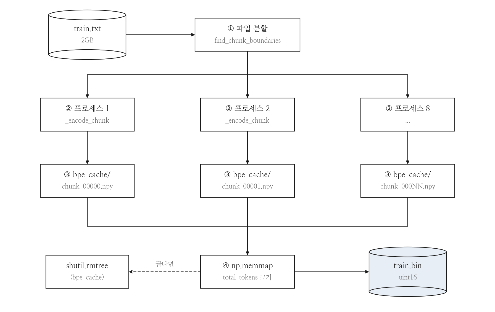
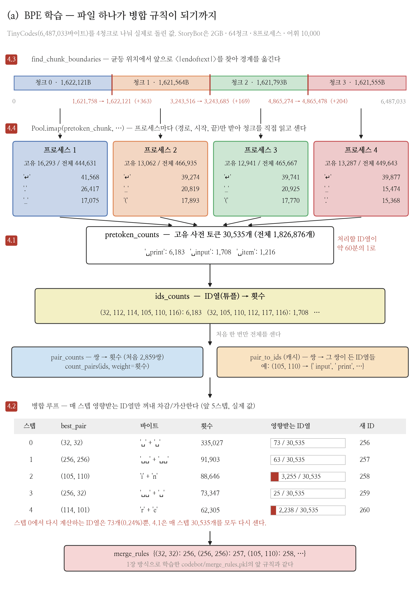
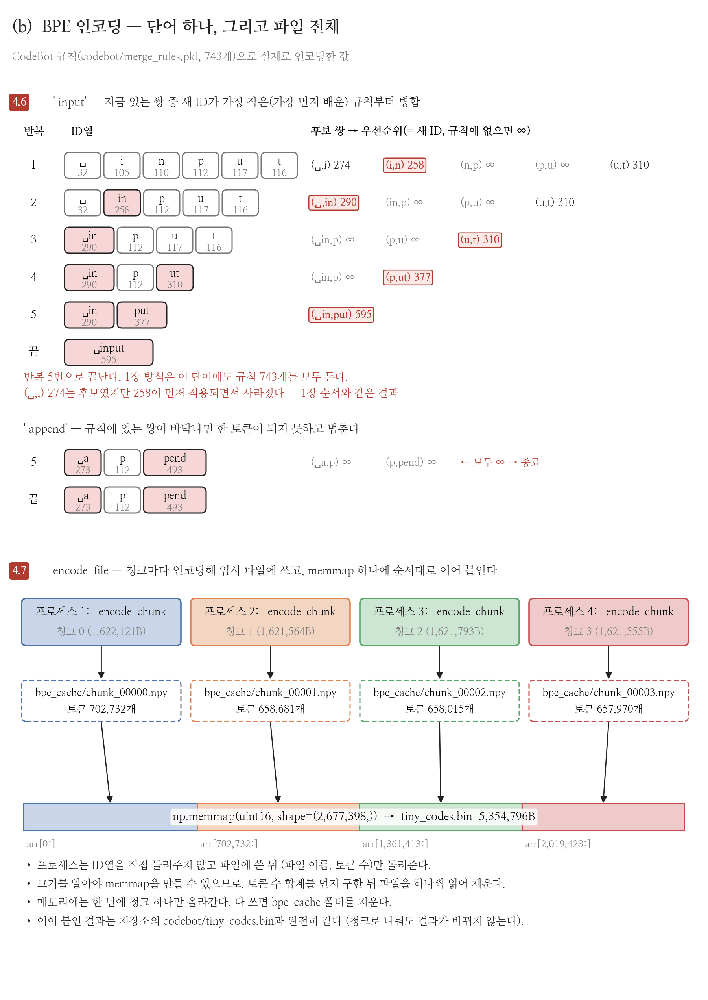

# 4장. 토크나이저 (응용편)

> **한 줄 요약** — 1장의 단순한 BPE를 **중복 제거 → 부분 갱신(캐시) → 분할 처리 → 병렬화** 순서로 고쳐 학습을 15분에서 1초 수준으로 줄이고, 인코딩도 **실제로 있는 쌍만 우선순위로 병합**하고 **청크 병렬 + 메모리 맵**으로 처리해 2GB짜리 TinyStories를 다룰 수 있게 만든다. 결과물은 어휘 10,000개짜리 StoryBot 토크나이저다.

---

## 2부 로드맵: StoryBot 만들기

StoryBot = 자연어로 **짧은 이야기 한 편**을 지어내는 모델. CodeBot(파이썬 코드 생성)보다 데이터도 크고 모델도 개선된 버전이다. 최종 목표는 **해피엔딩으로 끝나는 이야기꾼**.

**데이터셋: TinyStories** — GPT-4가 만든 짧은 이야기 약 200만 편. 어린아이도 읽을 수 있는 쉬운 영어 문체이고, 이야기마다 `<|endoftext|>`로 구분되어 있다.

```text
Once upon a time there was a little boy named Ben. Ben loved to explore ...
And that's how Ben found an amazing vase in the store!
<|endoftext|>
...
```

| 파일 | 크기 | 용도 |
|---|---|---|
| `storybot/tiny_stories_train.txt` | 약 2GB | 학습용 |
| `storybot/tiny_stories_valid.txt` | 약 20MB | 검증용 |

(`storybot/download.sh`로 받는다. 이미 학습된 `merge_rules.pkl`, 인코딩된 `.bin`도 같은 스크립트에 주석으로 들어 있다.)

| 장 | 주제 | 내용 |
|---|---|---|
| **4장** | 토크나이저(응용편) | 대규모 텍스트를 처리하기 위한 고속화 |
| 5장 | 모델(응용편) | 현대적인 개선을 반영한 아키텍처 |
| 6장 | 학습(응용편) | 사전 학습 개선 + **DPO**로 사후 학습 |

> 💡 **DPO(Direct Preference Optimization)** — 복잡한 강화 학습 없이 "선호되는 출력"을 배우게 하는 기법. 6장에서는 `해피엔딩 이야기` / `그렇지 않은 이야기` 쌍(`storybot/tiny_stories_dpo.json`)을 주고 해피엔딩 쪽을 고르도록 학습시킨다.

> ⚠️ 책의 2부 도입부 표에는 위치가 "2장·3장·4장"으로 적혀 있지만, 실제 장 번호는 4·5·6장이다.

---

## 4장 전체 흐름



*4장의 흐름 — 학습 개선(4.1~4.4)과 평가(4.5)를 거쳐 인코딩 개선(4.6~4.7)으로 이어진다. 화살표 위 기울임 글씨는 각 단계에서 드러난 한계다. (`ch04/diagrams.py`로 그린 그림)*

### 단계별 측정값 한눈에 보기 (책 수치, M2 맥북에어 / 8코어 기준)

| 절 | 개선 | 대상 | 바뀌는 것 | 측정값 |
|---|---|---|---|---|
| 1.7 | (기준) 단순 구현 | TinyCodes, vocab 1,000 | — | 학습 약 **15분** |
| 4.1 | 중복 제거 | TinyCodes, vocab 1,000 | `ids_list` → `ids_counts`(ID열: 횟수) | 학습 약 **30초** (≈30배) |
| 4.2 | 부분 갱신 | TinyCodes, vocab 1,000 | 영향받는 ID열만 갱신 (`pair_to_ids` 캐시) | 학습 약 **1초** |
| 4.2 | 〃 | TinyStories, vocab 10,000 | — | 사전 토큰화 수 분 + 학습 수십 초, **메모리 10GB 이상** |
| 4.3 | 분할 처리 | TinyStories, vocab 10,000 | 파일을 64청크로 읽고 버림 | 시간은 비슷, **메모리 대폭 감소** |
| 4.4 | 병렬화 | TinyStories, vocab 10,000 | 청크별 사전 토큰화를 8프로세스로 | 사전 토큰화 약 3분 → **약 30초** (≈6배) |
| 1.9 | (기준) 단순 인코딩 | TinyCodes 전체(약 5MB) | — | 인코딩 약 **5분** |
| 4.6 | 고속 병합 | TinyCodes 전체 | 실제로 있는 쌍만 우선순위로 병합 | 인코딩 약 **5초** |
| 4.7 | 분할 + 병렬 + memmap | TinyStories 학습용(약 2GB) | 청크별 인코딩 → 임시 파일 → 하나로 합침 | 인코딩 약 **20분** |

> 💡 모든 개선은 **결과(병합 규칙·토큰 ID열)를 바꾸지 않는다.** 같은 답을 더 빨리, 더 적은 메모리로 낼 뿐이다.

---

## 4.1 BPE 학습 개선 ①: 중복 제거 — `ch04/01_bpe_optimize.py`

### 문제: 같은 사전 토큰을 몇 번이고 다시 처리한다

[1장 구현](../ch01/README.md#16-사전-토큰화--ch0106_pretokenizepy)은 사전 토큰마다 ID열을 하나씩 `ids_list`에 넣는다. `" Hello"`가 세 번 나오면 똑같은 리스트가 세 개 들어가고, 쌍을 셀 때도 병합할 때도 세 번씩 처리한다.

```python
pretokenize(" Hello Hello Hello")
# [' Hello', ' Hello', ' Hello']
# ids_list = [[32, 72, 101, 108, 108, 111],
#             [32, 72, 101, 108, 108, 111],
#             [32, 72, 101, 108, 108, 111]]
```

### 해결: "한 번만 처리하고 × 횟수"

| 변수 | 저장 방식 | 예 |
|---|---|---|
| `ids_list` (1장) | 나온 만큼 반복 저장 | `[[32,72,...], [32,72,...], [32,72,...]]` |
| `ids_counts` (4.1) | **ID열 → 출현 횟수** 딕셔너리 | `{(32, 72, 101, 108, 108, 111): 3}` |

- 딕셔너리 키로 쓰려면 리스트가 아니라 **튜플**(불변)이어야 한다.
- `" the"`, `" and"`처럼 자주 나오는 사전 토큰이 많을수록 효과가 크다. 실제 텍스트는 같은 단어가 엄청나게 반복되므로 고유한 사전 토큰 수는 전체의 일부에 불과하다.

`count_pairs()`에 **가중치 `weight`** 를 추가한다.

```python
def count_pairs(ids, weight=1, counts=None):
    if counts is None:
        counts = defaultdict(int)
    for pair in zip(ids, ids[1:]):
        counts[pair] += weight        # 1이 아니라 "이 ID열이 나온 횟수"만큼 더함
    return counts
```

### 개선된 `train_bpe()`

```python
def train_bpe(input_text, vocab_size, end_token="<|endoftext|>"):
    texts = input_text.split(end_token)

    # 사전 토큰 → 출현 횟수
    pretoken_counts = defaultdict(int)
    for text in tqdm(texts, desc="Pretokenizing"):
        for pretoken in pretokenize(text):
            pretoken_counts[pretoken] += 1

    # 사전 토큰 → ID열(튜플)
    ids_counts = {tuple(p.encode("utf-8")): c for p, c in pretoken_counts.items()}

    num_merges = vocab_size - 256 - 1
    merge_rules = {}
    for step in tqdm(range(num_merges), desc="Training BPE"):
        # ❶ 고유 ID열만 돌면서 횟수를 가중치로 쌍을 셈
        pair_counts = defaultdict(int)
        for ids, count in ids_counts.items():
            count_pairs(ids, count, pair_counts)
        if not pair_counts:
            break

        # ❷ 가장 흔한 쌍 (동점이면 ID가 큰 쪽 — 재현성용)
        best_pair = max(pair_counts, key=lambda p: (pair_counts[p], p[0], p[1]))
        new_id = 256 + step
        merge_rules[best_pair] = new_id

        # ❸ 병합해서 새 딕셔너리를 만듦 (횟수는 그대로 넘겨받음)
        new_ids_counts = defaultdict(int)
        for ids, count in ids_counts.items():
            new_ids_counts[tuple(merge(ids, best_pair, new_id))] += count
        ids_counts = new_ids_counts
    return merge_rules
```

> 💡 책 본문은 `max(pair_counts, key=pair_counts.get)`이지만, 저장소 코드는 1장에서 소개한 **동점 처리용 키** `(횟수, 첫 ID, 두 번째 ID)`를 쓴다. 4.1~4.4와 `storybot/tokenizer.py` 모두 같다.

**결과**: TinyCodes(vocab 1,000) 학습이 약 15분 → **약 30초**.

---

## 4.2 BPE 학습 개선 ②: 부분 갱신 — `ch04/02_bpe_cache.py`

### 문제: 병합 한 번에 바뀌는 건 일부뿐인데 전부 다시 계산한다

4.1 구현은 매 스텝마다
- **문제 ❶** `pair_counts`를 처음부터 다시 세고,
- **문제 ❷** `ids_counts`를 통째로 새로 만든다.

하지만 병합으로 바뀌는 건 **선택된 쌍을 포함한 ID열**과 **그 ID열 안의 쌍**뿐이다.

```text
ids_counts = {(1,2,2,3): 100, (4,5,6): 50, (7,8,9): 200}
best_pair = (7, 8)  → new_id = 256

(1,2,2,3), (4,5,6) : (7,8)이 없음 → 그대로
(7,8,9)            : → (256,9) 로 교체
pair_counts        : (7,8) −200, (8,9) −200, (256,9) +200   ← 나머지 쌍은 그대로
```

### 해결: "쌍 → 그 쌍이 들어 있는 ID열" 캐시



*`best_pair`가 들어 있는 ID열만 캐시에서 꺼내 병합하고, ①~③ 세 자료구조를 고친다. (`ch04/diagrams.py`로 그린 그림)*

| 자료구조 | 내용 | 예 |
|---|---|---|
| `ids_counts` | ID열 → 출현 횟수 | `{(7,8,9): 200}` |
| `pair_counts` | 쌍 → 전체 출현 횟수 | `{(7,8): 200, (8,9): 200}` |
| `pair_to_ids` (**캐시**) | 쌍 → 그 쌍을 포함한 ID열 집합 | `{(7,8): {(7,8,9)}, (8,9): {(7,8,9)}}` |

### 구현 (학습 루프 부분)

```python
pair_to_ids = defaultdict(set)              # 캐시
pair_counts = defaultdict(int)
for ids, count in ids_counts.items():       # ❶ 처음 한 번만 전체를 셈 + 캐시 등록
    count_pairs(ids, count, pair_counts)
    for pair in zip(ids, ids[1:]):
        pair_to_ids[pair].add(ids)

for step in tqdm(range(num_merges), desc="Training BPE"):
    if not pair_counts:
        break
    best_pair = max(pair_counts, key=lambda p: (pair_counts[p], p[0], p[1]))
    new_id = 256 + step
    merge_rules[best_pair] = new_id

    affected_ids = pair_to_ids[best_pair]   # ❷ 영향받는 ID열만 꺼냄
    del pair_to_ids[best_pair]

    for ids in affected_ids:
        ids_count = ids_counts[tuple(ids)]
        new_ids = merge(ids, best_pair, new_id)

        del ids_counts[tuple(ids)]              # ❸ ID열 교체
        ids_counts[tuple(new_ids)] = ids_count

        for pair, c in count_pairs(ids).items():      # ❹ 옛 ID열의 쌍을 뺌
            pair_counts[pair] -= c * ids_count
            if pair_counts[pair] <= 0:
                del pair_counts[pair]
            pair_to_ids[pair].discard(tuple(ids))

        for pair, c in count_pairs(new_ids).items():  # ❺ 새 ID열의 쌍을 더함
            pair_counts[pair] += c * ids_count
            pair_to_ids[pair].add(tuple(new_ids))
```

- ❹에서 `c * ids_count` — 한 ID열 안에 같은 쌍이 여러 번(`c`) 있고, 그 ID열이 `ids_count`번 나오므로 둘을 곱한다.
- 옛 ID열의 쌍을 **전부 빼고** 새 ID열의 쌍을 **전부 더하는** 방식이라, `(8,9)`처럼 병합 대상이 아닌데 이웃이 바뀐 쌍도 자연스럽게 처리된다.

> 💡 아직 남은 비용 — 매 스텝 `max(pair_counts, ...)`는 **모든 쌍을 훑는다**. 쌍의 수가 아주 많아지면 이것이 다음 병목이 된다. 우선순위 큐(힙)로 바꾸는 방법이 있지만 책에서는 다루지 않는다(→ [7장 병목 찾기](../ch07/README.md#72-병목-지점-찾기)).

**결과**: TinyCodes(vocab 1,000) 학습이 **약 1초**. 최초 구현(약 15분) 대비 약 900배.

---

## 4.3 BPE 학습 개선 ③: 분할 처리 — `ch04/03_bpe_chunk.py`

### 문제: 2GB 파일을 통째로 읽으면 메모리가 10GB를 넘는다

TinyStories(vocab 10,000)를 4.2 코드로 돌리면 시간은 괜찮지만(사전 토큰화 수 분 + 학습 수십 초) **메모리를 10GB 이상** 쓴다.

```python
text = open(file_path).read()   # ← 2GB를 한 번에 메모리로
```

**왜 2GB가 10GB를 넘을까?** 원문 하나만 올라오는 것이 아니라 여러 요인이 겹친다.

- **원문과 그 조각이 동시에 남는다.** `split(end_token)`은 원문을 잘라 이야기마다 새 문자열을 만든다. 그래서 `text`와 `texts`가 함께 살아 있는 동안 원문 크기만큼이 한 벌 더 든다. TinyCodes(6.5MB)에서 `split()` 결과 문자열의 크기 합은 7.1MB였다.
- **파이썬 문자열은 가장 큰 문자에 맞춰 크기가 정해진다.** 문자당 1·2·4바이트 중 하나를 문자열 전체에 쓴다. 1,000자 문자열의 크기를 재 보면 모두 ASCII일 때 1,041바이트, 한 글자만 `'가'`로 바꾸면 2,058바이트, 이모지로 바꾸면 4,060바이트였다. 원문에 이런 문자가 하나라도 있으면 문자열 전체가 2~4배가 된다. TinyStories에 그런 문자가 있는지는 데이터가 저장소에 없어 확인하지 못했다.
- **사전 토큰마다 문자열 객체가 하나씩 생긴다.** TinyCodes의 사전 토큰 1,826,876개를 한꺼번에 리스트로 만들면 96MB로, 원문의 약 15배다. 4.2 코드는 이야기 하나씩 `findall()`하므로 이만큼이 한꺼번에 생기지는 않지만, 짧은 조각 하나에도 수십 바이트의 객체 머리가 붙는다는 점은 같다.

TinyCodes에서 `tracemalloc`으로 사전 토큰화 단계의 최대 메모리를 재 보았다. 4.2 방식은 16.3MB로 파일의 약 2.5배였고, 아래의 4.3 방식(64청크 + 제너레이터)은 2.8MB였다. TinyCodes는 ASCII 문자뿐이라 두 번째 요인이 없다. 책의 10GB는 TinyStories 기준이며, 그 정확한 내역은 데이터가 없어 재지 못했다.

**관찰**: BPE 학습 루프가 쓰는 건 `pretoken_counts`뿐이다. 원본 텍스트는 사전 토큰화만 끝나면 필요 없다.
→ **조금씩 읽어서 세고, 버리고, 다음 조각** 을 반복하면 메모리에는 "현재 청크 + 카운터"만 남는다.

### 파일 일부만 읽기

```python
with open(file_path, "rb") as f:   # 바이너리 모드 → bytes 반환
    f.seek(1000)                   # 1000바이트 위치로 이동
    chunk_bytes = f.read(500)      # 500바이트만 읽음
```

### 청크 경계를 `<|endoftext|>`에 맞추기 — `find_chunk_boundaries()`

그냥 균등하게 자르면 경계가 `<|endoftext|>`나 단어, 심지어 UTF-8 멀티바이트 문자 한가운데에 걸린다. 그래서 **균등 분할 위치에서 앞으로 4,096바이트씩 읽으며 `<|endoftext|>`를 찾아 경계를 옮긴다.**



*균등 경계마다 4096바이트씩 앞으로 읽으며 `<|endoftext|>`를 찾아 경계를 옮긴다. (`ch04/diagrams.py`로 그린 그림)*

```text
균등 경계:  |-------- 34.8MB --------|-------- 34.8MB --------| ...
조정 후:    |story...<|endoftext|>    |<|endoftext|>story...
                                       ^ 토큰의 시작 위치가 새 경계
```

```python
boundaries = find_chunk_boundaries("storybot/tiny_stories_train.txt", num_chunks=64)
len(boundaries)    # 65  (청크 64개 → 경계 65개, 처음은 0, 마지막은 파일 끝)
boundaries[:5]     # [0, 34809119, 69618218, 104426467, 139234745]
```

> ⚠️ 책에는 "모든 청크가 `<|endoftext|>`로 **끝나도록**"이라고 되어 있지만, 실제 코드는 경계를 **토큰이 시작하는 위치**로 잡는다. 그래서 `<|endoftext|>`는 다음 청크의 **맨 앞**에 붙는다(직접 확인: `b'<|endoftext|>\nimport...'`). 어느 쪽이든 청크 안에서 `split(end_token)`을 하므로 결과는 같다. 또 `sorted(set(...))` 때문에 문서가 매우 길면 경계가 겹쳐 청크 수가 지정값보다 줄 수 있다.

### 개선된 `train_bpe()` — 인수가 **텍스트 → 파일 경로**로 바뀜

```python
def train_bpe(file_path, vocab_size, end_token="<|endoftext|>"):
    chunk_boundaries = find_chunk_boundaries(file_path, num_chunks=64)   # ❶
    pretoken_counts = defaultdict(int)
    with open(file_path, "rb") as f:
        for i in tqdm(range(len(chunk_boundaries) - 1), desc="Pretokenizing"):
            start, end = chunk_boundaries[i], chunk_boundaries[i + 1]
            f.seek(start)                                                 # ❷ 이 청크만 읽음
            chunk_text = f.read(end - start).decode("utf-8", errors="ignore")
            for text in chunk_text.split(end_token):                      # ❸ 세서 누적
                for pretoken in pretokenize(text):
                    pretoken_counts[pretoken] += 1
            # chunk_text는 다음 반복에서 덮어써지므로 메모리에서 해제됨
    # ===== 이후는 4.2와 같은 BPE 학습 (pretoken_counts만 사용) =====
```

### 덤: `pretokenize()`를 제너레이터로

```python
def pretokenize(text):
    pattern = r"""'(?:[sdmt]|ll|ve|re)| ?\p{L}+| ?\p{N}+| ?[^\s\p{L}\p{N}]+|\s+(?!\S)|\s+"""
    for m in re.finditer(pattern, text):   # findall(리스트 전체) → finditer(하나씩)
        yield m.group(0)
```

- `findall()`은 결과 리스트를 통째로 만든다. `finditer()` + `yield`는 **하나씩 꺼내 쓰고 버리므로** 메모리를 덜 쓴다.
- 쓰는 쪽 코드(`for pretoken in pretokenize(text):`)는 바뀌지 않는다. 이후 절은 모두 이 버전을 쓴다.

**결과**: 처리 시간은 거의 같고 **메모리 사용량이 크게 줄었다.**

---

## 4.4 BPE 학습 개선 ④: 병렬화 — `ch04/04_bpe_parallel.py`

### 왜 사전 토큰화를 병렬화하나?

- TinyStories에서는 BPE 학습 루프보다 **사전 토큰화(약 3분)** 가 더 오래 걸린다.
- 청크끼리 서로 의존하지 않는다 → 청크마다 독립적으로 세고 나중에 **더하기만** 하면 된다. 병렬화하기 딱 좋은 구조다.

### `multiprocessing.Pool` 기초

```python
from multiprocessing import Pool
from tqdm import tqdm

def square(x):
    return x * x

if __name__ == '__main__':                       # ⚠️ 가드 필수
    with Pool(processes=4) as pool:
        results = list(tqdm(pool.imap(square, range(100)), total=100))
```

| 메서드 | 결과 반환 | 순서 | tqdm |
|---|---|---|---|
| `pool.map(f, xs)` | 전부 끝난 뒤 리스트 | 입력 순서 | 진행률 표시 어려움 |
| `pool.imap(f, xs)` | **이터레이터**로 하나씩 | 입력 순서 유지 | `tqdm(..., total=len(xs))`로 감싸면 됨 |

**규칙 두 가지**
1. 작업 함수는 **인수를 하나만** 받는다 → 여러 값은 튜플로 묶어 넘긴다.
2. `if __name__ == '__main__':` 가드를 쓴다. 없으면 새 프로세스가 스크립트를 다시 실행하면서 프로세스를 끝없이 만들 수 있다.

> 💡 **프로세스 수** — 사전 토큰화는 계산 위주(**CPU 바운드**)이므로 **물리 코어 수 이하**가 적당하다. 입출력 대기가 긴 I/O 바운드 작업이라면 코어 수의 2~4배까지도 쓸 수 있다.

### 병렬 처리 흐름



*청크별 사전 토큰화만 8프로세스로 나누고, 결과를 합친 뒤 BPE 학습 루프는 한 프로세스에서 돈다. (`ch04/diagrams.py`로 그린 그림)*

```python
def pretoken_chunk(args):                       # 인수 하나(튜플)만 받음
    file_path, start, end, end_token = args
    pretoken_counts = defaultdict(int)
    with open(file_path, "rb") as f:            # 각 프로세스가 파일을 직접 엶
        f.seek(start)
        chunk_text = f.read(end - start).decode("utf-8", errors="ignore")
        for text in chunk_text.split(end_token):
            for pretoken in pretokenize(text):
                pretoken_counts[pretoken] += 1
    return pretoken_counts                      # 청크 하나의 카운트

def train_bpe(file_path, vocab_size, end_token="<|endoftext|>",
              num_processes=8, num_chunks=64):
    # ❶ 청크 정보 준비
    b = find_chunk_boundaries(file_path, num_chunks)
    chunk_info_list = [(file_path, b[i], b[i + 1], end_token) for i in range(len(b) - 1)]

    # ❷ 병렬 사전 토큰화
    with Pool(processes=num_processes) as pool:
        all_results = list(tqdm(pool.imap(pretoken_chunk, chunk_info_list),
                                total=len(chunk_info_list), desc="Pretokenizing"))

    # ❸ 결과 합치기
    pretoken_counts = defaultdict(int)
    for chunk_result in all_results:
        for pretoken, count in chunk_result.items():
            pretoken_counts[pretoken] += count
    # ===== 이후는 4.2와 같은 BPE 학습 =====
```

- 프로세스 사이에 넘기는 건 **(경로, 시작, 끝)** 같은 작은 값뿐이다. 텍스트 자체를 넘기지 않으므로 직렬화(pickle) 비용이 거의 없다.
- 돌려받는 건 청크별 `pretoken_counts`(고유 사전 토큰 수만큼)라 원문보다 훨씬 작다.

```python
if __name__ == '__main__':
    merge_rules = train_bpe("storybot/tiny_stories_train.txt", 10000, num_processes=8)
    with open("storybot/merge_rules.pkl", "wb") as f:
        pickle.dump(merge_rules, f)
```

**결과**: 8코어에서 사전 토큰화 약 3분 → **약 30초**(≈6배).

> 💡 **왜 8배가 아니라 약 6배인가** — 병렬로 도는 것은 청크별 사전 토큰화뿐이다. 프로세스 시작, 청크별 결과(`pretoken_counts` 딕셔너리)를 pickle해 부모로 보내는 일, 부모에서 합치는 일은 나눠지지 않는다. 청크마다 걸리는 시간도 조금씩 달라서 가장 늦은 프로세스를 기다려야 한다. 이 저장소 환경(16코어, fork 방식)에서 TinyCodes를 64청크·8프로세스로 세 번 재 보니 순차 1.6~1.8초가 병렬 0.35~0.42초가 되어 약 4.2~4.7배였다. 빈 작업으로 잰 Pool 시작·종료가 약 0.035초, 결과 합치기가 약 0.04초였고, 청크 하나의 처리 시간은 0.017~0.035초로 두 배 가까이 차이가 났다. TinyCodes는 작아서 이런 고정 비용의 비중이 TinyStories보다 크다.

> 💡 완성본은 `storybot/tokenizer.py`의 `train_bpe()`다. 단, 그쪽은 기본값이 `num_chunks=8`이고(이 스크립트는 64), 사용하지 않는 `process_single_chunk()`도 함께 들어 있다.

---

## 4.5 토크나이저 평가 — `ch04/05_eval.py`

```python
from storybot.tokenizer import BPETokenizer   # 4.6·4.7 개선판을 앞당겨 사용
tokenizer = BPETokenizer.load_from("storybot/merge_rules.pkl")
```

### 학습된 토큰

| 처음 학습된 토큰 (256~265) | 마지막 토큰 (9990~9999) |
|---|---|
| `' t'` `'he'` `' a'` `' s'` `' w'` `'nd'` `' the'` `'ed'` `' b'` `' to'` | `' nicest'` `' whiskers'` `' booth'` `' Land'` `'Rocky'` `' meadows'` `' Starry'` `' imaginary'` `' bold'` `'<\|endoftext\|>'` |
| → 영어에서 가장 흔한 **짧은 조각** | → 특정 문맥에서만 쓰이는 **온전한 단어** |

CodeBot(1장)이 들여쓰기·`in`·`re` 같은 코드 조각부터 배웠다면, StoryBot은 `the`, `to` 같은 영어 기능어부터 배운다. **학습 데이터의 도메인이 어휘를 결정한다.**

### 압축률 (TinyStories 앞 10,000자)

| 토크나이저 | 어휘 크기 | 학습 데이터 | 토큰 수 | 압축률 (바이트/토큰) |
|---|---|---|---|---|
| **StoryBot** | 10,000 | 이야기 (TinyStories) | 2,394 | **4.18배** |
| CodeBot | 1,000 | 파이썬 코드 (TinyCodes) | 4,879 | 2.05배 |

(바이트 수는 둘 다 10,008)

- CodeBot 토크나이저는 코드용이라 자연어를 표현하는 데 서툴다 → 토큰이 두 배 넘게 필요하다.
- 어휘가 10배 크다는 점도 크다. 긴 어구를 토큰 하나로 묶을 수 있기 때문이다.
- 결론: 토크나이저 성능은 **학습 데이터의 도메인**과 **어휘 크기**에 크게 좌우된다. (1장 결과와 비교 → [1.8 토크나이저 평가](../ch01/README.md#18-토크나이저-평가--ch0108_evalpy))

---

## 4.6 BPE 인코딩 개선 ①: 고속 병합 — `ch04/06_encode_optimize.py`

### 문제: 규칙이 10,000개면 짧은 단어에도 `merge()`를 10,000번 돈다

```python
# 1장의 _encode_text()
def _encode_text(self, text):
    ids = list(text.encode("utf-8"))
    for merge_pair, new_id in self.merge_rules.items():   # 모든 규칙을 순서대로
        ids = merge(ids, merge_pair, new_id)
    return ids
```

`" the"`처럼 4바이트짜리 사전 토큰도 규칙 전체를 훑는다. 실제로 적용되는 규칙은 몇 개뿐인데도.

### 해결: ID열에 **실제로 있는 쌍**만 후보로 삼고, 그중 **가장 먼저 학습된** 쌍부터 병합

- 우선순위 = `merge_rules[pair]` (= 새 ID). **작을수록 일찍 학습된 규칙** → 우선순위가 높다.
- 규칙에 없는 쌍은 `float('inf')` → 절대 선택되지 않는다.
- 후보 중 최솟값이 `inf`면(= 적용할 규칙이 없으면) 종료.

### 손으로 따라가기: `[65, 66, 67, 66]` (`"ABCB"`)

```python
merge_rules = {(65, 66): 256, (67, 66): 257}   # (66, 67)은 규칙에 없음
```

| 반복 | ID열 | 후보 쌍과 우선순위 | 선택 |
|---|---|---|---|
| 1 | `[65, 66, 67, 66]` | (65,66)→**256**, (66,67)→inf, (67,66)→257 | (65,66) → 256 |
| 2 | `[256, 67, 66]` | (256,67)→inf, (67,66)→**257** | (67,66) → 257 |
| 3 | `[256, 257]` | (256,257)→inf | 최소가 inf → **종료** |



*지금 있는 쌍 중 규칙 ID가 가장 작은 쌍을 병합한다. 토큰이 하나만 남거나 규칙에 있는 쌍이 없으면 끝난다. (`ch04/diagrams.py`로 그린 그림)*

```python
def _encode_text(self, text):
    ids = list(text.encode("utf-8"))

    def get_merge_priority(pair):
        return self.merge_rules.get(pair, float('inf'))   # 규칙에 없으면 최하위

    while len(ids) > 1:
        counts = count_pairs(ids)                            # 지금 있는 쌍만
        best_pair = min(counts, key=get_merge_priority)      # 가장 이른 규칙
        if best_pair not in self.merge_rules:                # 더 병합할 게 없음
            break
        ids = merge(ids, best_pair, self.merge_rules[best_pair])
    return ids
```

### 왜 결과가 1장과 같은가?

1장 방식은 규칙을 ID 순서대로 적용한다. 4.6 방식도 "지금 적용 가능한 규칙 중 ID가 가장 작은 것"을 고르므로, **실제로 적용되는 규칙만 같은 순서로** 골라내는 셈이다. 적용 안 되는 규칙을 건너뛸 뿐 결과는 같다.

#### 건너뛴 규칙이 나중에 필요해지지 않는 이유

"건너뛸 뿐"이 성립하려면, 지금 건너뛴 규칙이 병합을 몇 번 더 한 뒤에 **적용 가능해지는 일이 없어야** 한다. 이것은 BPE 규칙의 성질 하나로 보장된다.

- **규칙의 새 ID는 쌍의 두 ID보다 항상 크다.** 규칙 `(a, b) → n`은 학습 중 토큰 `a`, `b`가 이미 있을 때 만들어졌으므로 `a < n`, `b < n`이다. `codebot/merge_rules.pkl`의 규칙 743개가 모두 이 조건을 만족했다.
- **병합으로 새로 생기는 쌍의 규칙은 방금 적용한 규칙보다 뒤에 있다.** 규칙 `r`을 적용하면 ID열에 토큰 `r`이 생기고, 새로 생기는 쌍은 모두 `r`을 포함한다. 이런 쌍의 규칙 ID는 위 성질에 따라 `r`보다 크다. 원래 있던 다른 쌍의 규칙도 `r`이 "지금 있는 것 중 최소"였으므로 `r`보다 크다.
- **그래서 적용되는 규칙 ID는 늘어나기만 한다.** `r`보다 작은 규칙은 지금도 나중에도 해당 쌍이 없다. 1장 방식이 그 규칙들을 돌며 아무것도 바꾸지 못하고 지나가는 것과, 4.6 방식이 아예 보지 않는 것은 결과가 같다. 두 방식은 같은 규칙을 같은 순서로 적용한다.

예를 들어 `' input'`은 258(`in`) → 290(`␣in`) → 310(`ut`) → 377(`put`) → 595(`␣input`) 순서로 병합된다(한눈에 보기 그림 (b)). 첫 반복에서 후보였던 `(␣, i)` 274는 258이 먼저 적용되면서 사라졌다. 1장 방식에서도 258이 274보다 먼저 돌므로 결과가 같다.

TinyCodes의 고유 사전 토큰 30,535개를 모두 두 방식으로 인코딩해 비교했다. 결과는 하나도 다르지 않았고, 4.6 방식에서 적용 규칙 ID가 줄어드는 경우도 없었다. 사전 토큰 하나에 실제로 적용되는 규칙은 평균 3.3개였다. 1장 방식은 743개를 모두 돈다.

> 💡 직접 확인 — `codebot/merge_rules.pkl`로 TinyCodes 앞 20,000자를 두 방식으로 인코딩해 보면 결과가 **완전히 같고**, 속도는 약 30배 차이가 났다(0.63초 vs 0.02초).

| | 1장 `_encode_text` | 4.6 `_encode_text` |
|---|---|---|
| 반복 횟수 | **규칙 수**(1,000 / 10,000 / 50,000) | 실제 병합 횟수 + 1 (사전 토큰 길이 이하) |
| 한 번의 비용 | `merge()` O(n) | `count_pairs()` + `min()` + `merge()` O(n) |
| 사전 토큰 하나 비용 | O(규칙 수 × n) | O(n²) — n은 사전 토큰의 바이트 수(보통 수~십여 개) |

> 💡 **더 빠르게 하려면** — 지금은 병합할 때마다 쌍을 처음부터 다시 센다. 연결 리스트 + 우선순위 큐(힙)로 "병합된 자리 주변 쌍만 갱신"하면 더 빨라진다(tiktoken·rustbpe 등). 또 같은 사전 토큰(`" the"`)이 반복되니 **결과를 캐싱**하는 방법도 있다. 책 범위 밖의 아이디어로, [7장](../ch07/README.md)의 도전 과제로 삼을 만하다.

**결과**: TinyCodes 전체(약 5MB, 2,677,398토큰) 인코딩이 약 5분 → **약 5초**.

---

## 4.7 BPE 인코딩 개선 ②: 대규모 데이터 처리 — `ch04/07_encode_parallel.py`

### 문제와 해결 방향

2GB를 `read()`로 한 번에 올려 인코딩하면 메모리가 모자랄 수 있다. 학습 때와 똑같이 **청크로 나누고**, 청크끼리는 독립적이니 **병렬로** 돌린다.



*청크마다 인코딩해 임시 파일에 쓰고, memmap 하나에 순서대로 이어 붙인 뒤 임시 폴더를 지운다. (`ch04/diagrams.py`로 그린 그림)*

### 청크 하나 인코딩 → 임시 파일

```python
def _encode_chunk(self, args):
    file_path, start, end, cache_dir, chunk_idx = args
    with open(file_path, "rb") as f:
        f.seek(start)
        chunk_text = f.read(end - start).decode("utf-8", errors="ignore")
        ids = self.encode(chunk_text)                     # 4.6의 고속 인코딩
    cache_file = os.path.join(cache_dir, f"chunk_{chunk_idx:05d}.npy")
    np.array(ids, dtype=np.uint16).tofile(cache_file)     # 2바이트씩 그대로 저장
    return cache_file, len(ids)                           # 파일 이름과 토큰 수만 돌려줌
```

- `chunk_{idx:05d}` → `chunk_00000`, `chunk_00001`, ... 0으로 채워 **이름순 정렬 = 원래 순서**가 된다.
- 결과 ID열 자체를 부모 프로세스로 돌려보내지 않고 **파일에 쓰고 경로만** 돌려준다 → 프로세스 간 전송량과 부모의 메모리를 아낀다.
- 확장자는 `.npy`지만 `tofile()`로 쓴 **헤더 없는 raw 바이너리**다. 그래서 읽을 때도 `np.load()`가 아니라 `np.fromfile()`을 쓴다.

### `np.memmap` — 디스크 파일을 배열처럼

```python
arr = np.memmap('data.bin', dtype=np.uint16, mode='w+', shape=(10000,))  # 파일 생성
arr[0] = 100
arr[1:5] = [200, 300, 400, 500]
arr.flush()                                                              # 디스크에 반영

loaded = np.memmap('data.bin', dtype=np.uint16, mode='r', shape=(10000,))
loaded[:5]   # [100 200 300 400 500]
```

배열처럼 다루지만 데이터는 파일에 있고, **접근하는 부분만** 그때그때 메모리로 불러온다.

### `encode_file()`

```python
def encode_file(self, file_path, output_file,
                num_processes=8, num_chunks=64, cache_dir="bpe_cache"):
    os.makedirs(cache_dir, exist_ok=True)
    try:
        # ❶ 청크 병렬 인코딩 → 임시 파일
        b = find_chunk_boundaries(file_path, num_chunks)
        chunk_info_list = [(file_path, b[i], b[i + 1], cache_dir, i) for i in range(len(b) - 1)]
        with Pool(processes=num_processes) as pool:
            cache_results = list(tqdm(pool.imap(self._encode_chunk, chunk_info_list),
                                      total=len(chunk_info_list), desc="Encoding chunks"))

        # ❷ 전체 토큰 수 = 출력 파일 크기
        cache_files = [r[0] for r in cache_results]
        total_tokens = sum(r[1] for r in cache_results)

        # ❸ 출력 파일을 memmap으로 미리 만들고
        arr = np.memmap(output_file, dtype=np.uint16, mode='w+', shape=(total_tokens,))

        # ❹ 임시 파일을 하나씩 읽어 순서대로 채워 넣음 (한 번에 청크 하나만 메모리에)
        idx = 0
        for cache_file in cache_files:
            chunk_data = np.fromfile(cache_file, dtype=np.uint16)
            arr[idx: idx + len(chunk_data)] = chunk_data
            idx += len(chunk_data)
        arr.flush()
        del arr
    finally:
        shutil.rmtree(cache_dir)          # 성공하든 실패하든 임시 폴더 삭제
    return total_tokens
```

> 💡 `pool.imap(self._encode_chunk, ...)` — 바운드 메서드를 넘기면 `self`(토크나이저 객체, 즉 `merge_rules`)도 함께 pickle되어 각 프로세스로 전달된다.

> ⚠️ `uint16`의 최댓값은 65,535다. StoryBot(10,000)·WebBot(50,000) 어휘는 들어가지만, 어휘가 65,536을 넘으면 `uint32`로 바꿔야 한다.

> ⚠️ 학습용과 검증용을 차례로 인코딩하는데 둘 다 기본 `cache_dir="bpe_cache"`를 쓴다. 순차 실행이고 매번 `rmtree`로 지우므로 문제없지만, **동시에** 돌리려면 캐시 폴더를 따로 지정해야 한다.

```python
if __name__ == '__main__':
    tokenizer = BPETokenizer.load_from("storybot/merge_rules.pkl")
    tokenizer.encode_file("storybot/tiny_stories_train.txt",
                          "storybot/tiny_stories_train.bin", num_processes=8)
    tokenizer.encode_file("storybot/tiny_stories_valid.txt",
                          "storybot/tiny_stories_valid.bin", num_processes=8)
```

**결과**: 8프로세스로 TinyStories 학습용 인코딩 **약 20분**. 완성된 `BPETokenizer`는 `storybot/tokenizer.py`에 있다(`from storybot.tokenizer import BPETokenizer`).

### 한눈에 보기: 파일이 병합 규칙과 토큰 ID 파일이 되기까지

4.1~4.7의 개선을 한 흐름으로 이어서 그렸다. TinyStories(2GB)는 저장소에 없으므로, 같은 코드(`storybot/tokenizer.py`)를 TinyCodes(`codebot/tiny_codes.txt`, 약 6.5MB)에 4청크로 돌려 얻은 실제 값을 넣었다. (a)는 학습(4.1~4.4), (b)는 인코딩(4.6~4.7)이다.



*그림 (a) — 파일을 `<|endoftext|>`에 맞춰 4청크로 자르고, 프로세스마다 사전 토큰을 센 뒤 합쳐서 `ids_counts`를 만든다. 병합 루프는 캐시로 영향받는 ID열만 고친다. (`ch04/flow_graph.py`로 그린 그림)*



*그림 (b) — `' input'`을 CodeBot 규칙으로 인코딩하는 과정(후보 중 우선순위가 가장 작은 쌍을 빨간 테두리로 표시)과, 청크별 인코딩 결과를 memmap 하나에 이어 붙이는 과정. ␣는 앞 공백이다.*

- **중복 제거의 효과는 숫자로 보인다.** TinyCodes의 사전 토큰은 1,826,876개지만 고유한 것은 30,535개다. 4.1부터 학습 루프는 약 60분의 1 크기인 `ids_counts`만 돈다.
- **부분 갱신은 대부분의 ID열을 건드리지 않는다.** 첫 병합 `(32, 32)`에 영향받는 ID열은 30,535개 중 73개(0.24%)다. `'i' + 'n'`처럼 흔한 쌍도 3,255개(약 11%)다. 4.1 방식은 매 스텝 30,535개를 모두 다시 센다.
- **청크 경계는 몇백 바이트만 움직인다.** 균등 위치 1,621,758에서 가장 가까운 다음 `<|endoftext|>`까지 363바이트를 옮겨 1,622,121이 경계가 된다. 청크 크기가 거의 같게 유지되므로 프로세스별 작업량도 고르게 나뉜다.
- **고속 인코딩은 규칙 수가 아니라 단어 길이만큼 돈다.** `' input'`은 5번 반복하면 토큰 하나(595)가 된다. 1장 방식은 이 단어에도 규칙 743개를 모두 훑는다. 적용된 규칙 ID는 258 → 290 → 310 → 377 → 595로 늘어나기만 하는데, 1장 방식이 규칙을 ID 순서로 적용하는 것과 같은 순서다.
- **규칙이 바닥나면 여러 토큰으로 남는다.** `' append'`는 `[␣a, p, pend]`에서 남은 쌍이 모두 규칙에 없어(∞) 멈춘다.
- **분할·병렬은 결과를 바꾸지 않는다.** 4청크로 나눠 학습한 앞 5개 규칙은 `codebot/merge_rules.pkl`의 앞 5개와 같다. 4청크로 나눠 인코딩해 이어 붙인 2,677,398토큰은 저장소의 `codebot/tiny_codes.bin`과 완전히 같다.

---

## 핵심 정리

- **중복 제거(4.1)**: 사전 토큰을 `ID열 → 횟수`로 묶고 `count_pairs(ids, weight)`로 횟수만큼 더한다. 같은 단어를 한 번만 처리한다.
- **부분 갱신(4.2)**: `pair_to_ids` 캐시로 병합에 영향받는 ID열만 찾아 `ids_counts`·`pair_counts`·캐시를 **차감/가산**으로 고친다. 전체 재계산이 사라진다.
- **분할 처리(4.3)**: `find_chunk_boundaries()`로 `<|endoftext|>` 위치에 맞춰 파일을 자르고 `seek()`+`read()`로 청크만 읽는다. 원문은 버리고 `pretoken_counts`만 남긴다. `pretokenize()`는 제너레이터로 바꾼다.
- **병렬화(4.4)**: 청크별 사전 토큰화는 서로 독립적이라 `Pool.imap()`으로 나눠 돌리고 카운트를 더한다. 인수는 하나, `__main__` 가드 필수, 프로세스 수는 물리 코어 이하.
- **평가(4.5)**: StoryBot 토크나이저(어휘 10,000)는 TinyStories에서 압축률 **4.18배**, CodeBot 토크나이저는 2.05배. 도메인과 어휘 크기가 성능을 결정한다.
- **고속 병합(4.6)**: 모든 규칙을 도는 대신 **ID열에 있는 쌍 중 ID가 가장 작은 규칙**부터 적용한다. 결과는 같고 TinyCodes 인코딩이 5분에서 5초로 줄었다.
- **대규모 인코딩(4.7)**: 청크 병렬 인코딩 → `uint16` 임시 파일 → `np.memmap`으로 하나의 `.bin`에 이어 붙인다. 메모리에는 늘 청크 하나 분량만 올라간다.

## 앞뒤 장과의 연결

| 1장의 한계 | 4장의 해결 |
|---|---|
| 같은 사전 토큰을 중복 처리 ([1.6](../ch01/README.md#16-사전-토큰화--ch0106_pretokenizepy)) | 4.1 중복 제거 |
| 병합마다 전체 쌍을 다시 셈 ([1.3](../ch01/README.md#13-bpe-학습-알고리즘--ch0103_bpe_trainpy)) | 4.2 부분 갱신 |
| `open().read()`로 전체를 한 번에 읽음 ([1.7](../ch01/README.md#17-tinycodes로-학습--ch0107_tiny_codespy)) | 4.3 분할 처리, 4.7 분할 인코딩 |
| `encode()`가 규칙 전체를 순회 ([1.4](../ch01/README.md#14-bpe-인코딩디코딩--ch0104_bpe_tokenizerpy)) | 4.6 고속 병합 |
| 단일 프로세스 | 4.4 병렬 학습, 4.7 병렬 인코딩 |

| 4장에서 남은 과제 | 다루는 곳 |
|---|---|
| 12GB OpenWebText, 어휘 50,000 | [7.1 WebBot의 토크나이저](../ch07/README.md#71-webbot의-토크나이저) |
| 어디가 느린지 측정하기 | [7.2 병목 지점 찾기](../ch07/README.md#72-병목-지점-찾기) (cProfile) |
| 파이썬 자체의 속도 한계 | [7.3 러스트·C++](../ch07/README.md#73-러스트와-c를-이용한-속도-개선) |
| `tiny_stories_train.bin`으로 모델 학습 | 5장(모델 응용편), 6장(학습 응용편 + DPO) |

## 복습 질문

1. 4.1에서 `ids_counts`의 키를 리스트가 아니라 튜플로 만드는 이유는? 이 구조가 특히 효과적인 데이터는 어떤 데이터인가?

   <details><summary>정답 보기</summary>

   딕셔너리 키는 해시할 수 있어야 한다. 리스트는 내용을 바꿀 수 있는(가변) 객체라 해시할 수 없고, 키로 쓰면 `TypeError: unhashable type: 'list'`가 난다. 튜플은 불변이라 키로 쓸 수 있다. 같은 이유로 4.2의 `pair_to_ids`도 집합에 튜플을 넣는다.

   효과가 큰 데이터는 **같은 사전 토큰이 많이 반복되는 데이터**다. 자연어나 코드는 `" the"`, `" ="`, 줄바꿈처럼 같은 조각이 계속 나온다. TinyCodes는 사전 토큰 1,826,876개 중 고유한 것이 30,535개뿐이라(한눈에 보기 그림 (a)) 학습 루프가 도는 ID열이 약 60분의 1로 준다. 반대로 모든 사전 토큰이 서로 다른 데이터라면 얻는 것이 없다.

   </details>

2. `ids_counts = {(1,2,2,3): 100, (7,8,9): 200}`에서 `(7,8)`을 256으로 병합하면 `pair_counts`의 어떤 항목이 얼마나 바뀌는가? `(1,2)`는 왜 건드리지 않아도 되는가?

   <details><summary>정답 보기</summary>

   `pair_counts`에서 바뀌는 항목은 셋이다.

   - `(7, 8)`: 200 → 0이 되어 삭제
   - `(8, 9)`: 200 → 0이 되어 삭제 (이 예에서는 `(8, 9)`가 `(7, 8, 9)`에만 있다)
   - `(256, 9)`: 새로 생겨 +200

   `(1, 2)`는 `(1, 2, 2, 3)` 안에 있는데, 이 ID열에는 `(7, 8)`이 없으므로 병합 전후가 같다. 그래서 그 안의 쌍 횟수도 바뀌지 않는다. 코드에서도 `pair_to_ids[(7, 8)]`에 `(1, 2, 2, 3)`이 들어 있지 않아 애초에 꺼내지지 않는다. 병합으로 바뀌는 것은 고른 쌍이 들어 있는 ID열뿐이라는 점이 4.2의 출발점이다.

   </details>

3. 4.2의 차감 코드에서 `count * ids_count`처럼 두 값을 곱하는 이유는?

   <details><summary>정답 보기</summary>

   두 값의 뜻이 다르기 때문이다. `count`(노트 코드의 `c`)는 **ID열 하나 안에서** 그 쌍이 나온 횟수이고, `ids_count`는 **그 ID열(사전 토큰)이 전체 텍스트에서** 나온 횟수다. `pair_counts`는 전체 텍스트 기준의 횟수이므로 둘을 곱해야 한다.

   예를 들어 ID열 `(1, 2, 1, 2)`가 100번 나왔다면 `count_pairs((1, 2, 1, 2))`는 `{(1, 2): 2, (2, 1): 1}`이므로, 이 ID열이 `pair_counts`에 보탠 값은 `(1, 2)`가 2 × 100 = 200, `(2, 1)`이 1 × 100 = 100이다. 뺄 때도 정확히 이만큼 빼야 처음부터 다시 센 값과 같아진다. 4.1의 `count_pairs(ids, weight=count)`가 더할 때 한 일과 같다.

   </details>

4. 파일을 균등한 크기로만 자르면 어떤 문제가 생기는가? `find_chunk_boundaries()`는 이를 어떻게 피하는가?

   <details><summary>정답 보기</summary>

   균등 위치는 텍스트 내용을 보지 않으므로 이야기, 단어, UTF-8 멀티바이트 문자의 한가운데를 자를 수 있다. 단어가 두 청크로 갈리면 사전 토큰이 둘로 쪼개져 잘못 세어지고, 멀티바이트 문자가 갈리면 `decode("utf-8", errors="ignore")`가 깨진 바이트를 버린다. 또 `split(end_token)`으로 나눈 문서 경계도 어긋난다.

   `find_chunk_boundaries()`는 균등 위치에서 시작해 4,096바이트씩 읽으며 `<|endoftext|>`를 찾고, 그 시작 위치로 경계를 옮긴다. 경계가 항상 문서 사이에 놓이므로 단어나 문자를 자르지 않는다. TinyCodes를 4청크로 나누면 경계가 각각 363, 169, 204바이트만 움직여 청크 크기도 거의 같게 유지된다(한눈에 보기 그림 (a)).

   </details>

5. 사전 토큰화는 병렬화했는데 BPE 학습 루프(병합 반복)는 병렬화하지 않은 이유는?

   <details><summary>정답 보기</summary>

   병합 반복은 **앞 스텝의 결과에 의존**하기 때문이다. 스텝 $`i`$에서 고를 `best_pair`는 스텝 $`i-1`$의 병합을 반영한 `pair_counts`로 정해진다. 예를 들어 `(256, 256)`이라는 쌍은 `(32, 32)`를 256으로 병합한 뒤에야 생긴다. 스텝들을 동시에 돌릴 수 없다.

   반면 사전 토큰화는 청크끼리 서로 의존하지 않아 따로 센 뒤 더하기만 하면 된다. 게다가 4.2 이후 학습 루프는 이미 빠르고(TinyStories에서 수십 초), 실제 병목은 사전 토큰화(약 3분)였다. 그래서 병렬화한 곳은 사전 토큰화다.

   </details>

6. `pool.map()`과 `pool.imap()`의 차이는? `if __name__ == '__main__':` 가드가 없으면 어떻게 될 수 있는가?

   <details><summary>정답 보기</summary>

   `pool.map()`은 모든 작업이 끝난 뒤 결과를 리스트로 한 번에 돌려준다. `pool.imap()`은 이터레이터를 돌려주고, 결과를 입력 순서대로 준비되는 대로 하나씩 내준다. 그래서 `tqdm(pool.imap(...), total=...)`으로 감싸면 진행률을 볼 수 있다. 두 방법 모두 결과 순서는 입력 순서다.

   가드가 없으면, 자식 프로세스를 새 인터프리터로 띄우는 방식(spawn, Windows와 macOS의 기본값)에서 자식이 스크립트를 처음부터 다시 실행한다. 그러면 모듈 최상단의 `Pool(...)` 생성 코드도 다시 실행되어 자식이 또 프로세스를 만들려 하고, 이것이 반복될 수 있다. 가드 안에 둔 코드는 자식에서 `__name__`이 `'__main__'`이 아니므로 실행되지 않는다.

   </details>

7. 4.6의 고속 인코딩이 1장 방식과 **같은 결과**를 내는 이유를 "새 ID가 작을수록 먼저 학습된 규칙"이라는 사실로 설명해 보라.

   <details><summary>정답 보기</summary>

   1장 방식은 규칙을 새 ID 순서(= 학습된 순서)대로 모두 적용한다. 핵심은 **병합으로 생기는 새 쌍의 규칙은 항상 방금 적용한 규칙보다 ID가 크다**는 점이다. 규칙 $`r`$로 만든 토큰을 포함하는 쌍은, 학습 때 그 토큰이 생긴 뒤에야 셀 수 있었으므로 $`r`$보다 나중에 학습되었다.

   4.6 방식은 매번 "지금 ID열에 있는 쌍 중 새 ID가 가장 작은 규칙 $`r`$"을 적용한다. $`r`$보다 작은 규칙은 지금 ID열에 쌍이 없고, 앞으로 생길 쌍은 모두 $`r`$보다 큰 ID를 가지므로 다시 적용될 일이 없다. 1장 방식은 그 규칙들을 돌면서 아무것도 바꾸지 못하고 지나칠 뿐이다. 결국 두 방식은 **실제로 적용되는 규칙을 같은 순서로** 적용한다.

   한눈에 보기 그림 (b)의 `' input'`에서 적용된 규칙은 258 → 290 → 310 → 377 → 595로 늘어나기만 한다. 1회차에 후보였던 `(␣, i)` 274는 258(`in`)이 먼저 적용되면서 사라졌는데, 1장 방식에서도 258이 274보다 먼저 적용되므로 결과가 같다. 노트의 비교(TinyCodes 앞 20,000자 결과 일치)에 더해, 4.6 방식으로 TinyCodes 전체를 인코딩한 2,677,398토큰도 저장소의 `codebot/tiny_codes.bin`과 같았다.

   </details>

8. 4.7에서 각 프로세스가 인코딩 결과를 직접 돌려주지 않고 임시 파일에 쓰는 이유는? `np.memmap`은 어떤 역할을 하는가?

   <details><summary>정답 보기</summary>

   ID열을 직접 돌려주면 청크의 토큰 전체가 pickle되어 부모 프로세스로 전송되고, 부모 메모리에 모든 청크의 결과가 쌓인다. 2GB 텍스트라면 수억 개의 파이썬 정수 리스트가 한꺼번에 메모리에 올라온다. 임시 파일에 쓰면 프로세스 사이에 오가는 것은 `(파일 이름, 토큰 수)`뿐이고, 결과는 디스크에 있다.

   `np.memmap`은 디스크 파일을 배열처럼 다루게 해 준다. 먼저 토큰 수 합계로 출력 파일 크기를 정해 memmap을 만들고, 임시 파일을 하나씩 읽어 `arr[idx: idx + len(chunk_data)]`에 순서대로 채운다. 메모리에는 늘 청크 하나 분량만 올라간다. TinyCodes를 4청크로 나눈 예에서는 702,732 / 658,681 / 658,015 / 657,970토큰이 `arr[0:]`, `arr[702,732:]`, `arr[1,361,413:]`, `arr[2,019,428:]`에 들어가 모두 2,677,398토큰이 된다(한눈에 보기 그림 (b)).

   </details>

9. 같은 TinyStories 텍스트에서 CodeBot 토크나이저의 압축률이 StoryBot의 절반 정도에 그친 이유 두 가지는?

   <details><summary>정답 보기</summary>

   1. **학습 데이터의 도메인** — CodeBot 토크나이저는 파이썬 코드로 학습해 들여쓰기, `in`, `re` 같은 코드 조각부터 배웠다. 영어 이야기에 자주 나오는 단어 조각은 규칙에 적어, 같은 문장을 더 잘게 쪼갠다.
   2. **어휘 크기** — CodeBot은 1,000개, StoryBot은 10,000개다. 어휘가 작으면 긴 단어나 어구를 토큰 하나로 묶을 수 없다.

   그 결과 TinyStories 앞 10,000자(10,008바이트)에서 StoryBot은 2,394토큰(4.18배), CodeBot은 4,879토큰(2.05배)이 필요했다(4.5).

   </details>
