# 5장. 모델 (응용편)

> **한 줄 요약** — 2장의 GPT-2를 뼈대는 그대로 두고 부품만 현대식으로 바꾼다. 위치 정보는 **RoPE**(회전), FFN은 **SwiGLU**(게이트), 정규화는 **RMSNorm**으로 교체하고 드롭아웃·편향·가중치 공유를 걷어낸다. 마지막으로 **KV 캐시**를 붙여 텍스트 생성 속도를 크게 높인다.

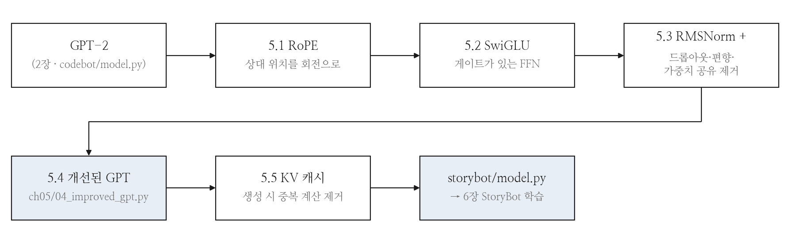

*5장의 흐름 — GPT-2의 부품을 하나씩 바꿔 개선된 GPT를 만들고, KV 캐시를 붙여 StoryBot 모델로 넘긴다. (`ch05/diagrams.py`로 그린 그림)*

### GPT-2 vs 개선된 GPT 한눈에 보기

| 항목 | GPT-2 (`codebot/model.py`) | 개선된 GPT (`ch05/04_improved_gpt.py`) |
|---|---|---|
| 위치 정보 | 학습 가능한 위치 임베딩 `pos_embed` (입력에 **더함**, 절대 위치) | **RoPE** (Q·K를 **회전**, 상대 위치) |
| FFN | `Linear → GELU → Linear` (중간 4배) | **SwiGLU** `O(SiLU(W x) ⊙ V x)` (중간 8/3배) |
| 정규화 | LayerNorm (평균·분산, γ·β) | **RMSNorm** (제곱평균만, γ만) |
| 편향 | FFN Linear·`unembed`에 bias 있음 | 모든 Linear `bias=False` |
| 드롭아웃 | 임베딩·어텐션·FFN에 `Dropout(0.1)` | **없음** |
| 가중치 공유 | `embed.weight = unembed.weight` | **공유 안 함** |
| 생성 | 매번 전체 토큰열 재계산 | **KV 캐시** (`use_cache=True`) |

> 💡 이번 장 구현은 gpt-oss, nanochat(Karpathy), 스탠퍼드 CS336 강의를 참고했다.

---

## 5.1 RoPE — `ch05/01_rope.py`

### 왜 상대 위치인가?

2장의 정현파 인코딩·학습형 위치 임베딩은 모두 "몇 번째 토큰인가"라는 **절대 위치**를 쓴다. 하지만 `"The cat ate the fish"`에서 중요한 건 cat이 2번째라는 사실보다 **cat과 fish가 얼마나 떨어져 있는가**다.

**RoPE(Rotary Position Embedding)** 는 쿼리와 키를 위치만큼 **회전**시켜 어텐션 스코어에 상대 위치를 녹여 넣는다.

### 5.1.1 원리 — 회전하면 내적은 "각도 차이"만 남는다

어텐션에서 위치 정보가 들어가야 할 곳은 $QK^\top$이다.

$$
\mathrm{Attention}(Q, K, V) = \mathrm{Softmax}\!\left(\mathrm{mask}\!\left(\frac{QK^\top}{\sqrt{d}}\right)\right)V,
\qquad
\mathrm{score}_{mn} = Q_m \cdot K_n^\top
$$

목표는 $\mathrm{score}_{mn}$이 **$m-n$에만 의존**하게 만드는 것이다. 2차원으로 생각해 보자. 위치 $m$의 쿼리는 $m\theta$만큼, 위치 $n$의 키는 $n\theta$만큼 돌린다.

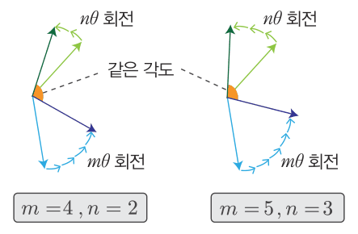

*그림 5-1 — (m=4, n=2)와 (m=5, n=3)은 회전 후 두 벡터 사이의 각도가 같다. 차이 (m−n)θ가 같으면 내적도 같다.*

2차원 회전 행렬:

$$
R(\theta)\begin{pmatrix} x \\ y \end{pmatrix} =
\begin{pmatrix} \cos\theta & -\sin\theta \\ \sin\theta & \cos\theta \end{pmatrix}
\begin{pmatrix} x \\ y \end{pmatrix} =
\begin{pmatrix} x\cos\theta - y\sin\theta \\ x\sin\theta + y\cos\theta \end{pmatrix}
$$

회전 행렬은 $R(a)^\top R(b) = R(b-a)$를 만족하므로

$$
\big(R(m\theta)\,q\big)^\top \big(R(n\theta)\,k\big) = q^\top R\big((n-m)\theta\big)\,k
$$

→ 스코어가 절대 위치 $m, n$이 아니라 **차이 $m-n$** 으로만 결정된다. (이 한 줄 유도는 책의 그림 설명을 수식으로 옮긴 것이다.)

### 5.1.2 고차원으로 확장 — 2개씩 짝지어 따로 돌린다

$d$차원 벡터를 인접한 두 원소씩 묶어 $d/2$개의 2차원 쌍으로 나눈다(64차원 → 32쌍).

$$
\big[(x_0, x_1),\ (x_2, x_3),\ \dots,\ (x_{62}, x_{63})\big]
$$

$k$번째 쌍 $(x_{2k}, x_{2k+1})$은 위치 $m$에서 $m\theta_k$만큼 회전한다.

$$
\theta_k = \frac{1}{\Theta^{2k/d}} \quad (k = 0, 1, \dots, d/2-1),
\qquad
\begin{pmatrix} x'_{2k} \\ x'_{2k+1} \end{pmatrix} =
\begin{pmatrix} \cos(m\theta_k) & -\sin(m\theta_k) \\ \sin(m\theta_k) & \cos(m\theta_k) \end{pmatrix}
\begin{pmatrix} x_{2k} \\ x_{2k+1} \end{pmatrix}
$$

- $\Theta$: 하이퍼파라미터(보통 **10000**), $d$: 벡터 차원
- $k$가 클수록 $\theta_k$가 작다 → **앞쪽 쌍은 빠르게, 뒤쪽 쌍은 천천히** 돈다. 여러 속도의 회전을 조합해 위치를 표현한다(시계의 초침·분침·시침과 비슷하다).

> 💡 **왜 2차원 쌍인가?** 고차원 회전을 행렬 하나로 다루면 복잡하다. 2×2 회전은 단순하고 쌍마다 독립이라 원소별 곱셈만으로 계산된다.

> 💡 **쌍으로 나눠도 "차이에만 의존"이 유지되는 이유** — 내적은 원소별 곱의 합이므로, 32쌍 각각의 2차원 내적을 더한 것과 같다: $`q\cdot k = \sum_{j=0}^{31} q_{(j)}^\top k_{(j)}`$. 쌍 $`j`$는 위치 $`m`$, $`n`$에서 각각 $`m\theta_j`$, $`n\theta_j`$만큼 돌므로, 5.1.1의 식에 따라 그 쌍의 내적은 $`(n-m)\theta_j`$에만 의존한다. 회전 속도 $`\theta_j`$가 쌍마다 달라도 각 항이 차이에만 의존하므로 합도 차이에만 의존한다. 같은 q, k를 (4, 2), (5, 3), (100, 98)에 놓고 계산한 점수는 모두 −10.1077이었다(5.5절 끝 한눈에 보기 그림 (a)).

### 5.1.3 구현

**초기화 — 모든 위치·쌍의 cos/sin을 미리 계산**

```python
class RoPE(nn.Module):
    def __init__(self, theta, key_dim, max_context_len):
        super().__init__()
        assert key_dim % 2 == 0                      # key_dim은 짝수
        half = key_dim // 2

        half_ids = torch.arange(0, half)
        inv_freq = 1.0 / (theta ** ((2.0 * half_ids) / key_dim))  # θ_k, (half,)

        positions = torch.arange(max_context_len)                  # (max_context_len,)
        angles = positions[:, None] * inv_freq[None, :]            # m·θ_k, (max_context_len, half)

        self.register_buffer("cos_cache", torch.cos(angles))
        self.register_buffer("sin_cache", torch.sin(angles))
```

- `positions[:, None]` (L, 1) × `inv_freq[None, :]` (1, half) → **브로드캐스트**로 (L, half). `angles[m, k]` = $m\theta_k$.
- `register_buffer()`: 학습 파라미터는 아니지만 모델의 일부인 텐서. `state_dict` 저장·로드와 `.to(device)` 이동에 함께 따라간다.

**순전파 — 짝수/홀수로 나눠 회전한 뒤 다시 섞기**

```python
    def forward(self, x):                           # x: (B, H, C, D)
        batch_size, num_head, context_len, key_dim = x.shape
        input_dtype = x.dtype
        x = x.float()                               # 정밀도를 위해 float32로 계산

        cos = self.cos_cache[:context_len]          # ❶ 현재 길이만큼 슬라이스
        sin = self.sin_cache[:context_len]

        x_even = x[..., 0::2]                       # ❷ x_0, x_2, ...
        x_odd  = x[..., 1::2]                       #    x_1, x_3, ...

        x_rot_even = x_even * cos - x_odd * sin     # ❸ 회전 공식
        x_rot_odd  = x_even * sin + x_odd * cos

        out = torch.stack([x_rot_even, x_rot_odd], dim=-1)   # ❹ (..., D/2, 2)
        out = out.reshape(batch_size, num_head, context_len, key_dim)  # 교대로 재배치
        return out.to(input_dtype)
```

> ⚠️ **수치 정밀도** — float16/bfloat16으로 각도와 삼각 함수를 계산하면 오차가 커져, 컨텍스트가 길 때 인접 위치를 구분하기 어려워진다. 그래서 float32로 올려 계산하고 원래 타입으로 되돌린다(6.4 혼합 정밀도에서 다시 다룬다).

### 5.1.4 MultiHeadAttention에 통합

```python
class MultiHeadAttention(nn.Module):
    def __init__(self, embed_dim, n_head, head_dim, rope=None):
        ...
        self.rope = rope

    def forward(self, x):
        ...                                         # Q, K, V 계산 → (B, H, C, D)
        if self.rope is not None:
            Q = self.rope(Q)                        # 쿼리와 키에만 적용
            K = self.rope(K)                        # (밸류에는 적용하지 않음)
        scores = torch.matmul(Q, K.transpose(-2, -1))
        ...
```

```python
rope = RoPE(theta=10000, key_dim=64, max_context_len=1024)
mha = MultiHeadAttention(embed_dim=512, n_head=8, head_dim=64, rope=rope)
mha(torch.randn(2, 10, 512)).shape    # torch.Size([2, 10, 512])
```

**포인트**
- RoPE는 **Q·K에만** 적용한다. 목적이 "내적에 상대 위치를 반영"이기 때문이다.
- cos/sin 캐시는 층과 무관하므로 **RoPE 인스턴스 하나를 모든 층이 공유**할 수 있다.
- 입력 임베딩에 위치 벡터를 더하는 기존 방식(`pos_embed`)은 **더 이상 필요 없다**.

---

## 5.2 SwiGLU — `ch05/02_swiglu.py`

### 5.2.1 Swish (SiLU)

$$
\mathrm{Swish}(x) = x \cdot \sigma(\beta x)
\quad\xrightarrow{\ \beta = 1\ }\quad
\mathrm{SiLU}(x) = x \cdot \sigma(x)
$$

$\sigma$는 시그모이드. 대부분의 구현은 $\beta=1$로 고정하며, 이를 **SiLU**(Sigmoid Linear Unit)라 부른다.

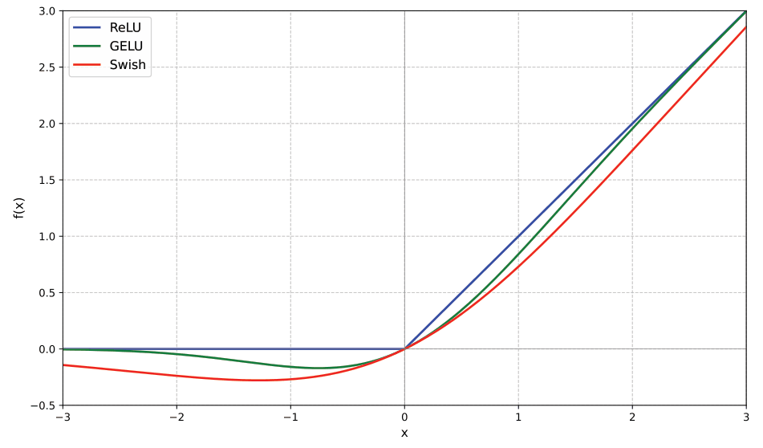

*그림 5-2 — ReLU는 음수를 0으로 잘라내지만 Swish·GELU는 음수 영역에서도 작은 값을 흘려보내고 기울기가 매끄럽게 변한다 → 학습이 안정되고 기울기 소실이 덜하다. (그래프는 `ch05/graph.py`로 그릴 수 있다)*

### 5.2.2 GLU와 그 변형

**GLU(Gated Linear Unit)**: 입력을 두 갈래로 나눠 한쪽은 **특징**, 다른 쪽은 **게이트**(0~1)로 만들고 요소별로 곱한다. 게이트가 "이 특징을 얼마나 통과시킬지"를 정한다.

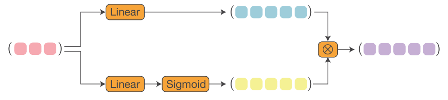

*그림 5-3 — GLU의 구조(⊗는 요소별 곱). 한쪽 Linear 출력에 시그모이드를 씌워 게이트로 쓴다.*

| 변형 | 게이트 활성화 함수 |
|---|---|
| GLU | Sigmoid |
| ReGLU | ReLU |
| GEGLU | GELU |
| **SwiGLU** | **Swish** ← Llama 등 최신 LLM 표준 |

> 💡 **신의 가호?** SwiGLU 논문은 왜 잘 되는지 설명하지 못한다며 "다른 모든 것과 마찬가지로 그 성공을 신의 은총(divine benevolence) 덕으로 돌린다"고 적었다. 효과는 실험으로 확인됐지만 이유는 아직 확실히 밝혀지지 않았다.

### 5.2.3 FFN 구조 비교

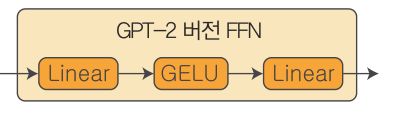

*그림 5-4 — GPT-2의 FFN: Linear로 확장 → GELU → Linear로 복원 (드롭아웃 생략).*

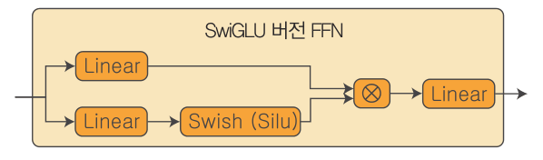

*그림 5-5 — SwiGLU FFN: 입력을 두 Linear(W, V)로 보내고, 한쪽에만 Swish를 씌워 곱한 뒤 출력 Linear(O)로 되돌린다.*

$$
\mathrm{FFN}_{\text{GPT-2}}(x) = \mathrm{GELU}(xW_1)\,W_2
\qquad
\mathrm{FFN}_{\text{SwiGLU}}(x) = \big(\mathrm{SiLU}(xW) \odot xV\big)\,O
$$

**중간 차원은 왜 8/3배인가?** (입력 차원 $d$, 중간 차원 $h$, 편향 무시)

| | Linear 개수 | 파라미터 수 | 같게 맞추면 |
|---|---|---|---|
| GPT-2 FFN | 2 | $2 \cdot d \cdot 4d = 8d^2$ | $h = 4d$ |
| SwiGLU FFN | 3 | $3 \cdot d \cdot h$ | $3dh = 8d^2 \Rightarrow h = \tfrac{8}{3}d \approx 2.67d$ |

### 5.2.4 구현

```python
class SwiGLU(nn.Module):
    def __init__(self, x_dim, hidden_dim=None):
        super().__init__()
        if hidden_dim is None:
            hidden_dim = int(x_dim * 8 / 3)        # 파라미터 수를 GPT-2 FFN과 맞춤
        self.W = nn.Linear(x_dim, hidden_dim, bias=False)   # 특징(Swish 통과)
        self.V = nn.Linear(x_dim, hidden_dim, bias=False)   # 곱해질 쪽
        self.O = nn.Linear(hidden_dim, x_dim, bias=False)   # 원래 차원으로

    def forward(self, x):
        gated = F.silu(self.W(x)) * self.V(x)      # 요소별 곱
        return self.O(gated)
```

- 책 본문은 `silu(x) = x * torch.sigmoid(x)`를 직접 정의해 쓰지만, 저장소 코드는 같은 연산인 `F.silu()`를 쓴다(`nn.SiLU`도 가능).
- 모든 Linear에 `bias=False` — 5.3.3에서 설명.

---

## 5.3 RMSNorm과 그 밖의 개선 — `ch05/03_rmsnorm.py`

### 5.3.1 RMSNorm

$$
\mathrm{LayerNorm}(x) = \gamma \odot \frac{x - \mu}{\sqrt{\sigma^2 + \epsilon}} + \beta
\qquad
\mathrm{RMSNorm}(x) = \gamma \odot \frac{x}{\sqrt{\frac{1}{n}\sum_{i=1}^{n} x_i^2 + \epsilon}}
$$

| | LayerNorm | RMSNorm |
|---|---|---|
| 평균 빼기 | O | **X** (생략) |
| 나누는 값 | 표준편차 $\sqrt{\sigma^2+\epsilon}$ | **RMS** $\sqrt{\mathrm{mean}(x^2)+\epsilon}$ |
| 학습 파라미터 | γ(스케일), β(시프트) | **γ만** |

→ 계산이 더 단순하지만, 여러 실험에서 성능 차이는 크지 않았다.

```python
class RMSNorm(nn.Module):
    def __init__(self, x):                 # x: 정규화할 차원 수(embed_dim)
        super().__init__()
        self.gamma = nn.Parameter(torch.ones(x))
        self.eps = 1e-5

    def forward(self, x):
        x2 = x ** 2                            # ❶ 제곱
        ms = x2.mean(dim=-1, keepdim=True)     # ❷ 마지막 차원(embed_dim)의 평균
        rms = torch.sqrt(ms + self.eps)        # ❸ RMS
        return self.gamma * x / rms            # ❹ 나누고 γ 곱하기
```

> 💡 실제 모델에서는 파이토치 내장 `nn.RMSNorm(embed_dim)`을 쓴다(5.4절 코드).

### 5.3.2 ~ 5.3.4 걷어내는 것들

| 개선 | 이유 | 코드 |
|---|---|---|
| **드롭아웃 제거** | 사전 학습 데이터가 거대해 1에포크만 돌아도 과대적합 위험이 거의 없다 | `nn.Dropout` 삭제 |
| **편향 제거** | 빼도 표현력·성능 차이가 거의 없고 계산량·메모리 접근이 준다 | `nn.Linear(..., bias=False)` |
| **가중치 공유 해제** | 입력 임베딩과 출력 예측 표현을 각자 최적화하는 유연성 | `# self.embed.weight = self.unembed.weight` 주석 처리 |

> ⚠️ **예외도 있다**
> - 작은 데이터셋을 여러 번 도는 **SFT**에서는 드롭아웃을 남기는 것도 고려할 만하다.
> - **가중치 감쇠(weight decay)** 는 여전히 널리 쓴다. 과대적합 방지만이 아니라 파라미터가 너무 커지는 것을 막아 옵티마이저와 함께 학습을 안정시키기 때문이다.
> - Gemma처럼 **가중치 공유를 유지하는 모델**도 있다. 이 책의 모델은 공유하지 않는다.

---

## 5.4 개선된 GPT 구현 — `ch05/04_improved_gpt.py`

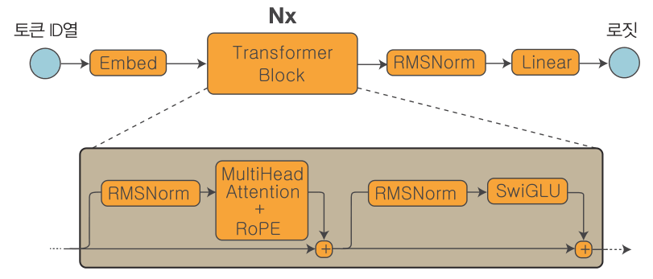

*그림 5-6 — 개선된 GPT의 전체 구조. Embed → (RMSNorm → MHA+RoPE → 잔차, RMSNorm → SwiGLU → 잔차) × N → RMSNorm → Linear → 로짓. 위치 임베딩을 더하는 단계가 사라졌다.*

### 5.4.1 Block

```python
class Block(nn.Module):
    def __init__(self, embed_dim, n_head, ff_dim, rope=None):
        super().__init__()
        head_dim = embed_dim // n_head
        self.norm1 = nn.RMSNorm(embed_dim)                  # LayerNorm → RMSNorm
        self.attn = MultiHeadAttention(embed_dim, n_head, head_dim, rope)  # 내부에서 RoPE
        self.norm2 = nn.RMSNorm(embed_dim)
        self.ffn = SwiGLU(embed_dim, ff_dim)                # GELU FFN → SwiGLU

    def forward(self, x):                                   # Pre-Norm + 잔차 (GPT-2와 동일)
        x = x + self.attn(self.norm1(x))
        x = x + self.ffn(self.norm2(x))
        return x
```

### 5.4.2 GPT

```python
class GPT(nn.Module):
    def __init__(self, vocab_size, max_context_len, embed_dim,
                 n_head, n_layer, ff_dim, theta=10000):
        super().__init__()
        ...                                                 # 하이퍼파라미터 저장(save용)
        self.embed = nn.Embedding(vocab_size, embed_dim)    # pos_embed 없음
        head_dim = embed_dim // n_head
        rope = RoPE(theta, head_dim, max_context_len)       # ⭐ 인스턴스 하나를
        self.blocks = nn.ModuleList([
            Block(embed_dim, n_head, ff_dim, rope)          #    모든 블록이 공유
            for _ in range(n_layer)
        ])
        self.norm = nn.RMSNorm(embed_dim)
        self.unembed = nn.Linear(embed_dim, vocab_size, bias=False)  # 가중치 공유 안 함
        self.apply(self._init_weights)                      # N(0, 0.02²) 초기화

    def forward(self, ids):
        x = self.embed(ids)
        for block in self.blocks:
            x = block(x)
        x = self.norm(x)
        return self.unembed(x)                              # (B, C, vocab_size)
```

- RoPE의 cos/sin은 위치에만 의존하고 층마다 다르지 않다 → **하나를 공유해 메모리를 아낀다**.
- 드롭아웃 관련 인수(`dropout_rate`)가 사라지고 `theta`가 생겼다.

### 5.4.3 저장과 불러오기

2장과 같은 방식이다. `state_dict`와 함께 생성자 인수(`vocab_size`, `max_context_len`, `embed_dim`, `n_head`, `n_layer`, `ff_dim`, `theta`)를 딕셔너리로 저장하고, `@classmethod load_from()`이 그 값으로 모델을 다시 만든 뒤 가중치를 넣는다.

```python
model.save("model.pt")
model = GPT.load_from("model.pt", device="cuda")
```

### 5.4.4 동작 확인

```python
model = GPT(vocab_size=10000, max_context_len=256, embed_dim=384,
            n_head=6, n_layer=6, ff_dim=int(384 * 8 / 3), theta=10000)
logits = model(torch.randint(0, 10000, (8, 256)))
print(logits.shape)   # torch.Size([8, 256, 10000])
```

---

## 5.5 KV 캐시 — `ch05/05_kvcache.py`

**KV 캐시(Key-Value Cache)**: 생성 결과는 **그대로**, 생성 속도만 크게 높이는 기법.

### 5.5.1 텍스트 생성의 낭비

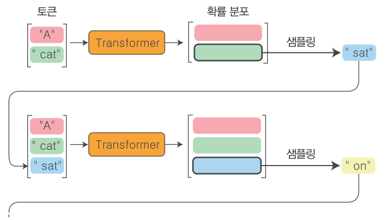

*그림 5-7 — `["A", " cat"]` → `" sat"` 예측 → `["A", " cat", " sat"]`를 통째로 다시 넣어 → `" on"` 예측 → … (실제 입력은 토큰 ID)*

- 매 단계 C개의 확률 분포를 계산하지만 **쓰는 건 마지막 하나**뿐이다.
- 어텐션 이외의 층(Embed, FFN, RMSNorm, Linear, Softmax)은 **토큰별로 독립** → 마지막 토큰만 계산해도 된다.
- **어텐션만** 과거 토큰 정보가 필요하다 → 개선 포인트는 어텐션.

### 5.5.2 어텐션과 KV 캐시

$Q = XW_q,\ K = XW_k,\ V = XW_v$ 로 만든 뒤 어텐션을 계산한다. 토큰이 2개일 때와 3개일 때를 나란히 놓아 보자.

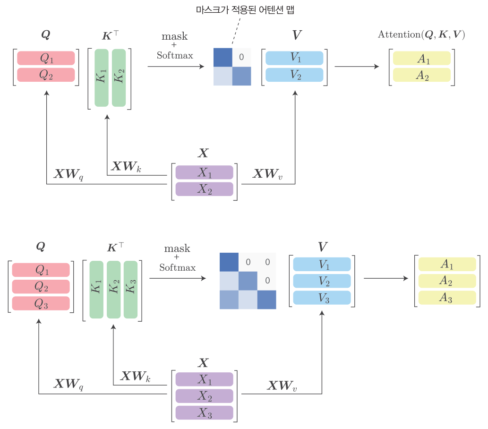

*그림 5-8 — 토큰 3개일 때도 [Q₁, Q₂], [K₁, K₂], [V₁, V₂]를 처음부터 다시 계산한다. 앞 단계에서 이미 구한 값이다.*

관찰 두 가지:
1. 과거 토큰의 **K, V는 변하지 않는다** → 저장해 두고 재사용(캐시).
2. 필요한 건 마지막 출력뿐이므로 **쿼리는 최신 토큰의 Q₃ 하나**면 된다.

#### 층이 여러 개여도 과거 K, V가 변하지 않는 이유

그림 5-8은 어텐션 한 층만 보여 준다. 실제 모델은 블록이 여러 개이고, 2번째 블록부터는 K, V를 아래 블록의 출력에서 만든다. 그래서 관찰 1이 성립하려면 **과거 위치의 출력이 모든 블록에서 뒤에 붙은 토큰의 영향을 받지 않아야** 한다.

이것을 보장하는 것이 인과 마스크다. 2장 2.6절의 "확인: 한 번에 넣기 = 접두사를 따로 넣기"와 같은 원리다. 마스크가 있으면 위치 $`i`$의 행은 모든 블록에서 0~$`i`$번째 토큰만 보고, 어텐션 밖의 층은 행마다 따로 계산한다. 따라서 뒤에 토큰이 붙어도 그 행의 값은 그대로이고, 그 행에서 만든 각 블록의 K, V도 그대로다. RoPE도 offset을 올바르게 넘기면 위치 $`i`$에 늘 같은 각도를 쓰므로 이 성질을 깨지 않는다.

- 직접 확인: 5.4.4 설정 모델(무작위 초기화)로 비교했다. 토큰 4개를 한 번에 프리필한 K 캐시와, 2개 프리필 → 1개 → 1개로 디코드하며 쌓은 K 캐시의 최대 차이는 6개 블록 모두 4.5e-07 ~ 1.0e-06이었다. 이는 부동소수점 오차 수준이다.
- 마스크가 없는 양방향 어텐션이라면 앞 위치의 값이 뒤 토큰에 따라 바뀐다(2.6절 비교표의 "`masked_fill` 줄을 뺐을 때" 열). 그러면 토큰이 붙을 때마다 과거 K, V를 다시 계산해야 하므로 KV 캐시를 쓸 수 없다.

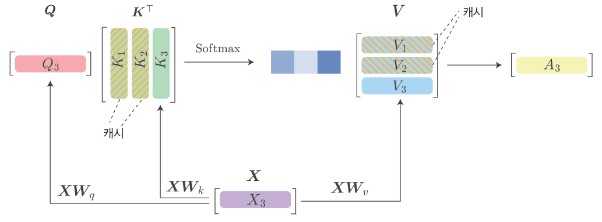

*그림 5-9 — 새로 계산하는 건 X₃에서 나온 Q₃, K₃, V₃뿐이다. K₁, K₂, V₁, V₂는 캐시에서 꺼낸다. 출력은 A₃ 한 행.*

> 💡 **Q 캐시는 왜 없나?** 과거 토큰의 쿼리는 과거 출력을 만들 때만 쓰였고 다시 쓸 일이 없다. 다시 쓰이는 건 "새 쿼리가 참조할 대상"인 K와 V뿐이다.

디코드 단계에서는 쿼리가 최신 토큰 하나이고, 참조하는 키는 모두 현재 또는 과거 위치다 → **인과 마스크가 필요 없다**.

> ⚠️ **디코드 입력은 1토큰이라고 가정한다** — 이 설명과 5.5.4 코드의 조건 `if not use_cache or is_first_call`은 디코드 단계에 새 토큰을 **1개씩만** 넣는다고 가정한다. 캐시가 있는 상태에서 2개 이상을 한 번에 넣으면, 첫 번째 새 토큰의 쿼리가 두 번째 새 토큰의 키를 보게 되는데도 마스크가 생략된다. 오류 없이 결과만 틀린다. 직접 확인한 값: 2토큰을 프리필한 뒤 2토큰을 한 번에 디코드하면, 캐시 없이 4토큰을 넣은 logits와의 최대 차이가 첫 새 토큰 0.43, 둘째 0.25였다. 둘째 토큰은 원래 키를 모두 봐도 되는 위치다. 그런데도 다른 이유는, 아래 블록에서 첫 새 토큰의 값이 이미 틀어졌고 그 K, V를 둘째 토큰이 참조하기 때문이다. 5.5.5의 생성 루프는 매번 1토큰만 넣으므로 이 문제가 생기지 않는다.

### 5.5.3 프리필과 디코드

| 단계 | 입력 | 하는 일 | 인과 마스크 |
|---|---|---|---|
| **프리필(Prefill)** | 프롬프트 전체 (여러 토큰) | 한 번에 처리, KV 캐시 초기화, 첫 토큰 예측 | **필요** (프롬프트 내부에서 미래를 보면 안 됨) |
| **디코드(Decode)** | 방금 생성한 토큰 1개 | 캐시에 K, V 추가, 다음 토큰 예측 | 불필요 |

```text
프리필: ["A", " cat"]  → 캐시 K1,K2 / V1,V2 저장 → " sat" 예측
디코드: [" sat"]       → 캐시에 K3 / V3 추가     → " on" 예측
디코드: [" on"]        → 캐시에 K4 / V4 추가     → ...
```

(책 본문의 "V1, V1"은 V1, V2의 오타로 보인다.)

### 5.5.4 구현

**MultiHeadAttention에 캐시 상태 추가**

```python
class MultiHeadAttention(nn.Module):
    def __init__(self, embed_dim, n_head, head_dim, rope=None):
        ...
        self.k_cache = None      # 키 캐시   (B, H, 지금까지 길이, D)
        self.v_cache = None      # 밸류 캐시
        self.cache_offset = 0    # 다음 토큰의 실제 위치 (RoPE용)

    def forward(self, x, use_cache=False):
        B, C, E = x.shape
        H, D = self.n_head, self.head_dim
        Q = self.W_q(x).view(B, C, H, D).transpose(1, 2)
        K = self.W_k(x).view(B, C, H, D).transpose(1, 2)
        V = self.W_v(x).view(B, C, H, D).transpose(1, 2)

        if self.rope is not None:                       # 캐시 사용 시 실제 위치를 넘김
            offset = self.cache_offset if use_cache else 0
            Q = self.rope(Q, offset)
            K = self.rope(K, offset)

        if use_cache:
            is_first_call = (self.k_cache is None)      # ❶ 프리필인가?
            if is_first_call:
                self.k_cache, self.v_cache = K, V       # ❷ 프리필: 캐시 초기화
            else:                                       # ❸ 디코드: 길이 축(dim=2)으로 이어 붙임
                self.k_cache = torch.cat([self.k_cache, K], dim=2)
                self.v_cache = torch.cat([self.v_cache, V], dim=2)
            self.cache_offset += C
            K, V = self.k_cache, self.v_cache           # ❹ 캐시 전체를 참조

        scores = torch.matmul(Q, K.transpose(-2, -1)) / (D ** 0.5)
        if not use_cache or is_first_call:              # 디코드 단계에선 마스크 생략
            mask = torch.tril(torch.ones(C, C, device=scores.device))
            scores = scores.masked_fill(mask == 0, float('-inf'))
        weights = F.softmax(scores, dim=-1)
        hidden = torch.matmul(weights, V)
        ...                                             # 헤드 합치기 → W_o

    def clear_cache(self):
        self.k_cache = None
        self.v_cache = None
        self.cache_offset = 0
```

(RoPE 부분은 저장소 코드의 `if use_cache: ... else: ...` 분기를 한 줄로 줄여 적었다.)

**Block / GPT** — `use_cache`를 아래로 전달하고, `clear_cache()`를 위에서 한 번에 부를 수 있게 한다.

```python
# Block
def forward(self, x, use_cache=False):
    x = x + self.attn(self.norm1(x), use_cache=use_cache)
    x = x + self.ffn(self.norm2(x))
    return x
def clear_cache(self):
    self.attn.clear_cache()

# GPT
def forward(self, ids, use_cache=False):
    x = self.embed(ids)
    for block in self.blocks:
        x = block(x, use_cache=use_cache)
    return self.unembed(self.norm(x))
def clear_cache(self):
    for block in self.blocks:
        block.clear_cache()
```

> ⚠️ **RoPE + KV 캐시** — 디코드 단계의 입력은 토큰 1개라서, 그대로 두면 RoPE는 이 토큰을 **0번 위치**로 착각한다. 그래서 `RoPE.forward(x, offset)`에 `cache_offset`을 넘겨 `cos_cache[offset:offset+C]`를 쓰게 한다. 책 본문 코드에는 빠져 있고 저장소 `05_kvcache.py`에만 들어 있다.

> ⚠️ **캐시 길이 제한** — 이 구현은 캐시가 끝없이 커진다. 실용 구현에서는 최대 컨텍스트 길이로 자르거나 최근 N개만 유지하는 **슬라이딩 윈도**가 필요하다. (`webbot/model.py`에는 최대 길이를 넘으면 오래된 부분을 잘라내는 코드가 들어 있다 → 8장)
>
> 위치도 문제가 된다. `RoPE.forward`에는 `offset + C`가 `max_context_len`을 넘으면 `offset = max_context_len - C`로 고정하는 줄이 있다(`ch05/05_kvcache.py`, `storybot/model.py` 34행). 그래서 캐시를 계속 쓰며 최대 길이를 넘기면 그 뒤의 토큰은 모두 마지막 위치(`max_context_len - 1`)의 각도로 회전된다. 오류 없이 위치 정보만 틀어진다. 직접 확인한 값: `max_context_len=8`인 RoPE에 같은 벡터를 offset 7, 8, 9, 20으로 넣으면 출력이 모두 같았고(차이 0), offset 6과는 최대 0.73 달랐다. `05_kvcache.py`의 시험(시작 1토큰 + 200토큰 생성)은 256을 넘지 않으므로 이 문제가 생기지 않는다.

### 5.5.5 텍스트 생성에 사용

```python
# 캐시 없음: 매번 전체 토큰열을 넣는다
logits = model(ids, use_cache=False)

# 캐시 있음: 첫 호출(프리필)만 프롬프트 전체, 이후엔 새 토큰 1개만
model.clear_cache()
next_id = start_ids
for _ in range(max_new_tokens):
    logits = model(next_id, use_cache=True)
    next_id = torch.argmax(logits[:, -1, :], dim=-1, keepdim=True)
    ids = torch.cat([ids, next_id], dim=1)
```

**결과**: 200토큰 생성 시 KV 캐시 쪽이 **약 5배 빠르다**(책 기준, M2 맥북에어 CPU). 환경과 모델 크기에 따라 수 배에서 10배 이상까지 차이가 나며, 생성 토큰이 많을수록 효과가 커진다.

**계산량 비교 (토큰 t번째를 생성할 때)**

| | 새로 계산하는 Q/K/V | 어텐션 스코어 | t개를 다 생성하는 총 비용 |
|---|---|---|---|
| 캐시 없음 | t개 토큰 전부 | t × t | 대략 $O(t^3)$ (스코어 기준) |
| KV 캐시 | **1개 토큰** | 1 × t | 대략 $O(t^2)$ |

(위 차수는 책에 없는 보충 설명이다. 대신 캐시 메모리가 토큰 수에 비례해 늘어난다 → 8장 GQA가 이 메모리를 줄인다.)

### 한눈에 보기: 개선된 GPT의 순전파와 KV 캐시 생성

이번 장의 부품을 5.4.4 설정(어휘 10,000, E=384, 헤드 6×64, 블록 6) 모델 하나로 이어서 그렸다. (a)는 토큰 3개가 모델을 지나는 길과 RoPE·SwiGLU의 실제 값이고, (b)는 같은 모델로 KV 캐시를 써서 생성할 때 블록 하나의 어텐션이 어떻게 바뀌는지다. StoryBot의 학습된 가중치는 저장소에 없으므로 토큰은 그림 5-7의 예를 쓰고, 형상과 수치는 `ch05/05_kvcache.py`의 클래스를 무작위 초기화로 실제 실행해 얻었다.

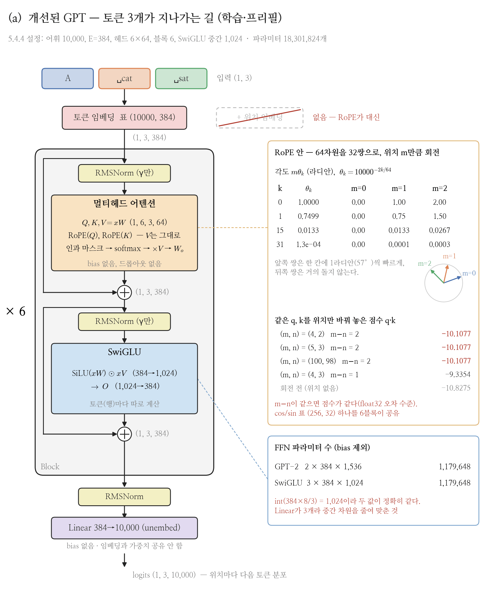

*그림 (a) — 위치 임베딩 없이 토큰 임베딩 → (RMSNorm → 어텐션+RoPE → 잔차, RMSNorm → SwiGLU → 잔차) × 6 → RMSNorm → unembed. 오른쪽은 RoPE의 쌍별 회전 각도와, 위치만 바꾼 같은 q·k의 점수다. (`ch05/flow_graph.py`로 그린 그림)*

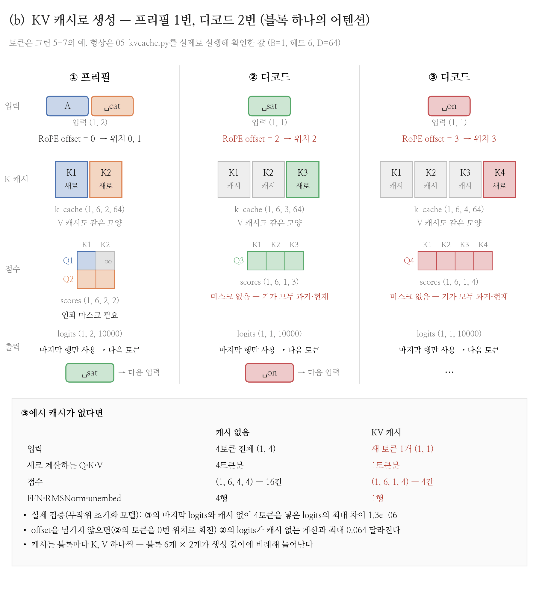

*그림 (b) — 프리필은 프롬프트 2토큰을 한 번에 처리하고, 디코드는 새 토큰 1개만 넣는다. K 캐시는 한 칸씩 늘고, 점수는 마지막 쿼리 한 행만 계산한다.*

- **위치는 어텐션 안에서만 들어간다.** 입력에 위치 벡터를 더하는 단계가 없고, 각 블록의 어텐션에서 Q와 K를 회전할 때만 위치가 반영된다. V와 잔차 경로에는 위치 벡터가 더해지지 않는다.
- **쌍마다 회전 속도가 다르다.** head_dim 64에서 $`k=0`$ 쌍은 한 칸에 1라디안씩, $`k=31`$ 쌍은 약 $`1.3\times10^{-4}`$라디안씩 돈다. 빠른 쌍은 약 6.3칸마다 한 바퀴를 돌고, 느린 쌍은 한 바퀴에 약 47,000칸이 걸린다.
- **점수는 위치 차이에만 의존한다.** 같은 q, k를 $`(m, n)`$ = (4, 2), (5, 3), (100, 98)에 놓으면 점수가 모두 −10.1077로 같고, 차이가 1인 (4, 3)에서는 −9.3354로 달라진다.
- **SwiGLU의 중간 차원 1,024는 파라미터 수를 맞춘 값이다.** GPT-2 FFN(2 × 384 × 1,536)과 SwiGLU(3 × 384 × 1,024)는 둘 다 1,179,648개로 정확히 같다.
- **디코드는 새 토큰 한 행만 계산한다.** K 캐시는 (1, 6, 2, 64) → (1, 6, 3, 64) → (1, 6, 4, 64)로 늘고, 점수는 (1, 6, 1, t) 한 행이다. 쿼리가 가장 최근 위치라 가릴 미래 키가 없으므로 마스크도 필요 없다.
- **캐시는 결과를 바꾸지 않지만 offset은 꼭 필요하다.** 캐시로 만든 마지막 logits와 캐시 없이 4토큰을 넣은 logits의 최대 차이는 1.3e-06(부동소수점 오차)이다. offset을 넘기지 않으면 ②에서 만든 logits가 캐시 없는 계산과 최대 0.064만큼 달라진다.

---

## 핵심 정리

- **RoPE**: Q·K의 2차원 쌍을 위치 $m$에 비례한 각도 $m\theta_k$로 회전한다. 회전 행렬의 성질로 내적이 **상대 위치 $m-n$** 에만 의존하게 된다. $\theta_k = \Theta^{-2k/d}$로 쌍마다 회전 속도가 다르다. 입력에 위치 벡터를 더하지 않는다.
- **SwiGLU**: `O(SiLU(Wx) ⊙ Vx)`. 게이트로 정보 흐름을 조절하고, Linear가 3개라 중간 차원을 **8/3배**로 잡아 파라미터 수를 GPT-2 FFN과 맞춘다.
- **RMSNorm**: 평균 빼기와 β를 없애고 RMS로만 나눈다. 더 단순하고 성능은 비슷하다.
- **걷어낸 것**: 드롭아웃(데이터가 충분히 큼), 편향(효과 미미), 가중치 공유(독립 최적화).
- **KV 캐시**: 과거 토큰의 K, V를 저장해 재사용하고, 새 토큰의 Q·K·V만 계산한다. **프리필**(프롬프트 전체, 마스크 O) → **디코드**(1토큰씩, 마스크 X). RoPE에는 `offset`으로 실제 위치를 알려야 한다.
- 완성된 모델은 `storybot/model.py`에 들어 있고 6장에서 StoryBot 학습에 쓴다.

## 이전·이후 장과의 연결

| 이번 장의 내용 | 관련 장 |
|---|---|
| 개선 전 GPT-2 (위치 임베딩, LayerNorm, GELU FFN, 어텐션 마스크) | 2장 모델 (기본편) — 2.5 위치 인코딩, 2.6 어텐션 마스크, 2.9 트랜스포머 블록 |
| RoPE를 float32로 계산하는 이유 | 6.4 혼합 정밀도 |
| 개선된 GPT로 StoryBot 학습 | 6장 |
| 어텐션 고속화(Flash Attention), KV 메모리 절감(GQA), 컨텍스트 길이 확장(PI·YaRN) | 8장 모델 (도전편) |

## 복습 질문

1. RoPE를 쿼리와 키에 적용하면 어텐션 스코어가 상대 위치에만 의존하게 되는 이유를 회전 행렬의 성질로 설명해 보라.

   <details><summary>정답 보기</summary>

   2차원 회전 행렬은 $`R(a)^\top = R(-a)`$이고 회전을 이어 하면 각도가 더해지므로 $`R(a)^\top R(b) = R(b-a)`$가 성립한다. 위치 $`m`$의 쿼리를 $`m\theta`$, 위치 $`n`$의 키를 $`n\theta`$만큼 돌리면 $`\big(R(m\theta)\,q\big)^\top \big(R(n\theta)\,k\big) = q^\top R(m\theta)^\top R(n\theta)\,k = q^\top R\big((n-m)\theta\big)\,k`$가 되어, 스코어에 남는 위치 정보는 차이 $`n-m`$뿐이다. 고차원에서는 2차원 쌍마다 이 식이 따로 성립하고, 내적은 쌍별 내적의 합이므로 전체 스코어도 차이에만 의존한다. 한눈에 보기 그림 (a)에서 같은 q, k를 (4, 2), (5, 3), (100, 98)에 놓은 점수는 모두 −10.1077이었다.

   </details>

2. $\theta_k = 1/\Theta^{2k/d}$에서 $k$가 커지면 회전 속도는 어떻게 되는가? 빠른 쌍과 느린 쌍은 각각 어떤 위치 정보를 담당할까?

   <details><summary>정답 보기</summary>

   $`k`$가 커질수록 $`\theta_k`$가 작아져 **천천히** 돈다. head_dim 64에서 $`\theta_0 = 1`$, $`\theta_{31} \approx 1.3\times10^{-4}`$다.

   - **빠른 쌍**(작은 $`k`$)은 한 칸만 떨어져도 각도가 크게 달라져 **가까운 거리**를 세밀하게 구별한다. 대신 $`2\pi/\theta_0 \approx 6.3`$칸마다 한 바퀴를 돌아 먼 거리는 구별하지 못한다.
   - **느린 쌍**(큰 $`k`$)은 가까운 위치끼리는 거의 차이가 없지만, 한 바퀴에 약 47,000칸이 걸리므로 **먼 거리**를 겹치지 않게 나타낸다.

   노트의 비유처럼 초침·분침·시침을 함께 보면 시각을 정확히 알 수 있는 것과 같다.

   </details>

3. RoPE를 밸류에는 적용하지 않는 이유는? 하나의 RoPE 인스턴스를 모든 층이 공유해도 되는 이유는?

   <details><summary>정답 보기</summary>

   RoPE의 목적은 **Q·K 내적(스코어)** 에 상대 위치를 반영하는 것이다. V는 스코어 계산에 쓰이지 않고 가중합의 재료로만 쓰이므로, V를 돌려도 "어디를 볼지"에는 아무 영향이 없고 섞이는 내용만 위치에 따라 바뀐다. 그래서 Q와 K에만 적용한다.

   하나의 인스턴스를 공유해도 되는 이유는 RoPE에 학습 파라미터가 없기 때문이다. cos/sin 표는 $`\Theta`$, head_dim, 최대 길이만으로 정해지는 상수(`register_buffer`)라 층마다 다를 이유가 없다. 5.4.4 설정에서는 (256, 32) 크기의 cos 표와 sin 표 하나씩을 6개 블록이 함께 쓴다.

   </details>

4. SwiGLU FFN의 중간 차원을 $4d$가 아니라 $\frac{8}{3}d$로 잡는 이유를 파라미터 수로 계산해 보라.

   <details><summary>정답 보기</summary>

   편향을 무시하면 GPT-2 FFN은 $`d \to 4d`$, $`4d \to d`$ Linear 2개라 $`2 \cdot d \cdot 4d = 8d^2`$개다. SwiGLU는 $`W`$, $`V`$($`d \to h`$)와 $`O`$($`h \to d`$) Linear 3개라 $`3dh`$개다. 둘을 같게 놓으면 $`3dh = 8d^2`$에서 $`h = \tfrac{8}{3}d`$다.

   중간 차원을 $`4d`$로 두면 $`12d^2`$로 1.5배가 된다. $`d = 384`$에서 계산하면 GPT-2 FFN은 $`2 \times 384 \times 1536 = 1{,}179{,}648`$, SwiGLU는 $`3 \times 384 \times 1024 = 1{,}179{,}648`$로 정확히 같고, $`h = 1536`$이면 1,769,472개가 된다.

   </details>

5. RMSNorm은 LayerNorm에서 무엇을 생략했는가?

   <details><summary>정답 보기</summary>

   두 가지를 생략했다. **평균 빼기**(중심화)를 하지 않고, 학습 파라미터 중 **β(시프트)** 를 없애 γ(스케일)만 남겼다. 그래서 나누는 값도 표준편차 $`\sqrt{\sigma^2+\epsilon}`$ 대신 제곱평균의 제곱근 $`\sqrt{\mathrm{mean}(x^2)+\epsilon}`$를 쓴다. 계산은 단순해지지만 성능 차이는 크지 않았다.

   </details>

6. LLM 사전 학습에서 드롭아웃은 빼지만 가중치 감쇠는 남기는 이유는?

   <details><summary>정답 보기</summary>

   드롭아웃은 과대적합을 막는 장치인데, LLM 사전 학습은 데이터가 거대해 1에포크만 돌아도 같은 예를 반복해 볼 일이 거의 없다. 과대적합 위험이 낮으니 드롭아웃은 학습을 방해할 뿐이라 뺀다.

   가중치 감쇠는 과대적합 방지만 하는 것이 아니다. 파라미터가 지나치게 커지는 것을 막아 옵티마이저와 함께 **학습을 안정시키는** 역할도 하므로 여전히 쓴다.

   </details>

7. KV 캐시에 Q는 저장하지 않는 이유는? 디코드 단계에서 인과 마스크가 필요 없는 이유는?

   <details><summary>정답 보기</summary>

   새 토큰의 출력을 만들 때 필요한 것은 **새 토큰의 쿼리 하나**와 **모든 위치의 K, V**다. 과거 토큰의 쿼리는 과거 위치의 출력을 만들 때만 쓰였고, 그 출력은 이미 다 썼으므로 다시 쓸 일이 없다. 반면 K와 V는 새 쿼리가 참조할 대상이라 매 단계 다시 필요하다.

   디코드 단계의 쿼리는 가장 최근 위치 하나뿐이고, 캐시에 있는 키는 모두 그 이전 또는 같은 위치다. 가려야 할 미래 키가 없으므로 마스크가 필요 없다. 한눈에 보기 그림 (b)에서 디코드의 점수는 (1, 6, 1, 3), (1, 6, 1, 4)처럼 한 행이고, 그 행의 모든 칸이 유효하다.

   </details>

8. KV 캐시와 RoPE를 함께 쓸 때 `offset`을 넘기지 않으면 어떤 일이 생기는가?

   <details><summary>정답 보기</summary>

   디코드 입력은 토큰 1개라서 offset이 없으면 RoPE가 `cos_cache[0:1]`을 써서 그 토큰을 **0번 위치**로 회전한다. 캐시에 있는 과거 K들은 제 위치(0, 1, …)로 회전되어 있으므로, 새 쿼리와 키 사이의 위치 차이가 틀어진다. 예를 들어 한눈에 보기 그림 (b)의 ②에서 실제 위치 2인 `" sat"`이 위치 0으로 취급되어, 위치 0의 `"A"`와 같은 자리에 있는 것처럼 계산된다. 이 토큰의 K도 잘못된 위치로 회전된 채 캐시에 저장되므로 이후 단계에도 오류가 남는다.

   결과적으로 생성 결과가 캐시 없이 계산한 것과 달라진다. 무작위 초기화 모델로 확인하면 offset을 넘긴 경우 logits 최대 차이는 1.3e-06(부동소수점 오차)이지만, 넘기지 않으면 ②의 logits가 최대 0.064만큼 달라졌다.

   </details>
