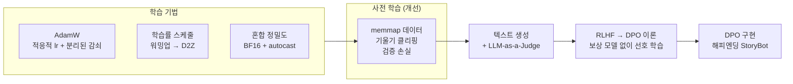
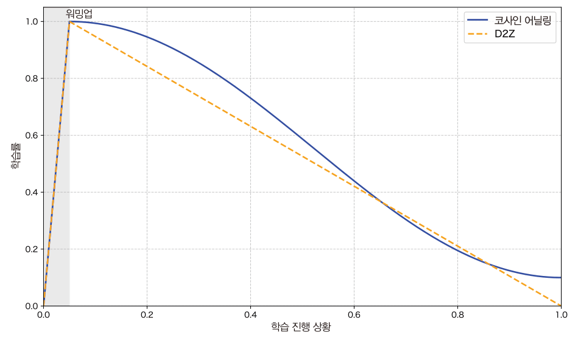
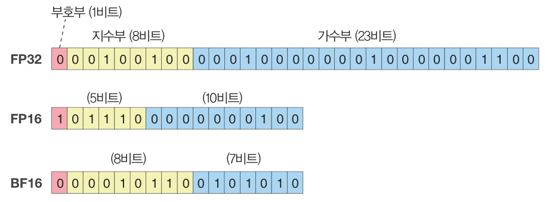
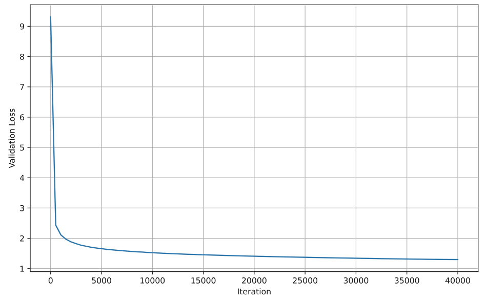
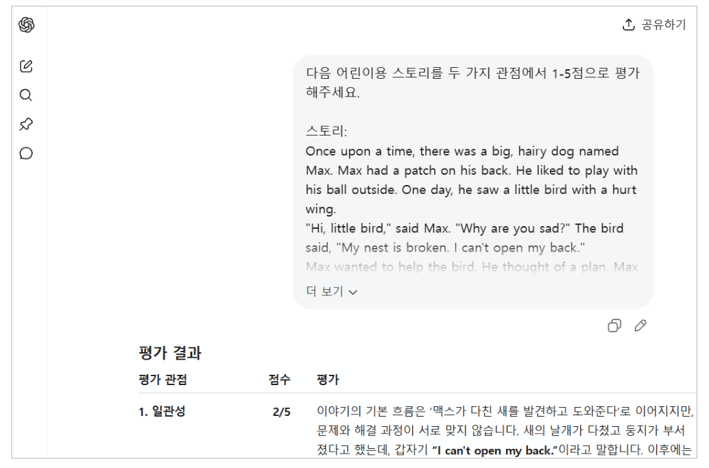
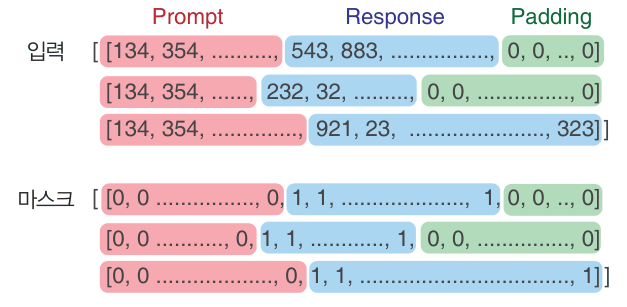
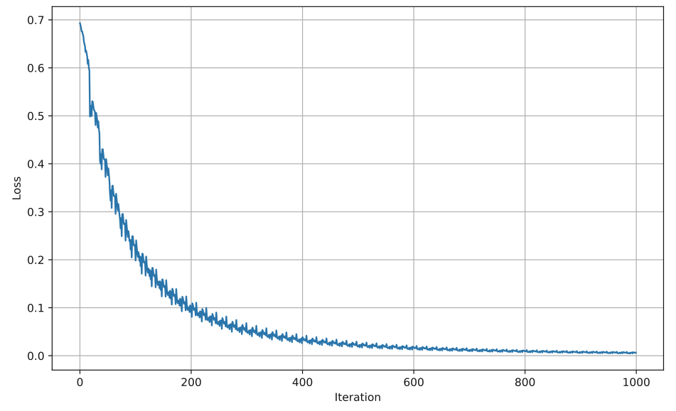

# 6장. 학습 (응용편)

> **한 줄 요약** — 옵티마이저(**AdamW**), **학습률 스케줄**(워밍업 + D2Z), **혼합 정밀도**(BF16 + autocast)를 익히고, 여기에 메모리 맵·기울기 클리핑·검증 평가를 더해 StoryBot(약 2,000만 파라미터)을 사전 학습한다. 품질은 **LLM-as-a-Judge**로 재고, 마지막으로 **DPO**로 선호 데이터를 학습시켜 StoryBot을 "해피엔딩 이야기꾼"으로 바꾼다.



| 절 | 주제 | 코드 |
|---|---|---|
| 6.1~6.2 | AdamW 원리와 구현 | `ch06/02_adamw.py` |
| 6.3 | 학습률 스케줄 (D2Z) | `ch06/03_lr_scheduler.py`, `ch06/lr_graph.py` |
| 6.4 | 혼합 정밀도 | `ch06/04_mixed_precision.py` |
| 6.5 | 사전 학습 (개선 버전) | `ch06/05_pretrain.py` |
| 6.6 | 텍스트 생성과 LLM-as-a-Judge | `ch06/06_generate.py`, `ch06/07_llm_judge.py` |
| 6.7 | RLHF와 DPO의 원리 | — |
| 6.8 | DPO 구현과 평가 | `ch06/08_dpo.py`, `ch06/09_llm_judge.py` |

---

## 6.1 AdamW의 원리

3장에서는 AdamW를 "그냥 쓰는" 데서 그쳤다. 이 절에서는 **왜 SGD도, 그냥 Adam도 아닌 AdamW인가**를 옵티마이저의 발전 과정을 따라가며 확인한다.

### 6.1.1 SGD

$$
\theta_{t+1} = \theta_t - \alpha\, g_t
$$

($\alpha$: 학습률, $g_t$: 스텝 $t$의 기울기)

- 단순하고 빠르다.
- **모든 파라미터에 같은 학습률**을 쓴다. 층마다 기울기 스케일이 크게 다르면, 어떤 층은 학습률이 너무 커서 불안정하고 다른 층은 너무 작아서 느리다.

### 6.1.2 모멘텀

기울기의 **지수 이동 평균(EMA)** 을 "관성"처럼 쓴다.

$$
m_t = \beta\, m_{t-1} + (1-\beta)\, g_t, \qquad \theta_{t+1} = \theta_t - \alpha\, m_t
$$

전개해 보면 과거 기울기에 붙는 가중치가 지수적으로 줄어든다.

$$
m_t = (1-\beta)\left(g_t + \beta g_{t-1} + \beta^2 g_{t-2} + \cdots\right)
$$

- 기울기가 스텝마다 출렁여도 큰 흐름을 따라가므로 **지그재그 진동이 줄어든다**.
- 하지만 "학습률이 모든 파라미터에 같다"는 SGD의 한계는 그대로다.

### 6.1.3 Adam

1차 모멘트(기울기의 EMA)와 **2차 모멘트(기울기 제곱의 EMA)** 를 함께 추적해 **파라미터별 학습률**을 만든다.

$$
\begin{aligned}
m_t &= \beta_1 m_{t-1} + (1-\beta_1)\, g_t && \text{(1) 1차 모멘트}\\
v_t &= \beta_2 v_{t-1} + (1-\beta_2)\, g_t^2 && \text{(2) 2차 모멘트}\\
\hat m_t &= \frac{m_t}{1-\beta_1^t}, \quad \hat v_t = \frac{v_t}{1-\beta_2^t} && \text{(3)(4) 편향 보정}\\
\theta_{t+1} &= \theta_t - \alpha\, \frac{\hat m_t}{\sqrt{\hat v_t} + \epsilon} && \text{(5) 갱신}
\end{aligned}
$$

- **편향 보정**: $m_0 = v_0 = 0$에서 출발하므로 학습 초반의 $m_t, v_t$는 0 쪽으로 치우친다. $1-\beta^t$로 나눠 이를 바로잡는다 (자세한 원리는 부록 D).
- **적응적 학습률**: $\sqrt{\hat v_t}$로 나누므로 기울기 변동이 **큰** 파라미터는 **작게**, 변동이 **작은** 파라미터는 **크게** 갱신된다.

> 💡 **편향 보정의 크기 감각** — $\beta_1 = 0.9$, $t=1$이면 $m_1 = 0.1\,g_1$이다. $1-0.9^1 = 0.1$로 나누면 $\hat m_1 = g_1$이 되어 원래 크기를 되찾는다. $t$가 커지면 $\beta^t \to 0$이라 보정은 사실상 사라진다.

### 6.1.4 Adam → AdamW

**L2 정규화 = 가중치 감쇠 (SGD에서는)**

$$
L_{\text{total}} = L + \frac{\lambda}{2}\sum_i \theta_i^2
\;\;\Rightarrow\;\;
\frac{\partial L_{\text{total}}}{\partial \theta} = g_t + \lambda\theta_t
\;\;\Rightarrow\;\;
\theta_{t+1} = \theta_t - \alpha g_t - \underbrace{\alpha\lambda\theta_t}_{\text{매 스텝 0 쪽으로}}
$$

SGD에서는 L2 정규화가 곧 **가중치 감쇠(weight decay)** — 파라미터를 매 스텝 일정 비율로 줄이는 효과 — 가 된다.

**Adam에 L2를 넣으면 문제가 생긴다**

$$
m_t = \beta_1 m_{t-1} + (1-\beta_1)(g_t + \lambda\theta_t), \qquad
v_t = \beta_2 v_{t-1} + (1-\beta_2)(g_t + \lambda\theta_t)^2
$$

정규화 항 $\lambda\theta_t$가 모멘트 안으로 섞여 들어가 결국 $\sqrt{\hat v_t}$로 나뉜다. 그러면 **감쇠 강도가 기울기 크기에 따라 달라진다** — 기울기가 큰 파라미터일수록 감쇠가 약해진다. "기울기와 무관하게 일정 비율로 줄인다"는 원래 의도가 깨진다.

**AdamW [Loshchilov et al., 2019]: 감쇠를 모멘트 계산에서 분리(decoupled)**

$$
\theta_{t+1} = \theta_t - \alpha\,\frac{\hat m_t}{\sqrt{\hat v_t} + \epsilon} \;-\; \alpha\lambda\,\theta_t
$$

모멘트는 순수한 $g_t$로만 계산하고, 마지막 항 $-\alpha\lambda\theta_t$를 **바깥에서 직접** 적용한다 → 적응적 학습률의 영향을 받지 않는다. 현재 대부분의 LLM이 AdamW를 표준으로 쓴다.

| 옵티마이저 | 저장하는 상태 | 파라미터별 학습률 | 가중치 감쇠 | 한계 |
|---|---|---|---|---|
| SGD | 없음 | ✗ (모두 같음) | L2 = 감쇠 | 층마다 스케일이 다르면 불안정/느림 |
| Momentum | $m$ | ✗ | L2 = 감쇠 | 진동은 줄지만 학습률은 여전히 공통 |
| Adam | $m, v$ | ✅ $1/\sqrt{\hat v}$ | L2가 $\sqrt{\hat v}$로 나뉘어 **왜곡** | 감쇠 강도가 기울기 크기에 의존 |
| **AdamW** | $m, v$ | ✅ | **분리된 감쇠** $-\alpha\lambda\theta$ | LLM의 사실상 표준 (단, 상태 메모리 2배) |

---

## 6.2 AdamW 구현 — `ch06/02_adamw.py`

### 6.2.1 SGD로 보는 옵티마이저의 틀

```python
import torch
from torch.optim.optimizer import Optimizer

class SGD(Optimizer):
    def __init__(self, params, lr=0.01):
        defaults = {'lr': lr}                   # 하이퍼파라미터를 dict로
        super().__init__(params, defaults)      # param_groups 등 내부 구조 초기화

    def step(self):
        for group in self.param_groups:         # 그룹마다 다른 설정 가능
            lr = group['lr']
            for p in group['params']:
                if p.grad is None:              # 기울기가 없는 파라미터는 건너뜀
                    continue
                p.data = p.data - lr * p.grad.data
```

**`Optimizer` 상속 규칙**
- `__init__()`: 하이퍼파라미터를 `defaults` 딕셔너리에 담아 `params`와 함께 부모에게 넘긴다.
- `step()`: `self.param_groups`를 돌며 `p.grad`(← `loss.backward()`가 채움)로 `p.data`를 갱신한다.

> 💡 **제자리 연산** — `p.data.add_(p.grad.data, alpha=-lr)`처럼 끝에 `_`가 붙은 메서드는 새 텐서를 만들지 않고 기존 텐서를 고친다 → 메모리 효율적.

### 6.2.2 AdamW

```python
class AdamW(Optimizer):
    def __init__(self, params, lr=1e-3, betas=(0.9, 0.999), eps=1e-8, weight_decay=0.01):
        defaults = {"lr": lr, "betas": betas, "eps": eps, "weight_decay": weight_decay}
        super().__init__(params, defaults)

    def step(self):
        for group in self.param_groups:
            beta1, beta2 = group['betas']
            for p in group['params']:
                if p.grad is None:
                    continue
                grad = p.grad.data
                state = self.state[p]                     # ⭐ 파라미터 전용 상태 dict

                if len(state) == 0:                       # 첫 호출 때만 초기화
                    state['t'] = 0
                    state['m'] = torch.zeros_like(p.data)
                    state['v'] = torch.zeros_like(p.data)

                state['t'] += 1
                t = state['t']

                # 1차·2차 모멘트 갱신
                m, v = state['m'], state['v']
                m = beta1 * m + (1 - beta1) * grad
                v = beta2 * v + (1 - beta2) * grad**2
                state['m'], state['v'] = m, v

                # 편향 보정
                m_hat = m / (1 - beta1**t)
                v_hat = v / (1 - beta2**t)

                lr, eps, wd = group['lr'], group['eps'], group['weight_decay']
                # Adam 갱신                         + 분리된 가중치 감쇠
                p.data = p.data - lr * m_hat / (v_hat.sqrt() + eps) - lr * wd * p.data
```

| 수식 | 코드 |
|---|---|
| $m_t,\ v_t$ | `state['m']`, `state['v']` (스텝을 넘어 유지되어야 하므로 `self.state`에 저장) |
| $\hat m_t,\ \hat v_t$ | `m_hat`, `v_hat` |
| $-\alpha\,\hat m_t / (\sqrt{\hat v_t}+\epsilon)$ | `- lr * m_hat / (v_hat.sqrt() + eps)` |
| $-\alpha\lambda\theta_t$ | `- lr * wd * p.data` |

### 6.2.3 동작 확인

```python
torch.manual_seed(0)
model = torch.nn.Linear(2, 1)
optimizer = AdamW(model.parameters(), lr=0.1)
x = torch.tensor([[1.0, 2.0]]); y = torch.tensor([[3.0]])

for step in range(5):
    loss = (model(x) - y).pow(2).mean()
    loss.backward()
    optimizer.step()
    optimizer.zero_grad()
    print(f"Step {step}: loss = {loss.item():.4f}")
```

```text
Step 0: loss = 8.0011
Step 1: loss = 5.8991
Step 2: loss = 4.1294
Step 3: loss = 2.6933
Step 4: loss = 1.5855
```

> ⚠️ 저장소의 `02_adamw.py`는 직접 만든 `AdamW` 줄이 주석 처리되어 있고 `torch.optim.AdamW`를 쓴다. 직접 구현을 확인하려면 두 줄의 주석을 바꿔야 한다. (`torch.optim.AdamW`도 기본 `weight_decay=0.01`이고 같은 분리형 감쇠를 쓰므로 결과는 사실상 같다.)

---

## 6.3 학습률 스케줄 — `ch06/03_lr_scheduler.py`

### 왜 학습률을 바꾸나

| 구간 | 고정 학습률의 문제 | 처방 |
|---|---|---|
| 학습 초기 | 파라미터가 무작위라 기울기가 크고 불안정 → 큰 lr이면 **발산** | **워밍업**: 0에서 서서히 올림 |
| 학습 후기 | 최적점 근처에서 갱신 폭이 너무 커 **진동** | **어닐링**: 서서히 내림 |

> 💡 **어닐링(annealing, 풀림)** — 금속을 달군 뒤 천천히 식혀 조직을 안정시키는 열처리. 높은 "온도"(학습률)로 넓게 탐색하다가 천천히 식히며 좋은 해에 정밀하게 수렴한다.

### 워밍업과 두 가지 어닐링

워밍업 ($t < t_{\text{warmup}}$):

$$
\eta(t) = \eta_{\max}\cdot\frac{t}{t_{\text{warmup}}}
$$

워밍업 이후의 진행률을 $p = \dfrac{t - t_{\text{warmup}}}{T - t_{\text{warmup}}} \in [0, 1]$ 이라 하면 ($T$: 전체 스텝 수),

| 방식 | 식 | 특징 |
|---|---|---|
| **코사인 어닐링** (GPT-3 등) | $\eta = \eta_{\min} + \tfrac12(\eta_{\max}-\eta_{\min})\bigl(1+\cos(\pi p)\bigr)$ | 널리 검증됨. $\eta_{\min}$(보통 $0.1\,\eta_{\max}$)을 따로 정해야 함 |
| **Linear D2Z** (Decay-To-Zero) [Bergsma et al., 2025] | $\eta = \eta_{\max}\,(1 - p)$ | 단순, $\eta_{\min}$ 불필요. 코사인과 같거나 더 낫다는 보고 → **이 책의 선택** |



*그림 6-1 — 회색 구간이 워밍업(여기서는 전체의 5%). 코사인은 처음엔 천천히 내려가다 $`0.1\,\eta_{\max}`$에서 멈추고, D2Z는 일정한 기울기로 0까지 내려간다. (`ch06/lr_graph.py`로 그린 그래프)*

GPT-3는 전체 학습의 약 0.1%를 워밍업에 썼다. StoryBot은 40,000스텝 중 200스텝(0.5%)이다.

### D2Z 구현

```python
def get_lr(it, max_lr, warmup_iters, max_iters):
    if it < warmup_iters:                                   # 워밍업: 0 → max_lr
        return max_lr * (it / warmup_iters)
    if it < max_iters:                                      # 어닐링: max_lr → 0
        progress = (it - warmup_iters) / (max_iters - warmup_iters)
        return max_lr * (1.0 - progress)
    return 0.0
```

학습 루프에서는 매 스텝 `param_groups`의 `'lr'`을 직접 바꾼다.

```python
for i in range(max_iters):
    lr = get_lr(i, max_lr, warmup_iters, max_iters)
    for param_group in optimizer.param_groups:
        param_group['lr'] = lr
    # ... 학습 처리 ...
```

> 💡 파이토치에도 `torch.optim.lr_scheduler.CosineAnnealingLR` 같은 스케줄러가 있어 `scheduler.step()`만 부르면 된다. 이 책은 원리가 보이도록 함수로 직접 구현했고, D2Z는 집필 시점 표준 라이브러리에 없어서 어차피 직접 만들어야 했다.

---

## 6.4 혼합 정밀도 — `ch06/04_mixed_precision.py`

기본 자료형인 FP32는 정밀하지만 느리고 메모리를 많이 쓴다. 16비트를 쓰면 최신 GPU의 전용 회로 덕분에 **수 배~10배 이상 빨라지고, 메모리는 절반**이 된다. 대신 수치 문제가 따라온다.

### 6.4.1 저정밀도(FP16)의 세 가지 문제

```python
large = torch.tensor(1000.0, dtype=torch.float16)
small = torch.tensor(0.01,   dtype=torch.float16)
print(large + small)   # tensor(1000., dtype=torch.float16)   ① 유효 자릿수 손실

print(torch.tensor(1e-8,    dtype=torch.float16))   # tensor(0., ...)    ② 언더플로
print(torch.tensor(70000.0, dtype=torch.float16))   # tensor(inf, ...)   ③ 오버플로
```

| 문제 | 원인 | 학습에 미치는 영향 |
|---|---|---|
| ① 유효 자릿수 손실 | 큰 수에 유효 자리를 다 써서 작은 변화가 묻힘 | 기울기 누적, 소프트맥스처럼 크기 차가 큰 연산 |
| ② 언더플로 | FP16 최소 양수 ≈ $6\times10^{-8}$ | 작은 기울기가 0이 되어 학습 정지 |
| ③ 오버플로 | FP16 최댓값 ≈ 65,504 | 활성값·기울기가 `inf` → 손실 `NaN` |

### 6.4.2 부동소수점 수의 구조

$$
\text{값} = (-1)^{\text{부호}} \times 1.\text{가수} \times 2^{\,\text{지수} - \text{편향}}
$$



*그림 6-2 — 분홍 = 부호부, 노랑 = 지수부(표현 범위), 파랑 = 가수부(정밀도). BF16은 FP32의 지수부 8비트를 그대로 두고 가수부만 7비트로 잘라낸 모양이다.*

| 형식 | 부호 | 지수부 (→ 범위) | 가수부 (→ 정밀도) | 편향 | 표현 범위 | 비고 |
|---|---|---|---|---|---|---|
| FP32 | 1 | 8 | 23 | 127 | 약 $10^{-38} \sim 10^{38}$ | 기본값 |
| FP16 | 1 | **5** | 10 | 15 | 약 $6\times10^{-8}$~65,504 | 범위가 좁아 언더/오버플로 위험 |
| **BF16** | 1 | **8** | 7 | 127 | **FP32와 같음** | 정밀도는 낮지만 범위가 넓음 → LLM 학습의 주류 |

**트레이드오프**: 지수부 비트 = **동적 범위**, 가수부 비트 = **정밀도**. 딥러닝에서는 정밀도보다 동적 범위가 더 중요한 경우가 많아 BF16이 선호된다.

```python
print(torch.tensor(1e-8,    dtype=torch.bfloat16))   # tensor(1.0012e-08, dtype=torch.bfloat16)
print(torch.tensor(70000.0, dtype=torch.bfloat16))   # tensor(70144., dtype=torch.bfloat16)
#                                                      ↑ 표현은 되지만 가수부가 짧아 오차가 큼
```

> ⚠️ **하드웨어 요구** — BF16 가속 회로가 없는 오래된 GPU(V100 등)나 CPU에서도 코드는 돌지만, 내부적으로 FP32로 에뮬레이션되므로 속도 이점은 없다.

### 6.4.3 혼합 정밀도 (`torch.autocast`)

BF16으로 언더/오버플로는 해결되지만 **유효 자릿수 손실**은 남는다. → **혼합 정밀도(mixed precision)**: 행렬곱처럼 빠름이 중요한 연산은 저정밀도로, 합계·평균처럼 누적 오차가 쌓이는 연산은 고정밀도로.

```python
with torch.autocast(device_type=device, dtype=torch.bfloat16):
    b = a @ a      # 행렬곱 → BF16
    c = a.sum()    # 합계   → FP32
print(b.dtype, c.dtype)   # torch.bfloat16 torch.float32
```

> 💡 **텐서 코어** — 행렬곱 내부의 곱셈-덧셈 누적도 텐서 코어가 FP32로 계산한 뒤 출력만 BF16으로 되돌린다. 입출력은 BF16이어도 정밀도가 필요한 곳은 자동으로 FP32다.

**학습 루프에서의 위치**

```python
for x, y in dataloader:
    optimizer.zero_grad()
    with torch.autocast(device_type='cuda', dtype=torch.bfloat16):
        logits = model(x)                 # 순전파와
        loss = loss_fn(logits, y)         # 손실 계산만 감싼다
    loss.backward()                       # 역전파·갱신은 autocast 밖
    optimizer.step()
```

`backward()`가 autocast 밖에 있어도, 순전파 때 만들어진 계산 그래프를 따라 알맞은 정밀도로 기울기가 계산된다.

**BF16을 못 쓰는 GPU라면: FP16 + `GradScaler`**

```python
scaler = torch.cuda.amp.GradScaler()
for x, y in dataloader:
    optimizer.zero_grad()
    with torch.autocast(device_type="cuda", dtype=torch.float16):
        loss = loss_fn(model(x), y)
    scaler.scale(loss).backward()   # 손실을 크게 키워 역전파 → 기울기 언더플로 방지
    scaler.step(optimizer)          # 기울기를 원래 크기로 되돌리고, inf/NaN이 없을 때만 갱신
    scaler.update()                 # 오버플로 나면 스케일 ↓, 안정적이면 ↑
```

BF16은 FP32와 동적 범위가 같으므로 보통 `GradScaler`가 필요 없다.

---

## 6.5 사전 학습 (개선 버전) — `ch06/05_pretrain.py`

6.1~6.4의 세 가지(AdamW, 스케줄, 혼합 정밀도)에 **세 가지를 더** 얹는다.

| 추가 기법 | 해결하는 문제 |
|---|---|
| ① `np.memmap` | 1GB짜리 학습 데이터를 메모리에 다 올리지 않기 |
| ② 기울기 클리핑 | 이상치 샘플로 인한 기울기 폭주 → 발산 방지 |
| ③ 검증 데이터 평가 | 과대적합 감시, 일반화 성능 측정 |

> 4장에서 토크나이저 학습·인코딩을 건너뛰었다면 `storybot/download.sh`에서 해당 줄의 주석을 풀고 실행해 `merge_rules.pkl`, `tiny_stories_train.bin`, `tiny_stories_valid.bin`을 받는다.

### 6.5.1 메모리 맵으로 데이터 읽기

```python
train_data = np.memmap('storybot/tiny_stories_train.bin', dtype=np.uint16, mode='r')
```

배열처럼 인덱싱하지만, 실제 데이터는 디스크에 두고 **접근한 부분만** 메모리로 읽는다.

```python
def get_batch(data, context_len, batch_size, device, random=True, offset=0):
    if random:   # 훈련: 임의 위치에서 batch_size개
        ix = torch.randint(len(data) - context_len - 1, (batch_size,))
    else:        # 검증: offset부터 context_len 간격으로 순서대로
        ix = torch.arange(offset, offset + batch_size * context_len, context_len)
        ix = ix[ix + context_len + 1 < len(data)]
        if len(ix) == 0:
            return None, None
    # uint16 → int64 (nn.Embedding은 torch.long 입력을 받음)
    x = torch.stack([torch.from_numpy(data[i:i+context_len].astype(np.int64)) for i in ix])
    y = torch.stack([torch.from_numpy(data[i+1:i+context_len+1].astype(np.int64)) for i in ix])
    return x.to(device), y.to(device)
```

### 6.5.2 기울기 클리핑

1. 모든 파라미터의 기울기를 하나의 벡터 $\mathbf g$로 본다.
2. L2 노름 $\lVert \mathbf g\rVert$(기울기 전체의 크기)를 구한다.
3. $\lVert \mathbf g\rVert > M$이면 $\mathbf g \leftarrow M\cdot\dfrac{\mathbf g}{\lVert \mathbf g\rVert}$ — **방향은 그대로, 크기만** $M$으로 자른다.

```python
loss.backward()
torch.nn.utils.clip_grad_norm_(model.parameters(), grad_clip)   # backward와 step 사이!
optimizer.step()
```

> 💡 `clip_grad_norm_()`은 **클리핑 전** 노름을 반환한다. 이 값이 계속 크다면 학습률이 너무 큰 것은 아닌지 의심해 볼 만하다.

### 6.5.3 검증 데이터로 평가

훈련 손실은 거의 항상 내려간다. 모델이 훈련 데이터를 "암기"하는 **과대적합**은 훈련에 쓰지 않은 검증 데이터로만 드러난다.

```python
def evaluate(model, val_data, context_len, batch_size, device):
    model.eval()                                   # 평가 모드
    total_loss, total_tokens = 0.0, 0
    max_start = len(val_data) - context_len - 1
    num_batches = (max_start // context_len) // batch_size + 1
    with torch.no_grad():                          # 기울기 계산 끔 → 메모리 절약
        for batch_idx in range(num_batches):
            offset = batch_idx * batch_size * context_len
            x, y = get_batch(val_data, context_len, batch_size, device,
                             random=False, offset=offset)
            if x is None:
                break
            with autocast(device_type=device.type, dtype=torch.bfloat16):
                logits = model(x)
                loss = F.cross_entropy(logits.view(-1, logits.size(-1)),
                                       y.view(-1), reduction='sum')   # 합계로 모았다가
            total_loss += loss.item()
            total_tokens += y.numel()
    model.train()
    return total_loss / total_tokens               # 마지막에 토큰 수로 나눠 평균
```

> 💡 `reduction='sum'`으로 더한 뒤 전체 토큰 수로 나누는 이유: 마지막 배치처럼 크기가 다른 배치가 섞여도 **토큰 단위의 정확한 평균**을 얻기 위해서다.

### 6.5.4 사전 학습 전체

**하이퍼파라미터** (StoryBot ≈ 2,000만 파라미터)

| 항목 | 값 | 항목 | 값 |
|---|---|---|---|
| `context_len` | 256 | `embed_dim` | 512 |
| `vocab_size` | 10,000 | `n_head` / `n_layer` | 16 / 4 |
| `batch_size` | 32 | `ff_dim` | 1,344 |
| `learning_rate` (max_lr) | 1e-3 | `theta` (RoPE) | 10,000 |
| `warmup_iters` / `max_iters` | 200 / 40,000 | `grad_clip` | 1.0 |
| `eval_iters` | 500 | `save_iters` | [500, 5000] |

**학습 루프 (핵심만)**

```python
for i in pbar:
    lr = get_lr(i, learning_rate, warmup_iters, max_iters)        # ① 학습률 설정
    for param_group in optimizer.param_groups:
        param_group['lr'] = lr

    batch_x, batch_y = get_batch(train_data, context_len, batch_size, device)  # ② 임의 배치

    optimizer.zero_grad()
    with autocast(device_type=device.type, dtype=torch.bfloat16):              # ③ 혼합 정밀도
        logits = model(batch_x)
        loss = F.cross_entropy(logits.view(-1, logits.size(-1)), batch_y.view(-1))
    loss.backward()
    torch.nn.utils.clip_grad_norm_(model.parameters(), grad_clip)              # ④ 클리핑
    optimizer.step()

    if i in save_iters:                                           # 중간 체크포인트 (6.6 평가용)
        model.save(f'storybot/model_iter_{i}.pt')

    if (i % eval_iters) == 0 or i == max_iters - 1:               # ⑤ 500스텝마다 검증
        val_loss = evaluate(model, val_data, context_len, batch_size, device)
        val_losses.append(val_loss); val_iters.append(i)
```

| 환경 | 40,000스텝 소요 시간 |
|---|---|
| GPU (RTX 4090) | 약 40분 |
| 애플 실리콘 (M2 맥북에어) | 약 1일 |
| CPU | 며칠 이상 (비추천) |



*그림 6-3 — 검증 손실이 약 9.3에서 시작해 수백 스텝 만에 2대로 급락하고, 이후 40,000스텝까지 1.3 근처로 천천히 내려간다. 과대적합 없이 순조롭게 학습되고 있다.*

> 💡 GPU가 없다면 `storybot/download.sh`의 주석을 풀어 학습된 사전 학습 모델(과 6.8의 DPO 모델)을 받을 수 있다.

---

## 6.6 텍스트 생성과 모델 평가 — `ch06/06_generate.py`, `ch06/07_llm_judge.py`

### 6.6.1 텍스트 생성

```python
tokenizer = BPETokenizer.load_from('storybot/merge_rules.pkl')
model = GPT.load_from('storybot/model_pretrain.pt', device=device)

prompt = "<|endoftext|>"     # TinyStories에서 이 토큰 뒤에는 새 이야기가 시작된다
for i in range(3):
    print(generate(model, tokenizer, prompt, max_new_tokens=300, temperature=1.0))
```

- `generate()`는 3장 CodeBot의 것과 거의 같고, **KV 캐시**(5장)로 빨라졌다.
- `"Once upon a time"`처럼 이야기 첫 문장을 프롬프트로 줘도 된다.

```text
Once upon a time, there was a big, hairy dog named Max. Max had a patch on his
back. He liked to play with his ball outside. One day, he saw a little bird with a
hurt wing.
"Hi, little bird," said Max. "Why are you sad?" The bird said, "My nest is broken. I
can't open my back."
... (중략) ...
The moral value clear story is to always help your friends when they need it.
```

인물 → 사건 → 해결이라는 **이야기의 뼈대**는 갖췄지만, `"I can't open my back."`처럼 문맥에 안 맞는 세부 표현이 남아 있다.

### 6.6.2 무엇으로 평가할까

| 방법 | 장점 | 한계 |
|---|---|---|
| 검증 손실 | 자동, 저렴 | "다음 토큰 예측"을 잴 뿐, 이야기 품질(일관성·문법)을 직접 재지 않음 |
| MMLU, HellaSwag 등 벤치마크 | 표준화 | 지식·추론용이지 이야기 품질용이 아님 |
| 사람 평가 | 가장 신뢰할 만함 | 시간·비용이 커서 샘플을 많이 못 봄 |
| **LLM-as-a-Judge** | 싸고 빠르며 대량 평가 가능 | 평가 LLM 자체의 편향, 실행마다 점수 변동 |

### 6.6.3 LLM-as-a-Judge

생성한 텍스트를 **다른 LLM에게 채점**시키는 방법이다. 브라우저로 간단히 해 볼 수 있다.

```text
다음 어린이용 스토리를 두 가지 관점에서 1-5점으로 평가해주세요.
스토리: 【여기에 스토리 붙여넣기】
평가 관점:
1. 일관성: 논리적으로 이어지는가, 이야기로서 앞뒤가 맞는가
2. 문법: 문법적으로 올바른 영어인가
```



*그림 6-4 — 위의 Max 이야기를 넣으면 일관성 2/5와 함께 "I can't open my back."이 문맥과 맞지 않는다는 이유까지 돌려준다.*

대량 평가는 API로 한다. `07_llm_judge.py`는 `gpt-4o-mini`에 `response_format={"type": "json_object"}`를 지정해 JSON(`coherence`, `grammar`, `comment`)으로 받아 파싱한다.

**학습 단계별 평가** (각 10샘플, GPT-4o-mini, 평균 ± 표준편차)

| 이터레이션 | 일관성 | 문법 |
|---|---|---|
| 500 | 2.00 ± 0.00 | 2.20 ± 0.42 |
| 5,000 | 2.90 ± 0.32 | 2.60 ± 0.84 |
| 40,000 | **3.30 ± 0.67** | **3.90 ± 0.32** |

→ 검증 손실이 줄어든 만큼(그림 6-3) 실제 이야기 품질도 올라간다. 특히 문법이 2.2 → 3.9로 크게 좋아졌다.

> 💡 **얼마나 믿을 만한가?** — Zheng 등 [2023]에 따르면 GPT-4의 판정과 사람의 판정은 80% 이상 일치해, 사람끼리의 일치율과 비슷했다. 완벽하진 않지만 개발 중인 모델을 빠르게 비교하는 용도로는 충분하다.

> ⚠️ 저장소의 `07_llm_judge.py` 마지막 요약부는 `s["일관성"]`, `s["문법"]` 키를 읽는데, 프롬프트가 요구하는 JSON 키는 `coherence`, `grammar`이다. 그대로 실행하면 요약 단계에서 `KeyError`가 날 수 있으니 키 이름을 맞춰야 한다.

---

## 6.7 RLHF와 DPO

사전 학습 다음에는 보통 SFT를 하지만(3장에서 다룸) 여기서는 건너뛰고, **사람의 선호를 학습**하는 RLHF와 DPO를 다룬다. 목표: StoryBot을 **해피엔딩 이야기꾼**으로.

### 6.7.1 공통 목표

**기호**: $x$ 프롬프트, $y$ 출력 전체, $\pi_\theta(y\mid x)$ 학습 중인 모델이 $y$를 낼 확률, $\pi_{\text{ref}}$ 참조 모델(보통 SFT 끝난 모델), $r(x,y)$ 보상.

$$
\max_{\pi_\theta}\; \mathbb E_{x\sim\mathcal D,\; y\sim\pi_\theta(y\mid x)}\bigl[r(x,y)\bigr] \;-\; \beta\, D_{\mathrm{KL}}\bigl[\pi_\theta(y\mid x)\,\Vert\,\pi_{\text{ref}}(y\mid x)\bigr]
$$

- 1항: 보상의 기댓값을 키운다 = 더 좋은 출력.
- 2항: 참조 모델에서 너무 멀어지지 않게 하는 **KL 정규화**. $\beta$가 두 항의 균형을 잡는다.

> 💡 **KL 다이버전스** — $D_{\mathrm{KL}}[P\Vert Q] = \mathbb E_{x\sim P}\!\left[\log\dfrac{P(x)}{Q(x)}\right]$. 0이면 두 분포가 같고, 클수록 다르다.

> ⚠️ **보상 해킹(reward hacking)** — KL 항이 없으면 모델은 보상 모델의 빈틈을 파고든다. 예: 보상 모델이 긴 답을 선호하면, 내용 없이 장황한 답만 늘어놓는다.

### 6.7.2 Bradley-Terry 모델과 선호 데이터

보상 함수를 사람이 직접 정의하기는 어렵다. 대신 **선호 데이터** — 같은 프롬프트 $x$에 대한 두 출력 중 승자 $y_w$, 패자 $y_l$ — 를 쓴다.

**Bradley-Terry 모델**: "A와 B 중 어느 쪽이 좋은가"라는 비교에서 각 선택지의 강도를 추정한다.

$$
p(y_w \succ y_l \mid x) = \frac{\exp r(x,y_w)}{\exp r(x,y_w) + \exp r(x,y_l)} = \sigma\bigl(r(x,y_w) - r(x,y_l)\bigr)
$$

(분자·분모를 $\exp r(x,y_w)$로 나누면 시그모이드 $\sigma(z) = 1/(1+e^{-z})$ 꼴이 된다.)

→ 선호 확률은 **보상의 차이**로만 정해진다. 차이가 0이면 0.5, 클수록 1에 가깝다.

### 6.7.3 RLHF

**1단계 — 보상 모델 $r_\phi$ 학습** (선호 확률의 음의 로그 최소화)

$$
\mathcal L_{\text{RM}} = -\,\mathbb E_{(x,y_w,y_l)\sim\mathcal D}\Bigl[\log\sigma\bigl(r_\phi(x,y_w) - r_\phi(x,y_l)\bigr)\Bigr] \tag{6.1}
$$

**2단계 — 강화 학습(REINFORCE, PPO 등)으로 정책 최적화**

$$
\max_{\pi_\theta}\; \mathbb E_{x\sim\mathcal D,\; y\sim\pi_\theta}\bigl[r_\phi(x,y)\bigr] - \beta\, D_{\mathrm{KL}}\bigl[\pi_\theta\,\Vert\,\pi_{\text{ref}}\bigr] \tag{6.2}
$$

→ 최적화를 **두 번**(보상 모델 + 강화 학습) 해야 해서 구현이 복잡하고 학습이 불안정해지기 쉽다.

### 6.7.4 DPO

**핵심**: 식 6.2는 **해석적으로** 풀린다. 최적 정책 $\pi^*$와 보상의 관계는 (유도는 부록 E)

$$
r(x,y) = \beta\log\frac{\pi^*(y\mid x)}{\pi_{\text{ref}}(y\mid x)} + \beta\log Z(x), \qquad
Z(x) = \sum_y \pi_{\text{ref}}(y\mid x)\exp\!\Bigl(\tfrac1\beta r(x,y)\Bigr) \tag{6.3}
$$

$Z(x)$는 가능한 모든 $y$에 대한 합이라 계산할 수 없다. 그런데 식 6.1에 필요한 것은 보상 **값**이 아니라 보상 **차이**다. 차이를 구하면 $Z(x)$가 상쇄된다($\pi^*$ 자리에 학습 대상 $\pi_\theta$를 넣는다).

$$
r(x,y_w) - r(x,y_l) = \beta\log\frac{\pi_\theta(y_w\mid x)}{\pi_{\text{ref}}(y_w\mid x)} - \beta\log\frac{\pi_\theta(y_l\mid x)}{\pi_{\text{ref}}(y_l\mid x)}
$$

이를 식 6.1에 대입하면 **DPO 손실**이 나온다.

$$
\boxed{\;
\mathcal L_{\text{DPO}} = -\,\mathbb E_{(x,y_w,y_l)\sim\mathcal D}\left[\log\sigma\!\left(\beta\log\frac{\pi_\theta(y_w\mid x)}{\pi_{\text{ref}}(y_w\mid x)} - \beta\log\frac{\pi_\theta(y_l\mid x)}{\pi_{\text{ref}}(y_l\mid x)}\right)\right]
\;}
$$

보상 모델이 식 안에 없다 → 선호 데이터에서 정책을 **지도 학습처럼** 바로 학습한다.

> 💡 **"Your Language Model is Secretly a Reward Model"** — DPO 논문의 부제. 식 6.3대로 정책(언어 모델)을 알면 보상을 구할 수 있고, 그 반대도 된다. 정책과 보상은 서로 바꿔 쓸 수 있다.

| | RLHF | DPO |
|---|---|---|
| 목표 | 보상 최대화 − $\beta$·KL (같음) | 같음 |
| 보상 모델 | 따로 학습 (식 6.1) | **없음** (정책 안에 암묵적으로 들어 있음) |
| 최적화 | 보상 모델 학습 + 강화 학습(PPO 등) 두 단계 | 분류 손실 하나로 한 단계 |
| 학습 중 샘플링 | 필요 (정책이 직접 생성) | 불필요 (고정된 선호 데이터만) |
| 필요한 모델 | 정책, 참조, 보상 (+ PPO는 가치 모델) | 정책, 참조 |
| 구현·안정성 | 복잡, 불안정하기 쉬움 | 단순, 안정적 |

---

## 6.8 DPO 구현 — `ch06/08_dpo.py`

### 6.8.1 선호 데이터와 마스크

`storybot/tiny_stories_dpo.json` (약 100쌍):

```json
{
  "prompt":   "Once upon a time, there was a boy named Tim who lost his toy. ",
  "chosen":   "Tim looked everywhere for his toy. ... They found it under the bed! Tim was so happy. ...",
  "rejected": "Tim looked for his toy but couldn't find it. ... His toy was gone forever. Tim was very sad. ..."
}
```

- `chosen`: 노력이 보상받고 문제가 풀리는 **긍정적 결말**
- `rejected`: 포기하거나 슬프게 끝나는 **부정적 결말**

손실에 필요한 $\log\pi_\theta(y\mid x)$는 응답 토큰들의 조건부 로그 확률의 **합**이다.

$$
\log\pi_\theta(y\mid x) = \sum_{n=1}^{N}\log\pi_\theta(y_n \mid x, y_1,\dots,y_{n-1})
$$

여기서 필요한 건 **응답 부분**뿐이다. 프롬프트와 패딩은 마스크로 지운다.



*그림 6-5 — 입력은 [프롬프트 | 응답 | 패딩(0)]을 이어 붙인 ID열이고, 마스크는 응답 위치만 1이다. 토큰별 로그 확률에 마스크를 곱하면 응답 부분만 남는다.*

### 6.8.2 구현

**`DPODataset`**

```python
class DPODataset(Dataset):
    def __init__(self, data_path, tokenizer, context_len):
        self.tokenizer, self.context_len = tokenizer, context_len
        with open(data_path) as f:
            data = json.load(f)
        self.samples = [self._create_sample(d['prompt'], d['chosen'], d['rejected'])
                        for d in data]

    def _pad_and_mask(self, ids, prompt_len):
        mask = [0] * prompt_len + [1] * (len(ids) - prompt_len)   # 응답만 1
        if len(ids) > self.context_len:                           # 길면 자르고
            ids, mask = ids[:self.context_len], mask[:self.context_len]
        else:                                                     # 짧으면 0으로 패딩
            pad_len = self.context_len - len(ids)
            ids, mask = ids + [0] * pad_len, mask + [0] * pad_len
        return ids, mask

    def _create_sample(self, prompt, chosen, rejected):
        prompt_ids = self.tokenizer.encode(prompt)
        chosen_ids = prompt_ids + self.tokenizer.encode(chosen)       # 프롬프트 + 응답
        rejected_ids = prompt_ids + self.tokenizer.encode(rejected)
        chosen_ids, chosen_mask = self._pad_and_mask(chosen_ids, len(prompt_ids))
        rejected_ids, rejected_mask = self._pad_and_mask(rejected_ids, len(prompt_ids))
        return chosen_ids, chosen_mask, rejected_ids, rejected_mask   # 리스트 4개

    def __len__(self):
        return len(self.samples)

    def __getitem__(self, idx):
        return tuple(torch.tensor(t, dtype=torch.long) for t in self.samples[idx])
```

(`__getitem__`은 저장소 코드의 네 줄짜리 `torch.tensor(...)`를 한 줄로 줄인 것이다.)

**응답 전체의 로그 확률**

```python
def get_sequence_logprobs(model, ids, mask):
    logits = model(ids)                                    # (B, C, V)
    log_probs = F.log_softmax(logits[:, :-1, :], dim=-1)   # 마지막 위치 제외 (B, C-1, V)
    labels = ids[:, 1:]                                    # 첫 위치 제외     (B, C-1)
    per_token_logprobs = torch.gather(                     # 정답 토큰의 로그 확률만 뽑기
        log_probs, dim=-1, index=labels.unsqueeze(-1)
    ).squeeze(-1)                                          # (B, C-1)
    masked_logprobs = per_token_logprobs * mask[:, 1:]     # 마스크도 한 칸 시프트
    return masked_logprobs.sum(dim=-1)                     # (B,)  = log π(y|x)
```

- **시프트**: 위치 $i$까지 보고 $i+1$을 예측하므로 예측은 앞에서, 정답은 뒤에서 한 칸씩 뺀다(사전 학습과 같은 구조).
- **`torch.gather`**: 어휘 전체의 로그 확률 중 정답 토큰 자리 값만 고른다(3.9절 GRPO에서 설명).

**DPO 손실**

로그 성질 $\log\frac ab = \log a - \log b$로 시그모이드 안을 정리하면

$$
\beta\Bigl[\bigl(\log\pi_\theta(y_w) - \log\pi_\theta(y_l)\bigr) - \bigl(\log\pi_{\text{ref}}(y_w) - \log\pi_{\text{ref}}(y_l)\bigr)\Bigr]
$$

```python
def compute_dpo_loss(model, ref_model, chosen_ids, chosen_mask,
                     rejected_ids, rejected_mask, beta):
    chosen_logprobs   = get_sequence_logprobs(model, chosen_ids, chosen_mask)        # log π_θ(y_w)
    rejected_logprobs = get_sequence_logprobs(model, rejected_ids, rejected_mask)    # log π_θ(y_l)
    with torch.no_grad():                                                            # 참조 모델은 고정
        ref_chosen_logprobs   = get_sequence_logprobs(ref_model, chosen_ids, chosen_mask)
        ref_rejected_logprobs = get_sequence_logprobs(ref_model, rejected_ids, rejected_mask)
    logits = beta * (
        (chosen_logprobs - rejected_logprobs) -
        (ref_chosen_logprobs - ref_rejected_logprobs)
    )
    return -F.logsigmoid(logits).mean()                                              # −log σ(·)
```

**학습 루프**

```python
model     = GPT.load_from(pretrain_model_path, device=device)   # 학습 대상
ref_model = GPT.load_from(pretrain_model_path, device=device)   # 같은 사전 학습 모델에서 시작, 고정
ref_model.eval()
optimizer = torch.optim.AdamW(model.parameters(), lr=learning_rate)

data_iter = cycle(dataloader)                 # 100쌍을 계속 돌려 씀
for i in range(max_iters):
    chosen_ids, chosen_mask, rejected_ids, rejected_mask = [t.to(device) for t in next(data_iter)]
    loss = compute_dpo_loss(model, ref_model, chosen_ids, chosen_mask,
                            rejected_ids, rejected_mask, beta)
    optimizer.zero_grad()
    loss.backward()
    optimizer.step()
```

| 하이퍼파라미터 | 값 |
|---|---|
| `context_len` | 256 |
| `batch_size` | 8 |
| `learning_rate` | 5e-6 (사전 학습의 1/200) |
| `beta` ($\beta$) | 0.1 |
| `max_iters` | 1,000 |

> 💡 **$\beta$의 의미** — 작을수록 선호 데이터에 맞춰 참조 모델에서 크게 벗어날 수 있고, 클수록 참조 모델 가까이에 머문다.

### 6.8.3 DPO 모델 평가 — `ch06/09_llm_judge.py`



*그림 6-6 — DPO 손실이 약 0.69에서 시작해 꾸준히 줄고, 약 1,000이터레이션에서 0 근처로 수렴한다.*

> 💡 **왜 0.69에서 시작할까?** — 처음에는 `model`과 `ref_model`이 같으므로 시그모이드 안의 값이 0이다. $-\log\sigma(0) = -\log 0.5 = \log 2 \approx 0.693$.

> ⚠️ 선호 데이터가 약 100쌍뿐인데 손실이 0 가까이 내려간다는 것은 훈련 쌍을 거의 완벽히 구분하게 됐다는 뜻이다. 손실 그래프만으로는 일반화를 판단할 수 없으므로, 아래처럼 **새로 생성한 이야기**로 따로 평가한다.

**페어와이즈 비교(pairwise comparison)**: 같은 프롬프트(`"Once upon a time"`)로 사전 학습 모델과 DPO 모델이 각각 이야기를 쓰고, GPT-4o-mini가 "어느 쪽이 더 해피엔딩인가"를 고른다. 따로 점수를 매기는 것보다 **둘을 직접 비교하는 편이 LLM에게 쉽다**.

```python
evaluation_prompt = f"""다음의 두 어린이용 스토리를 비교하여, 어느 쪽이 더 해피엔딩인지 판단해주세요.
【Story A】
{story_a}
【Story B】
{story_b}
...
JSON형식으로 답변: {{"winner": "A" or "B" or "tie", "reason": "간단한 이유"}}"""
```

| 100회 비교 | 승 |
|---|---|
| **DPO 모델** | **69** |
| 사전 학습 모델 | 31 |

→ 실행마다 조금씩 다르지만 DPO 모델이 대체로 이긴다. DPO로 결말의 "취향"이 바뀌었다.

> 💡 **위치 편향 방지** — LLM 심판은 먼저 나온 Story A를 편드는 경향이 있다. 코드에서는 비교할 때마다 두 모델의 순서를 무작위로 바꾸고 `mapping`으로 승자를 되돌린다.

---

## 핵심 정리

- **AdamW** = Adam(1차·2차 모멘트 + 편향 보정 → 파라미터별 학습률) + **분리된 가중치 감쇠** $-\alpha\lambda\theta$. Adam에 L2를 넣으면 감쇠가 $\sqrt{\hat v}$로 나뉘어 왜곡되는 문제를 해결한다.
- 직접 만든 옵티마이저는 `Optimizer`를 상속하고, `defaults` + `param_groups` + `self.state`(스텝 간 상태) 구조를 따른다.
- **학습률 스케줄**: 워밍업(0 → $\eta_{\max}$)으로 초반 발산을 막고, 어닐링으로 후반 진동을 줄인다. 이 책은 단순하고 성능도 좋은 **Linear D2Z**를 쓴다.
- **BF16**은 FP32와 같은 지수부 8비트 → 범위가 넓어 언더/오버플로에 강하다. 남는 유효 자릿수 문제는 **autocast(혼합 정밀도)** 가 누적 연산을 FP32로 돌려 해결한다. FP16이라면 `GradScaler`가 필요하다.
- 개선된 사전 학습 = 위 세 가지 + `memmap` + 기울기 클리핑(방향 유지, 크기만 제한) + 검증 손실 평가.
- 손실만으로는 이야기 품질을 알 수 없다 → **LLM-as-a-Judge**(채점 / 페어와이즈 비교). 저렴하지만 편향(위치 편향 등)에 주의한다.
- RLHF와 DPO는 같은 목표(보상 − $\beta$·KL)를 푼다. **DPO**는 최적해를 해석적으로 풀어 $Z(x)$를 상쇄시키고, 보상 모델·강화 학습 없이 **선호 쌍의 로그 확률 차이**만으로 학습한다.
- DPO 구현의 요점: 프롬프트·패딩을 지우는 **마스크**, 한 칸 **시프트**한 로그 확률 합, 고정된 **참조 모델**. StoryBot은 해피엔딩 판정에서 69 : 31로 이겼다.

## 다른 장과의 연결

| 내용 | 관련 장 |
|---|---|
| AdamW를 처음 사용, SFT, `torch.gather`와 GRPO | [3장 학습 (기본편)](../ch03/README.md) |
| TinyStories 토크나이저 학습·인코딩 (`tiny_stories_*.bin`) | 4장 토크나이저 (응용편) |
| StoryBot 모델(RoPE, SwiGLU, RMSNorm)과 KV 캐시 | [5장 모델 (응용편)](../ch05/README.md) |
| 기울기 누적, 분산 학습, ZeRO, Muon으로 더 큰 모델 학습 | [9장 학습 (도전편)](../ch09/README.md) |
| Adam의 편향 보정 원리 / DPO 최적해 유도 | 부록 D / 부록 E |

## 복습 질문

1. SGD → 모멘텀 → Adam으로 오면서 각각 어떤 문제가 해결되었는가? Adam에서도 남은 문제는?
2. Adam에 L2 정규화를 더하면 왜 "가중치 감쇠"가 제대로 되지 않는가? AdamW는 이를 어떻게 고쳤는가?
3. 편향 보정이 없으면 학습 첫 스텝의 $m_1$은 실제 기울기보다 얼마나 작아지는가? ($\beta_1=0.9$)
4. 워밍업 없이 큰 학습률로 시작하면 어떤 일이 생길 수 있는가? D2Z가 코사인 어닐링보다 편한 점은?
5. FP16과 BF16은 둘 다 16비트인데, LLM 학습에서 BF16이 선호되는 이유를 비트 구성으로 설명하라. BF16에서 `70000.0`이 `70144.`가 되는 이유는?
6. `autocast` 블록 안에 `loss.backward()`를 넣지 않는 이유는? BF16에서 `GradScaler`가 보통 필요 없는 이유는?
7. 기울기 클리핑은 기울기의 무엇을 바꾸고 무엇을 유지하는가?
8. 검증 손실이 낮다고 좋은 이야기를 쓴다고 단정할 수 없는 이유는? LLM-as-a-Judge의 장점과 위험은?
9. DPO 유도에서 분배 함수 $Z(x)$는 어떻게 사라지는가?
10. `get_sequence_logprobs()`에서 마스크를 `mask[:, 1:]`로 자르는 이유는? 프롬프트 부분까지 더하면 무엇이 달라질까?
11. DPO 손실 그래프가 약 0.693에서 시작하는 이유는? $\beta$를 키우면 학습 결과는 어떻게 달라질까?
