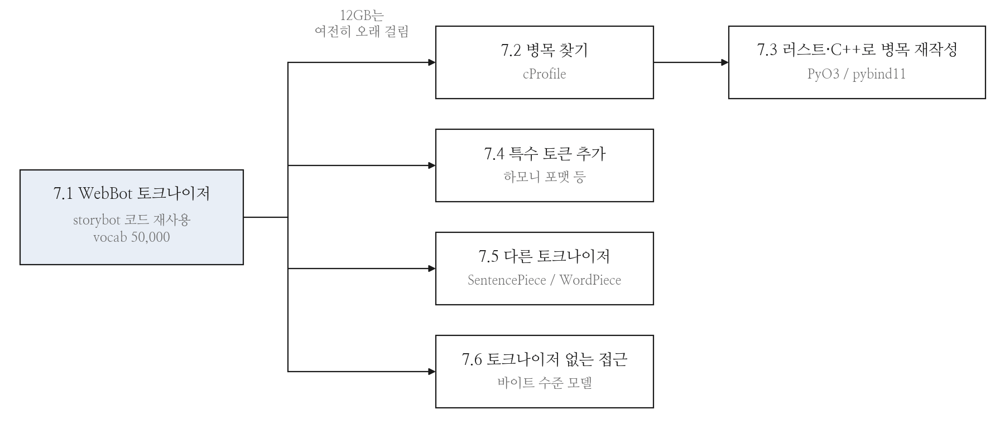
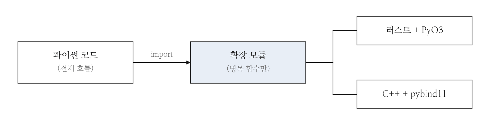
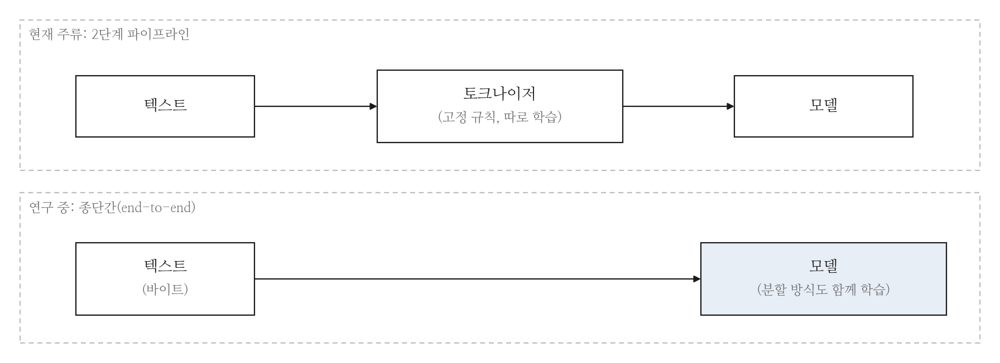
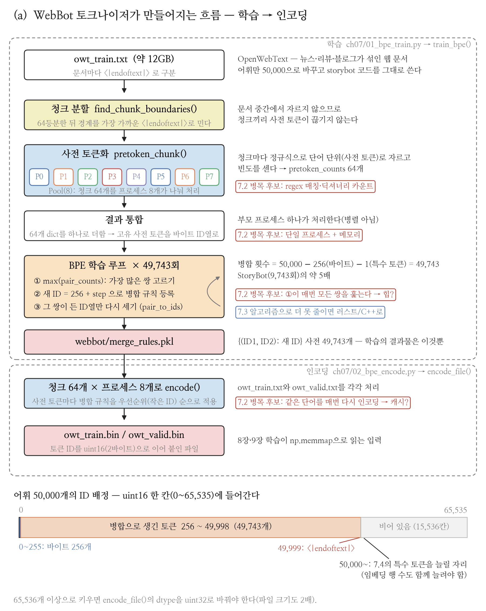
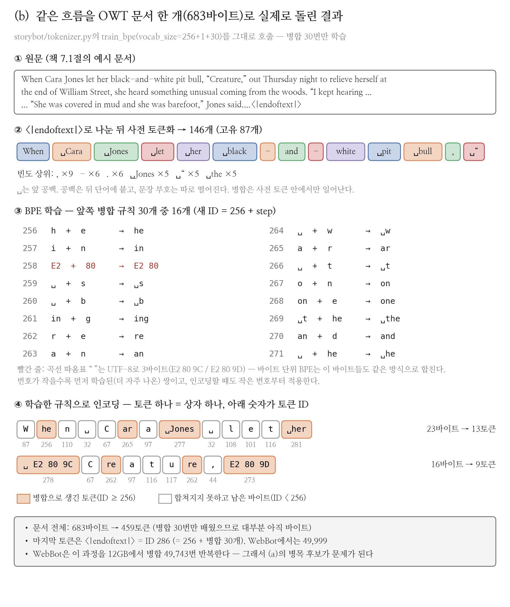

# 7장. 토크나이저 (도전편)

> **한 줄 요약** — StoryBot의 BPE 토크나이저를 그대로 써서 12GB OpenWebText로 **어휘 50,000개**짜리 WebBot 토크나이저를 만든다. 구현을 하나하나 보여 주기보다 **더 빠르게 만들 방향**(프로파일링 → 러스트/C++)과 **더 넓은 주제**(특수 토큰 확장, 다른 토크나이저, 토크나이저 없는 모델)를 힌트로 던지는 장이다.

---

## 3부 로드맵: WebBot 만들기

WebBot = 실제 **웹 텍스트**로 학습하는 모델. 노이즈가 섞여 있고 문체와 주제가 제각각이다. CodeBot·StoryBot에서 익힌 기술이 어디까지 통하는지 시험하는 단계다.

> 💡 도전편은 성격이 다르다. 책이 구현 절차를 끝까지 보여 주지 않고, **고민할 점과 힌트**만 준다. 나머지는 직접 채워 넣어야 한다.

**데이터셋: OpenWebText(OWT)** — GPT-2 학습 데이터를 재현하려고 인터넷 문서를 모은 코퍼스. 뉴스 기사, 리뷰, 블로그가 섞여 있다. 이 책은 스탠퍼드 **CS336** 강의에서 제공한 버전(전체를 텍스트 파일 하나로 합친 뒤 학습/검증으로 나누고, 문서마다 `<|endoftext|>`로 구분)을 쓴다.

```text
When Cara Jones let her black-and-white pit bull, "Creature," out Thursday night ...
"She was covered in mud and she was barefoot," Jones said....
<|endoftext|>
...
```

| 파일 | 크기 | 용도 |
|---|---|---|
| `webbot/owt_train.txt` | 약 **12GB** | 학습용 |
| `webbot/owt_valid.txt` | 약 300MB | 검증용 |

(`webbot/download.sh`로 받는다. 학습된 `merge_rules.pkl`과 인코딩된 `.bin`도 스크립트에 주석으로 들어 있다.)

| 장 | 주제 | 내용 |
|---|---|---|
| **7장** | 토크나이저(도전편) | 속도·효율을 더 높이기 위한 힌트, 다른 접근 방식 |
| 8장 | 모델(도전편) | 더 효율적인 아키텍처 |
| 9장 | 학습(도전편) | 메모리 효율 개선, 분산 학습, 효율적인 옵티마이저 |

### 세 봇의 데이터·토크나이저 비교

| | CodeBot (1부) | StoryBot (2부) | WebBot (3부) |
|---|---|---|---|
| 데이터 | TinyCodes 약 6MB | TinyStories 약 2GB | OpenWebText 약 12GB |
| 성격 | 파이썬 코드 | 쉬운 영어 동화 | 정제되지 않은 웹 문서 |
| 어휘 크기 | 1,000 | 10,000 | **50,000** |
| 토크나이저 코드 | `codebot/tokenizer.py` (1장) | `storybot/tokenizer.py` (4장) | `storybot/tokenizer.py` **재사용** |

---

## 7장 전체 흐름



*7장의 흐름 — 7.1의 토크나이저에서 고속화(7.2 → 7.3)와 더 넓은 주제(7.4~7.6)로 갈라진다. (`ch07/diagrams.py`로 그린 그림)*

---

## 7.1 WebBot의 토크나이저 — `ch07/01_bpe_train.py`, `ch07/02_bpe_encode.py`

4장에서 완성한 `storybot/tokenizer.py`를 **그대로** 쓴다. 바뀌는 것은 파일 경로와 어휘 크기뿐이다.

```python
# ch07/01_bpe_train.py — 학습
from storybot.tokenizer import train_bpe

if __name__ == '__main__':                     # Pool을 쓰므로 가드 필수
    merge_rules = train_bpe("webbot/owt_train.txt", vocab_size=50000,
                            num_processes=8, num_chunks=64)
    with open("webbot/merge_rules.pkl", "wb") as f:
        pickle.dump(merge_rules, f)
```

```python
# ch07/02_bpe_encode.py — 인코딩 (책 본문에는 없고 저장소에만 있는 스크립트)
from storybot.tokenizer import BPETokenizer

if __name__ == '__main__':
    tokenizer = BPETokenizer.load_from("webbot/merge_rules.pkl")
    tokenizer.encode_file("webbot/owt_train.txt", "webbot/owt_train.bin", num_processes=8)
    tokenizer.encode_file("webbot/owt_valid.txt", "webbot/owt_valid.bin", num_processes=8)
```

**어휘 크기 50,000** — GPT-2(50,257)와 비슷한 규모다.

| 어휘를 키우면 | 얻는 것 | 잃는 것 |
|---|---|---|
| 1,000 → 10,000 → 50,000 | 토큰 하나에 더 많은 정보 → 토큰열이 짧아짐 | 임베딩 계층(과 출력층) 파라미터 증가, 드문 토큰을 배우려면 데이터가 더 필요 |

> ⚠️ `encode_file()`은 ID를 `uint16`(최대 65,535)으로 저장한다. 50,000은 들어가지만, 어휘를 65,536 이상으로 키우려면 `uint32`로 바꿔야 한다.

> ⚠️ 동작은 하지만 **매우 오래 걸린다.** 4장 기준으로 2GB TinyStories 인코딩에 약 20분이 걸렸으니, 6배 큰 12GB에 어휘도 5배 크면 학습·인코딩 모두 몇 시간 단위를 각오해야 한다(책은 구체적인 시간을 제시하지 않음). 메모리도 문제다. 4.4의 병렬 사전 토큰화는 64개 청크 결과(`pretoken_counts`)를 모두 받아 합치고, 4.2의 캐시(`pair_to_ids`)는 고유 사전 토큰 수에 비례해 커진다. 미리 받아 둔 `merge_rules.pkl`·`.bin`을 쓰는 것도 방법이다.

#### 어휘를 키우면 어느 단계가 느려지나

어휘 크기가 시간에 주는 영향은 단계마다 다르다.

- **사전 토큰화**는 정규식으로 텍스트를 훑는 일이라 어휘 크기와 상관없다. 데이터 크기에만 비례한다.
- **학습 루프**는 병합 한 번이 스텝 하나다. 스텝 수가 `vocab_size - 257`이므로 어휘에 거의 비례해 늘어난다.
- **인코딩**의 `_encode_text()`는 사전 토큰 하나마다 "쌍 세기(`count_pairs`) → 우선순위가 가장 높은 쌍 찾기(`min`) → 병합"을 더 합칠 쌍이 없을 때까지 되풀이한다. 반복 횟수는 그 단어에 실제로 적용되는 병합 수다. 어휘가 커지면 단어가 더 크게 뭉치므로 반복도 늘지만, 단어 하나에 적용되는 병합 수는 천천히 는다.

TinyCodes로 직접 재 보았다(프로세스 1개, 이 노트를 쓴 PC 기준이라 절대값보다 비율을 볼 것).

| 측정 | 어휘 257 (병합 0) | 어휘 1,000 (병합 743) | 어휘 2,000 (병합 1,743) |
|---|---|---|---|
| `train_bpe()` 전체, 텍스트 앞 2MB | 0.60초 | 3.13초 | 7.09초 |
| 인코딩, 텍스트 앞 300KB (사전 토큰 86,922개) | — | 0.48초 | 0.51초 |
| 사전 토큰 하나에 적용된 병합 수 (평균) | — | 1.70 | 1.97 |

학습은 사전 토큰화 등 준비(약 0.6초)를 빼면 병합 수에 비례해 늘었고, 인코딩은 병합 규칙이 2배 이상 늘어도 약 5%만 느려졌다. 인코딩 규칙은 `codebot/merge_rules.pkl`·`merge_rules_2000.pkl`을 썼다. 따라서 WebBot에서 **인코딩 시간은 주로 데이터 크기(6배)에 비례**하고, 어휘 5배의 영향은 단어당 병합 수가 느는 만큼만 더해진다. 어휘에 크게 영향을 받는 쪽은 **학습 루프**다.

---

## 7.2 병목 지점 찾기

고속화의 첫걸음은 **어디가 느린지 재는 것**이다. 짐작으로 고치면 엉뚱한 곳을 최적화하기 쉽다.

```bash
# 프로그램 전체를 프로파일링, 누적 시간 순 정렬
python -m cProfile -s cumulative sample.py > profile.txt
```

```python
# 코드 안에서 특정 처리만 측정
import cProfile
cProfile.run('train_bpe(file_path, vocab_size)')
```

| 출력 열 | 의미 |
|---|---|
| `ncalls` | 호출 횟수 |
| `tottime` | 그 함수 **자체**에서 쓴 시간 (하위 호출 제외) |
| `cumtime` | 하위 호출까지 포함한 **누적** 시간 |

4장 구현에서 의심해 볼 만한 후보 (실측으로 확인할 것):

| 단계 | 후보 | 4장에서 이미 한 일 |
|---|---|---|
| 사전 토큰화 | `regex` 매칭, 딕셔너리 카운트 | 청크 분할 + 병렬화 (4.3·4.4) |
| 결과 통합 | 64개 `pretoken_counts`를 하나로 더하기 (단일 프로세스) | — |
| 학습 루프 | 매 스텝 `max(pair_counts, ...)`가 **모든 쌍을 훑음** | 부분 갱신으로 재계산 제거 (4.2) |
| 인코딩 | 사전 토큰마다 `count_pairs()`를 반복 호출, 같은 단어를 매번 다시 인코딩 | 고속 병합 + 병렬화 (4.6·4.7) |

> 💡 어휘가 10,000에서 50,000으로 커지면 학습 루프 반복 횟수도 5배가 된다. `max()`를 우선순위 큐(힙)로 바꾸거나, 인코딩에 사전 토큰별 결과 캐시를 두는 것이 자연스러운 다음 수다. 다만 **먼저 프로파일링으로 확인하고** 고칠 것.

#### 힙으로 바꿀 때 지켜야 할 두 가지

`max(pair_counts, ...)`는 매 스텝 모든 쌍을 훑는다. 힙(`heapq`)에 넣어 두면 가장 큰 것을 바로 꺼낼 수 있다. 다만 그대로 옮기면 두 군데에서 틀린다.

1. **빈도가 줄기도 한다.** 병합이 일어나면 주변 쌍의 빈도가 늘거나 줄지만, 힙은 안에 든 값을 고칠 수 없다. 그래서 바뀐 쌍은 새 빈도로 **다시 넣고**, 꺼냈을 때 그 값이 지금의 `pair_counts`와 다르면 **버리고 다음 것을 꺼낸다**(지연 삭제).
2. **동점 처리 순서를 똑같이 맞춰야 한다.** 저장소 코드는 `max(..., key=lambda pair: (pair_counts[pair], pair[0], pair[1]))`, 즉 빈도가 같으면 ID가 **큰** 쌍을 고른다. `heapq`는 가장 작은 것을 꺼내므로 키를 `(-횟수, -pair[0], -pair[1])`로 넣어야 같은 순서가 된다.

```python
key = lambda pair, c: (-c, -pair[0], -pair[1])        # max()와 같은 순서
while heap:
    _, pair, c = heapq.heappop(heap)
    if pair_counts.get(pair) == c:                     # 지금 빈도와 같을 때만 유효
        break                                          # 다르면 낡은 항목 → 버림
```

`storybot/tokenizer.py`의 `train_bpe()`와 이렇게 바꾼 힙 버전을 TinyCodes 앞 2MB에 돌려 비교했다.

| 어휘 | `train_bpe()` (max) | 힙 버전 | 병합 규칙이 같은가 | 버린 낡은 항목 |
|---|---|---|---|---|
| 1,000 | 3.13초 | 2.36초 | 같음 | 35,934개 |
| 2,000 | 7.09초 | 2.82초 | 같음 | 58,310개 |

어휘가 커질수록 차이가 벌어진다. 반대로 동점 처리를 빼고 키를 `(-횟수,)`만으로 두면, 어휘 1,000에서 78번째 병합(ID 333)부터 규칙이 달라졌다(743개 중 306개 위치가 다름). 결과가 원래 코드와 같은지는 이렇게 **병합 규칙을 직접 비교해서** 확인한다.

---

## 7.3 러스트와 C++를 이용한 속도 개선

병목을 찾았는데 알고리즘으로는 더 줄이기 어렵다면, **그 부분만** 저수준 언어로 다시 쓴다. 파이썬은 반복문과 문자열 처리에서 컴파일 언어보다 훨씬 느리다.



*병목 함수만 러스트(PyO3)나 C++(pybind11)로 만든 확장 모듈로 옮기고, 파이썬 코드는 이를 `import`해 쓴다. (`ch07/diagrams.py`로 그린 그림)*

| 언어 | 파이썬 연결 도구 | 결과 |
|---|---|---|
| 러스트 | **PyO3** | 러스트 코드를 파이썬 모듈로 빌드 → 보통 패키지처럼 `import` |
| C++ | **pybind11** | C++ 함수·클래스를 파이썬에 노출 |

**참고할 만한 러스트 구현**

| 라이브러리 | 특징 |
|---|---|
| Hugging Face **tokenizers** | 러스트로 만든 고속 토크나이저. 많은 LLM 프로젝트가 쓰지만, 여러 방식을 지원하느라 코드가 복잡하다. |
| nanochat **rustbpe** (Karpathy, 2025) | "단순하지만 충분히 빠르게". BPE만 다루므로 이 책처럼 밑바닥부터 이해하려는 사람에게 좋은 참고 자료. |

> 💡 러스트로 옮기면 GIL 없이 진짜 멀티스레드를 쓸 수 있어서, 4장처럼 프로세스를 띄우고 결과를 pickle로 주고받는 비용도 함께 줄어든다.

> 4장이 스레드가 아니라 **프로세스**(`multiprocessing.Pool`)를 쓴 이유가 GIL이다. CPython에서는 한 프로세스 안의 파이썬 코드를 한 번에 한 스레드만 실행하므로, 사전 토큰화처럼 파이썬 코드로 계산하는 일은 스레드를 늘려도 빨라지지 않는다. TinyCodes 전체(6.5MB)를 8청크로 나눠 `pretoken_chunk()`를 돌려 보면 순차 실행이 1.2~1.8초, 스레드 4개(`ThreadPoolExecutor`)는 약 55초(이 환경에서는 오히려 크게 느려졌다), 프로세스 4개는 약 0.4초였다. 대신 프로세스는 메모리를 나눠 쓰지 못하므로 각 청크의 결과 사전을 pickle로 부모에게 돌려보낸다. 이 실험에서는 8청크 결과가 합쳐 약 878KB였고, OWT 64청크에서는 이 결과를 받아 합치는 일이 7.2의 "결과 통합" 병목 후보가 된다. 러스트는 GIL이 없어 스레드끼리 메모리를 공유하며 병렬로 돌 수 있으므로 이 비용이 사라진다.

---

## 7.4 특수 토큰 추가

지금까지는 특수 토큰이 `<|endoftext|>` 하나였고, CodeBot의 대화는 **알파카 포맷**(`### Instruction:` / `### Response:`라는 **일반 문자열**)으로 구분했다. 단순하지만 역할이나 도구를 늘리기 어렵다.

실제 LLM은 역할·도구 지원을 위해 **전용 특수 토큰**을 어휘에 추가한다. 예: OpenAI gpt-oss의 **하모니 포맷(Harmony Format)**.

```text
<|start|>user<|message|>2 + 2는?<|end|>
<|start|>assistant<|channel|>analysis<|message|>간단한 계산 문제다.<|end|>
<|start|>assistant<|channel|>final<|message|>2 + 2 = 4입니다.<|return|>
```

| 토큰 | 역할 |
|---|---|
| `<\|start\|>` ... `<\|end\|>` | 메시지 하나의 시작과 끝 |
| `<\|message\|>` | 머리말(역할·채널)과 본문의 경계 |
| `<\|channel\|>` | 채널 지정 — `analysis`(추론 과정) / `final`(최종 답변) |
| `<\|return\|>` | 응답 종료 |

- **역할**(`system`, `user`, `assistant` ...)과 **채널**(`analysis`, `final` ...)을 조합해 추론 과정과 최종 답을 나눈다.
- 용도에 맞게 직접 정의할 수도 있다: 도구 호출용 `<|call|>`, 코드 생성용 `<|code_start|>` / `<|code_end|>` 등.

### 이 책의 토크나이저에 추가하려면 (도전 과제)

[1.5절](../ch01/README.md#15-특수-토큰--ch0105_special_tokenpy)의 `<|endoftext|>` 처리를 여러 토큰으로 일반화하면 된다.

| 위치 | 지금 (`<|endoftext|>` 하나) | 여러 개로 확장 |
|---|---|---|
| 학습 `train_bpe()` | `split(end_token)`, `num_merges = vocab_size - 256 - 1` | 모든 특수 토큰으로 분할(정규식 `|`로 묶기), 특수 토큰 수만큼 자리 확보 |
| 청크 분할 `find_chunk_boundaries()` | `<|endoftext|>`로 경계 조정 | 그대로 둬도 됨 (문서 경계 기준) |
| ID 부여 | `end_token_id = 256 + len(merge_rules)` | 마지막 번호부터 차례로 하나씩 |
| 인코딩 `encode()` | `re.split('(' + re.escape(end_token) + ')')` | 모든 특수 토큰을 `re.escape`해 `|`로 묶은 패턴으로 분할 |
| 디코딩 `id_to_bytes` | `<|endoftext|>`의 바이트열 등록 | 각 특수 토큰의 바이트열 등록 |

> ⚠️ 특수 토큰을 늘리면 `vocab_size`와 모델의 임베딩 크기도 함께 맞춰야 한다.

> ⚠️ **특수 토큰으로 먼저 나누는 이유** — 나누지 않고 바로 사전 토큰화하면 정규식이 특수 토큰을 일반 글자로 쪼갠다. `pretokenize("<|start|>user<|message|>2 + 2는?<|end|>")`의 실제 결과는 `'<|'`, `'start'`, `'|>'`, `'user'`, `'<|'`, `'message'`, `'|>'`, `'2'`, `' +'`, `' 2'`, `'는'`, `'?<|'`, `'end'`, `'|>'`다. 이대로면 학습에서는 `<|`·`|>` 같은 조각이 병합 통계에 섞이고, 인코딩 결과도 ID 하나가 아니라 여러 토큰이 된다. 게다가 `'?<|'`처럼 앞 글자와 붙은 조각이 생겨, 같은 특수 토큰이 앞 글자에 따라 다르게 쪼개진다. 그래서 학습·인코딩 모두 **특수 토큰 패턴으로 먼저 `split`한 뒤**, 특수 토큰이 아닌 조각만 사전 토큰화한다.

---

## 7.5 다른 토크나이저

| 토크나이저 | 사용처 | 처리 단위 | 병합(분할) 기준 |
|---|---|---|---|
| **BPE** (이 책) | GPT 계열 | UTF-8 **바이트** | 가장 **빈도가 높은** 쌍 |
| **SentencePiece** (Kudo & Richardson, 2018) | Llama, T5 등 | 유니코드 **코드 포인트** | BPE 또는 **유니그램 언어 모델** 알고리즘 지원 |
| **WordPiece** | BERT | 문자 | 언어 모델의 **가능도(likelihood)를 가장 크게 높이는** 쌍 |

- SentencePiece는 구글이 만든 서브워드 분할 라이브러리로, 바이트가 아니라 문자(코드 포인트) 수준에서 동작한다.
- WordPiece는 BPE와 거의 같은 구조지만 "얼마나 자주 나오나"가 아니라 "합치면 데이터를 얼마나 잘 설명하나"로 쌍을 고른다.
  흔히 소개되는 점수는 $`\mathrm{score}(a, b) = \dfrac{\mathrm{count}(ab)}{\mathrm{count}(a)\,\mathrm{count}(b)}`$다(Hugging Face 강좌 설명 기준). 따로따로 아주 흔한 조각끼리의 쌍은 점수가 낮고, 드물어도 **늘 붙어 다니는** 쌍은 점수가 높다. 7.1의 OWT 예시 문서로 첫 병합을 비교하면(여기서는 BPE와 맞춰 바이트 단위로 셌다), BPE는 가장 흔한 `h + e`(20번)를 고른다. `h`는 33번, `e`는 57번 나오므로 WordPiece 점수는 $`20/(33 \times 57) \approx 0.011`$이다. 반면 한 번씩만 나온 `8`과 `9`가 붙은 `89`는 $`1/(1 \times 1) = 1`$이라 WordPiece에서는 먼저 합쳐진다.
- 무엇이 최선인지는 작업과 데이터에 따라 다르다. 같은 문장을 여러 토크나이저로 나눠 비교해 보면 재미있다.

---

## 7.6 토크나이저를 사용하지 않는 접근법

근본적인 질문: **토크나이저와 모델을 따로 학습하는 것이 자연스러운가?**



*현재 주류인 토크나이저 + 모델의 2단계 파이프라인과, 바이트를 직접 받아 분할 방식까지 함께 학습하는 종단간 접근. (`ch07/diagrams.py`로 그린 그림)*

| | 토크나이저 + 모델 | 바이트 수준 모델 (예: Pagnoni et al., 2024) |
|---|---|---|
| 분할 | 학습 후 **고정된 규칙** — 문맥에 맞춰 바꿀 수 없음 | 모델이 직접 바이트를 처리 |
| 토큰열 길이 | 짧음 | **길어짐** (1장의 바이트 토크나이저 문제와 같음) |
| 언어별 차이 | 학습 데이터에 적은 언어는 토큰이 잘게 쪼개짐 (예: 1장에서 한글 1자 = 3토큰) | 근본적으로 해소될 가능성 |

→ 토크나이저와 모델을 한꺼번에 학습하는 **종단간 학습**이 언어 모델의 미래가 될지도 모른다.

### 한눈에 보기: WebBot 토크나이저가 만들어지는 흐름

7.1의 두 스크립트가 `owt_train.txt`를 `merge_rules.pkl`과 `owt_train.bin`으로 바꾸는 과정을 그렸다. (a)는 12GB 전체에 대한 단계별 흐름에 7.2의 병목 후보와 50,000개 어휘의 ID 배정을 함께 표시했다. 12GB 데이터와 WebBot의 `merge_rules.pkl`은 저장소에 없으므로, (b)에서는 책 7.1절의 OWT 예시 문서 한 개를 `storybot/tokenizer.py`의 `train_bpe()`에 그대로 넣어 병합 30번을 학습하고 인코딩했다.



*그림 (a) — 청크 분할 → 병렬 사전 토큰화 → 결과 통합 → BPE 학습 49,743회 → `merge_rules.pkl` → 인코딩 → `owt_train.bin`. 빨간 상자는 7.2의 병목 후보다. (`ch07/flow_graph.py`로 그린 그림)*



*그림 (b) — 683바이트 문서 하나를 실제로 처리한 결과. 사전 토큰 146개(고유 87개), 병합 30번, 인코딩 결과 459토큰.*

- **학습의 결과물은 병합 규칙 사전 하나뿐이다.** 병합 횟수는 50,000 − 256(바이트) − 1(`<|endoftext|>`) = 49,743이고, 새 ID는 `256 + step`이다. 그래서 병합 토큰은 256~49,998, `<|endoftext|>`는 49,999번이 된다.
- **병렬인 곳과 아닌 곳이 섞여 있다.** 사전 토큰화와 인코딩은 청크 64개를 프로세스 8개가 나눠 처리하지만, 결과 통합과 BPE 학습 루프는 프로세스 하나가 한다. 7.2에서 프로파일링으로 먼저 확인해야 하는 이유다.
- **청크 경계는 `<|endoftext|>`에 맞춘다.** `find_chunk_boundaries()`가 등분한 경계를 가장 가까운 문서 구분 토큰까지 밀어서, 사전 토큰이 청크 사이에서 잘리지 않는다.
- **병합은 사전 토큰 안에서만 일어난다.** (b)에서 `␣Jones`는 한 토큰이 되지만 `,`와 `␣“`는 따로 떨어진 사전 토큰이므로 서로 합쳐지지 않는다.
- **바이트 단위라 비ASCII 문자도 같은 규칙으로 합친다.** 곡선 따옴표 “ ”는 UTF-8 3바이트(E2 80 9C / E2 80 9D)인데, (b)에서 세 번째 병합(258)이 `E2 + 80`이었다.
- **ID는 uint16에 여유 있게 들어간다.** 최댓값 49,999는 65,535보다 작고, 50,000번부터 7.4의 특수 토큰을 더 붙일 수 있다. 65,536개를 넘기면 `encode_file()`의 dtype을 `uint32`로 바꿔야 한다.

---

## 핵심 정리

- **3부(WebBot)** 는 12GB OpenWebText를 다룬다. 책은 힌트만 주고 구현은 독자에게 맡긴다.
- **7.1** WebBot 토크나이저는 `storybot/tokenizer.py`를 그대로 쓰고 어휘만 **50,000**(GPT-2급)으로 키운다. 동작은 하지만 시간이 많이 든다. ID는 `uint16`에 들어간다.
- **7.2** 최적화 전에 **cProfile로 병목부터 잰다**(`cumtime` / `tottime`).
- **7.3** 병목만 **러스트(PyO3)** 나 **C++(pybind11)** 로 다시 쓴다. 참고: HF tokenizers(기능 많음, 복잡), rustbpe(단순, 학습용으로 좋음).
- **7.4** 실제 LLM은 **하모니 포맷** 같은 전용 특수 토큰으로 역할·채널·도구 호출을 구분한다. 1장의 `<|endoftext|>` 처리를 일반화하면 직접 추가할 수 있다.
- **7.5** 다른 선택지: **SentencePiece**(코드 포인트 단위, BPE/유니그램), **WordPiece**(가능도 기준 병합).
- **7.6** 바이트를 직접 다루는 **토크나이저 없는 모델**이 연구되고 있다. 토큰열은 길어지지만 고정 분할과 언어별 격차 문제를 풀 수 있다.

## 앞뒤 장과의 연결

| 이전 장 | 7장에서 |
|---|---|
| [1.5 특수 토큰](../ch01/README.md#15-특수-토큰--ch0105_special_tokenpy) (`<|endoftext|>` 하나) | 7.4 여러 특수 토큰, 하모니 포맷 |
| [1.2 바이트 단위 토큰화](../ch01/README.md#12-바이트-단위-토큰화--ch0102_byte_tokenizerpy) (토큰열이 김) | 7.6 바이트 수준 모델로 다시 등장 |
| [4.2 부분 갱신](../ch04/README.md), [4.4 병렬화](../ch04/README.md) | 7.2 남은 병목 측정 → 7.3 저수준 언어 |
| [4.7 대규모 인코딩](../ch04/README.md) | 7.1 `owt_train.bin` 생성 (`ch07/02_bpe_encode.py`) |
| 3장 SFT의 알파카 포맷 | 7.4 전용 특수 토큰으로 대체 |

`webbot/owt_train.bin`은 8장(모델 도전편)·9장(학습 도전편)의 입력이 된다.

## 복습 질문

1. WebBot에서 StoryBot의 토크나이저 코드를 수정 없이 재사용할 수 있는 이유는? 바꾼 값은 무엇인가?

   <details><summary>정답 보기</summary>

   코드가 어휘 크기·파일 경로에 묶여 있지 않기 때문이다. `train_bpe()`는 `vocab_size`를 인자로 받아 병합 횟수(`vocab_size - 256 - 1`)를 정하고, 청크 분할·병렬 사전 토큰화·부분 갱신도 데이터 크기와 상관없이 동작한다. 문서 구분도 TinyStories와 같은 `<|endoftext|>`를 쓴다.

   바꾼 값은 입력·출력 경로(`webbot/owt_train.txt`, `webbot/merge_rules.pkl`, `.bin`)와 `vocab_size=50000`뿐이다(`num_processes=8`, `num_chunks=64`는 학습 스크립트에서 넘기는 값).

   </details>

2. 어휘 크기를 50,000으로 키우면 얻는 것과 잃는 것은? `uint16` 저장에는 문제가 없는가?

   <details><summary>정답 보기</summary>

   얻는 것은 토큰 하나에 담기는 정보가 늘어 같은 글이 더 짧은 토큰열이 된다는 점이다. 컨텍스트 길이가 같아도 더 긴 글을 보고, 계산량도 줄어든다. 잃는 것은 임베딩 계층과 출력층의 행 수가 어휘 수만큼 커진다는 점(파라미터 증가), 그리고 드물게 나오는 토큰을 배우려면 데이터가 더 필요하다는 점이다.

   `uint16` 저장은 문제없다. 병합 토큰은 256~49,998, `<|endoftext|>`는 49,999번이라 최댓값 65,535 안에 들어간다. 다만 특수 토큰을 늘려 어휘가 65,536개 이상이 되면 `uint32`로 바꿔야 한다.

   </details>

3. cProfile 결과에서 `tottime`과 `cumtime`은 어떻게 다르며, 병목을 찾을 때 각각 어떻게 활용하는가?

   <details><summary>정답 보기</summary>

   `tottime`은 그 함수 **자체**에서 쓴 시간이고, `cumtime`은 그 함수가 부른 하위 함수까지 포함한 누적 시간이다.

   `cumtime`이 큰 함수를 위에서부터 따라 내려가면 "어느 단계가 오래 걸리는가"(예: `train_bpe` 안의 학습 루프)를 찾을 수 있다. 그 안에서 `tottime`이 큰 함수가 실제로 시간을 쓰는 곳(예: 수없이 불리는 `count_pairs`, `merge`, `max`의 키 함수)이다. `ncalls`도 함께 보면, 한 번이 느린 것인지 너무 많이 불리는 것인지 구분할 수 있다.

   </details>

4. 4장 구현에서 어휘가 커질수록 느려질 만한 부분은 어디인가? 어떤 자료구조로 바꿀 수 있을까?

   <details><summary>정답 보기</summary>

   학습 루프에서는 매 스텝 `max(pair_counts, key=...)`가 **모든 쌍을 훑는다.** 어휘가 50,000이면 이것을 49,743번 반복한다(StoryBot은 9,743번). 쌍의 빈도를 우선순위 큐(힙)에 넣고 갱신된 쌍만 다시 넣으면(꺼낼 때 현재 빈도와 다르면 버리는 방식), 최댓값 찾기를 매번 전체를 훑지 않고 할 수 있다.

   인코딩에서는 `_encode_text()`가 사전 토큰마다 `count_pairs()`와 `min()`을 병합 횟수만큼 반복하고, 같은 단어가 나올 때마다 처음부터 다시 계산한다. 병합 규칙이 많을수록 한 단어에 적용되는 병합도 늘어난다. 사전 토큰 → ID열 사전(캐시)을 두면 자주 나오는 단어는 한 번만 계산하면 된다. 그 밖에 64개 `pretoken_counts`를 하나로 합치는 단계도 단일 프로세스라 후보다. 어느 것이든 **먼저 프로파일링으로 확인**하고 고친다.

   </details>

5. 알파카 포맷(`### Instruction:`)과 하모니 포맷(`<|start|>` 등 특수 토큰)의 차이는? 특수 토큰을 쓰면 무엇이 좋아지는가?

   <details><summary>정답 보기</summary>

   알파카 포맷의 `### Instruction:`/`### Response:`는 **일반 문자열**이라 BPE가 여러 토큰으로 잘게 나눈다. 사용자 글 안에 같은 문자열이 들어 있으면 모델은 그것이 구분자인지 내용인지 구별할 수 없다. 역할이나 도구를 늘릴 때마다 새 문자열 약속을 만들어야 해서 확장도 어렵다.

   하모니 포맷의 `<|start|>`, `<|message|>`, `<|end|>` 등은 어휘에 따로 등록한 **전용 특수 토큰**으로, 각각 ID 하나다. 일반 텍스트를 인코딩해서는 절대 나오지 않으므로 경계가 분명하고, 역할(`user`, `assistant` …)과 채널(`analysis`, `final`)을 조합해 추론 과정과 최종 답, 도구 호출 같은 구조를 표현하기 쉽다. 토큰 하나라 컨텍스트도 덜 쓴다.

   </details>

6. 이 책의 토크나이저에 `<|start|>`, `<|end|>`를 추가하려면 학습·인코딩·디코딩에서 각각 무엇을 바꿔야 하는가?

   <details><summary>정답 보기</summary>

   1.5절의 `<|endoftext|>` 처리를 여러 토큰으로 일반화한다(7.4의 표).

   - **학습** `train_bpe()`: 모든 특수 토큰을 `re.escape`해 `|`로 묶은 패턴으로 텍스트를 나눠, 특수 토큰이 병합 통계에 섞이지 않게 한다. 병합 횟수는 `vocab_size - 256 - 특수 토큰 수`로 자리를 확보한다. 청크 분할은 문서 경계 기준이므로 `<|endoftext|>` 그대로 둬도 된다.
   - **인코딩** `encode()`: 같은 패턴으로 `re.split`하고(괄호로 묶어 구분자도 남김), 조각이 특수 토큰이면 그 ID를 넣고 아니면 사전 토큰화 → BPE로 처리한다. 특수 토큰 ID는 `256 + len(merge_rules)`부터 차례로 하나씩 준다.
   - **디코딩** `id_to_bytes`: 각 특수 토큰 ID에 그 문자열의 UTF-8 바이트열을 등록한다.

   어휘 수가 바뀌므로 모델의 임베딩·출력층 크기도 맞춰야 한다.

   </details>

7. BPE와 WordPiece는 병합할 쌍을 고르는 기준이 어떻게 다른가? SentencePiece는 처리 단위가 어떻게 다른가?

   <details><summary>정답 보기</summary>

   BPE는 현재 데이터에서 **가장 자주 나오는** 인접 쌍을 합친다. WordPiece는 구조는 거의 같지만 합쳤을 때 언어 모델의 **가능도(likelihood)를 가장 크게 높이는** 쌍, 즉 "합치면 데이터를 얼마나 잘 설명하는가"로 고른다. 그래서 따로따로는 흔한데 함께 나오는 것은 그만큼 특별하지 않은 쌍보다, 서로 붙어 다니는 쌍이 우선된다.

   SentencePiece는 이 책의 BPE처럼 UTF-8 **바이트**가 아니라 유니코드 **코드 포인트**(문자) 단위로 동작하고, 알고리즘으로 BPE와 유니그램 언어 모델을 모두 지원한다.

   </details>

8. 토크나이저 없이 바이트를 직접 다루는 모델의 장점과 단점은? 1장의 바이트 토크나이저가 가졌던 문제와 어떻게 연결되는가?

   <details><summary>정답 보기</summary>

   장점은 학습 후 고정되는 분할 규칙이 없다는 점이다. 모델이 바이트를 직접 처리하므로 문맥에 맞지 않는 분할 문제가 없고, 학습 데이터에 적은 언어의 글자가 잘게 쪼개지는 언어별 격차(1장에서 한글 1자 = 3토큰)도 근본적으로 줄일 수 있다. 토크나이저를 따로 학습할 필요도 없다.

   단점은 토큰열이 **길어진다**는 점이다. 1장의 바이트 토크나이저가 가졌던 문제 그대로다. 글자 하나가 1~4개 토큰이 되므로 같은 컨텍스트 길이에 담기는 글이 줄고, 어텐션 계산량은 길이의 제곱으로 늘어난다. 바이트 수준 모델 연구(예: Pagnoni et al., 2024)는 이 길이 문제를 모델 안에서 해결하려는 시도다.

   </details>

