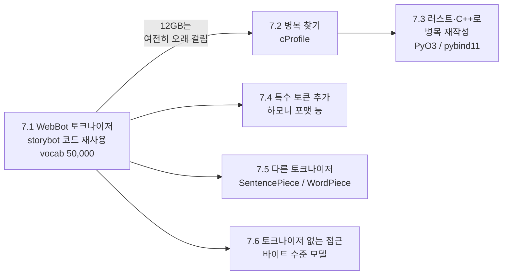
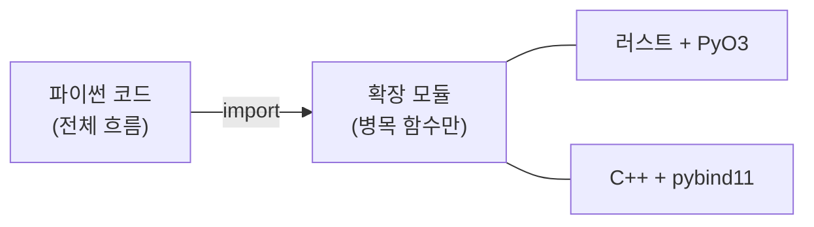
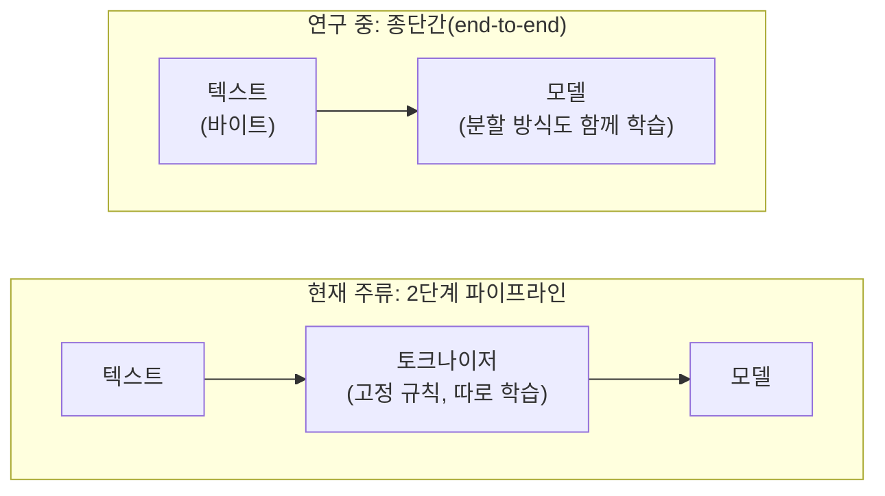

# 7장. 토크나이저 (도전편)

> **한 줄 요약** — StoryBot의 BPE 토크나이저를 그대로 써서 12GB OpenWebText로 **어휘 50,000개**짜리 WebBot 토크나이저를 만든다. 구현을 하나하나 보여 주기보다 **더 빠르게 만들 방향**(프로파일링 → 러스트/C++)과 **더 넓은 주제**(특수 토큰 확장, 다른 토크나이저, 토크나이저 없는 모델)를 힌트로 던지는 장이다.

---

## 3부 로드맵: WebBot 만들기

WebBot = 실제 **웹 텍스트**로 학습하는 모델. 노이즈가 섞여 있고 문체와 주제가 제각각이다. CodeBot·StoryBot에서 익힌 기술이 어디까지 통하는지 시험하는 단계다.

> 💡 도전편은 성격이 다르다. 책이 구현 절차를 끝까지 보여 주지 않고, **고민할 점과 힌트**만 준다. 나머지는 직접 채워 넣어야 한다.

**데이터셋: OpenWebText(OWT)** — GPT-2 학습 데이터를 재현하려고 인터넷 문서를 모은 코퍼스. 뉴스 기사, 리뷰, 블로그가 섞여 있다. 이 책은 스탠퍼드 **CS336** 강의에서 제공한 버전(전체를 텍스트 파일 하나로 합친 뒤 학습/검증으로 나누고, 문서마다 `<|endoftext|>`로 구분)을 쓴다.

```text
When Cara Jones let her black-and-white pit bull, "Creature," out Thursday night ...
"She was covered in mud and she was barefoot," Jones said....
<|endoftext|>
...
```

| 파일 | 크기 | 용도 |
|---|---|---|
| `webbot/owt_train.txt` | 약 **12GB** | 학습용 |
| `webbot/owt_valid.txt` | 약 300MB | 검증용 |

(`webbot/download.sh`로 받는다. 학습된 `merge_rules.pkl`과 인코딩된 `.bin`도 스크립트에 주석으로 들어 있다.)

| 장 | 주제 | 내용 |
|---|---|---|
| **7장** | 토크나이저(도전편) | 속도·효율을 더 높이기 위한 힌트, 다른 접근 방식 |
| 8장 | 모델(도전편) | 더 효율적인 아키텍처 |
| 9장 | 학습(도전편) | 메모리 효율 개선, 분산 학습, 효율적인 옵티마이저 |

### 세 봇의 데이터·토크나이저 비교

| | CodeBot (1부) | StoryBot (2부) | WebBot (3부) |
|---|---|---|---|
| 데이터 | TinyCodes 약 6MB | TinyStories 약 2GB | OpenWebText 약 12GB |
| 성격 | 파이썬 코드 | 쉬운 영어 동화 | 정제되지 않은 웹 문서 |
| 어휘 크기 | 1,000 | 10,000 | **50,000** |
| 토크나이저 코드 | `codebot/tokenizer.py` (1장) | `storybot/tokenizer.py` (4장) | `storybot/tokenizer.py` **재사용** |

---

## 7장 전체 흐름



---

## 7.1 WebBot의 토크나이저 — `ch07/01_bpe_train.py`, `ch07/02_bpe_encode.py`

4장에서 완성한 `storybot/tokenizer.py`를 **그대로** 쓴다. 바뀌는 것은 파일 경로와 어휘 크기뿐이다.

```python
# ch07/01_bpe_train.py — 학습
from storybot.tokenizer import train_bpe

if __name__ == '__main__':                     # Pool을 쓰므로 가드 필수
    merge_rules = train_bpe("webbot/owt_train.txt", vocab_size=50000,
                            num_processes=8, num_chunks=64)
    with open("webbot/merge_rules.pkl", "wb") as f:
        pickle.dump(merge_rules, f)
```

```python
# ch07/02_bpe_encode.py — 인코딩 (책 본문에는 없고 저장소에만 있는 스크립트)
from storybot.tokenizer import BPETokenizer

if __name__ == '__main__':
    tokenizer = BPETokenizer.load_from("webbot/merge_rules.pkl")
    tokenizer.encode_file("webbot/owt_train.txt", "webbot/owt_train.bin", num_processes=8)
    tokenizer.encode_file("webbot/owt_valid.txt", "webbot/owt_valid.bin", num_processes=8)
```

**어휘 크기 50,000** — GPT-2(50,257)와 비슷한 규모다.

| 어휘를 키우면 | 얻는 것 | 잃는 것 |
|---|---|---|
| 1,000 → 10,000 → 50,000 | 토큰 하나에 더 많은 정보 → 토큰열이 짧아짐 | 임베딩 계층(과 출력층) 파라미터 증가, 드문 토큰을 배우려면 데이터가 더 필요 |

> ⚠️ `encode_file()`은 ID를 `uint16`(최대 65,535)으로 저장한다. 50,000은 들어가지만, 어휘를 65,536 이상으로 키우려면 `uint32`로 바꿔야 한다.

> ⚠️ 동작은 하지만 **매우 오래 걸린다.** 4장 기준으로 2GB TinyStories 인코딩에 약 20분이 걸렸으니, 6배 큰 12GB에 어휘도 5배 크면 학습·인코딩 모두 몇 시간 단위를 각오해야 한다(책은 구체적인 시간을 제시하지 않음). 메모리도 문제다. 4.4의 병렬 사전 토큰화는 64개 청크 결과(`pretoken_counts`)를 모두 받아 합치고, 4.2의 캐시(`pair_to_ids`)는 고유 사전 토큰 수에 비례해 커진다. 미리 받아 둔 `merge_rules.pkl`·`.bin`을 쓰는 것도 방법이다.

---

## 7.2 병목 지점 찾기

고속화의 첫걸음은 **어디가 느린지 재는 것**이다. 짐작으로 고치면 엉뚱한 곳을 최적화하기 쉽다.

```bash
# 프로그램 전체를 프로파일링, 누적 시간 순 정렬
python -m cProfile -s cumulative sample.py > profile.txt
```

```python
# 코드 안에서 특정 처리만 측정
import cProfile
cProfile.run('train_bpe(file_path, vocab_size)')
```

| 출력 열 | 의미 |
|---|---|
| `ncalls` | 호출 횟수 |
| `tottime` | 그 함수 **자체**에서 쓴 시간 (하위 호출 제외) |
| `cumtime` | 하위 호출까지 포함한 **누적** 시간 |

4장 구현에서 의심해 볼 만한 후보 (실측으로 확인할 것):

| 단계 | 후보 | 4장에서 이미 한 일 |
|---|---|---|
| 사전 토큰화 | `regex` 매칭, 딕셔너리 카운트 | 청크 분할 + 병렬화 (4.3·4.4) |
| 결과 통합 | 64개 `pretoken_counts`를 하나로 더하기 (단일 프로세스) | — |
| 학습 루프 | 매 스텝 `max(pair_counts, ...)`가 **모든 쌍을 훑음** | 부분 갱신으로 재계산 제거 (4.2) |
| 인코딩 | 사전 토큰마다 `count_pairs()`를 반복 호출, 같은 단어를 매번 다시 인코딩 | 고속 병합 + 병렬화 (4.6·4.7) |

> 💡 어휘가 10,000에서 50,000으로 커지면 학습 루프 반복 횟수도 5배가 된다. `max()`를 우선순위 큐(힙)로 바꾸거나, 인코딩에 사전 토큰별 결과 캐시를 두는 것이 자연스러운 다음 수다. 다만 **먼저 프로파일링으로 확인하고** 고칠 것.

---

## 7.3 러스트와 C++를 이용한 속도 개선

병목을 찾았는데 알고리즘으로는 더 줄이기 어렵다면, **그 부분만** 저수준 언어로 다시 쓴다. 파이썬은 반복문과 문자열 처리에서 컴파일 언어보다 훨씬 느리다.



| 언어 | 파이썬 연결 도구 | 결과 |
|---|---|---|
| 러스트 | **PyO3** | 러스트 코드를 파이썬 모듈로 빌드 → 보통 패키지처럼 `import` |
| C++ | **pybind11** | C++ 함수·클래스를 파이썬에 노출 |

**참고할 만한 러스트 구현**

| 라이브러리 | 특징 |
|---|---|
| Hugging Face **tokenizers** | 러스트로 만든 고속 토크나이저. 많은 LLM 프로젝트가 쓰지만, 여러 방식을 지원하느라 코드가 복잡하다. |
| nanochat **rustbpe** (Karpathy, 2025) | "단순하지만 충분히 빠르게". BPE만 다루므로 이 책처럼 밑바닥부터 이해하려는 사람에게 좋은 참고 자료. |

> 💡 러스트로 옮기면 GIL 없이 진짜 멀티스레드를 쓸 수 있어서, 4장처럼 프로세스를 띄우고 결과를 pickle로 주고받는 비용도 함께 줄어든다.

---

## 7.4 특수 토큰 추가

지금까지는 특수 토큰이 `<|endoftext|>` 하나였고, CodeBot의 대화는 **알파카 포맷**(`### Instruction:` / `### Response:`라는 **일반 문자열**)으로 구분했다. 단순하지만 역할이나 도구를 늘리기 어렵다.

실제 LLM은 역할·도구 지원을 위해 **전용 특수 토큰**을 어휘에 추가한다. 예: OpenAI gpt-oss의 **하모니 포맷(Harmony Format)**.

```text
<|start|>user<|message|>2 + 2는?<|end|>
<|start|>assistant<|channel|>analysis<|message|>간단한 계산 문제다.<|end|>
<|start|>assistant<|channel|>final<|message|>2 + 2 = 4입니다.<|return|>
```

| 토큰 | 역할 |
|---|---|
| `<\|start\|>` ... `<\|end\|>` | 메시지 하나의 시작과 끝 |
| `<\|message\|>` | 머리말(역할·채널)과 본문의 경계 |
| `<\|channel\|>` | 채널 지정 — `analysis`(추론 과정) / `final`(최종 답변) |
| `<\|return\|>` | 응답 종료 |

- **역할**(`system`, `user`, `assistant` ...)과 **채널**(`analysis`, `final` ...)을 조합해 추론 과정과 최종 답을 나눈다.
- 용도에 맞게 직접 정의할 수도 있다: 도구 호출용 `<|call|>`, 코드 생성용 `<|code_start|>` / `<|code_end|>` 등.

### 이 책의 토크나이저에 추가하려면 (도전 과제)

[1.5절](../ch01/README.md#15-특수-토큰--ch0105_special_tokenpy)의 `<|endoftext|>` 처리를 여러 토큰으로 일반화하면 된다.

| 위치 | 지금 (`<|endoftext|>` 하나) | 여러 개로 확장 |
|---|---|---|
| 학습 `train_bpe()` | `split(end_token)`, `num_merges = vocab_size - 256 - 1` | 모든 특수 토큰으로 분할(정규식 `|`로 묶기), 특수 토큰 수만큼 자리 확보 |
| 청크 분할 `find_chunk_boundaries()` | `<|endoftext|>`로 경계 조정 | 그대로 둬도 됨 (문서 경계 기준) |
| ID 부여 | `end_token_id = 256 + len(merge_rules)` | 마지막 번호부터 차례로 하나씩 |
| 인코딩 `encode()` | `re.split('(' + re.escape(end_token) + ')')` | 모든 특수 토큰을 `re.escape`해 `|`로 묶은 패턴으로 분할 |
| 디코딩 `id_to_bytes` | `<|endoftext|>`의 바이트열 등록 | 각 특수 토큰의 바이트열 등록 |

> ⚠️ 특수 토큰을 늘리면 `vocab_size`와 모델의 임베딩 크기도 함께 맞춰야 한다.

---

## 7.5 다른 토크나이저

| 토크나이저 | 사용처 | 처리 단위 | 병합(분할) 기준 |
|---|---|---|---|
| **BPE** (이 책) | GPT 계열 | UTF-8 **바이트** | 가장 **빈도가 높은** 쌍 |
| **SentencePiece** (Kudo & Richardson, 2018) | Llama, T5 등 | 유니코드 **코드 포인트** | BPE 또는 **유니그램 언어 모델** 알고리즘 지원 |
| **WordPiece** | BERT | 문자 | 언어 모델의 **가능도(likelihood)를 가장 크게 높이는** 쌍 |

- SentencePiece는 구글이 만든 서브워드 분할 라이브러리로, 바이트가 아니라 문자(코드 포인트) 수준에서 동작한다.
- WordPiece는 BPE와 거의 같은 구조지만 "얼마나 자주 나오나"가 아니라 "합치면 데이터를 얼마나 잘 설명하나"로 쌍을 고른다.
- 무엇이 최선인지는 작업과 데이터에 따라 다르다. 같은 문장을 여러 토크나이저로 나눠 비교해 보면 재미있다.

---

## 7.6 토크나이저를 사용하지 않는 접근법

근본적인 질문: **토크나이저와 모델을 따로 학습하는 것이 자연스러운가?**



| | 토크나이저 + 모델 | 바이트 수준 모델 (예: Pagnoni et al., 2024) |
|---|---|---|
| 분할 | 학습 후 **고정된 규칙** — 문맥에 맞춰 바꿀 수 없음 | 모델이 직접 바이트를 처리 |
| 토큰열 길이 | 짧음 | **길어짐** (1장의 바이트 토크나이저 문제와 같음) |
| 언어별 차이 | 학습 데이터에 적은 언어는 토큰이 잘게 쪼개짐 (예: 1장에서 한글 1자 = 3토큰) | 근본적으로 해소될 가능성 |

→ 토크나이저와 모델을 한꺼번에 학습하는 **종단간 학습**이 언어 모델의 미래가 될지도 모른다.

---

## 핵심 정리

- **3부(WebBot)** 는 12GB OpenWebText를 다룬다. 책은 힌트만 주고 구현은 독자에게 맡긴다.
- **7.1** WebBot 토크나이저는 `storybot/tokenizer.py`를 그대로 쓰고 어휘만 **50,000**(GPT-2급)으로 키운다. 동작은 하지만 시간이 많이 든다. ID는 `uint16`에 들어간다.
- **7.2** 최적화 전에 **cProfile로 병목부터 잰다**(`cumtime` / `tottime`).
- **7.3** 병목만 **러스트(PyO3)** 나 **C++(pybind11)** 로 다시 쓴다. 참고: HF tokenizers(기능 많음, 복잡), rustbpe(단순, 학습용으로 좋음).
- **7.4** 실제 LLM은 **하모니 포맷** 같은 전용 특수 토큰으로 역할·채널·도구 호출을 구분한다. 1장의 `<|endoftext|>` 처리를 일반화하면 직접 추가할 수 있다.
- **7.5** 다른 선택지: **SentencePiece**(코드 포인트 단위, BPE/유니그램), **WordPiece**(가능도 기준 병합).
- **7.6** 바이트를 직접 다루는 **토크나이저 없는 모델**이 연구되고 있다. 토큰열은 길어지지만 고정 분할과 언어별 격차 문제를 풀 수 있다.

## 앞뒤 장과의 연결

| 이전 장 | 7장에서 |
|---|---|
| [1.5 특수 토큰](../ch01/README.md#15-특수-토큰--ch0105_special_tokenpy) (`<|endoftext|>` 하나) | 7.4 여러 특수 토큰, 하모니 포맷 |
| [1.2 바이트 단위 토큰화](../ch01/README.md#12-바이트-단위-토큰화--ch0102_byte_tokenizerpy) (토큰열이 김) | 7.6 바이트 수준 모델로 다시 등장 |
| [4.2 부분 갱신](../ch04/README.md), [4.4 병렬화](../ch04/README.md) | 7.2 남은 병목 측정 → 7.3 저수준 언어 |
| [4.7 대규모 인코딩](../ch04/README.md) | 7.1 `owt_train.bin` 생성 (`ch07/02_bpe_encode.py`) |
| 3장 SFT의 알파카 포맷 | 7.4 전용 특수 토큰으로 대체 |

`webbot/owt_train.bin`은 8장(모델 도전편)·9장(학습 도전편)의 입력이 된다.

## 복습 질문

1. WebBot에서 StoryBot의 토크나이저 코드를 수정 없이 재사용할 수 있는 이유는? 바꾼 값은 무엇인가?
2. 어휘 크기를 50,000으로 키우면 얻는 것과 잃는 것은? `uint16` 저장에는 문제가 없는가?
3. cProfile 결과에서 `tottime`과 `cumtime`은 어떻게 다르며, 병목을 찾을 때 각각 어떻게 활용하는가?
4. 4장 구현에서 어휘가 커질수록 느려질 만한 부분은 어디인가? 어떤 자료구조로 바꿀 수 있을까?
5. 알파카 포맷(`### Instruction:`)과 하모니 포맷(`<|start|>` 등 특수 토큰)의 차이는? 특수 토큰을 쓰면 무엇이 좋아지는가?
6. 이 책의 토크나이저에 `<|start|>`, `<|end|>`를 추가하려면 학습·인코딩·디코딩에서 각각 무엇을 바꿔야 하는가?
7. BPE와 WordPiece는 병합할 쌍을 고르는 기준이 어떻게 다른가? SentencePiece는 처리 단위가 어떻게 다른가?
8. 토크나이저 없이 바이트를 직접 다루는 모델의 장점과 단점은? 1장의 바이트 토크나이저가 가졌던 문제와 어떻게 연결되는가?
