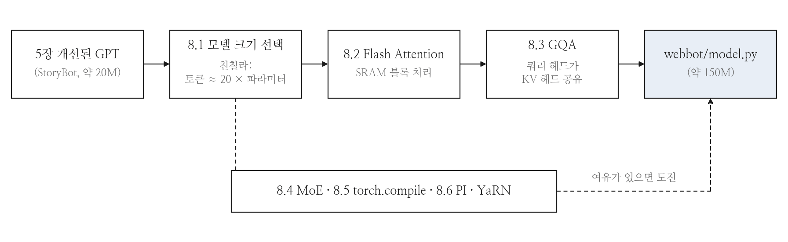
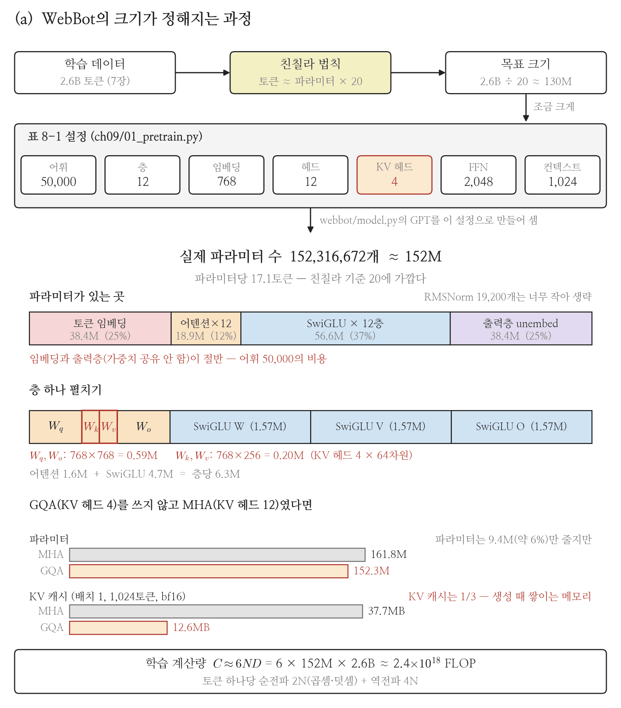
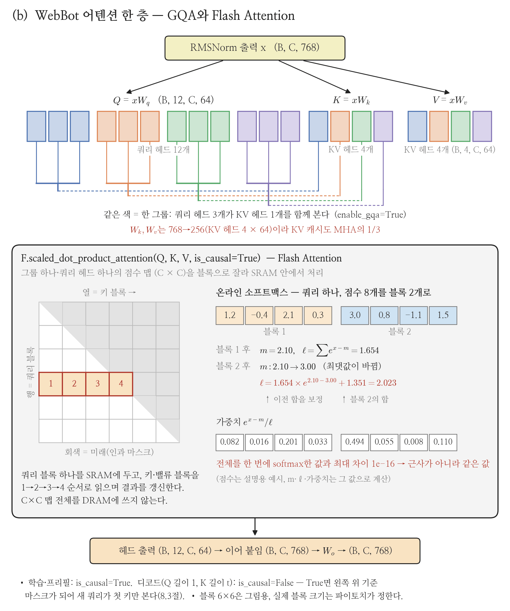

# 8장. 모델 (도전편)

> **한 줄 요약** — WebBot은 StoryBot보다 훨씬 큰 모델이다. **스케일링 법칙·친칠라 법칙**으로 크기(약 150M)를 정하고, **Flash Attention**·**GQA**로 어텐션의 속도와 KV 메모리를 줄인다. 그 밖에 **MoE**, **torch.compile**, **컨텍스트 길이 확장(PI·YaRN)** 을 소개한다.



*8장의 흐름 — 8.1~8.3은 WebBot 코드에 반영되고, 8.4~8.6(점선)은 여유가 있으면 도전할 기법이다. (`ch08/diagrams.py`로 그린 그림)*

| 기법 | 해결하는 문제 | WebBot 코드에 반영? |
|---|---|---|
| 스케일링 법칙 / 친칠라 법칙 | 계산 예산을 모델 크기와 데이터양에 어떻게 나눌까 | ✅ 하이퍼파라미터 설정 |
| Flash Attention | 어텐션이 메모리 대역폭에 묶임(메모리 바운드) | ✅ `F.scaled_dot_product_attention` |
| GQA | KV 헤드 수만큼 늘어나는 K·V 메모리 | ✅ `n_kv_head=4`, `enable_gqa=True` |
| MoE | 계산량을 억제하면서 파라미터 수 늘리기 | ✗ 소개만 |
| torch.compile | 파이썬 인터프리터 오버헤드 | ✅ `ch09/01_pretrain.py`에서 사용 |
| PI / YaRN | 학습 때보다 긴 컨텍스트에서 성능 붕괴 | ✗ 소개만 |

---

## 8.1 모델 크기 선택

### 스케일링 법칙

LLM의 손실은 파라미터 수 $N$과 학습 토큰 수 $D$가 늘수록 **멱법칙(power law)** 을 따라 줄어든다. 줄어드는 정도까지 **예측할 수 있다**는 점이 핵심이다. 작은 모델로 실험한 결과로 큰 모델의 성능과 최적 설정을 미리 추정할 수 있다.

**학습 계산량** [Kaplan et al., 2020]

$$
C \approx 6ND
$$

- 순전파: 토큰 하나당 약 $2N$ FLOP (파라미터마다 곱셈 1번 + 덧셈 1번)
- 역전파: 그 두 배인 약 $4N$ FLOP

> 💡 **역전파가 왜 순전파의 2배인가** — 선형층 $`y = xW`$ 하나를 보면, 순전파는 행렬곱 $`xW`$ 한 번이다. 역전파는 행렬곱을 두 번 한다. 앞 층으로 넘길 **입력 쪽 기울기** $`\partial L/\partial x = (\partial L/\partial y)\,W^\top`$와, 가중치를 갱신할 **가중치 쪽 기울기** $`\partial L/\partial W = x^\top (\partial L/\partial y)`$다. 둘 다 순전파와 같은 크기의 행렬곱이라 토큰당 $`2N + 2N = 4N`$이 된다.
>
> 또 $`6ND`$는 **가중치 행렬곱만 센 근사**다. 어텐션의 $`QK^\top`$과 (가중치 × $`V`$)는 파라미터가 없는 계산이라 $`N`$에 들어가지 않는다. Kaplan et al.은 이 항을 토큰당 순전파 약 $`2 \cdot n_{\text{layer}} \cdot C \cdot d`$로 따로 적는다($`C`$는 여기서 컨텍스트 길이). WebBot(12층, 컨텍스트 1,024, $`d`$ = 768)이면 약 18.9M FLOP으로, $`2N`$(약 304.6M)의 약 6%다. 컨텍스트가 길어질수록 이 항의 비중이 커진다.

### 친칠라 법칙 — 예산 $C$를 $N$과 $D$에 어떻게 나눌까

$C$가 고정되면 $N$과 $D$는 서로 맞바꾸는 관계다.

| 연구 | 결론 |
|---|---|
| OpenAI [Kaplan et al., 2020] | 예산이 늘면 **주로 모델을 키워라** |
| DeepMind [Hoffmann et al., 2022] — **친칠라 법칙** | 모델과 데이터를 **함께** 키워라. 기준: **토큰 수 ≈ 파라미터 수 × 20** |

예: 7B 파라미터 → 140B 토큰, 70B 파라미터 → 1,400B 토큰.

### WebBot에 적용

7장에서 준비한 데이터 ≈ **2.6B 토큰** → 2.6B ÷ 20 ≈ **130M 파라미터**.

**표 8-1 모델 크기 설정**

| 항목 | StoryBot | WebBot |
|---|---|---|
| 어휘 크기 | 10,000 | 50,000 |
| 층 수 | 4 | 12 |
| 임베딩 차원 | 512 | 768 |
| 헤드 수 | 16 | 12 |
| **KV 헤드 수** | 16 | **4** (GQA) |
| FFN 차원 | 1,344 | 2,048 |
| 컨텍스트 길이 | 256 | 1,024 |
| 파라미터 수 | 약 20M | 약 150M |

- 150M은 계산값보다 조금 크지만 2.6B ÷ 150M ≈ **파라미터당 17토큰**이라 친칠라 기준에서 크게 벗어나지 않는다.
- FFN 차원 2,048 ≈ 768 × 8/3 (5.2절의 SwiGLU 규칙). StoryBot도 1,344 ≈ 512 × 8/3 (= 1,365)보다 조금 작은 값이다.

<details>
<summary>파라미터 수 직접 세어 보기 (WebBot, 책에 없는 보충 계산)</summary>

head_dim = 768 / 12 = 64, KV 차원 = 4 × 64 = 256

| 부분 | 계산 | 개수 |
|---|---|---|
| `embed` | 50,000 × 768 | 38.4M |
| `unembed` (공유 안 함) | 768 × 50,000 | 38.4M |
| 층당 어텐션 | W_q 768² + W_k 768·256 + W_v 768·256 + W_o 768² | ≈ 1.57M |
| 층당 SwiGLU | 3 × 768 × 2,048 | ≈ 4.72M |
| 12층 합계 | 12 × (1.57M + 4.72M) | ≈ 75.5M |
| **총합** (RMSNorm 무시) | | **≈ 152M** |

→ 절반 가까이가 임베딩·출력층이다. 어휘 50,000의 비용이 크다.
</details>

> 💡 **에포크와 반복** — 친칠라 법칙은 데이터를 한 번만 보는 상황을 전제한다. 같은 데이터를 **약 4에포크까지** 반복해도 성능 저하가 거의 없다고 알려져 있다 [Muennighoff et al., 2023]. 자원에 여유가 있으면 에포크 수나 모델 크기를 늘리고, 부족하면 줄이면 된다.

> 💡 **학습 비용 vs 추론 비용** — 친칠라 법칙은 *학습* 비용만 최적화한다. 실제 서비스에서는 추론이 계속 일어나고 그 비용은 모델 크기에 비례한다. 그래서 작은 모델을 기준보다 많은 데이터로 학습시키는 편이 장기적으로 경제적일 수 있다. Llama 3 70B는 **파라미터당 215토큰**(친칠라 기준의 약 10배)으로 학습됐다.

---

## 8.2 Flash Attention

### 문제: 어텐션은 메모리 바운드다

| GPU 메모리 | 용량 | 속도 |
|---|---|---|
| 디바이스 메모리 (DRAM, HBM) | 큼 | 느림 |
| 캐시 메모리 (SRAM) | 작음 | 빠름 |

어텐션은 연산량에 비해 메모리 접근이 잦아 **DRAM 전송 속도가 병목**이 된다(**메모리 바운드**). 일반 구현은 $C \times C$ 어텐션 맵 전체를 DRAM에 썼다가 다시 읽기 때문에 특히 불리하다.

### 해결: 블록 단위로 SRAM 안에서 끝낸다

**Flash Attention** [Dao et al., 2022]
- Q·K·V를 블록으로 잘라 각 블록을 **SRAM 안에서** 처리한다 → 어텐션 맵 전체를 DRAM에 쓰지 않는다.
- 소프트맥스는 **온라인 소프트맥스**로 계산해 블록 단위로 처리해도 **결과가 정확히 같다**(근사가 아니다).

> 💡 **온라인 소프트맥스** [Milakov & Gimelshein, 2018] — 일반 소프트맥스는 전체 원소의 최댓값과 합을 먼저 구해야 한다. 온라인 방식은 블록을 하나씩 보면서 최댓값 $m$과 합 $\ell$을 순차적으로 갱신하고, 최댓값이 바뀌면 이전 결과를 보정한다. 보정 식을 쓰면 다음과 같다(책에는 말로만 설명되어 있어 보충함).
>
> $$m_{\text{new}} = \max(m_{\text{old}},\ m_{\text{blk}}), \qquad \ell_{\text{new}} = \ell_{\text{old}}\, e^{m_{\text{old}} - m_{\text{new}}} + \sum_{j \in \text{blk}} e^{x_j - m_{\text{new}}}$$
>
> **왜 이것이 필요한가**: softmax는 행 전체의 최댓값과 합을 알아야 정규화할 수 있다. 블록으로 나누면 앞 블록을 처리할 때는 뒤 블록의 점수를 아직 모르므로, "지금까지의 $`m`$, $`\ell`$"로 계산해 두고 나중에 고치는 방식이 필요하다.
>
> **출력도 같은 비율로 고친다**: 어텐션의 최종 출력은 가중치 × $`V`$의 합이다. 정규화하기 전의 누적값 $`o`$에도 같은 보정 계수를 곱한 뒤 새 블록 몫을 더하고, 마지막에 $`\ell`$로 한 번 나눈다.
>
> $$o_{\text{new}} = o_{\text{old}}\, e^{m_{\text{old}} - m_{\text{new}}} + \sum_{j \in \text{blk}} e^{x_j - m_{\text{new}}}\, v_j$$
>
> 마지막 출력은 $`o / \ell`$이다. 그래서 쿼리 행마다 $`m`$, $`\ell`$, $`o`$(길이 $`d`$ 벡터)만 들고 있으면 되고, $`C \times C`$ 가중치 맵 전체를 DRAM에 저장할 필요가 없다. 점수 8개·$`V`$ 3차원 예를 블록 2개(4개씩)로 나눠 이 식으로 계산하면, 한 번에 계산한 $`\mathrm{softmax}(x)V`$와 최대 차이 0.0으로 일치했다(`.venv/bin/python`으로 확인).

### 파이토치에서 쓰기

```python
y = F.scaled_dot_product_attention(q, k, v, is_causal=True)
```

- 하드웨어와 텐서 크기를 보고 Flash Attention 등 **적합한 구현을 자동 선택**한다.
- `is_causal=True` → 인과 마스크 자동 적용(2.6 어텐션 마스크). 5장의 `tril` + `masked_fill` + `softmax` + `matmul`을 한 줄로 대체한다.

---

## 8.3 Grouped-Query Attention (GQA)

멀티헤드 어텐션은 헤드마다 Q·K·V를 따로 가진다. 헤드를 늘리면 표현력은 오르지만 **K·V 메모리(=KV 캐시)도 비례해서 늘어난다**.

**GQA** [Ainslie et al., 2023]: 여러 쿼리 헤드가 **하나의 KV 헤드를 공유**한다.


*그림 8-1 — 멀티헤드 어텐션은 쿼리 헤드와 KV 헤드가 1:1, GQA는 쿼리 헤드 2개가 KV 헤드 1개를 공유한다(각 사각형이 헤드 하나). K·V 메모리가 절반이 된다.*

| | 쿼리 헤드 | KV 헤드 | K·V 메모리 |
|---|---|---|---|
| 멀티헤드 어텐션 (MHA) | $H$ | $H$ | 1 (기준) |
| **GQA** | $H$ | $H_{kv}$ ($1 < H_{kv} < H$) | $H_{kv}/H$ |
| (참고) MQA | $H$ | 1 | $1/H$ |
| WebBot | 12 | 4 (쿼리 3개씩 한 그룹) | **1/3** |

(MQA는 책에 나오지 않지만 GQA의 극단적인 경우로 알아 두면 좋다.)

> 💡 **왜 K·V만 캐시하고, K·V만 줄이나** — 디코드 단계에서 새 토큰의 Q는 그 단계의 어텐션에 한 번 쓰고 버린다. K·V는 이후 생성되는 모든 토큰이 다시 보므로 캐시에 계속 쌓인다(5장 KV 캐시). 메모리를 차지하는 것이 K·V이므로 GQA는 K·V 헤드만 줄인다. 그래서 GQA로 크게 줄어드는 것은 파라미터나 계산량이 아니라 **KV 캐시**다. `webbot/model.py`로 직접 세어 보면 WebBot(KV 헤드 4)은 152,316,672개, 같은 설정의 MHA(KV 헤드 12)는 161,753,856개로 약 6%만 차이 나지만, KV 캐시(배치 1, 1,024토큰, bf16, 12층)는 12.6MB 대 37.7MB로 3배 차이가 난다.

### 파이토치에서 쓰기

```python
hidden = F.scaled_dot_product_attention(
    q, k, v, is_causal=True, enable_gqa=True
)
# q: (B, n_head,    C, head_dim)
# k: (B, n_kv_head, C, head_dim)   ← 헤드 수가 더 적다 (n_kv_head < n_head)
# v: (B, n_kv_head, C, head_dim)
```

`enable_gqa=True`는 K·V 헤드를 쿼리 헤드 수만큼 반복해 쓰는 것과 같다. 반복 방식은 **연속한 쿼리 헤드끼리 한 그룹**이다. WebBot에서는 쿼리 헤드 $`h`$가 KV 헤드 $`h // 3`$을 쓴다(쿼리 0~2 → KV 0, 3~5 → KV 1, …). 쿼리 12개·KV 4개로 직접 비교하면 `k.repeat_interleave(3, dim=1)`로 늘려 넣은 결과와는 최대 차이 0.0으로 같고, `k.repeat(1, 3, 1, 1)`(0, 1, 2, 3, 0, 1, …로 반복)로 늘린 결과와는 다르다(최대 차이 약 3.5).

### `webbot/model.py`의 MultiHeadAttention

5장 KV 캐시 버전과 비교해 바뀐 부분만 추렸다.

```python
class MultiHeadAttention(nn.Module):
    def __init__(self, embed_dim, n_head, n_kv_head, head_dim, rope=None):
        ...
        self.W_q = nn.Linear(E, H * D, bias=False)
        self.W_k = nn.Linear(E, KV * D, bias=False)    # ⭐ KV 헤드 수만큼만
        self.W_v = nn.Linear(E, KV * D, bias=False)
        self.W_o = nn.Linear(H * D, E, bias=False)

    def forward(self, x, use_cache=False):
        Q = self.W_q(x).view(B, C, H, D).transpose(1, 2)    # (B, H,  C, D)
        K = self.W_k(x).view(B, C, KV, D).transpose(1, 2)   # (B, KV, C, D)
        V = self.W_v(x).view(B, C, KV, D).transpose(1, 2)   # (B, KV, C, D)
        ...  # RoPE(offset), KV 캐시 갱신은 5장과 동일

        if use_cache:
            # 캐시가 최대 길이를 넘으면 오래된 부분을 잘라냄
            max_cache_len = self.rope.cos_cache.size(0) if self.rope else 2048
            if self.k_cache.size(2) > max_cache_len:
                self.k_cache = self.k_cache[:, :, -max_cache_len:]
                self.v_cache = self.v_cache[:, :, -max_cache_len:]
                self.cache_offset = max_cache_len

        # Flash Attention + GQA
        is_causal = is_first_call if use_cache else True   # 디코드에서만 False
        hidden = F.scaled_dot_product_attention(Q, K, V, is_causal=is_causal,
                                                enable_gqa=True)
        ...
```

(실제 코드는 `use_cache` 분기 두 개로 `scaled_dot_product_attention`을 따로 호출한다. 동작은 같다.)

> ⚠️ **디코드에서 `is_causal=False`인 이유** — 디코드 단계의 Q는 길이 1, K는 길이 t다. 이때 `is_causal=True`를 주면 파이토치는 마스크를 **왼쪽 위 기준**으로 만들기 때문에 새 쿼리가 첫 번째 키만 보게 된다. 5장에서 디코드 단계에 마스크를 생략한 것과 같은 이유로 `False`를 준다. (파이토치 동작에 대한 보충 설명이다.)

> ⚠️ 캐시를 잘라낸 뒤에는 `cache_offset`이 `max_cache_len`에 고정되고, RoPE는 `offset + C > max_context_len`일 때 offset을 끝쪽으로 당긴다. 위치가 정확하지 않은 단순한 처리라서, 학습 길이를 넘는 생성은 품질이 떨어질 수 있다(→ 8.6).

### KV 캐시 메모리 비교 (보충 계산)

토큰 하나, 층 하나당 K·V 저장량 = $2 \times n_{kv} \times d_{head}$ 개의 값.

| WebBot (12층, head_dim 64, 1,024토큰, bf16 2바이트) | KV 헤드 | 토큰·층당 값 개수 | 전체 KV 캐시 (배치 1) |
|---|---|---|---|
| MHA였다면 | 12 | 2 × 12 × 64 = 1,536 | 약 37.7MB |
| **GQA (실제)** | 4 | 2 × 4 × 64 = 512 | **약 12.6MB** |

배치 크기와 컨텍스트 길이에 비례해 늘어나므로, 큰 모델·긴 문맥·많은 동시 사용자 환경에서 차이가 커진다.

---

## 8.4 Mixture of Experts (MoE)

일반 트랜스포머는 모든 토큰이 **같은 FFN 하나**를 지난다. **MoE** [Shazeer et al., 2017]는 FFN(=**전문가**, Expert)을 여러 개 두고, 토큰마다 **상위 k개(top-k)** 만 골라 계산한다.


*그림 8-2 — 전문가 4개 중 1개(top-1)를 쓰는 MoE. **라우터**(작은 신경망)가 확률을 내고, "We"는 FFN 2(p=0.65), "Like"는 FFN 1(p=0.8)로 보낸다. 출력에는 그 확률을 곱한다. (그림 출처: [Zhou et al., 2022])*

- **장점**: 파라미터 수(전문가 수)는 크게 늘리면서 토큰당 **계산량은 k개 전문가 분량**으로 억제한다.

**학습의 어려움**

| 문제 | 내용 | 대응 |
|---|---|---|
| 선택은 미분 불가 | top-k 선택은 O/X라 고르지 않은 전문가에 기울기가 흐르지 않는다. 강화 학습에서 보는 문제와 비슷하며 학습을 불안정하게 만든다 | (책에서는 문제 제기만) |
| 부하 쏠림 | 특정 전문가만 계속 선택 → 나머지는 학습이 안 됨 → 더 안 뽑힘 (악순환) | **보조 손실(auxiliary loss)**: 선택이 치우치면 페널티를 줘 고르게 쓰도록 유도 |

> 💡 **그러면 라우터는 어떻게 학습되나** — 그림 8-2처럼 출력에 확률을 곱하기 때문이다. top-1이면 출력은 $`p_i \cdot \mathrm{FFN}_i(x)`$이고, 손실의 기울기는 $`p_i`$를 거쳐 라우터로 흐른다. softmax 때문에 라우터의 모든 출력(고르지 않은 전문가의 로짓 포함)에 기울기가 간다. 그래서 라우터는 "고른 전문가의 확률을 올릴지 내릴지"는 배운다. 막히는 것은 두 가지다. 고르지 않은 전문가의 FFN은 계산하지 않았으니 기울기가 없고, "다른 전문가를 골랐다면 어땠을까"라는 신호도 없다. 전문가 4개·top-1 장난감 예로 확인하면, 역전파 뒤 `.grad`가 생긴 것은 고른 전문가 FFN 하나뿐이고, 라우터 가중치는 네 전문가 몫 모두에 기울기가 생겼다. 고르지 않은 전문가가 계속 학습되지 않으니 위의 악순환이 생기고, 보조 손실이 필요해진다.

---

## 8.5 torch.compile

파이토치는 **동적 계산 그래프**라 유연하지만 연산마다 파이썬 인터프리터를 거치는 오버헤드가 있다. `torch.compile`(파이토치 2.0+)은 **JIT(Just-In-Time) 컴파일**로 이 오버헤드를 줄인다.

```python
model = GPT(...)
model = torch.compile(model)   # 감싸기만 하면 된다
```

- **첫 실행**에서 최적화(컴파일) → **두 번째부터** 빨라진다.
- 내부: 파이썬 바이트코드에서 계산 그래프 추출 → **연산 융합(operation fusion)**, 메모리 레이아웃 최적화 → 최적화된 코드로 변환.

> 💡 첫 스텝이 오래 걸리는 건 정상이다. 짧은 실험에서는 컴파일 시간이 오히려 손해일 수 있다.

---

## 8.6 컨텍스트 길이 확장

사전 학습은 고정된 컨텍스트 길이로 하지만, 추론에서는 대화가 길어지는 등 **더 긴 입력**이 들어올 수 있다. 학습 범위 밖의 위치가 들어오면 위치 인코딩이 처음 보는 값이 되어 **성능이 크게 떨어진다**. RoPE 기반 모델의 해결책 두 가지:

| 방법 | 아이디어 | 특징 |
|---|---|---|
| **PI** (Position Interpolation) [Chen et al., 2023] | 위치 인덱스를 학습 범위 안으로 **압축**. 4배로 늘리려면 위치를 1/4로: $m \to m/4$ | 적은 파인튜닝으로 길이를 크게 늘린다. 단, **모든 주파수**의 회전 속도가 똑같이 느려진다 |
| **YaRN** [Peng et al., 2023] | **고주파 성분은 거의 그대로**, **저주파 성분을 중심으로** 조정 | 가까운 토큰 사이의 세밀한 위치 구분을 지킨다 |

5.1절의 $\theta_k = \Theta^{-2k/d}$ 기준으로 보면:
- **고주파** = $k$가 작은 쌍 (빠르게 회전) → 가까운 토큰 사이의 미세한 위치 차이 담당
- **저주파** = $k$가 큰 쌍 (천천히 회전) → 먼 거리의 위치 관계 담당
- PI는 $m\theta_k \to (m/s)\theta_k$로 **모든 $k$를 똑같이** 늦춘다 → 고주파 정보까지 흐려진다. YaRN은 저주파 쪽만 주로 늘린다.

> 💡 **왜 저주파 쪽이 문제인가 (WebBot 값으로 계산)** — 쌍 $`k`$가 한 바퀴 도는 데 걸리는 토큰 수(파장)는 $`2\pi/\theta_k`$다. WebBot(head_dim 64, $`\Theta`$ = 10000)에서 $`k = 0`$은 약 6.3토큰, $`k = 31`$은 약 47,117토큰이다. 학습 길이 1,024보다 파장이 긴 쌍은 $`k = 18`$~31의 **14쌍**이다($`k = 17`$은 약 838토큰, $`k = 18`$은 약 1,117토큰).
>
> - 고주파 쌍은 학습 중에 이미 여러 바퀴를 돌아 모든 각도를 봤다. 1,024를 넘는 위치도 이 쌍에게는 본 적 있는 각도다.
> - 저주파 쌍은 학습 중에 한 바퀴도 돌지 못했다. 1,024를 넘는 위치는 이 쌍에게 처음 보는 각도가 된다.
>
> 그래서 처음 보는 각도가 생기는 저주파 쌍만 압축하면 된다. PI처럼 고주파 쌍까지 $`1/s`$로 늦추면 이웃한 토큰 사이의 각도 차이도 $`1/s`$로 줄어 가까운 위치를 구분하기 어려워진다.

### 한눈에 보기: WebBot 모델이 정해지는 과정과 어텐션 한 층

이 장에서 WebBot에 실제로 반영한 것은 크기 설정(8.1), Flash Attention(8.2), GQA(8.3)다. (a)는 친칠라 법칙에서 출발해 `webbot/model.py`의 GPT를 표 8-1 설정으로 만들고 파라미터를 직접 센 결과이고, (b)는 그렇게 만든 모델의 어텐션 한 층에서 GQA와 Flash Attention이 하는 일을 펼친 것이다.



*그림 (a) — 2.6B 토큰 ÷ 20 ≈ 130M → 표 8-1 설정 → 실제 파라미터 152,316,672개. 파라미터 수와 KV 캐시 크기는 `webbot/model.py`로 직접 계산한 값이다. (`ch08/flow_graph.py`로 그린 그림)*



*그림 (b) — 쿼리 헤드 12개가 3개씩 KV 헤드 4개를 공유하고, 점수 맵은 블록 단위로 처리된다. 온라인 소프트맥스의 점수 8개는 설명용 예시이고, $`m`$, $`\ell`$, 가중치는 그 값으로 계산했다.*

- **150M은 계산으로 확인된다.** 설정대로 모델을 만들어 세면 152,316,672개이고, 2.6B 토큰이면 파라미터당 17.1토큰이다. 학습 계산량은 $`6ND`$ ≈ 2.4×10¹⁸ FLOP이다.
- **파라미터의 절반은 임베딩과 출력층이다.** 토큰 임베딩과 unembed가 각각 38.4M(25%)이고, 12층 블록 전체(약 75.5M) 중에서는 SwiGLU가 56.6M으로 가장 크다. 어휘 50,000의 비용이 크다.
- **GQA는 파라미터보다 KV 캐시를 줄인다.** MHA였다면 파라미터는 161.8M으로 9.4M(약 6%)만 더 많지만, KV 캐시(배치 1, 1,024토큰, bf16)는 37.7MB 대 12.6MB로 3배 차이가 난다. 줄어드는 것은 `W_k`·`W_v`(768→256)와 거기서 나온 K·V다.
- **쿼리 헤드는 그대로 12개다.** 그룹마다 쿼리 헤드 3개가 같은 K·V를 보지만 쿼리는 서로 달라서, 헤드 출력은 여전히 12개이고 이어 붙이면 768차원이다.
- **Flash Attention은 근사가 아니다.** 블록을 하나씩 보면서 최댓값이 바뀔 때 이전 합에 $`e^{m_{\text{old}} - m_{\text{new}}}`$를 곱해 보정하면, 전체를 한 번에 softmax한 값과 부동소수점 오차(약 1e-16) 안에서 같다.
- **`is_causal`은 상황에 따라 다르다.** 학습과 프리필은 `True`, KV 캐시를 쓰는 디코드는 Q 길이가 1이라 `False`다(8.3절).

---

## 핵심 정리

- **스케일링 법칙**: 손실은 $N$, $D$에 대해 멱법칙으로 줄고 예측 가능하다. 학습 계산량은 $C \approx 6ND$.
- **친칠라 법칙**: 토큰 수 ≈ 파라미터 수 × 20. WebBot은 2.6B 토큰 → 약 150M 파라미터(파라미터당 17토큰). 추론 비용까지 생각하면 작은 모델을 더 오래 학습시키는 선택도 있다(Llama 3 70B: 215토큰/파라미터).
- **Flash Attention**: 블록 단위 SRAM 처리 + 온라인 소프트맥스로 DRAM 전송을 줄인다. 결과는 정확히 같다. 파이토치에선 `F.scaled_dot_product_attention`.
- **GQA**: 쿼리 헤드 여러 개가 KV 헤드 하나를 공유한다. WebBot은 12:4 → K·V 메모리 1/3. `enable_gqa=True`.
- **MoE**: 라우터가 토큰마다 top-k 전문가를 고른다. 파라미터는 늘리고 계산량은 억제한다. 기울기 단절과 부하 쏠림 → 보조 손실.
- **torch.compile**: JIT 컴파일로 인터프리터 오버헤드를 줄인다(연산 융합 등).
- **PI / YaRN**: RoPE 위치를 압축해 컨텍스트를 늘린다. YaRN은 고주파를 보존한다.
- WebBot은 5장 구현만으로도 동작하지만, 여유가 있으면 이 개선들에 직접 도전해 보자.

## 이전·이후 장과의 연결

| 이번 장의 내용 | 관련 장 |
|---|---|
| 기반 아키텍처(RoPE, SwiGLU, RMSNorm, KV 캐시) | 5장 모델 (응용편) |
| 인과 마스크 | 2.6 어텐션 마스크 |
| StoryBot 모델 설정 | 6장 |
| WebBot 학습 데이터 약 2.6B 토큰 | 7장 |
| 여기서 정한 `webbot/model.py`로 WebBot 학습 | 9장 |

## 복습 질문

1. $C \approx 6ND$에서 6은 어디서 나오는가?

   <details><summary>정답 보기</summary>

   토큰 하나를 학습할 때 순전파에 약 $`2N`$ FLOP(파라미터마다 곱셈 1번 + 덧셈 1번), 역전파에 그 두 배인 약 $`4N`$ FLOP이 든다. 합치면 토큰당 $`6N`$이고, 토큰 $`D`$개를 학습하므로 $`C \approx 6ND`$다. 역전파가 2배인 것은 입력 쪽 기울기와 가중치 쪽 기울기를 각각 행렬곱으로 구하기 때문이다(8.1절의 💡).

   WebBot에 넣어 보면 $`6 \times 152\text{M} \times 2.6\text{B} \approx 2.4 \times 10^{18}`$ FLOP이다.

   </details>

2. 친칠라 법칙으로 2.6B 토큰에 맞는 모델 크기를 구해 보라. WebBot이 그보다 조금 큰 150M을 써도 괜찮은 이유는?

   <details><summary>정답 보기</summary>

   친칠라 기준은 토큰 수 ≈ 파라미터 수 × 20이므로 2.6B ÷ 20 ≈ **130M**이다.

   WebBot의 실제 파라미터 수는 152,316,672개(`webbot/model.py`로 센 값)이고, 2.6B ÷ 152M ≈ 파라미터당 **17토큰**이라 기준 20에서 크게 벗어나지 않는다. 게다가 같은 데이터를 약 4에포크까지 반복해도 성능 저하가 거의 없다고 알려져 있어, 데이터가 조금 모자라도 여러 번 보는 방법으로 보완할 수 있다.

   </details>

3. 서비스로 오래 쓸 모델이라면 친칠라 기준보다 작은 모델을 더 많은 데이터로 학습하는 편이 나을 수 있다. 왜 그런가?

   <details><summary>정답 보기</summary>

   친칠라 법칙은 **학습 비용**만 최적화한다. 서비스에서는 추론이 계속 일어나고, 그 비용은 모델 크기에 비례한다. 작은 모델을 기준보다 많은 데이터로 오래 학습시키면 학습 비용은 더 들지만 같은 성능을 더 작은 모델로 낼 수 있어, 추론까지 합친 전체 비용은 줄어든다.

   예: Llama 3 70B는 파라미터당 215토큰(친칠라 기준의 약 10배)으로 학습됐다.

   </details>

4. 어텐션이 "메모리 바운드"라는 말의 뜻은? Flash Attention은 결과를 근사하는가?

   <details><summary>정답 보기</summary>

   연산량에 비해 메모리 접근이 잦아서, 계산 속도보다 **DRAM(HBM)과 주고받는 전송 속도**가 전체 속도를 정한다는 뜻이다. 일반 구현은 $`C \times C`$ 어텐션 맵 전체를 DRAM에 썼다가 다시 읽기 때문에 특히 불리하다.

   Flash Attention은 **근사하지 않는다.** Q·K·V를 블록으로 잘라 SRAM 안에서 처리하고, 소프트맥스는 온라인 소프트맥스로 최댓값 $`m`$과 합 $`\ell`$을 갱신·보정하므로 결과가 정확히 같다. 그림 (b)의 예시에서도 블록 2개로 나눠 계산한 가중치와 한 번에 계산한 softmax의 차이는 약 1e-16(부동소수점 오차)이었다.

   </details>

5. WebBot(헤드 12, KV 헤드 4)에서 `W_k`의 출력 차원은? KV 캐시는 MHA 대비 몇 배인가?

   <details><summary>정답 보기</summary>

   head_dim = 768 / 12 = 64이고, `W_k`는 KV 헤드 수만큼만 만들므로 출력 차원은 4 × 64 = **256**이다(`nn.Linear(768, 256)`). `W_v`도 같다.

   KV 캐시는 KV 헤드 수에 비례하므로 4/12 = **1/3배**다. 1,024토큰·배치 1·bf16 기준으로 MHA라면 약 37.7MB, GQA는 약 12.6MB다.

   </details>

6. KV 캐시의 디코드 단계에서 `scaled_dot_product_attention`에 `is_causal=False`를 넘기는 이유는?

   <details><summary>정답 보기</summary>

   디코드 단계의 Q는 새 토큰 하나(길이 1)이고, K·V는 캐시까지 합친 길이 t다. 이때 `is_causal=True`를 주면 파이토치가 마스크를 **왼쪽 위 기준**으로 만들어, 새 쿼리가 첫 번째 키만 보게 된다.

   새 토큰은 가장 마지막 위치라서 캐시의 모든 키가 과거다. 가릴 미래가 없으므로 마스크가 필요 없고, 그래서 `False`를 준다. 5장에서 디코드 단계에 마스크를 생략한 것과 같은 이유다. 프롬프트 전체를 처리하는 첫 호출(프리필)에서는 `True`다.

   </details>

7. MoE에서 보조 손실이 없으면 어떤 악순환이 생기는가?

   <details><summary>정답 보기</summary>

   라우터가 특정 전문가만 계속 고르면, 고르지 않은 전문가에는 기울기가 흐르지 않아 학습이 안 된다. 학습이 안 된 전문가는 성능이 나빠 더 안 뽑히고, 뽑힌 전문가만 더 좋아진다. 결국 몇몇 전문가에 부하가 쏠려 전문가를 여러 개 둔 의미가 사라진다.

   **보조 손실(auxiliary loss)** 은 선택이 치우치면 페널티를 줘서 전문가를 고르게 쓰도록 유도한다.

   </details>

8. PI가 고주파 성분까지 똑같이 늦추면 어떤 문제가 생기고, YaRN은 이를 어떻게 피하는가?

   <details><summary>정답 보기</summary>

   PI는 $`m\theta_k \to (m/s)\theta_k`$로 모든 $`k`$의 회전 속도를 똑같이 늦춘다. 고주파 성분(작은 $`k`$, 빠르게 회전)은 가까운 토큰 사이의 미세한 위치 차이를 담당하는데, 이것까지 느려지면 인접한 위치끼리 구분이 흐려진다.

   YaRN은 **고주파 성분은 거의 그대로** 두고 **저주파 성분을 중심으로** 늘린다. 먼 거리의 위치 관계만 조정하므로 가까운 토큰 사이의 세밀한 위치 구분이 지켜진다. WebBot 값으로 계산하면 32쌍 중 학습 길이 1,024 안에서 한 바퀴도 돌지 못하는 쌍은 $`k = 18`$~31의 14쌍이고, 1,024를 넘는 위치에서 처음 보는 각도가 생기는 것은 이 쌍들이다.

   </details>
