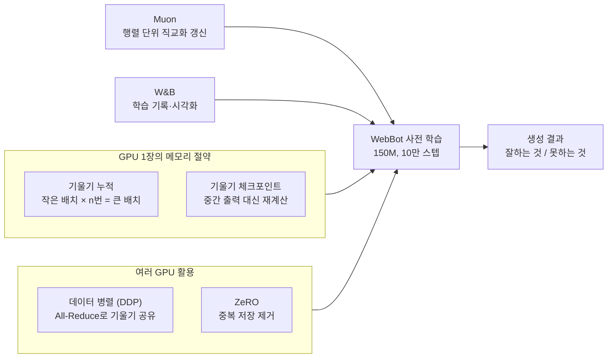
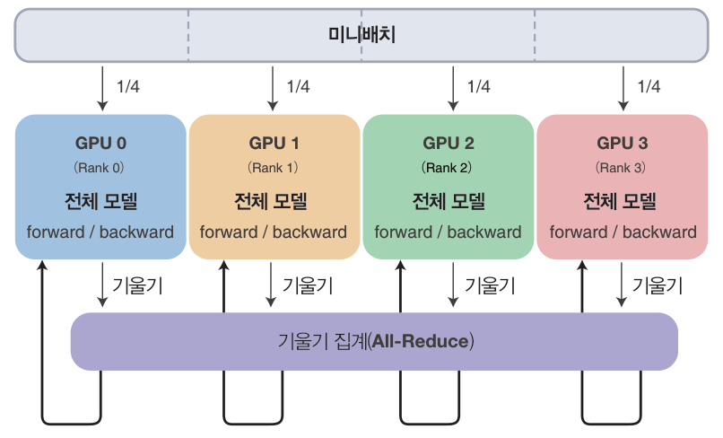
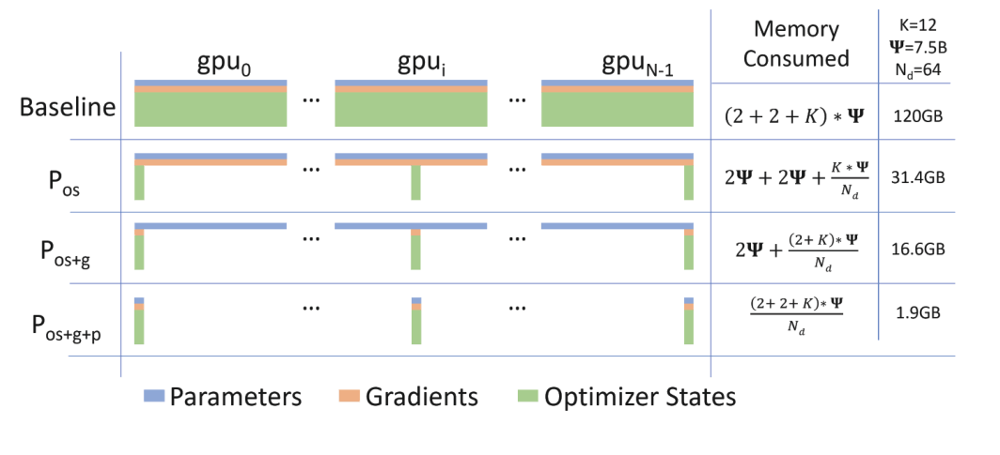
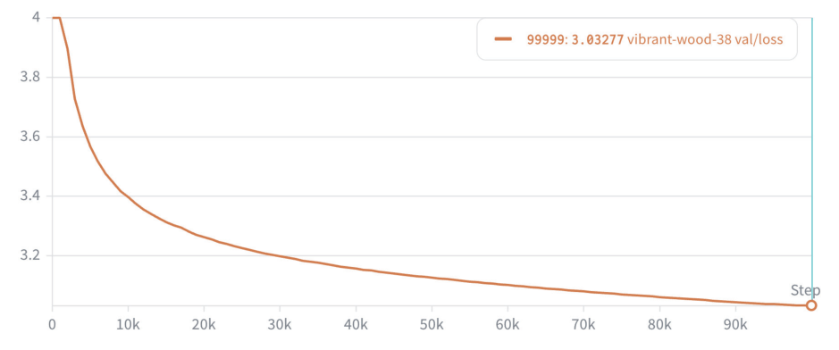

# 9장. 학습 (도전편)

> **한 줄 요약** — 모델이 커지면 **GPU 메모리**가 가장 큰 벽이 된다. **기울기 누적**과 **기울기 체크포인트**로 GPU 한 장의 메모리를 아끼고, **데이터 병렬(DDP)** 과 **ZeRO**로 여러 GPU를 쓰며, **Muon** 옵티마이저로 수렴 속도와 메모리 효율을 높인다. 이 기법들로 150M 파라미터의 WebBot을 10만 스텝 사전 학습해 검증 손실 약 3.0에 도달한다.



| 기법 | 무엇을 아끼나 | 대가 |
|---|---|---|
| 기울기 누적 | 활성값(중간 출력) 메모리 | 스텝당 시간 ↑ (순차 처리) |
| 기울기 체크포인트 | 활성값 메모리 | 역전파 때 재계산 → 시간 ↑ |
| 데이터 병렬 (DDP) | **시간** (GPU 수만큼 병렬) | GPU당 메모리는 그대로, 통신 비용 |
| ZeRO | 파라미터·기울기·옵티마이저 상태의 **중복** | 통신량 ↑ |
| Muon | 옵티마이저 상태 (2차 모멘트 없음) | 2차원 행렬에만 적용 가능 |

코드: `ch09/01_pretrain.py`(학습), `ch09/02_generate.py`(생성), 모델은 `webbot/model.py`.

---

## 9.1 기울기 누적 (Gradient Accumulation)

배치가 클수록 각 층의 **중간 출력**(역전파에 다시 필요해서 저장해 두는 값)도 늘어 메모리를 많이 쓴다. 그렇다고 배치를 줄이면 학습이 불안정하거나 느려진다.

→ **작은 배치(마이크로배치)로 순전파·역전파를 여러 번 하면서 기울기를 쌓고, 갱신은 한 번에** 한다.

```python
accumulation_steps = 4                    # 마이크로배치 8 × 4 = 유효 배치 32
optimizer.zero_grad()
for i, (inputs, targets) in enumerate(dataloader):
    logits = model(inputs)
    loss = F.cross_entropy(logits, targets) / accumulation_steps   # ⭐ 손실 조정
    loss.backward()                                                # .grad에 더해짐
    if (i + 1) % accumulation_steps == 0:                          # 4번마다 갱신
        optimizer.step()
        optimizer.zero_grad()
```

- 파이토치는 `backward()`를 부를 때마다 기울기를 `.grad`에 **더한다**. `zero_grad()` 전까지 계속 쌓인다.
- `cross_entropy`는 기본이 평균(`reduction='mean'`)이므로, 큰 배치 한 번과 같아지려면 **`accumulation_steps`로 나눠야** 한다.

**왜 성립하나** — 전체 배치 $B = n\cdot b$ ($n$: 누적 횟수, $b$: 마이크로배치 크기)

$$
\frac{1}{B}\sum_{i=1}^{B}\text{loss}_i
= \frac{1}{n}\left(\frac{1}{b}\sum_{i=1}^{b}\text{loss}_i + \frac{1}{b}\sum_{i=b+1}^{2b}\text{loss}_i + \cdots\right)
$$

마이크로배치별 평균 손실을 $n$으로 나눠 더하면, 전체 배치를 한 번에 처리한 평균 손실과 같다. 미분은 선형이므로 기울기도 같다.

> ⚠️ 정확히 같아지는 건 손실이 샘플별로 독립일 때다. 배치 정규화처럼 배치 통계를 쓰는 층이 있으면 결과가 조금 달라진다(WebBot은 RMSNorm이라 해당 없음).

---

## 9.2 기울기 체크포인트 (Gradient Checkpointing)

기울기 누적이 "배치를 쪼개서" 아낀다면, 기울기 체크포인트 [Chen et al., 2016]는 **중간 출력을 덜 저장해서** 아낀다. 일부만 저장하고 나머지는 **역전파 때 다시 계산**한다 → 메모리 ↓, 학습 시간 ↑.

```python
from torch.utils.checkpoint import checkpoint

class GPT(nn.Module):
    # ...(생략)
    def forward(self, ids):
        x = self.embed(ids)
        for block in self.blocks:
            x = checkpoint(block, x, use_reentrant=False)   # 블록 내부 출력은 저장하지 않음
        x = self.norm(x)
        return self.unembed(x)
```

- `use_reentrant=False`: 제약이 적고 불필요한 재계산도 줄여 현재 권장되는 설정. `True`는 예전 코드와의 호환용.

> 💡 저장소의 `webbot/model.py`와 `ch09/01_pretrain.py`에는 체크포인트가 적용되어 있지 않다. 메모리가 부족할 때 위처럼 `forward()`만 바꿔 쓰면 된다.

---

## 9.3 분산 학습 — 데이터 병렬

| 방식 | 나누는 것 | 언제 |
|---|---|---|
| **데이터 병렬** | 학습 데이터(배치) | 모델이 GPU 한 장에 들어갈 때 → 이 책의 범위 |
| 모델 병렬 | 모델 자체 | 모델이 GPU 한 장에 안 들어갈 때 |



*그림 9-1 — 데이터 병렬 개요. 모든 GPU에 같은 모델을 올리고 미니배치를 1/4씩 나눠 순전파·역전파한 뒤, All-Reduce로 기울기를 모아 모두가 같은 기울기로 갱신한다.*

- **All-Reduce**: 모든 GPU의 기울기를 더한 뒤, 그 결과를 다시 모든 GPU에 나눠 주는 연산. 모두 같은 기울기로 갱신하므로 **모델 사본이 항상 같은 상태**로 유지된다.
- **프로세스와 랭크**: 보통 프로세스 1개가 GPU 1장을 맡고, 각 프로세스는 **랭크(rank)** 번호(0, 1, 2, 3)로 구분한다.

### DDP (DistributedDataParallel)

```python
import os, torch
import torch.distributed as dist
from torch.nn.parallel import DistributedDataParallel as DDP

dist.init_process_group(backend='nccl')         # 1. 프로세스 그룹 초기화 (NVIDIA GPU 간 통신)
local_rank = int(os.environ['LOCAL_RANK'])      # 2. 이 프로세스가 맡을 GPU 번호
torch.cuda.set_device(local_rank)
model = GPT(config).to(local_rank)              # 3. 해당 GPU에 모델 배치
model = DDP(model, device_ids=[local_rank])     # 4. 감싸면 backward 때 All-Reduce 자동 수행
```

```bash
$ torchrun --nproc_per_node=4 train.py          # GPU 4장 → 프로세스 4개
```

`torchrun`이 `RANK`, `LOCAL_RANK` 같은 환경 변수를 각 프로세스에 넣어 준다.

---

## 9.4 ZeRO (Zero Redundancy Optimizer)

데이터 병렬은 GPU를 늘려도 **GPU 한 장의 메모리 사용량은 줄지 않는다**. 모든 GPU가 똑같은 것을 들고 있기 때문이다.

**학습 중 GPU 메모리에 있는 것**
- 모델 파라미터
- 기울기
- **옵티마이저 상태** ← 가장 큼. AdamW는 파라미터마다 모멘트 2개를 FP32로 저장 → 파라미터 $N$개면 $8N$바이트

ZeRO [Rajbhandari et al., 2019]는 이 **중복**을 없애 각 GPU가 일부만 맡게 하고, 필요할 때만 통신으로 모은다.



*그림 9-2 — 파랑 = 파라미터, 주황 = 기울기, 초록 = 옵티마이저 상태. 단계가 올라갈수록 GPU마다 들고 있는 막대가 짧아진다. (그림 출처: [Rajbhandari et al., 2019])*

그림의 기호: $\Psi$ = 파라미터 수, $K$ = 옵티마이저 상태의 파라미터당 바이트 수, $N_d$ = GPU 수. 혼합 정밀도 Adam을 가정해 파라미터·기울기는 FP16(각 $2\Psi$바이트), 옵티마이저 상태는 $K=12$(FP32 마스터 파라미터 4 + 1차 모멘트 4 + 2차 모멘트 4바이트)이다.

| 단계 | 분할 대상 | GPU당 메모리 | 7.5B 모델, GPU 64장 |
|---|---|---|---|
| Baseline (일반 데이터 병렬) | 없음 | $(2+2+K)\Psi$ | **120GB** |
| ZeRO-1 ($P_{os}$) | 옵티마이저 상태 | $2\Psi + 2\Psi + \dfrac{K\Psi}{N_d}$ | 31.4GB |
| ZeRO-2 ($P_{os+g}$) | + 기울기 | $2\Psi + \dfrac{(2+K)\Psi}{N_d}$ | 16.6GB |
| ZeRO-3 ($P_{os+g+p}$) | + 파라미터 | $\dfrac{(2+2+K)\Psi}{N_d}$ | **1.9GB** |

> 💡 **숫자 확인** — $\Psi = 7.5\text{B}$, $K=12$, $N_d=64$
> - Baseline: $`16 \times 7.5 = 120`$GB
> - ZeRO-1: $`4\times7.5 + 12\times7.5/64 = 30 + 1.41 \approx 31.4`$GB
> - ZeRO-2: $`2\times7.5 + 14\times7.5/64 = 15 + 1.64 \approx 16.6`$GB
> - ZeRO-3: $`16\times7.5/64 \approx 1.9`$GB
>
> ZeRO-1만으로도 메모리가 1/4로 준다. 옵티마이저 상태가 그만큼 큰 비중을 차지한다는 뜻이다.

**사용처**: 마이크로소프트 **DeepSpeed** 라이브러리, 파이토치의 `torch.distributed.fsdp`(FSDP, 비슷한 기능).

---

## 9.5 Muon 옵티마이저

**Muon** (Momentum Orthogonalization by Newton-Schulz) [Jordan et al., 2024] — 메모리를 적게 쓰면서 빨리 수렴해 주목받는 옵티마이저.

| | AdamW | Muon |
|---|---|---|
| 다루는 단위 | 원소 하나하나 독립 | **가중치 행렬 전체** |
| 저장하는 상태 | 1차 + 2차 모멘트 (FP32 2개) | **1차 모멘트만** |
| 갱신 방향 | $\hat m / \sqrt{\hat v}$ (원소별 스케일) | 1차 모멘트 행렬을 **직교화**한 것 |
| 적용 대상 | 모든 파라미터 | **2차원 행렬만** (편향·RMSNorm 가중치 불가) |

- **직교화**: 기울기(모멘텀) 행렬의 각 방향이 비슷한 크기를 갖도록 맞추는 연산. 특정 방향으로 갱신이 지나치게 커지는 것을 막는다.
- 2차 모멘트를 저장하지 않으므로 옵티마이저 상태 메모리가 AdamW의 절반이다.

> 💡 **보충 (책 범위 밖)** — 모멘텀 행렬을 특잇값 분해 $M = U\Sigma V^\top$ 했을 때 $\Sigma$를 모두 1로 바꾼 $UV^\top$가 "직교화된" 행렬이다. SVD는 비싸므로 행렬곱만으로 이를 근사하는 반복 계산이 이름에 들어간 **Newton-Schulz 반복**이다.

파이토치 2.9부터 `torch.optim.Muon`으로 쓸 수 있다. 행렬에만 적용되므로 **Muon + AdamW 하이브리드**로 구성한다.

```python
from torch.optim import Muon, AdamW

muon_params  = [p for p in model.parameters() if p.ndim == 2]   # 2차원 텐서(행렬)
adamw_params = [p for p in model.parameters() if p.ndim != 2]   # 그 밖 (편향, RMSNorm 등)

optim1 = Muon(muon_params, lr=0.02)        # 학습률도 서로 다르게
optim2 = AdamW(adamw_params, lr=3e-4)

loss.backward()
optim1.step(); optim2.step()
optim1.zero_grad(); optim2.zero_grad()
```

> ⚠️ 저장소의 `ch09/01_pretrain.py`는 Muon이 아니라 `torch.optim.AdamW`만 쓴다. 위 코드는 책에 실린 예시다.

---

## 9.6 Weights & Biases (W&B)

학습 중 손실·학습률 변화를 **실시간으로 기록·시각화**하는 도구. `wandb` 패키지를 설치하고 몇 줄만 추가하면 된다.

```python
import wandb
wandb.init(project='webbot')                                # 프로젝트 초기화
for step, (inputs, targets) in enumerate(dataloader):
    loss = train_step(model, inputs, targets)
    wandb.log({'loss': loss.item(), 'step': step})          # 지표 기록 → 웹 대시보드
wandb.finish()
```

여러 실험을 겹쳐 비교하거나, 하이퍼파라미터와 성능의 관계를 분석할 때 유용하다.

---

## 9.7 WebBot 학습과 생성 결과 — `ch09/01_pretrain.py`, `ch09/02_generate.py`

### 학습 설정

| 모델 | 값 | 학습 | 값 |
|---|---|---|---|
| `vocab_size` | 50,000 | `micro_batch_size` | 32 |
| `context_len` | 1,024 | `accumulation_steps` | 4 → **유효 배치 128** |
| `embed_dim` | 768 | `learning_rate` (max) | 6e-4 |
| `n_head` / `n_kv_head` | 12 / 4 (GQA) | `warmup_iters` / `max_iters` | 500 / 100,000 (D2Z) |
| `n_layer` | 12 | `grad_clip` | 1.0 |
| `ff_dim` | 2,048 | `eval_interval` | 1,000 |
| 파라미터 수 | 약 **150M** | 데이터 | `webbot/owt_train.bin` (OpenWebText) |

### 학습 루프의 핵심 — DDP + 기울기 누적 + 혼합 정밀도

```python
ddp = int(os.environ.get('RANK', -1)) != -1          # torchrun으로 띄웠는가?
if ddp:
    dist.init_process_group(backend='nccl')
    local_rank = int(os.environ['LOCAL_RANK'])
    device = torch.device(f'cuda:{local_rank}')
    torch.cuda.set_device(device)
    seed_offset = int(os.environ['RANK'])            # 랭크마다 시드를 달리 → 서로 다른 배치
else:
    device, local_rank, seed_offset = get_device(), 0, 0
is_main = (not ddp) or (local_rank == 0)             # 로그·평가·저장은 랭크 0만
torch.manual_seed(42 + seed_offset)

model = torch.compile(model)                         # 그래프 컴파일로 고속화
if ddp:
    model = DDP(model, device_ids=[local_rank])

for step in pbar:
    lr = get_lr(step, learning_rate, warmup_iters, max_iters)   # 6장의 D2Z 그대로
    for g in optimizer.param_groups:
        g['lr'] = lr
    optimizer.zero_grad()

    for micro_step in range(accumulation_steps):                # ── 기울기 누적
        batch_x, batch_y = get_batch(train_data, context_len, micro_batch_size, device)
        with autocast(device_type='cuda', dtype=torch.bfloat16):
            logits = model(batch_x)
            loss = F.cross_entropy(logits.view(-1, logits.size(-1)), batch_y.view(-1))
            loss = loss / accumulation_steps
        if ddp and micro_step < accumulation_steps - 1:
            with model.no_sync():                               # ⭐ 중간 단계는 All-Reduce 생략
                loss.backward()
        else:
            loss.backward()                                     # 마지막에만 동기화

    torch.nn.utils.clip_grad_norm_(model.parameters(), grad_clip)
    optimizer.step()
    if is_main:
        wandb.log({'train/loss': loss.item() * accumulation_steps, 'train/lr': lr}, step=step)
```

> 💡 **`model.no_sync()`** — DDP는 `backward()`마다 All-Reduce를 한다. 기울기 누적 중에는 어차피 마지막에 한 번만 합치면 되므로, 중간 마이크로배치에서는 동기화를 꺼서 통신 비용을 $1/n$로 줄인다.

> 💡 평가할 때는 `model.module`(DDP가 감싼 원래 모델)을 꺼내 랭크 0에서만 `evaluate()`를 돌린다. 평가 함수와 `get_batch()`는 6장과 같다.

> ⚠️ 유효 배치 128은 **GPU 1장 기준**이다. DDP로 GPU $k$장을 쓰면 전역 배치는 $128k$가 된다. 또 `evaluate()`와 학습 루프의 `autocast`가 `device_type='cuda'`로 고정되어 있어 이 스크립트는 사실상 CUDA GPU 전용이다.

### 학습 결과



*그림 9-3 — W&B 대시보드의 검증 손실. 처음 1만 스텝에서 빠르게 내려가고 이후 완만해져, 99,999스텝에서 3.03에 도달한다.*

- 150M 모델, 유효 배치 128(마이크로배치 32 × 누적 4), **10만 스텝 ≈ 5에포크**
- 최종 검증 손실 **약 3.0**

### 생성 결과 (`02_generate.py`, `temperature=0.5`, `max_new_tokens=100`)

| 프롬프트 | WebBot의 출력 | 평가 |
|---|---|---|
| `In 1991, Linus Torvalds created` | the first Linux kernel | ✅ 연도+인물 문맥에서 사실을 끌어냄 |
| `Monday, Tuesday, Wednesday,` | Thursday, Friday, Saturday, Sunday, and Monday. | ✅ 자주 나오는 패턴을 정확히 이어 감 |
| `Python was created by` | the team at UC Berkeley | ❌ 사실 오류 (실제로는 Guido van Rossum) |
| `Machine learning is defined as` | the ability to learn from a set of data, and the ability to learn from a set of data. | ❌ 같은 구절 반복, 개념 설명 실패 |

(저장소 스크립트에는 `The capital of Japan is` 프롬프트도 하나 더 들어 있다. 책에는 결과가 실려 있지 않다.)

**해석**
- **사전 학습이 준 것**: 문법에 맞는 영어, 언어 패턴, 문맥에 따른 사실 지식 일부 — 오직 "다음 토큰 예측"만으로 얻었다.
- **사전 학습만으로는 부족한 것**: 정확한 사실 답변, 개념 설명, 반복 회피.
- **다음 단계**: 스케일링 법칙대로 모델·데이터를 키우고, **SFT**로 지시 따르기를, **DPO·GRPO**로 더 좋은 답을 학습시킨다.

---

## 핵심 정리

- **기울기 누적**: 마이크로배치의 손실을 `accumulation_steps`로 나눠 `backward()`를 반복하고, $n$번마다 한 번 `step()`. 메모리는 작은 배치만큼, 효과는 큰 배치만큼.
- **기울기 체크포인트**: `checkpoint(block, x, use_reentrant=False)` — 중간 출력을 저장하지 않고 역전파 때 재계산. 메모리와 시간을 맞바꾼다.
- **데이터 병렬(DDP)**: 같은 모델을 GPU마다 복제하고 데이터를 나눠 처리, **All-Reduce**로 기울기를 합쳐 모두 같은 갱신을 한다. `torchrun --nproc_per_node=N`으로 실행. 기울기 누적과 함께 쓸 때는 `no_sync()`로 중간 통신을 생략한다.
- **ZeRO**: 데이터 병렬의 중복 저장을 없앤다. 옵티마이저 상태(ZeRO-1) → 기울기(ZeRO-2) → 파라미터(ZeRO-3) 순으로 분할, 7.5B·64 GPU 예에서 120GB → 1.9GB.
- **Muon**: 2차원 가중치 행렬의 모멘텀을 **직교화**해 갱신하고 2차 모멘트를 저장하지 않는다. 1차원 파라미터는 AdamW가 맡는 하이브리드 구성.
- **W&B**로 학습 곡선을 실시간 관찰. WebBot(150M)은 10만 스텝 후 검증 손실 약 3.0 — 문법과 패턴은 익혔지만 사실 정확도와 설명 능력은 부족하다 → SFT·DPO·GRPO의 몫.

## 다른 장과의 연결

| 내용 | 관련 장 |
|---|---|
| AdamW의 1·2차 모멘트(= ZeRO가 나누는 옵티마이저 상태), D2Z 스케줄, BF16 혼합 정밀도, 기울기 클리핑, `memmap` | [6장 학습 (응용편)](../ch06/README.md) |
| SFT와 GRPO (사전 학습 이후의 단계) | [3장 학습 (기본편)](../ch03/README.md) |
| DPO | [6장 6.7~6.8절](../ch06/README.md#67-rlhf와-dpo) |
| WebBot 토크나이저 (어휘 50,000) | 7장 토크나이저 (도전편) |
| WebBot 모델 (GQA 등) | [8장 모델 (도전편)](../ch08/README.md) |

## 복습 질문

1. 기울기 누적에서 손실을 `accumulation_steps`로 나누지 않으면 어떻게 되는가? 학습률과는 어떤 관계가 있을까?
2. 기울기 누적과 기울기 체크포인트는 둘 다 메모리를 아끼지만 방식이 다르다. 각각 무엇을 희생하는가?
3. 데이터 병렬에서 All-Reduce를 하지 않고 각 GPU가 자기 기울기로만 갱신하면 어떤 문제가 생기는가?
4. DDP와 기울기 누적을 함께 쓸 때 `no_sync()`가 필요한 이유는?
5. 데이터 병렬만으로는 "GPU 한 장에 안 들어가는 모델"을 학습할 수 없는 이유는? ZeRO-3는 이를 어떻게 해결하는가?
6. ZeRO-1만 적용해도 메모리가 크게 줄어드는 이유를 $(2+2+K)\Psi$ 식으로 설명하라.
7. Muon을 모든 파라미터에 적용할 수 없는 이유는? AdamW보다 메모리를 덜 쓰는 이유는?
8. WebBot이 "Python was created by"에 틀린 답을 하고, "Machine learning is defined as"에서 같은 말을 반복하는 이유는 무엇일까? 어떤 학습 단계로 개선할 수 있을까?
